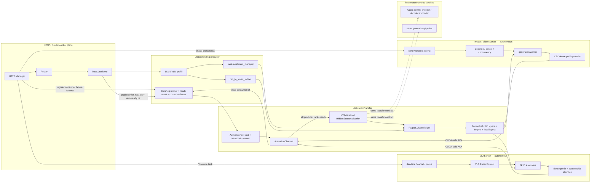

# ActivationTransfer 与自治生成服务

## 结论

运行时不再使用一个统一的 `GenerationManager` 管理 VLA、图片/视频以及未来音频的
业务阶段。每种能力由自己的 Server 管理调度和上下文：

- `VLAServer` 管理 action 请求、Prefix Context、TP worker 和取消语义；
- `ImageGenerationServer` 管理 cond/uncond 配对、并发和图片模型；
- 未来 `AudioGenerationServer` 可以拥有自己的 encoder/decoder/vocoder 阶段；
- `ActivationChannel` 只管理 activation reference、ready、lease 和 release。

当前 KV 路径先采用 dense snapshot：consumer worker 根据 `KVActivation`，从对应 rank 的
`mem_manager + req_to_token_indexs` 一次性 gather 连续 K/V，然后模型只对连续 K/V
做 attention。这是清晰优先的过渡实现；以后换成 zero-copy paged provider 时，不需要
修改 Server 的任务协议。

## 大流程



核心仍然是生产者/消费者模式。原始理解链只增加两个小动作：HTTP fan-out 前注册
consumer，`base_backend` 完成 prefill 后发布 rank-ready；它不导入 VLA、X2V 或具体
生成模型。

## 数据边界

### 控制面 handle

`ActivationRef` 是跨服务控制面对象：

```text
kind                        KV | HIDDEN_STATES
transport                   CUDA_IPC | CPU_SHM
slot_index + generation     ABA-safe owner identity
position_offset             optional logical position
```

``cond/uncond/condition`` 等 role 留在各 Generation Server 的任务协议中，不进入
transfer；同一个 Channel 因而不理解 X2V、VLA 或 Audio 业务语义。

`KVActivation` 是 channel ready 后返回的 KV view：

```text
(shm_index, request_id)     ABA-safe owner identity
infer_req_idx               rank-local request row
seq_len                     valid KV tokens
position_offset             next modality logical position
```

Server 持有 lease；model worker 是唯一读取生产者 page table 的 consumer adapter。

### 模型面 dense snapshot

`DensePrefixKV` 只包含：

```text
layers[n].key/value         [packed_token, local_kv_head, head_dim]
prefix_lengths              ragged batch lengths
page_table                  snapshot 内部的本地布局，不指向生产者 pool
position_offsets            suffix / generation position origin
```

Pi/VLA transformer layer 不再读取 `mem_manager`，Neo/X2V provider 也不再读取
`req_to_token_indexs`。两者只按 layer index 取 dense K/V。

理解模型到生成模型的稳定主载荷仍建议限定为两类：

1. `PREFIX_KV`：同一 transformer 语义的 continuation，例如 Pi、Neo、BAGEL；
2. `HIDDEN_STATES`：cross-attention/context conditioner，例如部分 Qwen-VL、Hunyuan、
   LTX、LongCat 路径。

mask、position、dtype、layout、model revision 都是 payload metadata，不扩张成新的
业务 manager。当前代码先落地 `PREFIX_KV -> DensePrefixKV`；hidden-state arena 可按同一
lease/handle 生命周期增加。

### Hidden States 跨进程传输

当前实现已经定义只携带控制面的 `HiddenStatesDescriptor` 和
`HiddenStatesActivation`，并允许按
`(kind, transport)` 注册 store；尚未绑定具体 hidden arena。不能把
hidden tensor 直接放进 RPyC/ZMQ pickle 作为正式数据面。建议保持控制面只发送下面这种
小 descriptor：

```text
HiddenStatesHandle
  payload_id + generation       ABA-safe arena slot identity
  transport                     CUDA_IPC | HOST_SHM
  rank + physical_device_uuid   producer locality
  offset + nbytes               persistent arena slice
  shape + stride + dtype        tensor view
  layout + valid_lengths        full / TP-sharded / ragged metadata
  ready_event                   producer completion fence
```

同机同 GPU 的首选实现是 persistent CUDA IPC arena：启动时导出/打开大块 arena 一次，
请求只传 slot descriptor；producer 写完后 record interprocess CUDA event，consumer stream
wait event 后直接建立 tensor view。consumer 完成后记录 done event，再由 lease 回收 slot。
这样 hot path 不复制 hidden，也不需要逐请求重复打开 CUDA IPC handle。

CPU fallback 使用 POSIX SHM/memfd ring，并在两个进程中 `cudaHostRegister` 成 pinned
memory。producer 执行异步 D2H，consumer 执行异步 H2D；slot generation、ready/done
sequence 和 lease 与 CUDA IPC backend 共用。它会多经过两次 PCIe，因此适合作为无 P2P、
跨容器兼容或显存压力模式，不应经过 Python bytes/pickle。

同机不同 GPU 且 P2P/NVLink 可用时，建议由 consumer-owned GPU arena 接收一次
`cudaMemcpyPeerAsync`/NCCL copy；直接远端读取 CUDA IPC 映射会让后续每层 attention
持续访问远端显存，通常不如一次搬到本地后重复使用。

## Lease 时序

```mermaid
sequenceDiagram
    participant HTTP as HTTP Manager
    participant P as base_backend / producer ranks
    participant T as ActivationChannel
    participant S as VLA or Image Server
    participant W as model worker

    HTTP->>T: register consumer bit
    HTTP->>P: normal router fan-out
    HTTP->>S: downstream wire task with owner identity
    S->>T: acquire ActivationRef
    P->>T: publish infer_req_idx and ready rank bit
    S->>T: resolve KVActivation
    T-->>S: handle after all ranks are ready
    S->>W: model task + handle
    W->>W: gather producer pages into DensePrefixKV
    W->>W: generation / VLA attention reads dense K/V only
    W-->>S: CUDA-safe ACK + result
    S->>T: release lease exactly once
    T->>HTTP: clear consumer bit; request can recycle normally
```

如果 worker RPC 丢失或 CUDA synchronize 不能证明读取结束，Server 进入
`restart_required`，lease 保持 pinned；worker 停止后才能统一释放。

## 代码位置

```text
lightllm/server/activation_transfer/
├── protocol.py             # ActivationRef + typed KV/hidden views
├── channel.py              # kind/transport store routing + lease
├── shm_kv.py               # current ShmReq readiness + paged-KV publisher
└── errors.py               # explicit CUDA-safe release decision

lightllm/server/generationserver/
├── kv_materializer.py      # rank-local paged KV -> DensePrefixKV
├── triton_kv_gather.py     # fused all-layer K/V snapshot gather
└── prefix_attention.py     # generation-side attention adapter

lightllm/server/generationserver/action/
├── server.py               # VLAServer and VLA Prefix Context
├── backend.py              # action preparation / TP ACK / postprocess
└── model_rpc.py            # PagedKVMaterializer call per TP rank

lightllm/server/generationserver/image/
├── server.py               # autonomous pairing / scheduling
├── backend.py              # image worker execution
└── model_rpc.py            # materialize before model.generate

```

旧 `generationserver/manager.py`、`prefix.py`、`protocol.py` 以及
`understanding_transfer` 已删除。正式 VLA 和 Image startup path 只依赖
`ActivationChannel`，不存在第二套 lease 或通用 generation manager。

## 当前取舍与后续替换

Dense snapshot 的代价是每个任务多一次显存 gather，并暂时在整个 downstream 任务完成后
才释放 producer lease。优点是 consumer attention、CUDA graph 输入和模型适配器完全不
理解生产者 allocator。

当前 Image/X2V worker 仍是单 rank 实现，因此启动时显式要求 target ``tp=1``；VLA
worker 已按 target TP rank 一一附着并分别 gather 本地 KV shard。Image TP 扩展应增加
对应 rank worker，而不是让 rank 0 偷读不完整的 sharded KV。

下一步可做两项独立优化，均不改变 Server 协议：

1. 将 worker RPC 拆成 `prepare/gather ACK` 与 `execute` 两阶段，在 gather synchronize 后
   提前释放 producer lease；
2. 将 `DensePrefixAttentionProvider` 换成 zero-copy paged provider，或根据序列长度在
   dense/paged 两种 provider 间自适应选择。

## 2026-08-24 H200 post-dense 基准

真实 `pi0_base`、隔离 H200、BF16、batch 1、三图、prefix 774 tokens、horizon 50、
10-step、Action CUDA Graph，warmup 5 次后采样 20 次。

离线 CUDA stage p50/p90：Vision `8.55/8.60 ms`，VLM prefill `9.10/11.17 ms`，
Triton dense Prefix KV gather `0.277/0.284 ms`，Action Expert `13.30/13.31 ms`。
BF16 action 最大/平均绝对误差 `0.01216/0.00218`，CUDA Graph 与 eager 逐元素一致。

正常 HTTP 多进程链路使用不同图像避免 embedding cache，warmup 5 次后采样 20 次：
wall p50/p90 `49.86/53.08 ms`，服务内部 total p50/p90 `41.47/42.40 ms`，queue
`22.86/23.62 ms`，Action backend `18.60/18.91 ms`，Action Expert
`15.71/15.82 ms`。启动与首次 CUDA Graph capture 不计入稳态样本。

优化前的逐层 Torch 实现会发起至少 36 次 `index_select`。同一隔离环境下，真实模型
gather p50 为 `0.643 ms`；单次 Triton launch 后为 `0.277 ms`。只测 13.6 MiB KV
搬运的微基准由 `0.509 ms` 降至 `0.114 ms`。更早记录的 `4.98 ms` gather 和
`79.34 ms` wall 来自另一套 TP8 服务将所有 GPU 打满时的共享卡测试，不应作为模型基线。
