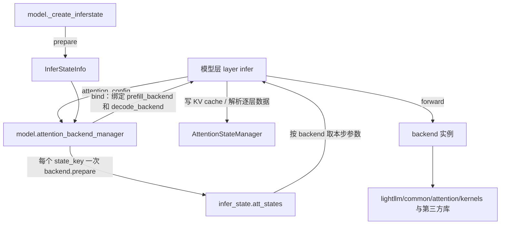
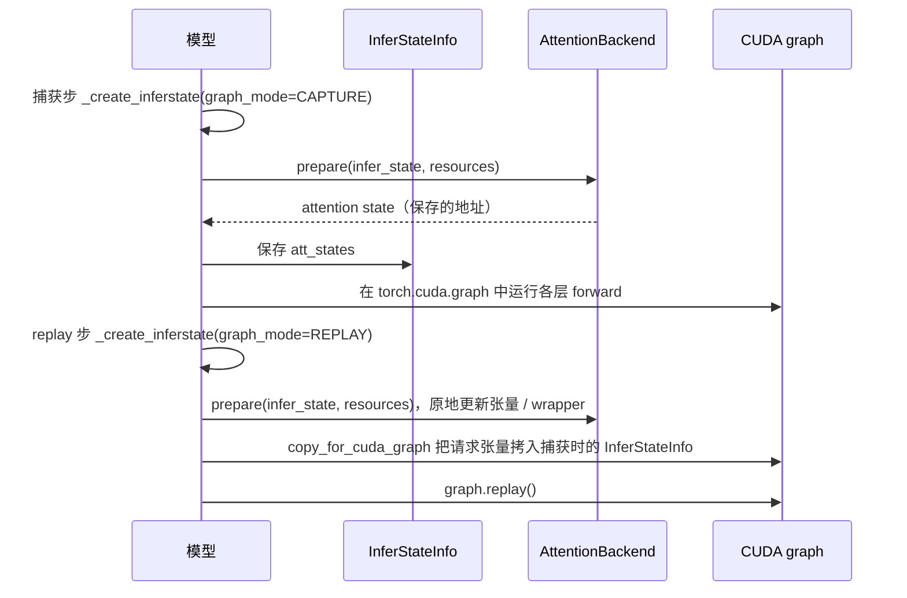

# Attention Backend 架构设计

本文定义 attention 计算层的分层、公共类型、接口契约和实现约束。具体 kernel 的调优参数、Tensor 形状细节和历史实现过程不在本文维护；它们属于代码、docstring 和测试。attention 状态存储（KV cache、线性注意力的 conv/SSM 状态）的设计见《Attention Resources 架构设计》。

## 1. 设计目标

`lightllm/common/attention/` 把"如何为一步推理准备 kernel 参数"和"如何为一层计算 attention"从模型代码与推理状态中分离出来。设计满足：

- kernel 不读写 `InferStateInfo`，所有输入通过显式类型传入。
- 一层的静态配置在模型加载时确定，在加载时选择并构造 backend 实例；不支持的配置在 warmup 之前报错，而不是在第一次推理时。
- 每步共用的派生参数（页表、累积偏移、split 调度、FlashInfer plan 等）在第一层之前计算一次，具有相同 `state_key` 的层共用一份。
- CUDA graph 的捕获和 replay 走同一条路径；replay 只改变 Tensor 内容，graph 依赖的地址和主机侧参数保持不变。
- microbatch overlap 的两个并发步各自持有参数，互不共享存储。
- 同一 attention 算法的不同实现（Triton、FlashInfer、FA3、FlashMLA、FlashKDA、FlashQLA 等）共用同一组层配置和层输入类型。

## 2. 分层和职责



依赖方向只有一个：`lightllm/common/basemodel` 和 `lightllm/models` 可以导入 `lightllm/common/attention`，反之不行。`lightllm/common/attention/**` 不导入 `InferStateInfo`、模型或 `lightllm.common.basemodel`。

### 2.1 模型层

模型的 layer infer 负责：

- 加载时，`attention_config(model)` 根据模型配置和本层的 attention state 返回 `LayerAttentionConfig`，描述 prefill 和 decode 各自需要的 layer config，以及可选的指定实现。层的全部静态属性（因果性、softmax scale、滑窗、sinks、ALiBi、图像 span、KV 量化方式、线性注意力的状态模式等）都写入 layer config。
- 在调用 attention 之前把本层的 K/V 写入 KV cache。
- 每次调用时解析 KV 量化 scale（`state.get_layer_kv_scales(layer)`）、线性注意力的 conv/SSM 状态视图、稀疏注意力的 top-k 索引和融合投影，构造族的 `LayerInputs`，用当前 backend 对应的 attention state 直接调用 `forward`。

GQA 层在 `attention_config()` 中声明 prefill 和 decode 的配置。Gemma4 在滑窗层的 prefill 配置中开启图像区间内双向 attention，DFlash 只声明 decode 配置。执行时，层从 KV 视图和权重组装 `GQALayerInputs`，连同当前步的 attention state 传给后端的 `forward()`。

模型层不直接调用 attention kernel。`unit_tests/common/attention/test_attention_call_sites.py` 检查 layer infer、infer state、model 和 `attention_backend_manager.py` 不导入 attention kernel 模块（视觉编码器除外，它在单张图像内计算 attention，不使用 KV cache），并检查 `lightllm/common/attention/**` 不导入模型侧代码。

### 2.2 模型初始化与每步参数

主模型和每个 MTP 草稿模型在各自的 `_init_attention` 中初始化层，因为各模型的 CUDA graph 上限和缓存布局不同。

`_init_attention` 为每个模型创建 `model.attention_backend_manager`（`AttentionBackendManager`）。纯 FFN 模型的 manager 没有绑定层，`has_attention` 为假。绑定前用层的 `attention_phases` 检查 `LayerAttentionConfig` 是否覆盖实际运行阶段。普通层需要两个阶段，DFlash 层只需要 decode。

- `bind(spec)` 为每个阶段独立选择实现，然后将两个 backend 赋给层。阶段、layer config 和请求的 backend 都相同的层复用 backend。某阶段的 layer config 为 `None` 时，该阶段返回 `None`，例如 DFlash 草稿层只在 decode 计算。每个阶段的每个 `state_key` 由第一个绑定的 backend 负责准备状态。
- `prepare(infer_state)` 在每个 microbatch 对本阶段各组的代表实例调用一次 `backend.prepare`，返回 `{state_key: att_state}`。没有状态组的阶段返回空字典。
- `model.requires_cpu_cache_sync`：是否有实现不能与 CPU cache 搬运在 GPU 上并行。

运行时创建时从模型读取一次全部静态信息，之后不再持有模型：

- `resources` 是模型的资源与容量（`AttentionBuildResources`），供 backend 的 `setup` 创建跨步存储（第 3 节）。
- `step_config` 是 `configure_attention_step` 的关键字参数：decode 每请求行数、是否为 dynamic verify 布局、线性注意力的投机状态索引和 CUDA graph 的 KV 长度容量。`configure_attention_step` 根据当前阶段和 graph 模式把适用值写入 `InferStateInfo`。
- 因此 graph 容量必须在 `_init_attention` 之前确定：`graph_max_len_in_batch` 的 MTP 余量调整在模型构造函数中完成，而不是在 `_init_cudagraph` 中。

层的因果性（`attention_is_causal`）在绑定时写入 layer config。

每步只有一个入口。`model._create_inferstate(model_input, microbatch_index, graph_mode=...)` 填充请求字段，调用 `init_some_extra_state` 生成索引张量，再执行 `infer_state.att_states = model.attention_backend_manager.prepare(infer_state)`，返回完整的状态。`graph_mode`（`GraphMode.EAGER`、`CAPTURE`、`REPLAY`）在创建时传入并保存在 `infer_state.graph_mode` 上，backend 据此准备 eager、捕获和 replay 步。只写 KV cache 的步骤（DSpark 的 KV-only 提交）传 `build_attention=False`。

### 2.3 模型层直接调用 backend

```python
# 加载时
config = layer.attention_config(model)
layer.prefill_backend, layer.decode_backend = model.attention_backend_manager.bind(config)
# 每次调用
o = layer.decode_backend.forward(infer_state.att_states[layer.decode_backend.state_key], GQALayerInputs(...), out=..., alloc_func=...)
```

MLA 的 prefill 与 decode 使用不同的 layer config 类型，其余族通常相同。输出 `out` 由调用方分配，`alloc_func` 语义见第 4.4 节。

`lightllm/common/attention/selector.py` 按 layer config 的类型确定算法族，按名称选择实现，规则见第 5 节。

### 2.4 Backend 层

`AttentionBackend` 实例提供准备本步状态的 `prepare` 和计算本层输出的 `forward`。

- 类属性 `name` 是实现名，`phase` 是运行阶段（`"prefill"` 或 `"decode"`）。选择器只把 backend 绑定到它声明的阶段，注册表登记到错误阶段时抛出 `TypeError`。
- `group_key(layer_config)` 声明哪些配置会改变本步准备工作。运行时用 `(backend 类, group_key)` 作为 `state_key`，prefill 和 decode 各有自己的状态表。
- `prepare(infer_state, resources)` 首次调用时执行 `setup(resources)`，在实例上创建该组跨步复用的存储，随后调用 `build(infer_state)`。`setup` 和 `build` 只能读取 `group_key` 包含的 layer config 字段，模型级资源由 `resources` 提供。
- `build(infer_state)` 为当前 microbatch 生成一份 `AttState`。所有持有同一 `state_key` 的层直接使用它；`forward` 所需而 `setup` 才知道的值（如 page size）放在 `AttState` 中，因为只有组的代表实例执行过 `setup`。
- `forward(att_state, layer_inputs, ...)` 使用实例持有的 `layer_config`，结合当前层的张量计算输出。
- `requires_cpu_cache_sync()` 声明 CPU cache 搬运是否需要与该 backend 的计算同步。

例如，两层 MLA decode 只有 `softmax_scale` 不同。Triton 可以为它们准备同一份切分计划，FlashInfer 在 `plan` 时就读取 scale，因此要准备两份。两种后端都从静态 layer config 获取 scale。

### 2.5 Kernel 层

`lightllm/common/attention/kernels/<family>/` 存放 Triton kernel 及其封装；第三方库（FA3、FlashInfer、FlashMLA、FlashKDA、FlashQLA）只由 backend 层调用。

## 3. 类型及其生命周期

每步的主流程是 `InferStateInfo → backend.prepare → att_state → backend.forward`。模型为这一步提供请求长度和 KV 索引，各后端只在 `att_state` 中保留 kernel 所需的参数。

模型的 `AttentionBuildResources` 只用于初始化。需要跨步保存页表、wrapper 或 CUDA graph 缓冲区的后端在 `setup` 中把它们放在组的代表实例上，不另设存储类型；其余后端不覆盖 `setup`。

| 类型 | 生命周期 | 内容 |
| --- | --- | --- |
| `*LayerConfig` | 模型加载时确定 | 一层的静态配置：head 数、维度、dtype、scale、因果性、滑窗、sinks、KV 量化方式等。frozen dataclass，可哈希，构造时校验字段。 |
| `AttentionBackend` | 模型加载时创建 | 每层持有各阶段的 backend，相同阶段与 layer config 的层共用同一实例。 |
| `AttentionBuildResources` | 每个模型对象一份 | 模型提供给 backend `setup` 的资源与容量，不含模型对象：设备、page size、最大序列长度、CUDA graph 最大 batch size、decode 行数上限（含 MTP 和 TPSP 对齐）、microbatch 数、共享 workspace 的大小与按名称共享的分配函数、decode batch 是否带 diverse 分组，以及模型预留的 prefill workspace。 |
| `InferStateInfo` | 每步一次 | 保存请求张量、累积偏移、prefill 的 cached prefix、投机解码的行布局、CUDA graph 容量和 microbatch 编号。 |
| `att_state` | 属于当前 microbatch，兼容的层共用 | 层通过 `infer_state.att_states[backend.state_key]` 取出状态。各后端的状态只持有所需字段或预先准备的页表、索引和 wrapper。 |
| `*LayerInputs` | 每次层调用 | 本层的张量：q、KV cache 视图、量化 scale、状态视图、稀疏索引等。 |

其他约定：

- KV cache 由模型层在 attention 之前写入，不由 backend 写入。
- attention state 显式传参，不经过全局 forward context；microbatch overlap 的两个并发步各自持有 attention state。
- workspace 在进程内按 (设备, 名称, 大小, dtype) 共享（`lightllm/utils/workspace_utils.py` 的 `get_gpu_workspace_buffer`）。

## 4. 接口契约

### 4.1 LayerConfig 与 backend 构造

- layer config 只描述层本身，不含任何每步数据。`require_positive` 等校验在 `__post_init__` 中执行。
- `AttentionBackend.__init__` 调用子类的 `_check_supported(layer_config)`。配置不受支持时抛出 `NotImplementedError`。例如 Triton GQA 不支持非默认 scale、右侧窗口、sinks 和非因果，FA3 GQA 的 FP8 KV 只支持 BF16 模型。显式要求 FlashKDA 时，KDA prefill backend 也会在构造时检查 kernel 能否加载。
- backend 只持有静态配置，相同 layer config 的所有层共用一个实例。
- 模型层必须把模型要求的全部层属性（因果性、sinks、滑窗、量化方式等）写入 layer config，让 backend 拒绝无法执行的配置，而不是静默按默认行为计算。

### 4.2 InferStateInfo

- builder 直接读取模型为当前 microbatch 准备的 `InferStateInfo`。
- `req_to_token_indexs[b_req_idx[i], pos]` 是请求 i 第 pos 个 token 的物理 cache 槽位。
- decode 默认每个请求一行。投机解码时，固定布局下每个请求有 `decode_rows_per_request` 个连续行；dynamic verify 布局下行数可变，相同 `b_req_idx` 的连续行属于同一请求，`pad_req_idx` 的行是 padding，各自独立。
- 线性注意力的投机解码行从请求最后一个被接受的行恢复状态；`req_to_mtp_state_index` 在 manager 创建时从本角色的 recurrent 状态取得，存于 `step_config`，decode 行数大于 1 时写入 batch。
- `cuda_graph_max_kv_seq_len` 在捕获和 replay 步给出 graph 的长度容量，eager 步为 `None`；`uses_cuda_graph` 是唯一的 graph 开关。

### 4.3 AttentionBackend.build

`backend.build(infer_state)` 对每个状态组每步执行一次，包括 CUDA graph 的捕获步和 replay 步，在第一层之前、捕获之外运行。跨步复用的缓冲区保存在组的代表实例上，由 `build` 生成本步状态。约束：

1. **graph 步的派生状态按 `(microbatch_index, batch_size)` 保存并原地改写。** 使用 `self._keep_for_graph(infer_state, name, value)`：eager 步原样返回；graph 步第一次保存副本，之后 `copy_` 到同一地址。graph 捕获时读取的是这个地址；replay 步新建的张量 graph 看不到。microbatch overlap 的两个微批是不同的 graph，不能共享存储。
2. **主机侧字段在 replay 时保持捕获时的值，且必须对每次 replay 有效。** 网格大小、scratch 大小和 kernel 配置被固化在 graph 中，graph 步应按容量而不是捕获步的实际长度确定。只用于选择 kernel 配置、kernel 自己在 GPU 上读取实际长度的字段称为 hint，可以取本步实际值，必须在 docstring 中注明。例如 Triton GQA decode 的 `kv_seq_len_bound` 是界，`max_kv_seq_len` 是 hint。
3. **eager 步可以使用新分配的存储**，但固定大小的缓冲（如 FlashInfer 的页索引）应按容量预分配、按 microbatch 切片复用，避免每个 graph batch size 各保存一份。
4. 第三方库的有状态对象（FlashInfer wrapper、FlashMLA scheduler metadata）按 `(microbatch_index, batch_size)` 保存；replay 步原地改写其缓冲并在 GPU 上或用 `fast_decode_plan` 重新规划，不能创建新对象。

启用 prefill CUDA graph 时，有状态的 prefill（线性注意力、稀疏 attention 的 CPU 步）作为 graph 段之间的 CPU 步执行，从 replay 步自己的 `new_infer_state.att_states[backend.state_key]` 读取参数。

### 4.4 AttentionBackend.forward

```python
backend.forward(att_state, layer_inputs, *, out, alloc_func=torch.empty) -> out
```

- 填充并返回调用方提供的 `out`；`out` 不得与输入或 attention state 别名。
- kernel 尽可能直接写入 `out`。GDN 和 KDA prefill 在 eager 模式下可传 `out=None` 使用 kernel 返回的输出。Graph replay 时，KDA 直接写入捕获的地址，GDN chunk kernel 的结果只复制一次到捕获的地址。BF16 FlashMLA sparse prefill 的 head 已对齐且 `out` 连续时可直接写入。需要补齐 head、目标不连续或只有旧版 kernel 时，按 query 分块计算并复制到 `out`，限制临时显存。其他需要拷贝的情况包括 Neo FA3 的 kernel 自行分配输出，以及多个 chunk 先以 FP32 合并。
- 临时缓冲只通过 `alloc_func(shape, dtype=, device=)` 分配，backend 不保留任何缓冲；调用方的分配器负责复用和 graph 生命周期。
- CUDA graph 重放时，已捕获的 kernel 读取捕获时的张量地址，builder 在重放前更新这些地址上的内容。
- 线性注意力（GDN、KDA）的 backend 原地更新调用方提供的 conv/SSM 状态视图，每步每层恰好执行一次。replay 状态（保存逐 token 历史以便提交被接受的前缀）由 replay decode backend 在 `forward` 末尾通过 `LayerInputs.replay_state` 调用 `finish_decode_token`，游标只在状态的最后一个逻辑层推进。backend 层只依赖该调用协议，不导入 `attention_state` 包。

## 5. 选择实现

- 实现名称与命令行一致：`--llm_prefill_att_backend` / `--llm_decode_att_backend` 的第一个值用于全注意力族（`gqa`、`mla`、`sparse_mla`），第二个值用于线性注意力族（`gdn`、`kda`），缺省为 `auto`。
- 一个名称可以对应同一族的多个 backend，取第一个能用该 layer config 构造的 backend。例如 `triton` 包括普通与量化 KV 的 Triton GQA；稀疏 MLA 只有一个名称 `flashmla_sparse`，各阶段在 FlashMLA 支持该 cache 格式时使用 FlashMLA，否则使用 FA3；KDA 的 `flashkda` 与 `triton` 对应同一组 backend，由 layer config 的 `prefill_kernel` 决定 prefill 是否使用 FlashKDA。
- `--llm_kv_type` 决定 layer config 的 `kv_quant`，选择器只在接受该量化方式的实现中挑选。
- `auto` 按优先级依次尝试：backend 能以该 layer config 构造（不抛出 `NotImplementedError`），且第三方库通过 `validate()`。先构造再验证，因为验证要启动子进程。都不满足时退回 Triton（不验证）。例如 Neo 的图像 span 不被 FlashInfer 支持，会被自动跳过。
- 显式指定的实现不存在或不支持该配置时，在模型加载时抛出 `ValueError`，并列出各 backend 拒绝的原因。
- EP MoE 排除 FlashInfer；有 MTP 时 decode 优先 FA3。
- 层可以用 `LayerAttentionConfig.prefill_backend_name` 和 `decode_backend_name` 分别指定实现。Bloom 和 Gemma4 的 GQA 层在两个阶段都指定 `triton`。GLM-5 和 MTP 草稿模型只在稀疏 MLA 分支指定 `flashmla_sparse`，KDA 分支使用命令行的第二个值。

## 6. 分组与时序

### 6.1 分组

prefill、decode 各自按 `(backend 类, backend.group_key(layer_config))` 分组。例如，两层的 prefill 配置不同，但其 decode backend 和分组键相同，decode 时只准备一次参数。

| 模型 | 组 | 说明 |
| --- | --- | --- |
| Llama 系 GQA | 1 | 所有层同一组。 |
| Gemma4（Triton） | 1 | 滑窗层和全注意力层的 layer config 不同（head dim、滑窗、图像 span），但 Triton GQA 的准备工作与 layer config 无关，因此共用一份 attention state。若改用 FlashInfer，会按 head dim 自动分成两组，各自 plan。 |
| Qwen3-Next | 2 | GQA 全注意力层一组，GDN 层一组。 |
| DeepSeek V2/V3（FA3 MLA） | 1 | |
| GLM-5 | 2 | 稀疏 MLA 层一组，KDA 层一组。 |
| DeepSeek V4 | 每个压缩比一组 | SWA 稀疏 MLA 的 scheduler metadata 依赖压缩比。 |

main 与 MTP draft 模型不共用组的 attention state。

### 6.2 时序

模型加载：

1. 构造各层。
2. `prepare_attention_states` 与 KV 容量 profiling。GLM-5 及其 MTP 草稿模型在这一步按 prefill microbatch 预留 FP8 KV 反量化 workspace。稀疏注意力层将当前 microbatch 的 workspace 作为 `SparseMLAPrefillLayerInputs.fp8_workspace` 传给 FA3。
3. `init_runtime` 中的 `_init_attention` 创建 `AttentionBackendManager`，调用每层的 `attention_config()`，绑定两个阶段的 backend 并登记各状态组的代表实例，随后执行 warmup 和 CUDA graph 捕获。

layer config 在 KV 分配之后确定，因为 KV head 数、量化 KV 的 group size 和是否有静态 q scale 都来自该层的 attention state。

每步由 `_create_inferstate` 创建完整的状态，其中 `attention_backend_manager.prepare` 为本阶段的每个 `state_key` 准备一份状态。microbatch overlap 的两个 `InferStateInfo` 各自持有 `att_states`。

## 7. CUDA Graph 时序



`copy_for_cuda_graph` 在 replay 前刷新状态直接引用的 batch 张量（如 `b_seq_len`）。`backend.build` 原地刷新代表实例持有的派生张量。

## 8. 算法族概览

| 族 | layer config | 实现 | 说明 |
| --- | --- | --- | --- |
| `gqa` | `GQALayerConfig` | `triton`、`triton_quant`（int8/int4 分组量化 KV）、`flashinfer`、`fa3` | 覆盖 MHA/MQA/GQA、自定义 scale、因果/非因果、单侧/双侧滑窗、sinks、ALiBi、FP8 KV（FlashInfer 按 tensor、FA3 按 head）、图像 span 内双向注意力；decode 支持三种投机解码布局。 |
| `mla` | `MLAPrefillLayerConfig`、`MLADecodeLayerConfig` | `triton`、`flashinfer`、`fa3` | softmax scale（含 YaRN mscale）由模型层计算并写入 layer config。Triton decode 的 split 调度由 `build` 在第一层之前生成；GLM 256 维 prefill 使用专用 kernel。 |
| `sparse_mla` | `SparseMLALayerConfig`、`SWASparseMLALayerConfig` | `fa3`、`flashmla`、`flashmla_swa` | DeepSeek V3.2、GLM-5、DeepSeek V4。top-k、kpool 等 `build` 依赖的参数在 layer config 中。top-k 索引由模型层的 indexer 计算并通过 layer inputs 传入；indexer 元数据（如 `Glm5NextInferStateInfo.nsa_step`）属于模型，保存在各模型的 `InferStateInfo` 子类上。 |
| `gdn` | `GDNLayerConfig` | `triton`、`flashqla`（prefill）、`replay` | Gated DeltaNet（Qwen3-Next 等）。 |
| `kda` | `KDALayerConfig` | `triton`（prefill 可按步选择 FlashKDA）、`replay` | Kimi Delta Attention（GLM-5-Next 线性层）。FlashKDA 由 `backends/kda/flashkda.py` 加载。 |

## 9. 目录和代码组织

```text
lightllm/common/attention/          # 不知道模型的存在
├── backend.py                      # 公共接口和类型：AttentionBackend、AttentionBuildResources
├── selector.py                     # (LayerConfig, 阶段, 名称) → backend 实例
├── backends/
│   ├── __init__.py                 # require_positive、set_flashinfer_envs
│   └── <family>/
│       ├── __init__.py             # 该族的 LayerConfig 与 LayerInputs
│       └── <backend>.py            # AttState、Backend
└── kernels/<family>/               # Triton kernel 与封装
lightllm/common/basemodel/
├── attention_backend_manager.py    # AttentionBackendManager、LayerAttentionConfig、configure_attention_step
├── basemodel.py                    # _init_attention、_create_inferstate
└── infer_struct.py                 # GraphMode、当前 microbatch 的 att_states
```

视觉编码器的 `attention_vit/` 不使用 KV cache，不属于本层。

## 10. 新增实现

1. 若是新算法族，在 `backends/<family>/__init__.py` 定义 layer config（frozen、构造时校验）和 layer inputs，并写清张量布局。
2. 在 `backends/<family>/<backend>.py` 定义 backend 和本步状态。backend 构造时检查配置，`group_key` 列出准备工作读取的配置字段，需要跨步存储时覆盖 `setup`，`build` 遵守第 4.3 节的约束，`forward` 读取当前层的输入。与已有 backend 只差少量行为的实现（如 replay 状态、另一种 prefill kernel）以子类表达，不复制整个类。
3. 在 `selector.py` 的注册表中登记该实现的名称、backend 和 `auto` 优先级。
4. 模型层在 `attention_config()` 中返回两个阶段的配置。逐层数据在模型层解析后通过 layer inputs 传入。

## 11. 测试和评审要求

- backend 与独立的 torch 参考实现对比（量化路径对比反量化后的参考，容差需说明来源），覆盖 cached prefix、各 decode 布局和该实现声明支持的层属性。
- 不支持的 layer config 在构造时被拒绝；选择器测试覆盖 `auto` 跳过不支持的配置、显式指定不支持时报错。
- 新的 decode backend 加入 `unit_tests/common/attention/backends/test_step_builder_graph_contract.py`：同一 `(microbatch, batch size)` 的捕获步与 replay 步保持地址和布局、值等于 eager 构造、主机字段除 hint 外不变、不同 microbatch 不共享存储。
- 在 `unit_tests/common/basemodel/test_attention_backend_manager.py` 中验证新的 `group_key`。键相同的层共用 attention state，PD 节点只为所需阶段执行 `setup`。
- 至少一个测试通过 LightLLM 的 `CudaGraph.capture_decode` / `replay` 在长度变化后 replay。
- 重构已有路径时，用相同输入与改动前对比各层输出逐位一致；有意改变行为的修复单独提交并附回归测试。

## 12. 非目标

- CUDA graph 依赖 `InferStateInfo.copy_for_cuda_graph` 刷新请求张量。
- KV cache 写入仍由模型层完成。


## TODOs

1. 推理接口
