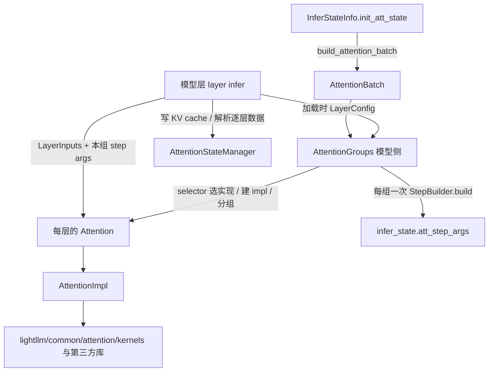
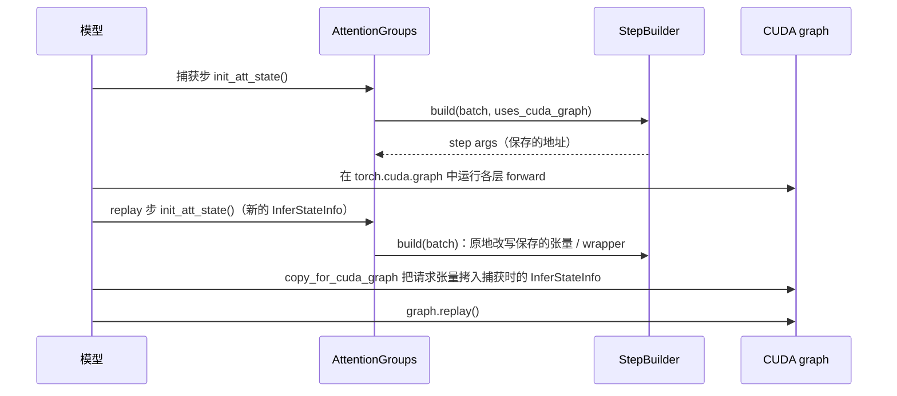

# Attention Backend 架构设计

本文定义 attention 计算层的分层、公共类型、接口契约和实现约束。具体 kernel 的调优参数、Tensor 形状细节和历史实现过程不在本文维护；它们属于代码、docstring 和测试。attention 状态存储（KV cache、线性注意力的 conv/SSM 状态）的设计见《Attention Resources 架构设计》。

## 1. 设计目标

`lightllm/common/attention/` 把"如何为一步推理准备 kernel 参数"和"如何为一层计算 attention"从模型代码与推理状态中分离出来。设计满足：

- kernel 不读写 `InferStateInfo`，所有输入通过显式类型传入。
- 一层的静态配置在模型加载时确定，实现在加载时选择、impl 在加载时构造；不支持的配置在 warmup 之前报错，而不是在第一次推理时。
- 每步共用的派生参数（页表、累积偏移、split 调度、FlashInfer plan 等）在第一层之前计算一次，共用同一 step builder 的层共用一份。
- CUDA graph 的捕获和 replay 走同一条路径；replay 只改变 Tensor 内容，graph 依赖的地址和主机侧参数保持不变。
- microbatch overlap 的两个并发步各自持有参数，互不共享存储。
- 同一 attention 算法的不同实现（Triton、FlashInfer、FA3、FlashMLA、FlashKDA、FlashQLA 等）共用同一组层配置和层输入类型。

## 2. 分层和职责



依赖方向只有一个：`lightllm/common/basemodel` 和 `lightllm/models` 可以导入 `lightllm/common/attention`，反之不行。`lightllm/common/attention/**` 不导入 `InferStateInfo`、模型或 `lightllm.common.basemodel`。

### 2.1 模型层

模型的 layer infer 负责：

- 加载时在 `init_attention(model)` 中从模型配置和本层的 attention state 构造 layer config，调用 `model.att_groups.create_attention(prefill_config, decode_config)`，保存返回的 `Attention`。层的全部静态属性（因果性、softmax scale、滑窗、sinks、ALiBi、图像 span、KV 量化方式、线性注意力的状态模式等）都写入 layer config。
- 在调用 attention 之前把本层的 K/V 写入 KV cache。
- 每次调用时解析逐层数据：KV 量化 scale（`state.get_layer_kv_scales(layer)`）、线性注意力的 conv/SSM 状态视图、稀疏注意力的 top-k 索引、融合投影的切分，构造族的 `LayerInputs`，用本组的 step args 调用 `Attention`。

GQA 层共用 `lightllm/common/basemodel/layer_infer/gqa_attention.py` 中的 `GQAAttentionLayerMixin`，模型通过钩子（`_gqa_layer_config_fields`、`_gqa_layer_weights`、`_gqa_kv_cache`）和属性（`prefill_image_spans`、`attends_in_prefill`）表达自己的差异。

模型层不直接调用 attention kernel。`unit_tests/common/attention/test_attention_call_sites.py` 检查 layer infer、infer state、model 和 `attention_groups.py` 不导入 attention kernel 模块（视觉编码器除外，它在单张图像内计算 attention，不使用 KV cache），并检查 `lightllm/common/attention/**` 不导入模型侧代码。

### 2.2 模型侧：AttentionGroups 与 InferStateInfo

`lightllm/common/basemodel/attention_groups.py` 中的 `AttentionGroups` 每个模型对象一个，main 和各 MTP draft 模型各自持有，因为它们的 CUDA graph 上限和缓存布局不同。它负责：

- `create_attention`：为层的每个阶段选择实现（第 5 节）、构造 impl（相同 (backend, layer config) 的层共用一个 impl），并把层放入组（第 6 节）。某阶段的 layer config 为 `None` 表示该层在这一阶段不计算 attention（例如 DFlash 草稿层只在 decode 计算）。
- 持有每组的 step builder。step builder 在该阶段第一次 build 时创建，只做 prefill 的 PD 节点不会创建 decode builder，也不会分配 decode 资源。
- `build_step_args(infer_state)`：每步用 `build_attention_batch` 构造一次 `AttentionBatch`，对本阶段的每组调用一次 builder，返回 `{组名: step_args}`。
- `requires_cpu_cache_sync`：是否有组的实现不能与 CPU cache 搬运在 GPU 上并行。

模型提供给 step builder 的资源与容量由 `step_builder_context(model)` 一次性放入 `StepBuilderContext`（第 3 节）。模型属性（因果性、投机解码的 dynamic verify 布局、线性注意力的投机状态索引）由 `attention_groups.py` 中的函数从模型读取，不放在 backend 上。

`InferStateInfo` 的 `att_groups` 由 `_create_inferstate` 设为模型的 `AttentionGroups`；`init_att_state()` 执行 `self.att_step_args = self.att_groups.build_step_args(self)`。step args 不持有 `InferStateInfo`。没有 attention 状态的模型（只有 FFN）不创建 `AttentionGroups`。

### 2.3 Attention 与选择器

`lightllm/common/attention/layer.py` 中的 `Attention` 是一层的 attention，持有 prefill 与 decode 的 impl 和所属组名：

```python
class Attention:
    group: str
    def prefill(self, step_args, layer_inputs, *, out, alloc_func=torch.empty) -> torch.Tensor: ...
    def decode(self, step_args, layer_inputs, *, out, alloc_func=torch.empty) -> torch.Tensor: ...
```

模型层的调用形如：

```python
# 加载时
self.attn = model.att_groups.create_attention(GQALayerConfig(...), GQALayerConfig(...))
# 每次调用
o = self.attn.decode(infer_state.att_step_args[self.attn.group], GQALayerInputs(...), out=..., alloc_func=...)
```

MLA 的 prefill 与 decode 使用不同的 layer config 类型，其余族通常相同。输出 `out` 由调用方分配，`alloc_func` 语义见第 4.4 节。

`lightllm/common/attention/selector.py` 按 layer config 的类型确定算法族，按名称选择实现，规则见第 5 节。

### 2.4 Backend 层

`lightllm/common/attention/backends/<family>/<impl>.py` 定义各算法族的实现。每个实现由三部分组成：

| 类型 | 作用 |
| --- | --- |
| `AttentionBackend` | 静态描述：`get_name()`、`get_impl_cls()`，以及下列类方法。 |
| `AttentionStepBuilder` | 从 `AttentionBatch` 构造本实现的 step args，每步一次。 |
| `AttentionImpl` | 持有一个 layer config，对每层调用 `forward`。 |

`AttentionBackend` 的类方法：

- `create_step_builder(layer_config, ctx)`：从 layer config 和 `StepBuilderContext` 构造本实现的 step builder。各 step builder 的构造参数保持显式，不统一成同一签名。
- `step_builder_key(layer_config)`：layer config 中 step builder 依赖的部分，默认返回 `None`（不依赖）。例如 FlashInfer 的 plan 依赖 head 数、head dim、dtype、`kv_quant` 和 MLA 的 softmax scale；FA3 GQA 与量化 Triton 返回 `kv_quant`；Triton MLA decode 返回决定 split 调度 kernel 配置的维度；FA3 稀疏 MLA decode 返回 top-k、kpool 和因果性；DeepSeek V4 的 SWA 稀疏 MLA 返回压缩比。
- `requires_cpu_cache_sync()`：其 kernel 是否不能与 CPU cache 搬运在 GPU 上并行，默认 `False`；FA3 在设置 `LIGHTLLM_FA3_CPU_CACHE_SYNC` 时返回 `True`。

注意 `AttentionBackend` 描述某个实现，是静态类型；它不持有实例状态。

### 2.5 Kernel 层

`lightllm/common/attention/kernels/<family>/` 存放 Triton kernel 及其封装；第三方库（FA3、FlashInfer、FlashMLA、FlashKDA、FlashQLA）只由 backend 层调用。

## 3. 类型及其生命周期

类型按生命周期命名：

| 类型 | 生命周期 | 内容 |
| --- | --- | --- |
| `*LayerConfig` | 模型加载时确定 | 一层的静态配置：head 数、维度、dtype、scale、因果性、滑窗、sinks、KV 量化方式等。frozen dataclass，可哈希，构造时校验字段。 |
| `Attention`、`AttentionImpl` | 模型加载时创建 | 每层一个 `Attention`；相同 (backend, layer config) 的层共用一个 impl。 |
| `StepBuilderContext`、`AttentionStepBuilder` | 每个模型对象一份 | context 是模型交给 step builder 的资源与容量，不含模型对象：设备、page size、最大序列长度、CUDA graph 最大 batch size、decode 行数上限（含 MTP 和 TPSP 对齐）、microbatch 数、共享 workspace 的大小与按名称共享的分配函数、decode batch 是否带 diverse 分组，以及模型预留的 prefill workspace。 |
| `AttentionBatch` | 每步一次 | 与实现无关的本步请求描述：请求张量、累积偏移、prefill 的 cached prefix、投机解码的行布局、CUDA graph 容量和 microbatch 编号。 |
| `*StepArgs` | 每步每组一次，组内各层共用 | 某个实现为本步准备的 kernel 参数，保存在 `InferStateInfo.att_step_args[组名]`。 |
| `*LayerInputs` | 每次层调用 | 本层的张量：q、KV cache 视图、量化 scale、状态视图、稀疏索引等。 |

其他约定：

- KV cache 由模型层在 attention 之前写入，不由 impl 写入。
- step args 显式传参，不经过全局 forward context；microbatch overlap 的两个并发步各自持有 step args。
- workspace 在进程内按 (设备, 名称, 大小, dtype) 共享（`get_gpu_workspace_buffer`）。

## 4. 接口契约

### 4.1 LayerConfig 与 impl 构造

- layer config 只描述层本身，不含任何每步数据。`require_positive` 等校验在 `__post_init__` 中执行。
- impl 在构造时检查自身是否支持该 layer config，不支持时抛出 `NotImplementedError`。例如 Triton GQA 不支持非默认 scale、右侧窗口、sinks 和非因果；FA3 GQA 的 FP8 KV 只支持 BF16 模型；显式要求 FlashKDA 而它无法加载时，KDA prefill impl 拒绝该配置并给出安装方法。
- impl 只持有静态配置，相同 layer config 的所有层共用一个实例。
- 模型层必须把模型要求的全部层属性（因果性、sinks、滑窗、量化方式等）写入 layer config，让 impl 拒绝无法执行的配置，而不是静默按默认行为计算。

### 4.2 AttentionBatch

- 由 `AttentionGroups` 每步从 `InferStateInfo` 构造一次，字段均为调用方持有的设备张量或主机整数。
- `req_to_token_indexs[b_req_idx[i], pos]` 是请求 i 第 pos 个 token 的物理 cache 槽位。
- decode 默认每个请求一行。投机解码时，固定布局下每个请求有 `decode_rows_per_request` 个连续行；dynamic verify 布局下行数可变，相同 `b_req_idx` 的连续行属于同一请求，`pad_req_idx` 的行是 padding，各自独立。
- 线性注意力的投机解码行从请求最后一个被接受的行恢复状态；`req_to_mtp_state_index` 由 `AttentionGroups` 在创建时从本角色的 recurrent 状态取得，decode 行数大于 1 时写入 batch。
- `cuda_graph_max_kv_seq_len` 在捕获和 replay 步给出 graph 的长度容量，eager 步为 `None`；`uses_cuda_graph` 是唯一的 graph 开关。

### 4.3 AttentionStepBuilder.build

`build(batch)` 每步执行一次，包括 CUDA graph 的捕获步和 replay 步，在第一层之前、捕获之外运行。约束：

1. **graph 步的派生状态按 `(microbatch_index, batch_size)` 保存并原地改写。** 使用 `keep_for_cuda_graph(store, key, value)`：第一次保存副本，之后 `copy_` 到同一地址。graph 捕获时读取的是这个地址；replay 步新建的张量 graph 看不到。microbatch overlap 的两个微批是不同的 graph，不能共享存储。
2. **主机侧字段在 replay 时保持捕获时的值，且必须对每次 replay 有效。** 网格大小、scratch 大小和 kernel 配置被固化在 graph 中，graph 步应按容量而不是捕获步的实际长度确定。只用于选择 kernel 配置、kernel 自己在 GPU 上读取实际长度的字段称为 hint，可以取本步实际值，必须在 docstring 中注明。例如 Triton GQA decode 的 `kv_seq_len_bound` 是界，`max_kv_seq_len` 是 hint。
3. **eager 步可以使用新分配的存储**，但固定大小的缓冲（如 FlashInfer 的页索引）应按容量预分配、按 microbatch 切片复用，避免每个 graph batch size 各保存一份。
4. 第三方库的有状态对象（FlashInfer wrapper、FlashMLA scheduler metadata）按 `(microbatch_index, batch_size)` 保存；replay 步原地改写其缓冲并在 GPU 上或用 `fast_decode_plan` 重新规划，不能创建新对象。

prefill 步不被 decode graph 捕获。启用 prefill CUDA graph 时，有状态的 prefill（线性注意力、稀疏 attention 的 CPU 步）作为 graph 段之间的 CPU 步执行，从 replay 步自己的 `new_infer_state.att_step_args[组名]` 读取参数。

### 4.4 AttentionImpl.forward

```python
impl.forward(step_args, layer_inputs, *, out, alloc_func=torch.empty) -> out
```

- 填充并返回调用方提供的 `out`；`out` 不得与输入或 step args 别名。
- 临时缓冲只通过 `alloc_func(shape, dtype=, device=)` 分配，impl 不保留任何缓冲；调用方的分配器负责复用和 graph 生命周期。
- forward 不读取 `InferStateInfo`，不修改 step args。
- 线性注意力（GDN、KDA）的 impl 原地更新调用方提供的 conv/SSM 状态视图，每步每层恰好执行一次。replay 状态（保存逐 token 历史以便提交被接受的前缀）由 replay decode impl 在 `forward` 末尾通过 `LayerInputs.replay_state` 调用 `finish_decode_token`，游标只在状态的最后一个逻辑层推进。backend 层只依赖该调用协议，不导入 `attention_state` 包。

## 5. 选择实现

- 实现名称与命令行一致：`--llm_prefill_att_backend` / `--llm_decode_att_backend` 的第一个值用于全注意力族（`gqa`、`mla`、`sparse_mla`），第二个值用于线性注意力族（`gdn`、`kda`），缺省为 `auto`。
- 一个名称可以对应同一族的多个 backend，取第一个 impl 接受该 layer config 的。例如 `triton` 包括普通与量化 KV 的 Triton GQA；稀疏 MLA 只有一个名称 `flashmla_sparse`，各阶段在 FlashMLA 支持该 cache 格式时使用 FlashMLA，否则使用 FA3；KDA 的 `flashkda` 与 `triton` 对应同一组 backend，由 layer config 的 `prefill_kernel` 决定 prefill 是否使用 FlashKDA。
- `--llm_kv_type` 决定 layer config 的 `kv_quant`，选择器只在接受该量化方式的实现中挑选。
- `auto` 按优先级依次尝试：impl 能以该 layer config 构造（不抛出 `NotImplementedError`），且第三方库通过 `validate()`。先构造再验证，因为验证要启动子进程。都不满足时退回 Triton（不验证）。例如 Neo 的图像 span 不被 FlashInfer 支持，会被自动跳过。
- 显式指定的实现不存在或不支持该配置时，在模型加载时抛出 `ValueError`，并列出各 backend 拒绝的原因。
- EP MoE 排除 FlashInfer；有 MTP 时 decode 优先 FA3。
- 模型可以用 `TpPartBaseModel.att_implementation` 固定全注意力族的实现名称，忽略命令行的第一个值：Bloom 和 Gemma4 为 `triton`，GLM-5 及其 MTP 草稿模型为 `flashmla_sparse`。

## 6. 分组与时序

### 6.1 分组

分组键是 (prefill backend, decode backend, 各自的 `step_builder_key`)。层不指定组名，键相同的层自动进入同一组，共用一份 step args。组名由两个阶段的 backend 名称组成（不计算 attention 的阶段记为 `-`），同名的不同组加 `#n` 后缀。

| 模型 | 组 | 说明 |
| --- | --- | --- |
| Llama 系 GQA | 1 | 所有层同一组。 |
| Gemma4（Triton） | 1 | 滑窗层和全注意力层的 layer config 不同（head dim、滑窗、图像 span），但 Triton GQA 的 step builder 与 layer config 无关，因此共用一份 step args。若改用 FlashInfer，会按 head dim 自动分成两组，各自 plan。 |
| Qwen3-Next | 2 | GQA 全注意力层一组，GDN 层一组。 |
| DeepSeek V2/V3（FA3 MLA） | 1 | |
| GLM-5 | 2 | 稀疏 MLA 层一组，KDA 层一组。 |
| DeepSeek V4 | 每个压缩比一组 | SWA 稀疏 MLA 的 step builder 依赖压缩比。 |

main 与 MTP draft 模型不共用组的 step args。

### 6.2 时序

模型加载：

1. 构造各层。
2. `prepare_attention_states` 与 KV 容量 profiling。需要计入 profiling 的固定 workspace 由模型在这一步预留，例如 GLM-5 FP8 稀疏 prefill 的 KV 反量化 workspace（`attention_prefill_workspaces`，经 `StepBuilderContext.prefill_workspace` 按 microbatch 交给 step builder）。
3. `init_runtime`：`_init_attention` 创建 `AttentionGroups`，各层调用 `init_attention`，经 `create_attention` 完成选择、impl 构造和分组；然后 warmup、CUDA graph 捕获。

layer config 在 KV 分配之后确定，因为 KV head 数、量化 KV 的 group size 和是否有静态 q scale 都来自该层的 attention state。

每步：`_create_inferstate` → `init_att_state()` 为本阶段的每组 build 一次 → 各层用本组 step args 调用 `Attention`。microbatch overlap 的两个 `InferStateInfo` 各自持有 `att_step_args`。

## 7. CUDA Graph 时序



由此得出：step args 中直接引用的 batch 张量（如 `b_seq_len`）在 replay 前由 `copy_for_cuda_graph` 刷新；step builder 派生的张量必须由 builder 自己在原地刷新。

## 8. 算法族概览

| 族 | layer config | 实现 | 说明 |
| --- | --- | --- | --- |
| `gqa` | `GQALayerConfig` | `triton`、`triton_quant`（int8/int4 分组量化 KV）、`flashinfer`、`fa3` | 覆盖 MHA/MQA/GQA、自定义 scale、因果/非因果、单侧/双侧滑窗、sinks、ALiBi、FP8 KV（FlashInfer 按 tensor、FA3 按 head）、图像 span 内双向注意力；decode 支持三种投机解码布局。 |
| `mla` | `MLAPrefillLayerConfig`、`MLADecodeLayerConfig` | `triton`、`flashinfer`、`fa3` | softmax scale（含 YaRN mscale）由模型层计算并写入 layer config。Triton decode 的 split 调度由 step builder 在第一层之前生成；GLM 256 维 prefill 使用专用 kernel。 |
| `sparse_mla` | `SparseMLALayerConfig`、`SWASparseMLALayerConfig` | `fa3`、`flashmla`、`flashmla_swa` | DeepSeek V3.2、GLM-5、DeepSeek V4。top-k、kpool 等 step builder 依赖的参数在 layer config 中。top-k 索引由模型层的 indexer 计算并通过 layer inputs 传入；indexer 元数据（如 `Glm5NextInferStateInfo.nsa_step`）属于模型，保存在各模型的 `InferStateInfo` 子类上。 |
| `gdn` | `GDNLayerConfig` | `triton`、`flashqla`（prefill）、`replay` | Gated DeltaNet（Qwen3-Next 等）。 |
| `kda` | `KDALayerConfig` | `triton`（prefill 可按步选择 FlashKDA）、`replay` | Kimi Delta Attention（GLM-5-Next 线性层）。FlashKDA 由 `backends/kda/flashkda.py` 加载。 |

## 9. 目录和代码组织

```text
lightllm/common/attention/          # 不知道模型的存在
├── backend.py                      # 公共类型：AttentionBatch、StepBuilderContext、AttentionStepBuilder、AttentionImpl、AttentionBackend
├── selector.py                     # (LayerConfig, 阶段, 名称) → AttentionBackend 与 impl
├── layer.py                        # Attention：每层一个
├── backends/
│   ├── __init__.py                 # keep_for_cuda_graph、require_positive
│   └── <family>/
│       ├── __init__.py             # 该族的 LayerConfig 与 LayerInputs
│       └── <impl>.py               # StepArgs、StepBuilder、Impl、Backend
└── kernels/<family>/               # Triton kernel 与封装
lightllm/common/basemodel/
├── attention_groups.py             # AttentionGroups、build_attention_batch、step_builder_context
├── layer_infer/gqa_attention.py    # GQA 层的 init_attention 与调用
└── infer_struct.py                 # att_groups、att_step_args
```

视觉编码器的 `attention_vit/` 不使用 KV cache，不属于本层。

## 10. 新增实现

1. 若是新算法族，在 `backends/<family>/__init__.py` 定义 layer config（frozen、构造时校验）和 layer inputs，并写清张量布局。
2. 在 `backends/<family>/<impl>.py` 定义 step args、step builder、impl 和 `AttentionBackend`（含 `create_step_builder`，必要时 `step_builder_key`）。impl 在构造时拒绝不支持的配置；step builder 遵守第 4.3 节的约束，并在 docstring 中区分界和 hint。
3. 在 `selector.py` 的注册表中登记该实现的名称、backend 和 `auto` 优先级。
4. 模型层在 `init_attention` 中构造 layer config 并调用 `create_attention`，逐层数据在模型层解析后通过 layer inputs 传入。

## 11. 测试和评审要求

- impl 与独立的 torch 参考实现对比（量化路径对比反量化后的参考，容差需说明来源），覆盖 cached prefix、各 decode 布局和该实现声明支持的层属性。
- 不支持的 layer config 在构造时被拒绝；选择器测试覆盖 `auto` 跳过不支持的配置、显式指定不支持时报错。
- 新的 decode step builder 加入 `unit_tests/common/attention/backends/test_step_builder_graph_contract.py`：同一 `(microbatch, batch size)` 的捕获步与 replay 步保持地址和布局、值等于 eager 构造、主机字段除 hint 外不变、不同 microbatch 不共享存储。
- 新的 `step_builder_key` 加入分组测试（`unit_tests/common/basemodel/test_attention_groups.py`）：键相同的层共用 step args，PD 节点只创建所需阶段的 builder。
- 至少一个测试通过 LightLLM 的 `CudaGraph.capture_decode` / `replay` 在长度变化后 replay。
- 重构已有路径时，用相同输入与改动前对比各层输出逐位一致；有意改变行为的修复单独提交并附回归测试。

## 12. 非目标

- `AttentionBatch` 目前与 `InferStateInfo` 字段一一对应；CUDA graph 仍依赖 `InferStateInfo.copy_for_cuda_graph` 刷新请求张量。
- KV cache 写入仍由模型层完成。
