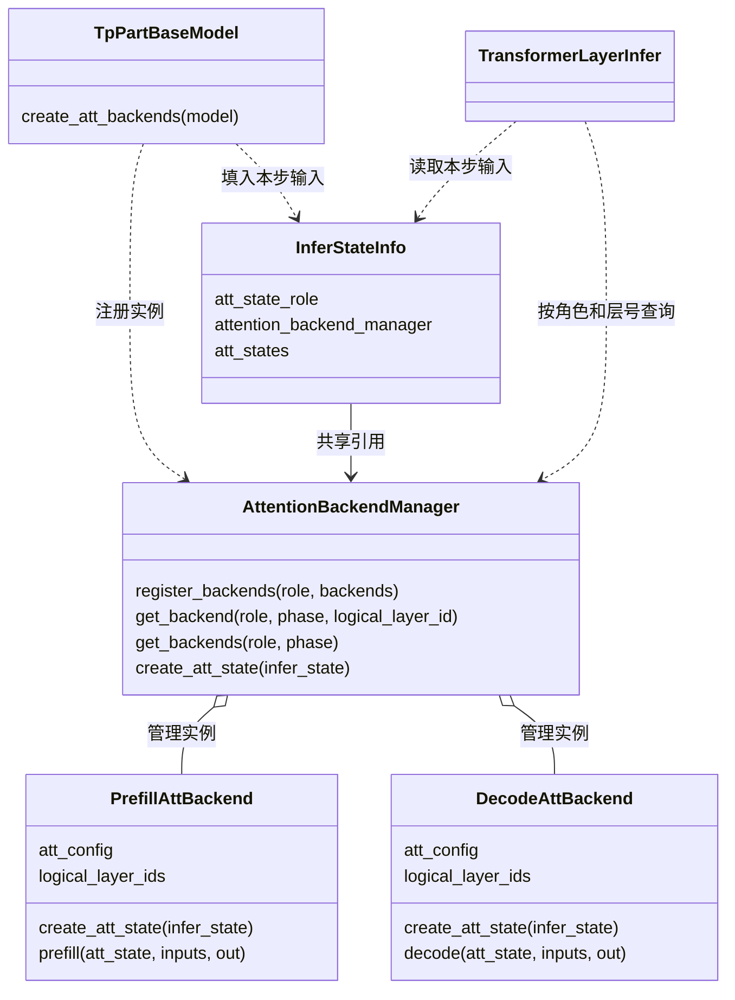

# Attention Backend 架构设计

模型层描述计算需求。`common/attention/attention_backend_manager.py` 中的 `AttentionBackendManager`
接收模型创建的 prefill 和 decode backend，并按角色登记。
每步先由 backend 创建执行参数，各层再通过 manager 查询对应的 backend 并执行计算。

## 1. 类型与职责

两个阶段的 backend 接口及配置基类定义在 `common/attention/base_backend.py`。

| 类型 | 职责 | 生命周期 |
| --- | --- | --- |
| `PrefillAttBackend` | 保存计算配置和运行时配置，提供 `create_att_state` 和 `prefill` | 模型生命周期 |
| `DecodeAttBackend` | 保存计算配置和运行时配置，提供 `create_att_state` 和 `decode` | 模型生命周期 |
| `AttRuntimeConfig` | 保存逻辑层号，以及具体 backend 从模型读取的容量和启动参数 | 构造时创建，随 backend 保留 |
| `InferStateInfo` | 保存当前步公共输入：请求、序列长度、索引、阶段和 graph 布局 | 当前 microbatch |
| 具体 `AttState` | 保存该 backend 计算所需的私有参数与准备结果 | 当前步；使用同一 backend 的层复用 |
| 各族 `AttInputs` | 提供本层 q、cache、量化 scale、权重、稀疏索引或 recurrent 状态视图 | 当前层调用 |

`AttConfig`、`AttState`、`AttInputs` 是公共接口的泛型参数，不是要求各算法族继承的三个基类。
GQA、MLA、sparse MLA、GDN、KDA 各自定义具体配置、状态和输入类型。

公共请求输入直接从 `InferStateInfo` 读取，不额外构造 metadata 对象或定义一份字段接口。
backend 只读取所需字段；返回的 `att_state` 不保存整个 `InferStateInfo`，避免延长其生命周期或形成引用环。
公共 attention 层可以导入 `InferStateInfo`，其他模型类和初始化策略仍留在模型侧。

## 2. 注册与复用

prefill 与 decode 独立选择实现。启动参数 `--att_backend` 按算法族和阶段覆盖默认选择，例如
`--att_backend gqa.prefill=fa3 gdn.prefill=flashqla`。模型指定的实现优先，未覆盖项使用 `auto`。
各算法族在自己的 `selector.py` 提供含逻辑类型名称的独立入口，例如
`select_gdn_prefill_backend()`、`select_gdn_decode_backend()` 和 `select_gqa_prefill_backend()`。
模型通过 `att_config.dtype` 传入计算 dtype。KDA 的 SSM 精度由 `ssm_dtype` 指定，
GQA 的 KV 量化由 `kv_quant` 指定，稀疏 MLA 的缓存编码由 `kv_cache_format` 指定。
具体实现根据这些配置检查支持范围。
模型根据 `--ssm_state_mode` 创建 State 布局及 `att_config.replay`，并调用对应状态模式的选择入口。
GDN decode 分为 `select_gdn_decode_backend()` 和 `select_gdn_replay_decode_backend()`。
KDA 提供对应的 `select_kda_replay_prefill_backend()`、`select_kda_replay_decode_backend()`，
native 入口沿用 `select_kda_prefill_backend()`、`select_kda_decode_backend()`。
每个入口固定使用自己的候选表，配置的 replay 标记与入口不符时直接报错。
KDA prefill 的 kernel 由模型将 `--att_backend kda.prefill=...` 写入 `KDAAttConfig.prefill_kernel`；
prefill 选择入口仅按 native/replay 状态构造后端，不再接受第二份 kernel 请求或改写配置。
`triton` 表示该模式下的 Triton 实现。自动选择和候选回退均在同一状态模式内进行。
GDN prefill 共用 `select_gdn_prefill_backend()`。同一实现支持两种布局，
replay 为每个请求使用一个 canonical SSM 槽，native 使用 `state_mtp_step + 1` 个槽。
Prefill 写回对应槽位的 SSM 及卷积状态，随后由所选 decode 实现接续计算。
模型实现 `create_att_backends()`，根据自身结构确定后端种类及服务的逻辑层号，再直接调用对应算法族的选择函数。
普通 GQA 模型为全部层创建一组 prefill/decode 后端。GLM-5-Next 分别为 KDA 层和稀疏 MLA 层创建后端。
Gemma4 和 GPT-OSS 显式区分滑动窗口层与全注意力层，DeepSeek-V4 按模型的压缩比例创建后端。
选择函数先读取自己对应的启动参数，再按该阶段支持的实现构造后端。
自动选择使用算法族对应阶段的优先级；MTP 和 EP 配置决定候选顺序与可用实现。
显式指定实现名时直接尝试该实现。启动参数校验汇总各族公布的选项。
同一完整阶段配置与同一具体实现复用 backend 对象。不同配置各自准备状态，不设计跨配置共享。



main 和各 draft 共用一个 manager。与 `AttentionStateManager` 一样，实例作为具名成员登记。
例如 `draft0_triton_gqa_decode_3_backend` 表示 draft0 的 Triton GQA decode 实例，3 是它服务的最小逻辑层号。
模型在创建入口按自身结构确定共享后端的逻辑层，并直接创建相应实例。
Manager 保留模型提供的实例，在注册时生成阶段列表和逐层查询索引，不再按配置重新合并。

模型类在 `create_att_backends(model)` 中直接根据 `model.config`、TP 划分和启动参数构造
各阶段的 `AttConfig`，收集服务的逻辑层号，并调用对应算法族的选择函数。
GQA 的量化参数同时读取已创建缓存的 scale 布局。配置构造与后端创建放在同一入口，
不再通过逐层配置函数或独立的配置构造辅助函数间接调用。
DeepSeek V4 在该入口先准备 SWA 和 FlashMLA 的运行资源，再按压缩比例创建后端。

模型在持久存储和 Graph 容量确定后，用 `register_backends` 一次登记本角色的实例。
decode-only 层只声明 decode，纯 FFN 角色注册空集合。每个角色登记后可独立 warmup 和 CUDA Graph capture。

## 3. 每步准备与逐层调用

```python
# 模型加载时
backends = model.create_att_backends(model)
model.attention_backend_manager.register_backends(model.att_state_role, backends)

# 每步：请求字段和模型额外索引准备完成后，第一层之前
infer_state.attention_backend_manager = model.attention_backend_manager
infer_state.att_states = model.attention_backend_manager.create_att_state(infer_state)

# prefill 的模型层
manager = infer_state.attention_backend_manager
role = infer_state.att_state_role
impl = manager.get_backend(role, "prefill", layer.layer_num_)
out = impl.prefill(infer_state.att_states[impl], inputs, out=out, alloc_func=alloc_func)

# decode 的模型层
impl = manager.get_backend(role, "decode", layer.layer_num_)
out = impl.decode(infer_state.att_states[impl], inputs, out=out, alloc_func=alloc_func)
```

本步字典直接以 backend 对象为键，不增加 `state_key`、对象编号或第二层状态分组。
模型在创建后端时将固定 decode 布局和 Graph 容量写入后端的运行时配置。
后端在 `create_att_state()` 中生成本步的行偏移、状态槽、接受数量和 kernel 调度参数。
GDN、KDA 按自身角色和逻辑层从现有 State 查询 MTP 索引，直接用于构造 `att_state`。
manager 根据 `infer_state.att_state_role` 和 `is_prefill` 找到实例并调用 `create_att_state`。

backend 使用 `self.att_config` 保存计算配置，并管理容量固定的私有缓冲。
当前步骤的 wrapper、调度对象和动态张量由 `att_state` 持有，捕获状态随 CUDA Graph 保留。
`get_workspace(name, role, numel, dtype)` 在同设备、同名称、同 dtype 的缓存中查找。
其他角色已有足够容量时，将前缀视图缓存到 `(role, numel)` 再返回。
后续同尺寸请求直接命中同一个张量，保证 CUDA Graph 捕获的地址稳定。
构造时本族选择器将 `model.att_state_role` 传给 backend。Manager 按角色、阶段和逻辑层号登记实例。
选择器将逻辑层号填进候选实现的 `create_runtime_config(model)` 返回值，再传给 backend 构造函数。
有模型级参数的实现定义自己的 `RuntimeConfig`，FA3 的 GQA 和 MLA decode
共用模块级的 `FA3DecodeRuntimeConfig`。FA3 用运行时配置设置页表容量，FlashInfer 用它设置
缓存容量和 workspace 大小。基类配置还包含固定解码布局和 Graph 容量。GPU 缓冲区可按需初始化，
页表的容量缓冲由 backend 持有，第三方计划与调度对象由本步 state 持有。`create_att_state` 返回本步计算输入。
固定步长的索引由使用它的具体 backend 在状态准备方法中管理，缓存动态绑定到该方法，
按设备、dtype、长度和步长等实际参数复用；调用方不能改写返回张量或其视图。
随请求变化的长度、分组、接受数量和状态槽每步生成，由当前 `att_state` 持有。
`page_size`、`causal` 和最大草稿步数等固定配置在 backend 上读取，不在 state 中重复保存。
GDN 和 KDA 的原生 decode 与 replay decode 各自准备 SSM 槽位和行偏移，仅共用投机请求的行分组计算。

`AttentionStateManager` 继续管理跨步的 KV、conv、SSM 和 replay 存储。
backend 对象复用不表示各逻辑层共用这些数据；模型层在执行前写好 KV，并通过 `AttInputs` 传入本层视图。
稀疏 attention 的 indexer 仍属于模型，最终索引通过本层输入传入。

## 4. 输出与状态更新

- `decode` 填充并返回调用方提供的 `out`；普通 prefill 同样如此。
- GDN、KDA prefill 也接受 `out=None`，直接复用 chunk kernel 的输出；graph 路径需要稳定输出地址时提供 `out`。
- 临时计算缓冲通过 `alloc_func` 分配，调用方负责其复用与 graph 生命周期。
- `out` 不与输入或本步状态别名。
- 线性 attention 每步每逻辑层更新一次调用方提供的 recurrent 状态视图；`create_att_state` 只准备执行参数。
- Replay backend 保留既有的 accepted-prefix、history 和最后逻辑层推进游标的语义。

## 5. Microbatch 与 CUDA Graph

每个 microbatch 持有自己的 `InferStateInfo.att_states`。共享 backend 不保存“当前步状态”成员。

capture 和 replay 都在 graph 外执行 `create_att_state`。捕获的 `InferStateInfo` 保留该图的
`att_states` 及其动态张量，普通步骤不再把派生张量存入 backend 的缓存字典。
replay 前由 `InferStateInfo.copy_for_cuda_graph` 更新公共请求张量，以及同一 backend 的捕获
attention state 中的 tensor 字段，保持捕获地址和布局。已更新的公共输入不重复复制。
不同 microbatch 和 graph 各自保留动态状态；只读索引常量可以共享。
图内产生的临时索引继续由图在 replay 时重算。启动边界和 scratch 容量按 graph 上限确定。

FlashInfer wrapper、FlashMLA scheduler 等第三方对象随捕获 state 保留。
FlashInfer replay 输入只准备动态页参数，统一复制到捕获 state 后，由具体 backend 的
`refresh_cuda_graph_state` 刷新原 wrapper 的计划。Triton MLA 的分块大小和批内偏移为
state 顶层张量，每步生成并沿用统一的原地复制流程。
V4 的 GPU scheduler 需要区分 warmup 和 capture 使用的元数据。
按名称共享的 workspace 仍需遵守 stream 的执行顺序，不能仅凭本步字典隔离推断 scratch 可并发写入。

PD 节点只在实际执行某阶段时创建该阶段的重型资源。
CPU cache 同步需求由 manager 汇总已登记 backend 的能力声明。

## 6. 修改实现时的验证

- 配置不支持时在模型加载阶段报错；显式请求与自动选择保持既有能力和分布式一致性规则。
- 相同完整配置复用实例，不同配置的状态分离；一个阶段的差异不影响另一阶段复用。
- 查询按角色、阶段和逻辑层号精确匹配。重复注册同一角色或同阶段层号报错。
- 各族输出及 recurrent 更新与独立参考一致，覆盖 cached prefix、量化、滑窗、图像 span 和投机布局。
- graph replay 在请求与长度变化后保持捕获地址、布局和数值正确，不同 microbatch 的动态存储互不覆盖；共享只读常量保持不变。
- 普通步的状态可以随引用释放；backend 和 `att_state` 不持有完整 `InferStateInfo`。
