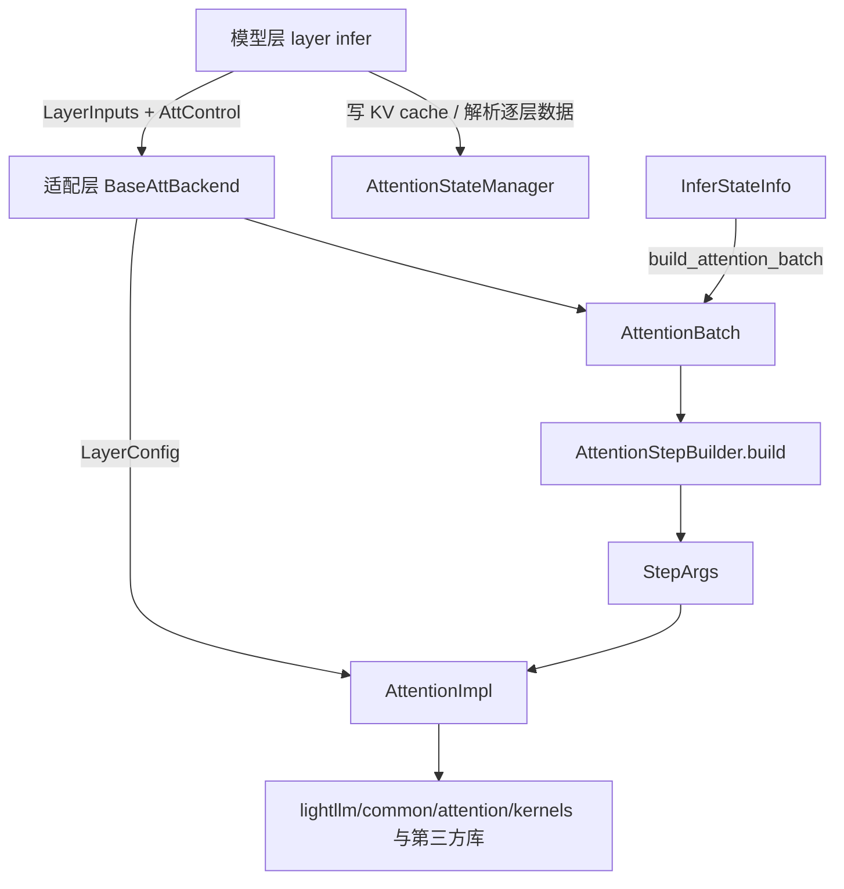
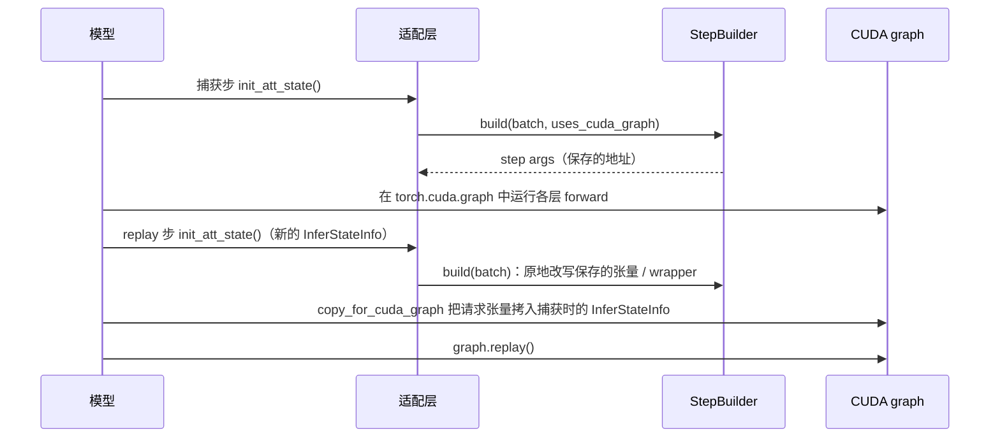

# Attention Backend 架构设计

本文定义 attention 计算层的分层、公共类型、接口契约和实现约束。具体 kernel 的调优参数、Tensor 形状细节和历史实现过程不在本文维护；它们属于代码、docstring 和测试。attention 状态存储（KV cache、线性注意力的 conv/SSM 状态）的设计见《Attention Resources 架构设计》。

## 1. 设计目标

`lightllm/common/attention/backends/` 把"如何为一步推理准备 kernel 参数"和"如何为一层计算 attention"从模型代码与推理状态中分离出来。设计满足：

- kernel 不读写 `InferStateInfo`，所有输入通过显式类型传入。
- 一层的静态配置在模型加载后即可确定，不支持的配置在创建 impl 时报错，而不是在第一次推理时。
- 每步共用的派生参数（页表、累积偏移、split 调度、FlashInfer plan 等）在第一层之前计算一次，所有层共用。
- CUDA graph 的捕获和 replay 走同一条路径；replay 只改变 Tensor 内容，graph 依赖的地址和主机侧参数保持不变。
- microbatch overlap 的两个并发步各自持有参数，互不共享存储。
- 同一 attention 算法的不同实现（Triton、FlashInfer、FA3、FlashMLA、FlashKDA、FlashQLA 等）共用同一组层配置和层输入类型。

## 2. 分层和职责



### 2.1 模型层

模型的 layer infer 负责：

- 在调用 attention 之前把本层的 K/V 写入 KV cache。
- 解析逐层数据：KV 量化 scale（`state.get_layer_kv_scales(layer)`）、线性注意力的 conv/SSM 状态视图、稀疏注意力的 top-k 索引、融合投影的切分。
- 通过 `infer_state.prefill_att_state` / `decode_att_state`（线性层为 `*_att_state1`）调用适配层，并用 `AttControl` 传递滑窗、sinks、ALiBi、图像 span 等层属性。

模型层不直接调用 attention kernel。`unit_tests/common/attention/test_attention_call_sites.py` 检查 layer infer、infer state、model 和适配层不导入 attention kernel 模块（视觉编码器除外，它在单张图像内计算 attention，不使用 KV cache）。

### 2.2 适配层（BaseAttBackend）

`lightllm/common/basemodel/attention/**` 中的 `BaseAttBackend` 子类面向模型，负责：

- 按启动参数和设备选择实现（`create_utils.py`、`create_linear_utils.py`），并加载可选的第三方库。
- 每步用 `build_attention_batch(infer_state, backend)` 生成 `AttentionBatch`，调用 step builder 得到 step args（`init_state`，在第一层之前、捕获之外执行）。
- 每次层调用根据 Tensor 形状和 `AttControl` 构造 layer config，通过 `get_attention_impl(backend_cls, layer_config)` 取得缓存的 impl 并调用 `forward`。
- 分配输出 `out` 和临时缓冲（`alloc_func`）。

`BaseAttBackend` 按 (类, 模型) 复用实例，但每次构造都会重新执行 `__init__`；持有 CUDA graph 状态的 decode step builder 因此只在第一次构造时创建。

注意不要混淆：`BaseAttBackend` 是模型侧的适配器，`AttentionBackend` 是本层描述某个实现的静态类型。

### 2.3 Backend 层

`lightllm/common/attention/backends/<family>/<impl>.py` 定义各算法族的实现。每个实现由三部分组成：

| 类型 | 作用 |
| --- | --- |
| `AttentionBackend` | 静态描述：`get_name()`、`get_step_builder_cls()`、`get_impl_cls()`。 |
| `AttentionStepBuilder` | 从 `AttentionBatch` 构造本实现的 step args，每步一次。 |
| `AttentionImpl` | 持有一个 layer config，对每层调用 `forward`。 |

### 2.4 Kernel 层

`lightllm/common/attention/kernels/<family>/` 存放 Triton kernel 及其封装；第三方库（FA3、FlashInfer、FlashMLA、FlashKDA、FlashQLA）只由 backend 层调用。

## 3. 类型及其生命周期

类型按生命周期命名：

| 类型 | 生命周期 | 内容 |
| --- | --- | --- |
| `*LayerConfig` | 模型加载后固定 | 一层的静态配置：head 数、维度、dtype、scale、因果性、滑窗、sinks、KV 量化方式等。frozen dataclass，可哈希，构造时校验字段。 |
| `AttentionBatch` | 每步一次 | 与实现无关的本步请求描述：请求张量、累积偏移、prefill 的 cached prefix、投机解码的行布局、CUDA graph 容量和 microbatch 编号。 |
| `*StepArgs` | 每步一次，所有层共用 | 某个实现为本步准备的 kernel 参数。 |
| `*LayerInputs` | 每次层调用 | 本层的张量：q、KV cache 视图、量化 scale、状态视图、稀疏索引等。 |

其他约定：

- KV cache 由模型层在 attention 之前写入，不由 impl 写入。
- step args 显式传参，不经过全局 forward context；microbatch overlap 的两个并发步各自持有 step args。

## 4. 接口契约

### 4.1 LayerConfig 与 impl 构造

- layer config 只描述层本身，不含任何每步数据。`require_positive` 等校验在 `__post_init__` 中执行。
- impl 在构造时检查自身是否支持该 layer config，不支持时抛出 `NotImplementedError`。例如 Triton GQA 不支持非默认 scale、右侧窗口、sinks 和非因果；FA3 GQA 的 FP8 KV 只支持 BF16 模型。
- impl 只持有静态配置，相同 layer config 的所有层共用一个实例。
- 适配层必须把模型要求的全部层属性（因果性、sinks、滑窗、量化方式等）传入 layer config，让 impl 拒绝无法执行的配置，而不是静默按默认行为计算。

### 4.2 AttentionBatch

- 由适配层每步从 `InferStateInfo` 构造一次，字段均为调用方持有的设备张量或主机整数。
- `req_to_token_indexs[b_req_idx[i], pos]` 是请求 i 第 pos 个 token 的物理 cache 槽位。
- decode 默认每个请求一行。投机解码时，固定布局下每个请求有 `decode_rows_per_request` 个连续行；dynamic verify 布局下行数可变，相同 `b_req_idx` 的连续行属于同一请求，`pad_req_idx` 的行是 padding，各自独立。
- `cuda_graph_max_kv_seq_len` 在捕获和 replay 步给出 graph 的长度容量，eager 步为 `None`；`uses_cuda_graph` 是唯一的 graph 开关。

### 4.3 AttentionStepBuilder.build

`build(batch)` 每步执行一次，包括 CUDA graph 的捕获步和 replay 步，在第一层之前、捕获之外运行。约束：

1. **graph 步的派生状态按 `(microbatch_index, batch_size)` 保存并原地改写。** 使用 `keep_for_cuda_graph(store, key, value)`：第一次保存副本，之后 `copy_` 到同一地址。graph 捕获时读取的是这个地址；replay 步新建的张量 graph 看不到。microbatch overlap 的两个微批是不同的 graph，不能共享存储。
2. **主机侧字段在 replay 时保持捕获时的值，且必须对每次 replay 有效。** 网格大小、scratch 大小和 kernel 配置被固化在 graph 中，graph 步应按容量而不是捕获步的实际长度确定。只用于选择 kernel 配置、kernel 自己在 GPU 上读取实际长度的字段称为 hint，可以取本步实际值，必须在 docstring 中注明。例如 Triton GQA decode 的 `kv_seq_len_bound` 是界，`max_kv_seq_len` 是 hint。
3. **eager 步可以使用新分配的存储**，但固定大小的缓冲（如 FlashInfer 的页索引）应按容量预分配、按 microbatch 切片复用，避免每个 graph batch size 各保存一份。
4. 第三方库的有状态对象（FlashInfer wrapper、FlashMLA scheduler metadata）按 `(microbatch_index, batch_size)` 保存；replay 步原地改写其缓冲并在 GPU 上或用 `fast_decode_plan` 重新规划，不能创建新对象。

prefill 步不被 decode graph 捕获。启用 prefill CUDA graph 时，有状态的 prefill（线性注意力、稀疏 attention 的 CPU 步）作为 graph 段之间的 CPU 步执行，使用 replay 步自己的 step args。

### 4.4 AttentionImpl.forward

```python
impl.forward(step_args, layer_inputs, *, out, alloc_func=torch.empty) -> out
```

- 填充并返回调用方提供的 `out`；`out` 不得与输入或 step args 别名。
- 临时缓冲只通过 `alloc_func(shape, dtype=, device=)` 分配，impl 不保留任何缓冲；调用方的分配器负责复用和 graph 生命周期。
- forward 不读取 `InferStateInfo`，不修改 step args。
- 线性注意力（GDN、KDA）的 impl 原地更新调用方提供的 conv/SSM 状态视图，每步每层恰好执行一次。replay 状态（保存逐 token 历史以便提交被接受的前缀）在每层之后由适配层调用 `finish_decode_token`，游标只在状态的最后一个逻辑层推进。

## 5. CUDA Graph 时序



由此得出：step args 中直接引用的 batch 张量（如 `b_seq_len`）在 replay 前由 `copy_for_cuda_graph` 刷新；step builder 派生的张量必须由 builder 自己在原地刷新。

## 6. 算法族概览

| 族 | layer config | 实现 | 说明 |
| --- | --- | --- | --- |
| `gqa` | `GQALayerConfig` | `triton`、`triton_quant`（int8/int4 分组量化 KV）、`flashinfer`、`fa3` | 覆盖 MHA/MQA/GQA、自定义 scale、因果/非因果、单侧/双侧滑窗、sinks、ALiBi、FP8 KV（FlashInfer 按 tensor、FA3 按 head）、图像 span 内双向注意力；decode 支持三种投机解码布局。 |
| `mla` | `MLAPrefillLayerConfig`、`MLADecodeLayerConfig` | `triton`、`flashinfer`、`fa3` | Triton decode 的 split 调度由 step builder 在第一层之前生成；GLM 256 维 prefill 使用专用 kernel。 |
| `sparse_mla` | `SparseMLALayerConfig`、`SWASparseMLALayerConfig` | `fa3`、`flashmla`、`flashmla_swa` | DeepSeek V3.2、GLM-5、DeepSeek V4。top-k 索引由模型层的 indexer 计算并通过 layer inputs 传入；indexer 元数据保存在各模型的 `InferStateInfo` 上。 |
| `gdn` | `GDNLayerConfig` | `triton`、`flashqla`（prefill）、`replay` | Gated DeltaNet（Qwen3-Next 等）。 |
| `kda` | `KDALayerConfig` | `triton`（prefill 可按步选择 FlashKDA）、`replay` | Kimi Delta Attention（GLM-5-Next 线性层）。FlashKDA 由 `backends/kda/flashkda.py` 加载。 |

## 7. 目录和代码组织

```text
lightllm/common/attention/
├── backend.py                 # 公共类型：AttentionBatch、AttentionStepBuilder、AttentionImpl、AttentionBackend
├── backends/
│   ├── __init__.py            # keep_for_cuda_graph、require_positive
│   └── <family>/
│       ├── __init__.py        # 该族的 LayerConfig 与 LayerInputs
│       └── <impl>.py          # StepArgs、StepBuilder、Impl、Backend
└── kernels/<family>/          # Triton kernel 与封装
lightllm/common/basemodel/attention/   # 适配层：实现选择、build_attention_batch、各实现的 BaseAttBackend
```

## 8. 新增实现

1. 若是新算法族，在 `backends/<family>/__init__.py` 定义 layer config（frozen、构造时校验）和 layer inputs，并写清张量布局。
2. 在 `backends/<family>/<impl>.py` 定义 step args、step builder、impl 和 `AttentionBackend`。impl 在构造时拒绝不支持的配置；step builder 遵守第 4.3 节的约束，并在 docstring 中区分界和 hint。
3. 在适配层新增或扩展 `BaseAttBackend` 子类，并在 `create_utils.py` 或 `create_linear_utils.py` 注册。持有 graph 状态的 step builder 只创建一次。
4. 模型层只通过适配层调用 attention，逐层数据在模型层解析。

## 9. 测试和评审要求

- impl 与独立的 torch 参考实现对比（量化路径对比反量化后的参考，容差需说明来源），覆盖 cached prefix、各 decode 布局和该实现声明支持的层属性。
- 不支持的 layer config 在构造时被拒绝。
- 新的 decode step builder 加入 `unit_tests/common/attention/backends/test_step_builder_graph_contract.py`：同一 `(microbatch, batch size)` 的捕获步与 replay 步保持地址和布局、值等于 eager 构造、主机字段除 hint 外不变、不同 microbatch 不共享存储。
- 至少一个测试通过 LightLLM 的 `CudaGraph.capture_decode` / `replay` 在长度变化后 replay。
- 重构已有路径时，用相同输入通过适配层接口与改动前对比输出逐位一致；有意改变行为的修复单独提交并附回归测试。

## 10. 非目标和后续工作

- 适配层仍按 slot 0/1 区分层类型，并在每次层调用时由张量形状构造 layer config；按层分组（layer group）在加载时为每层创建 impl 留待后续。
- `AttentionBatch` 目前与 `InferStateInfo` 字段一一对应；CUDA graph 仍依赖 `InferStateInfo.copy_for_cuda_graph` 刷新请求张量。
- KV cache 写入仍由模型层完成。
