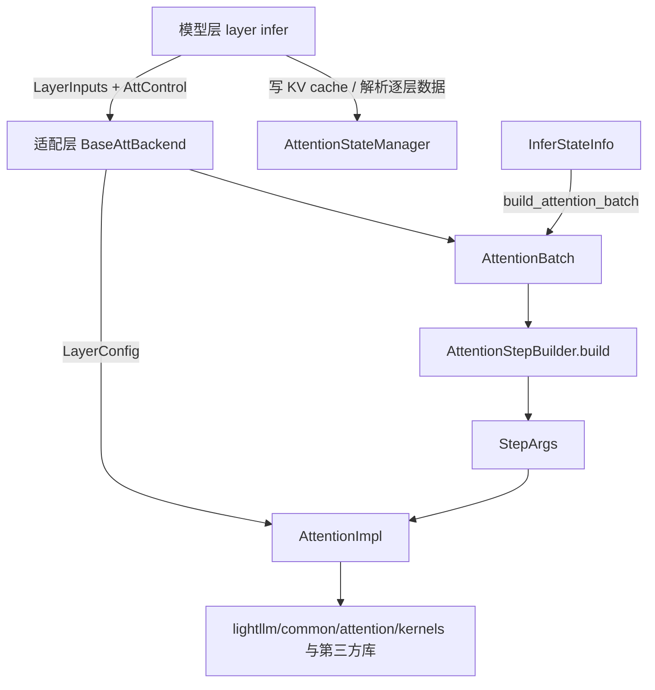
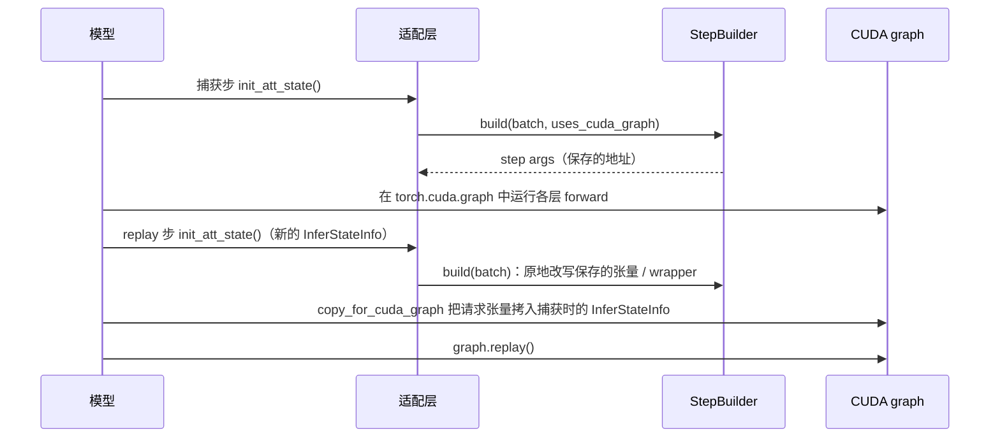
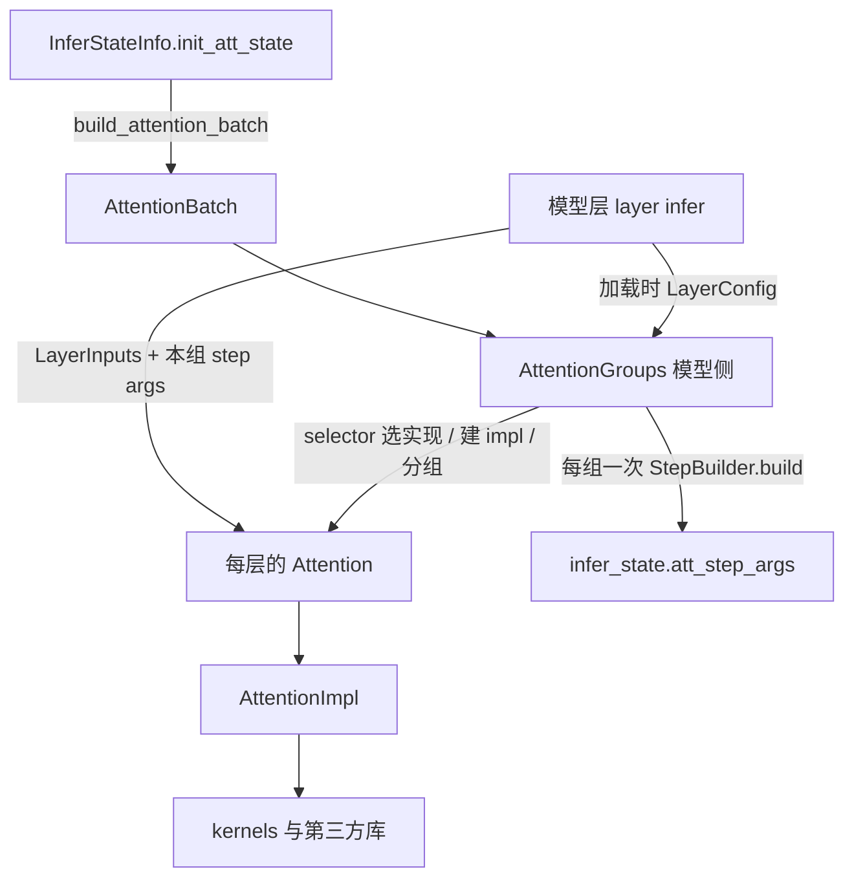

# Attention Backend 架构设计

本文定义 attention 计算层的分层、公共类型、接口契约和实现约束。具体 kernel 的调优参数、Tensor 形状细节和历史实现过程不在本文维护；它们属于代码、docstring 和测试。attention 状态存储（KV cache、线性注意力的 conv/SSM 状态）的设计见《Attention Resources 架构设计》。

## 1. 设计目标

`lightllm/common/attention/backends/` 把"如何为一步推理准备 kernel 参数"和"如何为一层计算 attention"从模型代码与推理状态中分离出来。设计满足：

- kernel 不读写 `InferStateInfo`，所有输入通过显式类型传入。
- 一层的静态配置在模型加载后即可确定，不支持的配置在创建 impl 时报错，而不是在第一次推理时。（当前实现在 warmup 的第一次前向时才创建 impl，见第 10.1 节。）
- 每步共用的派生参数（页表、累积偏移、split 调度、FlashInfer plan 等）在第一层之前计算一次，所有层共用。
- CUDA graph 的捕获和 replay 走同一条路径；replay 只改变 Tensor 内容，graph 依赖的地址和主机侧参数保持不变。
- microbatch overlap 的两个并发步各自持有参数，互不共享存储。
- 同一 attention 算法的不同实现（Triton、FlashInfer、FA3、FlashMLA、FlashKDA、FlashQLA 等）共用同一组层配置和层输入类型。

## 2. 分层和职责



### 2.1 模型层

模型的 layer infer 负责：

- 在调用 attention 之前把本层的 K/V 写入 KV cache。
- 解析逐层数据：KV 量化 scale（`state.get_layer_kv_scales(layer)`）、线性注意力的 conv/SSM 状态视图、稀疏注意力的 top-k 索引、融合投影的切分。
- 通过 `infer_state.prefill_att_state` / `decode_att_state`（线性层为 `*_att_state1`）调用适配层，并用 `AttControl` 传递滑窗、sinks、ALiBi、图像 span 等层属性。

模型层不直接调用 attention kernel。`unit_tests/common/attention/test_attention_call_sites.py` 检查 layer infer、infer state、model 和适配层不导入 attention kernel 模块（视觉编码器除外，它在单张图像内计算 attention，不使用 KV cache）。

### 2.2 适配层（BaseAttBackend）

`lightllm/common/basemodel/attention/**` 中的 `BaseAttBackend` 子类面向模型，负责：

- 按启动参数和设备选择实现（`create_utils.py`、`create_linear_utils.py`），并加载可选的第三方库。
- 每步用 `build_attention_batch(infer_state, backend)` 生成 `AttentionBatch`，调用 step builder 得到 step args（`init_state`，在第一层之前、捕获之外执行）。
- 每次层调用根据 Tensor 形状和 `AttControl` 构造 layer config，通过 `get_attention_impl(backend_cls, layer_config)` 取得缓存的 impl 并调用 `forward`。
- 分配输出 `out` 和临时缓冲（`alloc_func`）。

`BaseAttBackend` 按 (类, 模型) 复用实例，但每次构造都会重新执行 `__init__`；持有 CUDA graph 状态的 decode step builder 因此只在第一次构造时创建。

注意不要混淆：`BaseAttBackend` 是模型侧的适配器，`AttentionBackend` 是本层描述某个实现的静态类型。

适配层是过渡结构，目标是将其移除，见第 10 节。

### 2.3 Backend 层

`lightllm/common/attention/backends/<family>/<impl>.py` 定义各算法族的实现。每个实现由三部分组成：

| 类型 | 作用 |
| --- | --- |
| `AttentionBackend` | 静态描述：`get_name()`、`get_step_builder_cls()`、`get_impl_cls()`。 |
| `AttentionStepBuilder` | 从 `AttentionBatch` 构造本实现的 step args，每步一次。 |
| `AttentionImpl` | 持有一个 layer config，对每层调用 `forward`。 |

### 2.4 Kernel 层

`lightllm/common/attention/kernels/<family>/` 存放 Triton kernel 及其封装；第三方库（FA3、FlashInfer、FlashMLA、FlashKDA、FlashQLA）只由 backend 层调用。

## 3. 类型及其生命周期

类型按生命周期命名：

| 类型 | 生命周期 | 内容 |
| --- | --- | --- |
| `*LayerConfig` | 模型加载后固定 | 一层的静态配置：head 数、维度、dtype、scale、因果性、滑窗、sinks、KV 量化方式等。frozen dataclass，可哈希，构造时校验字段。 |
| `AttentionBatch` | 每步一次 | 与实现无关的本步请求描述：请求张量、累积偏移、prefill 的 cached prefix、投机解码的行布局、CUDA graph 容量和 microbatch 编号。 |
| `*StepArgs` | 每步一次，所有层共用 | 某个实现为本步准备的 kernel 参数。 |
| `*LayerInputs` | 每次层调用 | 本层的张量：q、KV cache 视图、量化 scale、状态视图、稀疏索引等。 |

其他约定：

- KV cache 由模型层在 attention 之前写入，不由 impl 写入。
- step args 显式传参，不经过全局 forward context；microbatch overlap 的两个并发步各自持有 step args。

## 4. 接口契约

### 4.1 LayerConfig 与 impl 构造

- layer config 只描述层本身，不含任何每步数据。`require_positive` 等校验在 `__post_init__` 中执行。
- impl 在构造时检查自身是否支持该 layer config，不支持时抛出 `NotImplementedError`。例如 Triton GQA 不支持非默认 scale、右侧窗口、sinks 和非因果；FA3 GQA 的 FP8 KV 只支持 BF16 模型。
- impl 只持有静态配置，相同 layer config 的所有层共用一个实例。
- 适配层必须把模型要求的全部层属性（因果性、sinks、滑窗、量化方式等）传入 layer config，让 impl 拒绝无法执行的配置，而不是静默按默认行为计算。

### 4.2 AttentionBatch

- 由适配层每步从 `InferStateInfo` 构造一次，字段均为调用方持有的设备张量或主机整数。
- `req_to_token_indexs[b_req_idx[i], pos]` 是请求 i 第 pos 个 token 的物理 cache 槽位。
- decode 默认每个请求一行。投机解码时，固定布局下每个请求有 `decode_rows_per_request` 个连续行；dynamic verify 布局下行数可变，相同 `b_req_idx` 的连续行属于同一请求，`pad_req_idx` 的行是 padding，各自独立。
- `cuda_graph_max_kv_seq_len` 在捕获和 replay 步给出 graph 的长度容量，eager 步为 `None`；`uses_cuda_graph` 是唯一的 graph 开关。

### 4.3 AttentionStepBuilder.build

`build(batch)` 每步执行一次，包括 CUDA graph 的捕获步和 replay 步，在第一层之前、捕获之外运行。约束：

1. **graph 步的派生状态按 `(microbatch_index, batch_size)` 保存并原地改写。** 使用 `keep_for_cuda_graph(store, key, value)`：第一次保存副本，之后 `copy_` 到同一地址。graph 捕获时读取的是这个地址；replay 步新建的张量 graph 看不到。microbatch overlap 的两个微批是不同的 graph，不能共享存储。
2. **主机侧字段在 replay 时保持捕获时的值，且必须对每次 replay 有效。** 网格大小、scratch 大小和 kernel 配置被固化在 graph 中，graph 步应按容量而不是捕获步的实际长度确定。只用于选择 kernel 配置、kernel 自己在 GPU 上读取实际长度的字段称为 hint，可以取本步实际值，必须在 docstring 中注明。例如 Triton GQA decode 的 `kv_seq_len_bound` 是界，`max_kv_seq_len` 是 hint。
3. **eager 步可以使用新分配的存储**，但固定大小的缓冲（如 FlashInfer 的页索引）应按容量预分配、按 microbatch 切片复用，避免每个 graph batch size 各保存一份。
4. 第三方库的有状态对象（FlashInfer wrapper、FlashMLA scheduler metadata）按 `(microbatch_index, batch_size)` 保存；replay 步原地改写其缓冲并在 GPU 上或用 `fast_decode_plan` 重新规划，不能创建新对象。

prefill 步不被 decode graph 捕获。启用 prefill CUDA graph 时，有状态的 prefill（线性注意力、稀疏 attention 的 CPU 步）作为 graph 段之间的 CPU 步执行，使用 replay 步自己的 step args。

### 4.4 AttentionImpl.forward

```python
impl.forward(step_args, layer_inputs, *, out, alloc_func=torch.empty) -> out
```

- 填充并返回调用方提供的 `out`；`out` 不得与输入或 step args 别名。
- 临时缓冲只通过 `alloc_func(shape, dtype=, device=)` 分配，impl 不保留任何缓冲；调用方的分配器负责复用和 graph 生命周期。
- forward 不读取 `InferStateInfo`，不修改 step args。
- 线性注意力（GDN、KDA）的 impl 原地更新调用方提供的 conv/SSM 状态视图，每步每层恰好执行一次。replay 状态（保存逐 token 历史以便提交被接受的前缀）在每层之后由适配层调用 `finish_decode_token`，游标只在状态的最后一个逻辑层推进。

## 5. CUDA Graph 时序



由此得出：step args 中直接引用的 batch 张量（如 `b_seq_len`）在 replay 前由 `copy_for_cuda_graph` 刷新；step builder 派生的张量必须由 builder 自己在原地刷新。

## 6. 算法族概览

| 族 | layer config | 实现 | 说明 |
| --- | --- | --- | --- |
| `gqa` | `GQALayerConfig` | `triton`、`triton_quant`（int8/int4 分组量化 KV）、`flashinfer`、`fa3` | 覆盖 MHA/MQA/GQA、自定义 scale、因果/非因果、单侧/双侧滑窗、sinks、ALiBi、FP8 KV（FlashInfer 按 tensor、FA3 按 head）、图像 span 内双向注意力；decode 支持三种投机解码布局。 |
| `mla` | `MLAPrefillLayerConfig`、`MLADecodeLayerConfig` | `triton`、`flashinfer`、`fa3` | Triton decode 的 split 调度由 step builder 在第一层之前生成；GLM 256 维 prefill 使用专用 kernel。 |
| `sparse_mla` | `SparseMLALayerConfig`、`SWASparseMLALayerConfig` | `fa3`、`flashmla`、`flashmla_swa` | DeepSeek V3.2、GLM-5、DeepSeek V4。top-k 索引由模型层的 indexer 计算并通过 layer inputs 传入；indexer 元数据保存在各模型的 `InferStateInfo` 上。 |
| `gdn` | `GDNLayerConfig` | `triton`、`flashqla`（prefill）、`replay` | Gated DeltaNet（Qwen3-Next 等）。 |
| `kda` | `KDALayerConfig` | `triton`（prefill 可按步选择 FlashKDA）、`replay` | Kimi Delta Attention（GLM-5-Next 线性层）。FlashKDA 由 `backends/kda/flashkda.py` 加载。 |

## 7. 目录和代码组织

```text
lightllm/common/attention/
├── backend.py                 # 公共类型：AttentionBatch、AttentionStepBuilder、AttentionImpl、AttentionBackend
├── backends/
│   ├── __init__.py            # keep_for_cuda_graph、require_positive
│   └── <family>/
│       ├── __init__.py        # 该族的 LayerConfig 与 LayerInputs
│       └── <impl>.py          # StepArgs、StepBuilder、Impl、Backend
└── kernels/<family>/          # Triton kernel 与封装
lightllm/common/basemodel/attention/   # 适配层：实现选择、build_attention_batch、各实现的 BaseAttBackend
```

## 8. 新增实现

1. 若是新算法族，在 `backends/<family>/__init__.py` 定义 layer config（frozen、构造时校验）和 layer inputs，并写清张量布局。
2. 在 `backends/<family>/<impl>.py` 定义 step args、step builder、impl 和 `AttentionBackend`。impl 在构造时拒绝不支持的配置；step builder 遵守第 4.3 节的约束，并在 docstring 中区分界和 hint。
3. 在适配层新增或扩展 `BaseAttBackend` 子类，并在 `create_utils.py` 或 `create_linear_utils.py` 注册。持有 graph 状态的 step builder 只创建一次。
4. 模型层只通过适配层调用 attention，逐层数据在模型层解析。

## 9. 测试和评审要求

- impl 与独立的 torch 参考实现对比（量化路径对比反量化后的参考，容差需说明来源），覆盖 cached prefix、各 decode 布局和该实现声明支持的层属性。
- 不支持的 layer config 在构造时被拒绝。
- 新的 decode step builder 加入 `unit_tests/common/attention/backends/test_step_builder_graph_contract.py`：同一 `(microbatch, batch size)` 的捕获步与 replay 步保持地址和布局、值等于 eager 构造、主机字段除 hint 外不变、不同 microbatch 不共享存储。
- 至少一个测试通过 LightLLM 的 `CudaGraph.capture_decode` / `replay` 在长度变化后 replay。
- 重构已有路径时，用相同输入通过适配层接口与改动前对比输出逐位一致；有意改变行为的修复单独提交并附回归测试。

## 10. 目标架构：移除适配层

状态：设计评审中，代码尚未迁移。第 2–9 节描述当前实现，本节描述目标和迁移方式。

### 10.1 现状的问题

适配层（第 2.2 节）在 backend 层完成后只剩"翻译"和"持有生命周期"两件事，但做得不干净：

- **两个 `attention` 包、两种 "backend"。** `lightllm/common/basemodel/attention/` 按库组织（`triton/`、`fa3/`、`flashinfer/`），`lightllm/common/attention/backends/` 按算法族组织（`gqa/`、`mla/`），同一实现要在两棵树里各找一次；`BaseAttBackend` 与 `AttentionBackend` 需要在文档和 docstring 中反复提示不要混淆。
- **`AttControl` 是无类型的杂物袋。** 它混合了层的静态属性（滑窗、ALiBi、sinks、图像 span）、逐层权重（`tp_alibi`、`sink_weight`、`kv_scales`）和每次调用的张量（稀疏索引、GDN 的投影与状态视图，放在 `*_dict: Dict` 中）。适配层的大部分代码是把它拆回 `LayerConfig` / `LayerInputs`；同一族的 Triton、FA3、FlashInfer 适配器因此几乎相同。
- **生命周期没有明确的拥有者。** 模型用固定的 slot 0/1（`prefill_att_backend`、`prefill_att_backend1` 等）区分层类型，slot 1 的含义由各模型自定（Qwen3-Next 是 GDN，Gemma4 是第二个 Triton）。`BaseAttBackend.__new__` 按 (类, 模型) 复用实例但每次重跑 `__init__`，所以需要"decode step builder 只在第一次构造时创建"的保护。attention state 通过弱引用回指 `InferStateInfo`，并由 `check_att_states` 防止循环引用。
- **层配置在运行时才确定。** layer config 每次调用由张量形状和 `AttControl` 重建，impl 在第一次调用时创建；不支持的配置要到 warmup 的第一次前向才报错，没有真正满足第 1 节的目标。
- **模型属性放在 backend 上。** `uses_causal_attention`、`uses_dynamic_spec_verify_layout` 读取模型和启动参数；FlashInfer MLA 适配器从模型配置重新计算 softmax scale（含 YaRN mscale），与模型层重复。
- **共享同一 step builder 的层重复构造 step args。** Gemma4 的两个 slot 是同一个 `TritonAttBackend` 实例，但两个 state 每步各 build 一次。

### 10.2 目标分层

去掉适配层这一概念，把它剩下的职责交给生命周期相同的拥有者：

| 职责 | 当前位置 | 目标位置 | 生命周期 |
| --- | --- | --- | --- |
| 选择实现、创建 impl | `create_utils.py`、`get_attention_impl` | `common/attention/selector.py`，模型加载时 | 模型 |
| 每层的 layer config 与 impl | 每次调用重建 | `Attention` 对象，层在加载时创建 | 层 |
| step builder 及其资源 | `BaseAttBackend` 单例 | `AttentionGroups`（模型侧） | 模型 |
| 每步构造 batch 与 step args | attention state 的 `init_state` | `InferStateInfo.init_att_state` | 步 |
| 每次调用的张量 | `AttControl` | 族的 `LayerInputs`，由模型层直接构造 | 调用 |



依赖方向只有一个：`lightllm/common/basemodel` 和 `lightllm/models` 可以导入 `lightllm/common/attention`，反之不行。`lightllm/common/attention/**` 不导入 `InferStateInfo`、模型或 `lightllm.common.basemodel`，由 `test_attention_call_sites.py` 检查。

```text
lightllm/common/attention/          # 不知道模型的存在
├── backend.py                      # 现有公共类型，新增 StepBuilderContext
├── selector.py                     # (LayerConfig, 阶段, 启动参数, 设备) → AttentionBackend
├── layer.py                        # Attention：每层一个
├── backends/<family>/<impl>.py
└── kernels/<family>/
lightllm/common/basemodel/
├── attention_groups.py             # AttentionGroups：分组、step builder 生命周期、每步 build
└── infer_struct.py                 # build_attention_batch、att_step_args
```

`lightllm/common/basemodel/attention/` 整体删除。

### 10.3 组件

**`Attention`（`common/attention/layer.py`）**：一层的 attention，持有 prefill 与 decode 的 impl 和所属组。

```python
class Attention:
    group: str
    def prefill(self, step_args, layer_inputs, *, out, alloc_func=torch.empty) -> torch.Tensor: ...
    def decode(self, step_args, layer_inputs, *, out, alloc_func=torch.empty) -> torch.Tensor: ...
```

- 由模型侧的 `AttentionGroups.create_attention(prefill_config, decode_config)` 创建；MLA 的 prefill 与 decode 使用不同的 layer config，其余族通常相同。
- 创建时即选择实现并构造 impl，不支持的配置在模型加载时报错。相同 (backend, layer config) 的层共用一个 impl。
- 输出 `out` 仍由调用方分配，`alloc_func` 语义不变（第 4.4 节）。

模型层的调用形如：

```python
# 加载时
self.attn = groups.create_attention(GQALayerConfig(...), GQALayerConfig(...))
# 每次调用
o = self.attn.decode(infer_state.att_step_args[self.attn.group], GQALayerInputs(...), out=..., alloc_func=...)
```

**`selector.py`**：按 layer config 的类型确定算法族，按启动参数和设备选择实现。

- 命令行参数语义不变：`--llm_prefill_att_backend` / `--llm_decode_att_backend` 的第一个值用于全注意力族（`gqa`、`mla`、`sparse_mla`），第二个值用于线性注意力族（`gdn`、`kda`）。
- `--llm_kv_type` 决定 layer config 的 `kv_quant`，选择器只在支持该量化方式的实现中挑选。
- `auto` 按现有优先级依次尝试：第三方库通过 `validate()`，且 impl 能以该 layer config 构造（不抛出 `NotImplementedError`）。这取代按模型维护的映射表，例如 Neo 的图像 span 不被 FlashInfer 支持，会被自动跳过。显式指定的实现不支持该配置时直接报错。
- EP MoE 排除 FlashInfer、MTP 时 decode 优先 FA3 等现有规则保留在选择器中。

**`StepBuilderContext`（`backend.py`）**：模型交给 step builder 的资源与容量，不含模型对象。字段以迁移时的实际需要为准，预计包括设备、page size、最大序列长度、CUDA graph 最大 batch size、decode 行数上限（含 MTP 和 TPSP 对齐）、microbatch 数和按名称共享的 workspace 分配函数。

`AttentionBackend` 新增两个类方法：

- `create_step_builder(layer_config, ctx)`：从 layer config 和 context 构造本实现的 step builder。各 step builder 的构造参数保持显式，不统一成同一签名。
- `step_builder_key(layer_config)`：layer config 中 step builder 依赖的部分，默认返回 `None`（不依赖）。FlashInfer 的 plan 依赖 head 数、head dim、dtype 和 MLA 的 softmax scale，因此返回这些字段。

**`AttentionGroups`（`basemodel/attention_groups.py`）**：每个模型对象一个，main 和各 MTP draft 模型各自持有，因为它们的 CUDA graph 上限和缓存布局不同。

- 分组键是 (prefill backend, decode backend, `step_builder_key`)。层不指定组名，键相同的层自动进入同一组，共用一份 step args。
- 每组的 step builder 在该阶段第一次 build 时创建；只做 prefill 的 PD 节点不会创建 decode builder，也不会分配 decode 资源。
- workspace 保持进程内按 (设备, 名称, 大小, dtype) 共享，与现在的 `get_gpu_workspace_buffer` 相同。
- `build_step_args(infer_state)`：构造一次 `AttentionBatch`，对每组调用其 builder，返回 `{组名: step_args}`。组可以登记 batch 补充项，见第 10.6 节。

**`InferStateInfo`**：

- `att_step_args: dict[str, StepArgs]` 取代 `prefill_att_state`、`decode_att_state` 及其 `*1` 版本。
- `init_att_state()` 变为 `self.att_step_args = model.att_groups.build_step_args(self)`。
- `build_attention_batch` 移到模型侧。因果性已在 layer config 中；动态 verify 布局由模型决定，不再询问 backend。
- step args 不持有 `InferStateInfo`，弱引用和 `check_att_states` 不再需要。

### 10.4 时序

模型加载：

1. 构造各层。
2. 创建 `AttentionGroups`；各层调用 `create_attention`，完成选择、impl 构造和分组。
3. `prepare_attention_states` 与 KV 容量 profiling。需要计入 profiling 的固定 workspace（如 GLM-5 FP8 prefill）由对应实现的可选钩子在这一步之前预留。
4. `init_runtime`：warmup、CUDA graph 捕获。

步骤 2 必须早于步骤 3，这要求各层的 layer config 在 KV 分配前即可确定；head 数、dtype、`kv_quant` 等都来自配置和启动参数，预计满足，迁移时逐模型确认。

每步：`_create_inferstate` → `init_att_state()` 为每组 build 一次 → 各层用本组 step args 调用 `Attention`。

CUDA graph 的约束不变（第 4.3、5 节）：捕获步和 replay 步都调用 `build`，builder 原地改写按 `(microbatch_index, batch_size)` 保存的状态。`copy_for_cuda_graph` 只刷新 `InferStateInfo` 的请求张量；当前的 `copy_for_decode_cuda_graph` 删除。现在各 attention state 只有 `step_args` 等非张量字段，它实际已不拷贝任何内容。

microbatch overlap 的两个 `InferStateInfo` 各自持有 `att_step_args`。prefill CUDA graph 的 CPU 步（线性注意力、稀疏 attention）从 replay 步自己的 `new_infer_state.att_step_args[group]` 读取参数，与现在通过 `new_infer_state.prefill_att_state1` 进入的方式等价。

### 10.5 分组示例

| 模型 | 组 | 说明 |
| --- | --- | --- |
| Llama 系 GQA | 1 | 所有层同一组。 |
| Gemma4（Triton） | 1 | 滑窗层和全注意力层的 layer config 不同（head dim、滑窗、图像 span），但 Triton GQA 的 step builder 与 layer config 无关，因此共用一份 step args，每步少 build 一次。若改用 FlashInfer，会按 head dim 自动分成两组，各自 plan。 |
| Qwen3-Next | 2 | GQA 全注意力层一组，GDN 层一组。 |
| DeepSeek V2/V3（FA3 MLA） | 1 | FA3 MLA decode 复用 FA3 GQA 的 decode step builder，分组键按 backend 计算，不受影响。 |

### 10.6 需要专门处理的情况

- **FA3 页表。** 页表容量（`running_max_req_size × (mtp_step + 1)`、TPSP 对齐、CUDA graph 上限）由模型计算后放入 context；缓冲在第一次 decode build 时分配，PD prefill 节点不分配。
- **FlashInfer workspace。** 大小仍由 `--flashinfer_workspace_size` 决定，通过 context 的 workspace 分配函数按名称共享。
- **因果性。** 块并行 draft 模型（`dspark`、`dflash`、`dflash2`）的非因果由模型在构造 layer config 时设置，取代 `uses_causal_attention`。
- **MLA softmax scale。** 由模型计算一次并写入 layer config；FlashInfer MLA 的 step builder 通过 `step_builder_key` 拿到它，不再在适配器中重复计算 mscale。
- **GDN 投机解码的状态索引。** decode batch 需要 GDN 状态的 `mtp_state_index`。GDN 组在创建时从 `AttentionStateManager` 取得本角色的 GDN 状态，并登记为 batch 补充项，在 build 前写入 `req_to_mtp_state_index`。
- **replay 状态的游标推进。** 当前由适配器在每层之后调用 `finish_decode_token`。目标是由 impl 在 `forward` 末尾通过 `LayerInputs.replay_state` 调用，与"impl 负责原地更新状态"（第 4.4 节）一致；backend 层只依赖一个由该族定义的协议，不导入 `attention_state` 包。
- **稀疏 attention 的 indexer 元数据。** DeepSeek V3.2 和 GLM-5 的 indexer 元数据（如 `Glm5NextInferStateInfo.nsa_step`）属于模型，继续放在各模型的 `InferStateInfo` 子类上，由模型层解析后通过 layer inputs 传入。
- **step builder 需要的模型参数。** 稀疏 top-k、DeepSeek V4 的压缩比等目前由适配器从模型配置读取并传给 step builder。迁移时把它们加入对应的 layer config（若属于层）或 context（若属于模型）。
- **视觉编码器。** `attention_vit/` 不使用 KV cache，不在本次范围内。

### 10.7 删除清单

| 删除 | 由谁取代 |
| --- | --- |
| `lightllm/common/basemodel/attention/` 整个包 | 见下列各项 |
| `BaseAttBackend`、其单例和 impl 缓存 | `AttentionGroups`、`Attention` |
| `BasePrefillAttState` / `BaseDecodeAttState`、弱引用、`check_att_states` | `InferStateInfo.att_step_args` |
| `AttControl`、`mla_layer.py`、`sparse_mla_layer.py` | 模型层构造的族 `LayerConfig` / `LayerInputs` |
| 模型的 `prefill_att_backend` / `decode_att_backend` 及 `*1`、`_init_att_backend1` | `AttentionGroups` 自动分组 |
| `InferStateInfo` 的四个 attention state 字段、`copy_for_decode_cuda_graph` | `att_step_args` |
| `create_utils.py`、`create_linear_utils.py`、各族映射表与 Neo 映射表 | `selector.py` |
| 按库划分的适配器子类（`int8kv`、`int4kv`、`fp8`、`neo` 等） | layer config 的 `kv_quant`、`bidirectional_image_spans` 与选择器 |

### 10.8 迁移步骤

在第 2–9 节描述的实现合入后进行，每步一个 PR。迁移期间新旧路径并存，`InferStateInfo` 同时保留 `att_step_args` 和旧的 state 字段，直到最后一步。

1. 新增 `Attention`、`selector.py`、`StepBuilderContext`、`AttentionGroups`，并迁移 Llama 系 GQA 模型。
2. GQA 变体：Gemma4（多种层配置）、Bloom（ALiBi）、GPT-OSS（sinks）、Neo（图像 span）、量化 KV。
3. MLA（DeepSeek V2/V3），然后稀疏 MLA（DeepSeek V3.2、GLM-5、DeepSeek V4）。
4. 线性注意力：GDN、KDA。
5. 删除 `lightllm/common/basemodel/attention/`、`AttControl`、旧 state 和 slot 字段，更新本文第 2–9 节。

每步的验证：

- 同一输入下，迁移前后各层输出逐位一致；有意改变行为的修复单独提交。
- step builder 的 CUDA graph 契约测试（第 9 节）继续通过；新增分组测试（分组键、共用 step args、PD 节点只创建所需阶段的 builder）和选择器测试（`auto` 跳过不支持的配置、显式指定不支持时报错）。
- `test_attention_call_sites.py` 增加检查：`lightllm/common/attention/**` 不导入 `lightllm.common.basemodel` 和 `lightllm.models`。
- 每个迁移到的模型用真实权重做端到端精度检查，覆盖 CUDA graph、microbatch overlap 和 MTP（如适用）。

### 10.9 待定问题

- replay 游标推进放在 impl 中（第 10.6 节的方案），还是由模型层在调用后执行。
- 各 step builder 的 `step_builder_key` 字段，尤其是 FlashInfer 和稀疏 MLA。
- main 与 MTP draft 模型是否可以共用某些组的 step args。当前不共用，目标设计也不共用。

## 11. 非目标

- `AttentionBatch` 目前与 `InferStateInfo` 字段一一对应；CUDA graph 仍依赖 `InferStateInfo.copy_for_cuda_graph` 刷新请求张量。
- KV cache 写入仍由模型层完成。
