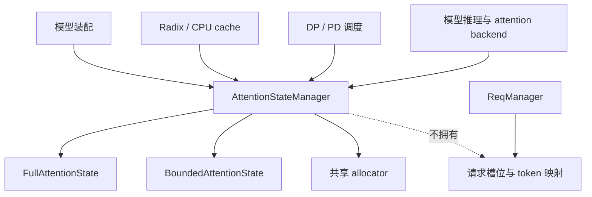

# Attention Resources 架构设计

本文只定义 attention resource 的架构、公共接口和实现约束。具体模型参数、Tensor 形状、页大小、kernel 调优值和历史实现过程不在本文维护；这些内容属于代码和测试的实现细节。

## 1. 设计目标

`lightllm/common/attention_state/` 提供可组合的 attention 状态资源。资源层负责状态存储、布局描述、快照和跨设备数据操作；请求调度、radix cache、CPU cache、通信队列和页面生命周期由调用方负责。

设计必须满足：

- 同一管理器可以同时持有 main、draft 及其他模型角色的 State。
- full attention、bounded attention 和不同量化/编码方案通过独立 State 实现组合。
- State 不拥有请求到物理 token 的映射，也不负责分配或回收外部页索引。
- 共享 allocator 只管理索引和容量；State 只管理自己的 Tensor、布局和算法状态。
- 新增算法优先新增独立 State 和创建入口，避免通过大量算法分支修改公共基类。
- 所有跨模块数据操作都通过显式索引、长度、布局和资源引用完成，不从全局推理上下文隐式读取状态。

## 2. 架构和职责



### 2.1 AttentionStateManager

管理器负责：

- 注册、查询和组织模型 State。
- 按模型需要创建或绑定 full-attention、bounded-attention allocator。
- 在容量确定后统一初始化 State 存储和大小页池。
- 聚合多个 State 的重置、复制、保存、恢复及 CPU/DP/PD 操作。
- 生成并缓存各 State 的传输布局。
- 创建 PD/DP IPC 视图并重新绑定需要本地设备注册的页池。

管理器不负责：

- 请求 KV 映射表、radix 树、缓存命中策略和页面引用计数。
- 选择请求要使用的 token 或状态页索引。
- 解释具体算法的 Tensor 字段、ring 位置或压缩规则。
- 在 State 未提供能力时通过通用分支猜测其行为。

### 2.2 State

每个 State 代表一种逻辑 attention 算法和存储编码方案。State 必须独立实现自己的配置、存储、计算视图、量化/编码、快照和恢复逻辑。

同一种逻辑算法的不同存储编码属于同一算法目录。例如：

- `full_att/gqa/` 包含普通 GQA、INT4/INT8 分组量化和静态 FP8。
- `full_att/mla/` 包含普通 MLA。
- `full_att/packed_mla/` 包含 Packed MLA 及其 FP8/E8M0 变体。
- `bounded_att/gdn/`、`bounded_att/kda/`、`bounded_att/sliding_window/` 和 `bounded_att/window_compressor/` 分别包含对应算法及其传输实现。

量化、压缩或 FP8 变体不单独建立只按精度命名的顶层目录；它们应放在所属逻辑算法目录中。

### 2.3 allocator、页池和请求映射

```text
ReqManager
├── request_slots
└── req_to_token_indexs

AttentionStateManager
├── full_att_allocator
├── bounded_att_big_page_allocator
└── bounded_att_small_page_allocator

State
├── runtime tensors
├── optional page pools
└── transfer layouts
```

- `ReqManager` 是请求槽位和 token 映射的唯一所有者。
- `FullAttKVAllocator` 管理 full-attention token 索引。
- `StatePageAllocator` 管理 bounded 状态页槽位。
- 各页池只保存快照数据，不维护独立空闲列表和前缀引用关系。
- 缓存调用方保存“前缀长度—页槽位”的关联，并在最后一个使用方结束后归还索引。
- main/draft 可以共享 allocator；共享只表示索引域相同，不表示两个 State 的数据自动一致。

## 3. State 命名、注册和查询

### 3.1 State 类型名称

`get_state_type()` 返回稳定的小写 snake_case 算法和存储方案标记，不包含 `full_att`、`bounded_att`、模型角色或 `_state` 后缀。管理器生成：

```python
state_name = f"{model_role}_{state.get_state_type()}_state"
```

名称必须能够区分影响布局或数据解释的方案参数，例如量化位宽、分组方式、scale 方案和编码精度。层号、容量、设备和请求信息不进入名称。

### 3.2 注册和查询

```python
manager.register_state(model_role, state)
manager.finish_state_registration()
manager.get_state(
    model_role=model_role,
    state_type_filter=state_type_filter,
    logical_layer_id=logical_layer_id,
    state_class=state_class,
)
```

注册完成后才允许查询。查询必须同时按模型角色、方案过滤条件、逻辑层归属和可选 State 类型筛选，最终只能匹配一个 State。`get_state` 可缓存；缓存只依赖注册期稳定信息，不依赖后续原地分配的 Tensor。

State 必须提供逻辑层归属查询和访问视图：

```python
state.contains_logical_layer(logical_layer_id)
state.get_layer_view(logical_layer_id)
```

一个 State 可以服务多个逻辑层；共享层映射由具体配置描述，模型负责保证只有生产层写入共享数据。

## 4. 公共接口契约

以下接口是行为契约，具体配置参数和返回视图由实现定义。基类不承载具体算法字段。

### 4.1 FullAttentionState

```python
class FullAttentionState:
    def get_state_type(self) -> str: ...
    def allocate_storage(self, token_capacity: int) -> None: ...
    def get_token_bytes(self) -> int: ...
    def contains_logical_layer(self, logical_layer_id: int) -> bool: ...
    def get_storage_layer_index(self, logical_layer_id: int) -> int: ...
    def get_layer_view(self, logical_layer_id: int) -> Any: ...
    def write_full_att_kv(self, logical_layer_id: int, token_indices: torch.Tensor, kv: Any) -> None: ...
    def copy_full_att_tokens(self, src_indices: torch.Tensor, dst_indices: torch.Tensor) -> None: ...
    def get_cpu_transfer_regions(self) -> tuple[TransferRegion, ...]: ...
    def write_to_cpu(
        self,
        token_indices: torch.Tensor,
        cpu_page_buffers: torch.Tensor,
        cpu_page_indices: list[int],
        layout: StateTransferLayout,
        cpu_page_ready_flags: list[bool] | None = None,
    ) -> None: ...
    def read_from_cpu(
        self,
        cpu_page_buffers: torch.Tensor,
        cpu_page_indices: list[int],
        token_indices: torch.Tensor,
        layout: StateTransferLayout,
    ) -> None: ...
    def copy_tokens_from_dp(
        self,
        src_token_indices: torch.Tensor,
        dst_token_indices: torch.Tensor,
        remote_dp_full_att_state: "FullAttentionState",
    ) -> None: ...
    def get_pd_transfer_regions(self) -> tuple[TransferRegion, ...]: ...
    def write_to_pd_page(
        self,
        token_indices: torch.Tensor,
        pd_page_buffers: torch.Tensor,
        pd_page_index: int,
        layout: StateTransferLayout,
    ) -> None: ...
    def read_from_pd_page(
        self,
        pd_page_buffers: torch.Tensor,
        token_indices: torch.Tensor,
        pd_page_index: int,
        layout: StateTransferLayout,
    ) -> None: ...
```

所有表示 token 的索引参数由调用方准备为 CUDA Tensor。State 不在接口内部做设备、dtype 或索引格式转换，不分配请求映射。量化和 packed State 的复制必须保持其完整物理表示，包括必要的 scale、indexer 和 padding。

### 4.2 BoundedAttentionState

```python
class BoundedAttentionState:
    def get_state_type(self) -> str: ...
    def initialize_page_pools(
        self,
        big_page_capacity: int,
        small_page_capacity: int = 0,
        device: str | torch.device | int = "cpu",
        pin_memory: bool = True,
    ) -> None: ...
    def contains_logical_layer(self, logical_layer_id: int) -> bool: ...
    def get_layer_view(self, logical_layer_id: int) -> Any: ...
    def reset_bounded_att_state(self, req_indices: list[int]) -> None: ...
    def save_bounded_att_runtime_to_pages(
        self,
        req_indices: list[int],
        state_token_lens: list[int],
        page_kind: PageKind,
        page_slot_ids: list[int],
    ) -> None: ...
    def restore_bounded_att_runtime_from_pages(
        self,
        req_indices: list[int],
        state_token_lens: list[int],
        page_kind: PageKind,
        page_slot_ids: list[int],
    ) -> None: ...
    def commit_bounded_att_state(
        self,
        req_indices: torch.Tensor,
        accepted_steps: torch.Tensor,
    ) -> None: ...
    def get_cpu_transfer_regions(self) -> tuple[TransferRegion, ...]: ...
    def write_state_pages_to_cpu(...) -> None: ...
    def read_state_pages_from_cpu(...) -> None: ...
    def copy_big_pages_from_dp(...) -> None: ...
    def copy_runtime_state_from_dp(...) -> None: ...
    def get_pd_transfer_regions(self) -> tuple[TransferRegion, ...]: ...
    def write_to_pd_page(
        self,
        req_idx: int,
        pd_page_buffers: torch.Tensor,
        pd_page_index: int,
        state_token_len: int,
        layout: StateTransferLayout,
    ) -> None: ...
    def read_from_pd_page(
        self,
        pd_page_buffers: torch.Tensor,
        req_idx: int,
        pd_page_index: int,
        state_token_len: int,
        layout: StateTransferLayout,
    ) -> None: ...
```

`state_token_len` 表示状态已经执行到的绝对前缀长度，不表示当前搬运的 token 数。ring、窗口或游标位置必须由具体 State 根据该长度恢复。请求列表、长度列表和页槽位列表按位置一一对应，关联关系由调用方维护。

### 4.3 AttentionStateManager 聚合接口

管理器提供按资源组合调用 State 的入口，至少包括：

```python
manager.initialize_storage(...)
manager.allocate_storage(...)
manager.get_full_attention_states(role=None)
manager.get_bounded_attention_states(role=None)
manager.get_cpu_page_layouts()
manager.get_pd_token_page_layouts()
manager.get_pd_runtime_page_layouts()
manager.copy_full_att_tokens(...)
manager.reset_bounded_att_state(...)
manager.save_bounded_att_runtime_to_pages(...)
manager.restore_bounded_att_runtime_from_pages(...)
manager.commit_bounded_att_state(...)
manager.write_req_to_cpu(...)
manager.read_req_from_cpu(...)
manager.copy_from_dp(...)
manager.write_to_pd_page(...)
manager.read_from_pd_page(...)
```

管理器只做聚合和公共前置检查；字段编码、ring 恢复、压缩边界和特殊传输由具体 State 实现。某种 State 不参与某条路径时返回空布局或由管理器跳过，不通过无意义的通用适配层伪造支持。

## 5. 布局和传输契约

### 5.1 传输类型

- `TransferRegion` 描述一个 State 字段在外部页中的范围、dtype、轴顺序、形状和 TP 映射。
- `StateTransferLayout` 描述一次完整页面传输的统一页规格和区域集合。
- `AxisMapping` 描述本地和外部轴的起点、长度及是否循环；循环窗口必须通过显式映射表达，不能依赖调用方猜测。
- State 返回的布局定义必须稳定；使用 `lru_cache` 缓存，并通过独立副本返回，避免调用方修改缓存对象。
- 存储分配或页面规格变化后，管理器负责清理相关布局缓存。

CPU、DP、PD 使用同一套布局语义，但入口不同：

- CPU 传输可以处理联合页和 CPU 页就绪标记。
- DP 传输使用源、目标 token 或页槽位的显式映射。
- PD 传输必须接收明确的页索引；State 不分配网络页、不修改请求映射。

### 5.2 异步和设备约束

- State 的 GPU 操作提交到调用方当前流；State 不隐式同步设备或主机。
- 传输调用方负责建立生产流、通信流、接收流和消费流之间的依赖。
- NCCL/NIXL 的完成语义由传输层提供；读 PD 页前必须确认接收端数据已完成，不以发送端完成代替接收端完成。
- 跨设备复制要求调用方保证 peer/IPC 可访问、源数据生命周期有效、索引和目标区域满足实现约束。
- CPU 页的 pinned/registered 方式由缓存和进程启动策略决定，State 只使用传入的 buffer。
- 需要 kernel 加速的聚合复制应保持异步语义，避免在公共 State 接口中加入主机同步。

### 5.3 数据所有权

- allocator 所有索引；State 所有运行态 Tensor 和页池 Tensor；ReqManager 所有请求映射；缓存流程所有引用关系。
- 任何索引只能由其 allocator 归还一次。
- IPC 浅拷贝不得复制 allocator；DP shared 场景必须提供页池重新注册到当前设备的显式流程。
- 失败路径必须由调用方释放已分配索引并阻止未完成数据进入可见 State。

## 6. 模型初始化和装配

每种逻辑 attention 算法提供独立创建入口，量化和编码变体由参数选择或在同一逻辑目录中提供专用创建函数。模型基类只负责统一生命周期，不解析具体 State 的内部字段。

推荐流程：

```text
模型读取配置
  -> 创建本模型拥有的 full/bounded State 列表
  -> manager.register_state(role, state)
  -> 所有 main/draft 完成装配
  -> manager.finish_state_registration()
  -> 绑定标定或其他外部参数
  -> manager.initialize_storage(...)
  -> 模型和 backend 通过 manager.get_state(...) 获取视图
```

模型可以让一个 State 服务多个逻辑层，也可以为同一模型创建多个逻辑方案。层映射必须由 State 配置完整描述，推理层不得用物理存储下标推断逻辑层归属。

## 7. 目录和代码组织

```text
lightllm/common/attention_state/
├── manager.py
├── types.py
├── utils.py
├── allocators/
├── full_att/
│   ├── base_state.py
│   ├── dp_transfer.py
│   ├── gqa/
│   ├── mla/
│   ├── packed_mla/
│   └── compressed_att/
└── bounded_att/
    ├── base_state.py
    ├── copy_kernel.py
    ├── transfer_utils.py
    ├── gdn/
    ├── kda/
    ├── sliding_window/
    └── window_compressor/
```

每个逻辑 State 目录包含其配置、State、创建入口和专用传输实现；跨算法共享的基类、布局类型、allocator 和通用 kernel 保留在类别根目录。

代码编写约束：

1. 公共接口放在私有辅助函数之前；类内依次放置初始化、公共属性/方法、私有辅助方法。
2. 新增或大幅修改的函数，参数数量不少于 4 个时，声明和调用均使用逐行 `key=value` 格式；不为格式要求引入 `*args`、`**kwargs` 或转发字典。
3. 配置字段必须有中文注释，说明含义、单位、Tensor 轴、全局/TP 范围和默认值语义。
4. 公共接口 docstring 必须说明操作对象、索引含义、长度语义、数据范围和调用方责任。
5. 具体 State 之间不继承实现；只继承对应类别的抽象基类，共享逻辑通过独立工具函数或明确的公共 kernel 提供。
6. 不创建只有一次调用、只做参数转发或只包装断言的小函数；特殊算法行为放在对应 State 中。
7. 已知输入约束在边界处使用简洁断言；不在公共接口中做隐式设备、dtype、索引或请求映射转换。
8. 传输 kernel 的输入输出布局、stride、有效长度和循环映射必须在调用前明确；kernel 不负责外部资源分配和跨流同步。
9. 修改现有基础流程时优先保持调用顺序和数据所有权不变；目录整理、命名调整和功能重构分开提交。
10. 代码注释说明设计原因和调用契约，不重复逐行解释显而易见的 Python 语句，也不记录短期性能实验参数。

## 8. 测试和评审要求

新增或修改 State 至少验证：

- 配置校验、逻辑层归属和共享层映射。
- 存储容量、页池启用/禁用和 allocator 生命周期。
- 运行态重置、保存、恢复及绝对状态长度语义。
- CPU、DP、PD 的布局、索引方向和量化/编码字段完整性。
- main/draft、多 TP、跨设备或 IPC 场景下的资源所有权。
- 异步流依赖和失败路径，不以主机同步掩盖错误。

目录或导入路径调整必须同时运行：

- `compileall` 和包导入检查。
- 受影响 State 的单元测试。
- 相关模型创建和资源布局测试。
- `git diff --check`。

评审时优先检查：接口契约是否与基类一致、State 是否越权访问请求流程、布局是否可逆、索引是否可能重复归还、同步是否由正确的生产/消费流建立，以及量化变体是否仍归属于正确的逻辑算法目录。

## 9. 非目标

本文不规定：

- 具体模型的 hidden size、head 数、压缩比例、窗口大小或页大小。
- 某个 GPU、通信库或 Triton 版本的调优参数。
- radix cache 的匹配策略、淘汰策略和外部磁盘格式。
- 某个模型的 attention 数学公式或 kernel 内部实现。
- 历史兼容路径和临时实验代码。

这些内容应在对应模型、State、kernel 或测试文件中维护，并通过公共接口满足本文契约。
