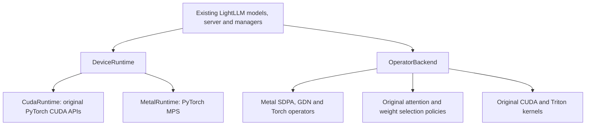

# Device runtime and operator backend

LightLLM keeps model execution, weight loading, request scheduling, KV allocation
and hybrid state management in the existing inference pipeline. Two separate
interfaces now own device operations and implementation selection.



## Device runtime

`lightllm/backends/runtime.py` defines the Torch tensor runtime contract.
`get_device_runtime()` supplies the process's selected implementation.
`lightllm/backends/cuda/runtime.py` is the CUDA implementation.

The runtime owns:

- Tensor allocation with explicit devices, host staging and tensor/module moves.
- Device selection, generators, synchronization and memory queries.
- Streams, events, graph handles, capture contexts and graph pools.
- The default accelerator communication backend (`nccl` for CUDA).
- An optional `layer_submission_hook(index, batch_size)` after decode layers.
  CUDA leaves this hook `None`. Metal uses non-timing MPS events to enqueue work
  while the CPU encodes subsequent layers; the hook adds no completion wait.

CUDA methods forward the original positional and keyword arguments unchanged.
Tensor moves continue to call `.cuda()` internally. CPU allocations keep their
explicit CPU device, and pinned memory, dtype, `non_blocking` and memory-format
arguments retain their previous values. Native stream, event and graph objects
are returned directly, preserving their ownership and wait/record/replay order.
Creating the runtime performs no availability probe or device initialization.

The existing `ModelInput.to_cuda()` entry point remains available; internal
execution uses `ModelInput.to_device()`.

## Operator backend

`lightllm/backends/operators.py` defines the operator interface.
`get_operator_backend()` supplies it independently of the device runtime.

The CUDA provider handles:

- Named kernel resolution, using the explicit table in
  `lightllm/backends/cuda/bindings.py` (Metal has its own explicit table).
- Full/MLA/NSA/NEO, linear and vision attention selection.
- `PlatformAwareOp` routing and its existing Triton/native fallback policy.
- The Triton allocator setup required by linear attention.

Callers bind the returned kernel function when their module is loaded, or at
the same local import site used previously. The resolved object is the original
kernel function; there is no per-token dispatch wrapper around its execution.
Device-specific kernel implementations and specialized attention/quantization
implementations retain their existing source paths.

The three CUDA attention selector modules contain the original selection code.
Existing factory functions and backend-map imports remain available through
compatibility facades. Concrete attention classes are loaded on demand through
the backend, retaining their public import names.

Shape arithmetic that only needed `triton.cdiv` uses the equivalent integer
`ceil_div` helper, without importing a kernel runtime.

## Selection and extension

Both interfaces default to the CUDA provider. There is no automatic device
detection or CPU fallback. Existing CUDA commands, flags, model classes,
attention priorities, validation rules, MTP handling and numerical kernels keep
their previous behavior. The existing torchada initialization remains intact;
CUDA runtime calls look up `torch.cuda` dynamically.

New providers can implement `DeviceRuntime` and `OperatorBackend` separately,
then register and select them before importing inference modules:

```python
from lightllm.backends import (
    register_device_runtime,
    register_operator_backend,
    select_device_runtime,
    select_operator_backend,
)

# Supply implementations for both interfaces in a future backend integration.
register_device_runtime("custom", RuntimeImplementation)
register_operator_backend("custom", OperatorImplementation)
select_device_runtime("custom")
select_operator_backend("custom")
```

Selection is process-local and becomes fixed once an interface is used, because
inference modules retain bound runtime and kernel references. A worker must
select its providers before importing those modules. Unknown names and attempts
to switch an already-bound provider raise an explicit error.

Apple Metal is selected by `--hardware_platform metal` in the standard server.
The launcher selects both providers before importing the inference code and
propagates `LIGHTLLM_BACKEND=metal` to spawned workers. Direct model integrations
can set that environment variable before their first LightLLM import.

`lightllm/backends/metal` implements runtime operations, dense SDPA over the
existing paged KV buffers, and GDN convolution/recurrent operators over
`ReqManagerForMamba` state. Model orchestration, weights, scheduler, sampling,
radix cache and HTTP serving are the original LightLLM implementations.
No separate model runner, KV allocator or HTTP server is introduced.

Metal uses the default command queue with synchronous event barriers. CUDA graph
capture, tensor storage recycling, pinned host transfers, device collectives
and CUDA IPC are unavailable; unsupported server configurations fail at startup.
Gloo supplies single-rank process-group metadata; existing singleton collective
shortcuts avoid device communication. The portable Torch allocator owns Metal
intermediate tensors. CUDA retains its original allocator and native handles.

See [Apple Metal deployment](apple_metal.md) for supported flags and commands.

## Review scope

The refactor uses argument-preserving call substitutions and moves selection
policies without changing their algorithms. Source review compares normalized
ASTs against upstream, including call order and arguments. CUDA/Triton numerical kernel sources and CUDA deployment commands remain unchanged.
CUDA-only package dependencies have Darwin environment markers; Metal serving
dependencies are provided by the optional `metal` extra.

Static equivalence does not establish GPU execution or performance equivalence.
This change has not been exercised on CUDA hardware in the current Mac workspace.
