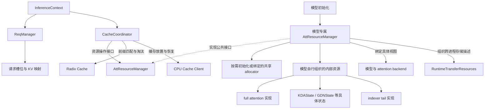

# Runtime Resources 架构设计草案

本文记录围绕 [PR #1655](https://github.com/ModelTC/LightLLM/pull/1655) 讨论的运行时资源重构方案，作为后续共同完善的设计稿。文中的目录、类名和接口描述目标结构；当前实现仍使用 `MemoryManager`、状态管理器及缓存协调组件等模块。

## 1. 设计约定

统一在 `lightllm/common/runtime_resources/` 下组织可复用的资源实现，由 `AttResourceManager` 约定公共资源管理接口，各模型提供具体管理器实现，完成自身资源的初始化、组合和访问适配。

公共层约定三种 allocator 入口，具体实例按模型组合和启用的功能初始化：

```python
class AttResourceManager:
    full_att_allocator: KVPageAllocator | None
    bounded_att_big_page_allocator: CheckpointSlotAllocator | None
    bounded_att_small_page_allocator: CheckpointSlotAllocator | None
```

这三个入口表示资源管理器对分配域的管理责任。具体初始化必须保证所需 allocator 已创建或绑定，无需的 allocator 为 `None`。例如纯 full-attention 模型只初始化 `full_att_allocator`；启用 linear checkpoint 的组合再按配置初始化大小页 allocator。GPU linear 运行态的存在本身不要求启用 checkpoint 池。

- 基类不声明固定的 `main_full_att`、`draft_full_att`、`main_linear_att`、`draft_linear_att`、`main_indexer_tail`、`draft_indexer_tail` 成员。具体模型自行组织内部资源，数量、组合、字段名和实现类型由模型决定。
- `full_att`、`linear_att`、`indexer_tail` 保留为可复用实现的目录分类。full attention 保存历史 KV；linear attention 按算法直接定义 `KDAState`、`GDNState` 等状态对象，包含该实现的运行态与可选 checkpoint；indexer tail 保存增量索引所需尾部状态。
- main/draft 可以采用不同方案；同一共享分配域的参与方使用同一个 allocator 实例，遵守统一的索引和回收约定。资源对象持有 buffer 和数据有效性信息，分配与回收通过管理器统一组织。
- `req_to_token_indexs` 和请求槽位仍由 `ReqManager` 持有。资源管理器接收显式传入的物理索引、请求槽位及恢复长度，提供资源操作接口。
- 内部 attention 资源的暴露方式作为接口设计问题单独讨论。当前建议按调用方区分统一资源操作、模型推理视图和 State 直接传输操作，详见第 6 节。

本文区分已确定的职责边界和建议接口。main/draft 采用组合管理器还是分别装配管理器实例、推理视图的具体类型及方法名仍待细化。

## 2. 整体结构与职责边界



图中的资源类别按模型需要选择，可以缺省或包含多个实例。箭头表示调用或组合关系；main/draft 管理器实例的具体装配方式尚未固定。

| 层次 | 组件 | 职责 |
| --- | --- | --- |
| 请求流程 | `InferenceContext`、`ReqManager` | 创建、暂停、恢复和完成请求；由 ReqManager 管理请求槽位、KV 索引映射及采样参数 |
| 缓存策略 | `CacheCoordinator`、radix cache | 决定复用哪个前缀、何时保存 checkpoint、哪些资源可以发布、何时淘汰 |
| 资源管理 | `AttResourceManager` 公共接口及模型专属实现 | 按需初始化或绑定 allocator，管理共享索引域，组织模型内部资源和恢复操作 |
| 资源实现 | 模型所需的 Resources、存储布局、checkpoint pool | 持有 buffer、布局与数据有效性，使用管理器分配的索引执行读写、复制、重置和快照 |
| 传输调度 | 现有 DP/PD 与多级缓存模块 | 管理任务、队列、通信、事件同步及完成通知 |

`AttResourceManager` 不持有请求 KV 映射表，也不直接访问全局 `g_infer_context` 或通过 `ReqManager` 查询映射。资源方法接收调用方提供的请求槽位、长度、物理索引和资源引用；将逻辑 token 位置转换为物理索引、写入或清理请求映射属于请求流程。radix 前缀匹配和放置策略由 `CacheCoordinator` 决定，再调用资源管理器执行。

代码依赖从流程层向资源层单向传递。资源实现不反向导入请求调度模块；传输调度使用资源视图和复制接口。

## 3. 对象结构与资源归属

```text
ReqManager
├── request_slots
└── req_to_token_indexs           # 共享请求到 KV 的索引映射

AttResourceManager              # 公共接口与 allocator 入口
├── full_att_allocator: KVPageAllocator | None
├── bounded_att_big_page_allocator: CheckpointSlotAllocator | None
└── bounded_att_small_page_allocator: CheckpointSlotAllocator | None

<Model>AttResourceManager       # 模型实现，内部结构由其自行定义
├── 按需创建或绑定所需 allocator
├── 初始化模型所需的资源组合
├── 实现统一的资源操作接口
└── 绑定推理视图、组织传输所需状态 # 搬运直接调用 State 方法
```

例如纯 full-attention 管理器可以只保存一个 KV 存储对象；混合模型管理器可以组合 KV、多个 linear 运行态及 indexer tail；包含 draft 时按实际方案组织相关资源。可共用初始化逻辑的模型可以复用管理器实现。公共调用方通过接口使用这些组合。

以下列出可复用资源组件的结构示例。linear attention 直接使用 `KDAState`、`GDNState` 等具体状态对象，不再增加统一的资源包装层。管理器内部的字段名和实例数量由模型决定，checkpoint pool 仅在相应功能启用时存在：

```text
FullAttentionState
├── storage_spec                 # 容量、页大小、保留索引范围、device
├── storage                      # 完整数据区域、固定参数及存储描述
└── layer_mapping                # 本模型的层映射

KDAState                         # 一种具体 attention 状态实现
├── conv_state: LayerCache       # 卷积历史窗口及 MTP 尾部空间
├── ssm_state: LayerCache        # KDA 递推状态及 MTP 状态槽位
├── mtp_state_index: Tensor | None
├── big_pages_pool              # 按需创建，使用管理器分配的槽位
│   ├── buffers
│   └── state_token_lens
└── small_pages_pool            # 按需创建
    ├── buffers
    └── state_token_lens

GDNState                         # 独立定义 GDN 状态、布局和快照操作
└── 按其实现组织 Conv / SSM / MTP 状态及可选大小页 pool

IndexerTailState
└── tail_buffer                  # 本模型 indexer 实现所需的尾部状态
```

同一共享分配域中的 allocator 只初始化一次，由资源管理器负责其完整生命周期。若 main/draft 分别使用管理器实例，装配时应注入共享 allocator 引用，并明确唯一的创建和销毁责任及统一回收入口；若采用一个组合管理器，则由该实现协调内部资源。两种装配方式均不能因模型数增加而重复分配或释放同一共享索引。实例装配形式保留为待定项。

| 资源 | 持有者 | 分配单位 / 生命周期 |
| --- | --- | --- |
| full-attention 空闲页与容量状态 | `AttResourceManager.full_att_allocator` | 每次为请求统一分配/回收物理页索引，main/draft 共用 |
| 大页 checkpoint 空闲槽位 | `AttResourceManager.bounded_att_big_page_allocator` | 为 main/draft 参与的大页 pool 统一分配槽位 ID |
| 小页 checkpoint 空闲槽位 | `AttResourceManager.bounded_att_small_page_allocator` | 为 main/draft 参与的小页 pool 统一分配槽位 ID，独立于大页分配域 |
| 请求 KV 索引表 | `ReqManager` | 记录逻辑 token 到共享物理索引的映射；负责绑定、更新和清理 |
| HOLD 保留物理页及索引描述 | `AttResourceManager` 及其 full-attention allocator | 从普通分配范围排除保留页；ReqManager 使用其索引初始化 HOLD 行 |
| KV、量化 scale、packed indexer buffer 与层映射 | 具体管理器组织的 full-attention 资源 | 按统一容量建立存储，使用共享索引访问各自数据 |
| KDA/GDN 的 Conv/SSM、MTP 游标 | 具体管理器持有的 `KDAState` / `GDNState` | 使用共同请求槽位域，由各算法状态对象分别维护 |
| 大小页 checkpoint buffer 与 `state_token_lens` | 各具体状态对象中启用的 pool | 使用共同分配的槽位 ID，分别保存数据和长度；不持有独立空闲列表 |
| indexer 原始尾部窗口 | 具体管理器组织的 indexer 资源 | 使用共同请求槽位域，各自维护所需 tail 布局 |
| 请求槽位 | `ReqManager` | 请求创建时分配，完成时回收，暂停时保留 |

### 3.1 main/draft 共享 full-attention allocator

`AttResourceManager` 统一分配一次 KV 索引并返回结果；请求流程通过 `ReqManager` 将索引写入共享请求表。复用前缀时，缓存协调器提供已有索引，由 `ReqManager` 绑定映射。main 和 draft 从同一请求映射获取索引，访问各自的存储：

```text
逻辑 token 位置 t
        ↓ ReqManager.req_to_token_indexs
统一物理索引 i
        ├── main 对应的 KV 存储位置
        └── draft 对应的 KV 存储位置
```

二者的层数、head 维度、dtype 和量化布局可以不同；同一索引域内需要使用兼容的 page_size，并且各存储都覆盖 allocator 可返回的索引范围。第一阶段统一容量和物理页索引规则，暂不引入模型间索引重映射。

共享索引表示存储位置的对应关系，不表示 main/draft 在每个位置都已经写入有效 KV。MTP 预留区和回退后的有效长度仍由请求执行流程维护。

释放时，请求流程与缓存协调器确认使用方已完成并解除相关引用，再将可回收的索引交给资源管理器，归还 allocator 一次；`ReqManager` 同步清理对应请求映射。任一模型的资源对象都不能自行释放共享索引。容量评估需要计入各模型真实占用的存储；若资源实例只是同一 buffer 的视图，不重复计算该 buffer。

### 3.2 main/draft 共享 linear checkpoint allocator

main/draft 选择各自需要的具体状态对象，例如 main 使用 `KDAState`，draft 使用 `GDNState` 或无需 linear 状态。各状态对象持有自身运行态及启用的大页或小页 pool。对同一前缀的一个大页或小页 checkpoint，管理器从对应 allocator 分配一次槽位 ID，将该 ID 交给参与的两侧 pool。两侧的状态布局、dtype 和单槽位字节数可以不同，各自的存储必须覆盖共享 allocator 可返回的槽位范围。

例如分配大页槽位 `s` 后，main 和 draft 对应的大页 pool 在各自的槽位 `s` 保存状态。具体管理器负责找到参与操作的 pool，公共协调器无需读取模型内部字段。两侧各自维护 `state_token_lens[s]`；本次复用所需的两侧状态都对应目标长度并满足同步条件后，缓存协调器才可发布或恢复这个联合 checkpoint。仅一侧具有 linear 资源时，只处理该侧。

共享 checkpoint 需要约定共同的恢复边界和 token 位置语义，并确保参与实现都能捕获该位置的状态。MTP 推测中的临时状态需先按执行流程选出对应位置的状态，再保存快照。共享索引不要求 main/draft 每一步同步执行；回收时须等所有参与方结束使用，槽位只归还一次。

linear 运行态与两侧 indexer tail 均由 `ReqManager` 提供的 `req_idx` 定位。indexer tail 不单独分配 checkpoint 槽位；其状态布局和恢复规则由各自实现描述。

### 3.3 分配状态与数据状态分离

allocator 是索引分配的唯一事实来源，资源对象是存储布局与数据有效性的持有者。缓存协调器决定哪些资源可共享和发布，radix 持有相应页/槽位引用；资源管理器在最后一个使用方释放后统一回收索引。

同一 linear checkpoint 可以包含 main/draft 多个状态资源的快照。槽位分配状态由共享 allocator 维护，数据内容和有效长度由各侧 pool 分别维护。

对于使用 K-pool 的实现，已完成池化的压缩 key/scale 保留在对应 full-attention 资源的 packed 存储中，indexer tail 资源管理增量计算需要的原始短窗口；二者的组合关系由具体管理器维护。

### 3.4 按具体 attention 实现定义状态

直接定义 `KDAState`、`GDNState` 等状态类型，具体算法负责自己的成员、布局、重置、快照与恢复语义。`AttResourceManager` 初始化并组合所需对象，公共缓存流程通过管理器访问它们。不同模型也可以复用同一种状态实现。

以当前 KDA 路径使用的 Conv/SSM 存储布局为基础，`KDAState` 的成员定义草案如下；这些是目标设计名称，当前代码仍由 `LinearStateManager` 管理相应状态：

```python
class KDAState:
    conv_state: LayerCache
    ssm_state: LayerCache
    mtp_state_index: torch.Tensor | None
    mtp_step: int  # 该实例的 MTP 布局参数
    big_pages_pool: LinearCheckpointPool | None
    small_pages_pool: LinearCheckpointPool | None
```

`LayerCache` 封装按层组织的 Tensor。该示例中的 Conv、SSM 和 MTP 索引驻留 GPU；checkpoint pool 独立持有快照 buffer 和 `state_token_lens`。设请求槽位容量为 `N`（包含保留槽位），该实例的 `mtp_step` 为 `S`：

| 成员 | 内容与索引方式 |
| --- | --- |
| `conv_state` | 对应算法的卷积历史窗口，当前布局的窗口为 `conv_kernel_size - 1 + S`；用 `buffer[layer, req_idx, ...]` 访问 |
| `ssm_state` | KDA 的递推矩阵状态，每请求预留 `S + 1` 个状态槽位；第 `j` 个槽位位于 `buffer[layer, req_idx * (S + 1) + j, ...]` |
| `mtp_state_index` | 形状为 `[N]` 的 `int32` Tensor；记录各请求接受的 MTP 状态索引。`S == 0` 时为 `None` |
| 大小页 pool | 按需创建，保存该算法指定前缀位置的状态，并分别记录 `state_token_lens`；槽位来自管理器的对应 `bounded_att_*_allocator` |

`GDNState` 按 GDN 实现独立定义。当前 GDN 路径同样使用 Conv/SSM 和 MTP 状态，可以复用底层 `LayerCache`、兼容的 checkpoint buffer 布局及复制工具。共同的存储成员不要求两种算法继承同一个包含所有字段的状态类，也不代表其状态内容可以互换。

运行态按 `ReqManager` 的槽位容量预分配，状态对象接收 `req_idx` 执行操作。main/draft 可以持有同一种状态类的两个独立实例，也可以使用不同状态类型；各实例的层数、维度、dtype 和 MTP 配置由对应模型决定。allocator 仍由 `AttResourceManager` 创建或绑定并统一管理。

后续 sliding-window attention 可以直接定义 `SlidingWindowState`，按窗口 KV、有效范围和游标等实际需求组织成员。它可以使用适用的 bounded-attention checkpoint 分配域，但其快照布局与恢复语义由自身实现定义。状态对象的必需操作接口在后续逐层设计中细化。

## 4. 目录设计

以下是建议的目标目录。已有 Triton/CUDA 计算 kernel 保持原目录，资源模块通过 operator 或复制函数调用它们。

```text
lightllm/common/
├── runtime_resources/
│   ├── __init__.py
│   ├── manager.py                    # AttResourceManager 公共接口与基础逻辑
│   ├── types.py                      # 跨资源共享的描述与引用类型
│   ├── allocators/                   # 管理器按需创建或绑定，同一分配域共享实例
│   │   ├── __init__.py
│   │   ├── full_att.py               # KVPageAllocator
│   │   └── linear_att.py             # CheckpointSlotAllocator，按需创建大小页实例
│   ├── full_att/
│   │   ├── __init__.py
│   │   ├── resources.py              # FullAttentionState
│   │   ├── storage/
│   │   │   ├── __init__.py
│   │   │   ├── base.py               # KV 存储基础接口与普通布局
│   │   │   ├── group_quantized.py    # INT4 / INT8
│   │   │   ├── static_fp8.py         # static FP8
│   │   │   ├── mla.py                # MLA / indexed MLA
│   │   │   └── glm5_next.py          # GLM packed 存储布局
│   │   ├── operator/                # KV 写入、复制、量化相关操作
│   │   └── transfer.py              # State 内部复用的 CPU/DP/PD 搬运函数
│   ├── linear_att/
│   │   ├── __init__.py
│   │   ├── kda_state.py              # KDAState：KDA 状态及快照操作
│   │   ├── gdn_state.py              # GDNState：GDN 状态及快照操作
│   │   ├── checkpoint_pool.py        # 可复用的 LinearCheckpointPool 存储组件
│   │   └── transfer.py               # 具体状态的打包与 TP 布局转换
│   ├── indexer_tail/
│   │   ├── __init__.py
│   │   ├── resources.py              # IndexerTailState
│   │   └── transfer.py               # tail 窗口传输
│   └── transfer/
│       ├── __init__.py
│       ├── resources.py              # RuntimeTransferResources
│       ├── attention_state.py        # HybridAttentionStateTransfer
│       └── cpu_cache.py              # KV 与 checkpoint 的联合页格式
├── cache_coordinator.py              # 缓存复用、checkpoint 发布策略
└── req_manager/                      # 请求槽位、KV 索引映射、采样与生命周期

lightllm/models/<model>/
├── model.py                         # 选择、装配本模型的资源管理器
└── runtime_resources.py             # 模型专属 AttResourceManager 及推理视图
```

`allocators/` 与三类可复用资源目录平级，体现分配器由管理器直接管理。模型专属组合和推理视图放在 `lightllm/models/<model>/runtime_resources.py`，同类模型可以复用实现。公共资源包不反向导入模型实现；模型初始化负责选择和装配。main/draft 的内部组织由所选管理器决定。

`FullAttentionState` 直接定义 CPU、DP、PD 的数据读写接口，由布局子类实现并调用 kernel。可复用的搬运函数放在 `full_att/transfer.py` 或 `operator/`，作为 State 的内部实现；不要求为每个 State 配套 Transfer 类。linear 和 indexer 的搬运实现留在各自目录，顶层 `transfer/` 组织多资源传输和共享页格式。网络通信与任务队列继续由 server 层管理。

`types.py` 仅放实际跨模块使用的类型，例如 checkpoint 引用的 pool 类别、槽位和有效长度，以及跨资源使用的纯数据页布局字段；`BufferTransferLayout` / `StateCopyMapping` 若只用于 full-attention，则留在该目录，实际复用后再提取共享部分。各资源的内部类型留在自己的目录。KDA/GDN 的状态成员直接定义在各自实现中，重复且语义一致的存储或复制逻辑可以抽成内部工具。暂不引入统一插件注册机制或要求不同资源继承同一个大接口。

## 5. allocator 与 checkpoint pool

### 5.1 allocator 的公共入口与按需初始化

| 公共入口 | 类型 | 初始化条件 |
| --- | --- | --- |
| `full_att_allocator` | `KVPageAllocator \| None` | 组合中存在需要页式 KV 分配的 full-attention 资源 |
| `bounded_att_big_page_allocator` | `CheckpointSlotAllocator \| None` | 启用大页 linear checkpoint |
| `bounded_att_small_page_allocator` | `CheckpointSlotAllocator \| None` | 启用小页 linear checkpoint |

具体管理器初始化完成时，已启用的分配域必须具有 allocator 实例及容量匹配的资源，未启用的入口保持 `None`。申请未启用的分配域应明确报错；公共缓存流程根据已启用能力选择操作。只有 full attention 的配置无需创建 linear allocator、运行态或 checkpoint pool。

allocator 入口的存在只能说明该分配域已启用，具体恢复边界、支持的传输布局等能力仍由模型管理器明确描述。

大小页均启用时，使用同一种 allocator 类的两个独立实例，每个实例供参与模型对应类别的 pool 共用。同一模型的单个快照保存该实现所需的完整状态，例如 Conv/SSM；main/draft 的快照布局和大小可以不同。“大页/小页”指 token 边界和缓存策略，不表示快照按 token 数分成不同大小。

`KVPageAllocator` 第一阶段可保留现有整页 token 索引接口；checkpoint allocator 返回状态槽位 ID。GPU 运行态和 indexer tail 使用请求槽位，不使用上述 checkpoint allocator。

### 5.2 管理器、allocator 与 pool 分工

`CheckpointSlotAllocator` 只维护可用槽位。`LinearCheckpointPool` 只持有状态 buffer 和有效长度，使用外部传入的槽位完成保存、恢复和失效处理。`AttResourceManager` 将二者组合成完整的分配/释放操作：

1. 从对应 allocator 分配槽位，并确保涉及该槽位的 `state_token_lens[slot]` 为 `None`。
2. 调用对应 pool 保存快照并记录 token 长度；异步操作通过 stream/event 保证后续读取顺序。保存失败时使该槽位的快照记录失效。
3. 恢复前确认所有所需状态的 `state_token_lens[slot] == restored_len`，并满足数据复制的同步条件。
4. 释放前确认没有请求、radix 或传输使用方继续读取，将相关 pool 的 `state_token_lens[slot]` 清为 `None`，再归还槽位一次。

CPU load/offload 尾页的两个暂存槽位 ID 由管理器统一保留，排除在大页 allocator 的普通分配范围外；参与操作的 main/draft 大页 pool 分别为这些槽位提供存储。

缓存协调器决定保存边界和淘汰时机，资源管理器负责槽位分配、跨资源操作和回收，pool 执行数据操作。

### 5.3 页内状态的 token 长度元数据

各模型实际创建的 `big_pages_pool` 和 `small_pages_pool` 分别保留一份 `state_token_lens: list[int | None]`，按槽位 ID 索引，记录该槽位保存的状态所对应的 token 前缀长度。长度从序列起点计数；pool 的物理槽位大小由具体状态布局决定。这是本设计明确保留的校验信息；原大小页方案的长度关联由请求和 radix 节点表达，当前 PR 在此基础上增加了槽位级记录。

| 槽位记录 | 含义 |
| --- | --- |
| `state_token_lens[slot] is None` | 该槽位没有有效快照记录，包括尚未保存、保存失败或已经释放的情况 |
| `state_token_lens[slot] == L` | 该槽位的快照对应处理完前 `L` 个 token 后的状态 |

上层的 `length → slot` 映射表达某个前缀关联哪个槽位；pool 中的 `slot → state_token_len` 记录槽位内快照对应的位置。恢复时两者必须一致。只预留槽位但尚未捕获状态的中间页边界保持 `None`。

`LinearCheckpointPool` 通过保存、载入和失效接口维护这份记录；`AttResourceManager` 组织操作并校验恢复条件，allocator 只维护槽位的分配状态。CPU offload/load 同步携带并恢复长度元数据。长度记录本身不表示异步复制已完成，也不标识具体 token 前缀；同步由 stream/event 保证，前缀身份由请求与缓存关联关系保证。

## 6. 对外接口与 attention 资源暴露方式

已确定的是模型专属管理器负责初始化和组织内部资源。以下访问方式为当前建议，具体方法名和视图类型仍需结合调用方细化。资源接口接收索引、长度、槽位及资源引用；请求信息的整理由请求流程和缓存协调器完成。

### 6.1 FullAttentionState：公共接口与不同 storage 的完整处理

本节是底层接口草案。`FullAttentionState` 负责一组历史 KV 存储的容量描述、布局访问、写入及复制，包含该布局所需的 scale 和 packed indexer 数据。`AttResourceManager` 决定实例组合、共享索引域及生命周期。allocator、请求映射、前缀发布和通信任务由对应上层负责。

#### 继承与内部 storage 的关系

建议以 `FullAttentionState` 作为公共接口，由具体布局子类实现差异。子类内部的 storage 持有 buffer 和布局信息，operator 可以复用已有写入、量化及复制 kernel。布局选择集中在具体子类及其配套实现，公共调用方使用稳定接口。

```text
FullAttentionState
├── DenseFullAttentionState
├── GroupQuantizedFullAttentionState  # INT4 / INT8 等
├── StaticFP8FullAttentionState
└── MLAFullAttentionState
    └── PackedMLAFullAttentionState  # 示例：附带 indexer 数据
```

这些是目标实现示例，具体继承关系以可复用的行为为准。改变布局的子类必须重新核对存储描述、层视图、写入、完整复制和传输能力；父类的布局假设不能直接用于新的 packed 格式。内部 storage 可以是明确类型的数据对象或已有存储实现，本阶段不要求再建立一套与 State 平行的公共继承体系。

#### 必须提供的公共接口

```python
# ViewT / WriteT 为具体布局定义的类型，下面是公共签名草案。
class FullAttentionState:
    @classmethod
    def get_required_bytes(cls, layout_config, storage_spec) -> int:
        ...

    def __init__(self, layout_config, storage_spec):
        ...

    def get_storage_descriptor(self) -> StorageDescriptor:
        ...

    def get_layer_view(self, layer_id: int) -> ViewT:
        ...

    def write_kv(self, layer_id: int, token_indices: torch.Tensor, kv: WriteT) -> None:
        ...

    def copy_tokens(self, src_indices: torch.Tensor, dst_indices: torch.Tensor) -> None:
        ...

    # layout 描述该 State 在外部页中的位置及本地轴到页内轴的映射。
    def write_to_cpu(
        self, token_indices, cpu_buffer, cpu_page_indices,
        *, layout: BufferTransferLayout, page_token_offset: int = 0,
    ) -> None:
        raise NotImplementedError

    def read_from_cpu(
        self, cpu_buffer, cpu_page_indices, token_indices,
        *, layout: BufferTransferLayout, page_token_offset: int = 0,
    ) -> None:
        raise NotImplementedError

    # 一个明确源 State 到当前 State；组合层按来源和分片拆分批次。
    def copy_from_dp(
        self, src_state, src_token_indices, dst_token_indices,
        *, mapping: StateCopyMapping,
    ) -> None:
        raise NotImplementedError

    # pd_buffer 为已选中的一页，区域偏移相对该页起点。
    def write_to_pd_buffer(
        self, token_indices, pd_buffer,
        *, layout: BufferTransferLayout, page_token_offset: int = 0,
    ) -> None:
        raise NotImplementedError

    def read_from_pd_buffer(
        self, pd_buffer, token_indices,
        *, layout: BufferTransferLayout, page_token_offset: int = 0,
    ) -> None:
        raise NotImplementedError
```

“必须提供”表示各布局满足相同的操作契约，可以继承正确的公共实现。创建或绑定 buffer 属于初始化；请求使用哪些物理 token 槽位由管理器的 allocator 决定。

| 接口 | 完整语义 |
| --- | --- |
| `get_required_bytes(layout_config, storage_spec)` | 在创建大块 buffer 前计算常驻 Tensor 存储需求，包括 KV、动态 scale、由本状态持有的固定参数、packed 数据、布局填充及保留区域。与真实初始化使用相同布局规则；管理器汇总资源需求，单独考虑传输空间和框架分配开销 |
| 初始化 | 创建或绑定实际存储，建立层映射并校验容量、dtype、对齐和配置；随后暴露有效视图。共享底层存储的所有权及其负责区域必须明确 |
| `get_storage_descriptor()` | 返回完整存储描述，供管理器做记账、兼容性检查和传输初始化。描述覆盖本 State 负责的全部数据及固定布局信息，其结构在正常推理期间保持稳定 |
| `get_layer_view(layer_id)` | 返回该逻辑层供匹配 backend 使用的具体视图，包含计算所需 Tensor 和参数。视图引用底层存储，不触发 KV 搬运；没有对应 full-attention 存储的层明确报错 |
| `write_kv(layer_id, token_indices, kv)` | 将输入 KV 写入已分配物理位置，完成该布局需要的编码、量化及关联 scale 更新。输入类型与格式由具体布局明确，不能把浮点 KV、已量化数据和 packed 字节隐式混用 |
| `copy_tokens(src_indices, dst_indices)` | 在同一 State 内复制所有所辖存储层的对应 token 数据，覆盖全部随 token 变化的字段；保持存储表示，不重新量化。只操作本 State 负责的区域，遵守该布局声明的复制粒度与对齐条件 |

容量、device、层映射及布局标识应从同一份稳定配置和描述中取得，避免多处维护互相矛盾的副本。配置相同且只改变容量时，容量计算和真实 buffer 创建应覆盖相同的数据组成。共享底层内存按实际分配去重记账。

#### StorageDescriptor 必须描述什么

`StorageDescriptor` 是存储结构与语义的描述，具体类型仍待实现时细化。至少包含：

| 信息 | 用途 |
| --- | --- |
| 容量、保留索引范围、page size、device | 确认存储覆盖管理器给出的物理索引域 |
| 布局标识/版本、资源身份、层映射、量化配置 | 标识模型角色及资源，记录逻辑层到本地物理层的映射，定位实际存储并检查兼容性 |
| 本 State 的 TP 分片描述 | 记录所属 TP 组及 rank、各字段本地轴到全局 head/channel 的对应和副本关系；不同资源可以使用不同分片方案 |
| 本 State 的数据区域及 Tensor 视图 | 列出 KV、动态 scale、packed 辅助字段，说明 token 维、stride、区域偏移和必要复制粒度 |
| 固定参数 | 列出静态 scale 等解释缓存所需的参数，明确如何绑定及验证兼容性 |
| 传输支持与格式 | 声明已实现的路径、可支持的字段表示、页格式及映射约束；组合页的区域位置由管理器统一安排，通过 layout/mapping 参数传入直接方法 |
| 底层分配与视图的关系 | 区分实际占用和别名视图，避免重复计费或重复/越界复制 |

该描述的结构只读，里面引用的 Tensor 可以由合法计算操作更新。固定布局信息不等于数据就绪信号；stream/event 同步和前缀关联仍由调用流程负责。

完整性以本 State 声明的数据范围为准。每次增加辅助 buffer 或 packed 字段，都需要检查描述、容量计算、写入和复制/传输是否一起覆盖它。公共层不根据 `hasattr(scale_buffer)` 或固定属性名推测资源组成。

#### 计算视图与完整存储范围

| 布局 | 计算视图的主要内容 | 完整复制需要覆盖的内容 |
| --- | --- | --- |
| 普通 K/V | K、V | 对应位置的全部 K/V |
| 分组 INT4/INT8 | K/V 与动态 scale | packed/量化 K/V 加上对应动态 scale |
| 静态 FP8 | 以正确数值类型解释的 KV 及静态 scale | 本地 token 复制只搬 KV；跨资源使用须验证或传递固定量化参数 |
| MLA | 压缩 KV 或其所需分段 | 本 State 负责的完整压缩 KV 表示 |
| 带 indexer 的 packed 布局 | attention KV 子视图、indexer key/scale 子视图 | KV 及全部相关 packed 辅助数据；按实际存储区域处理别名 |

`get_layer_view()` 可以返回 `DenseKVView`、`QuantizedKVView`、`MLAView` 等具体小对象。视图类型由模型/backend 在初始化绑定时确认。各布局不必返回相同 Tensor 个数，也不必填充包含所有可选字段的大对象。

GLM 当前 attention 读取的只是 packed buffer 的一部分；indexer 还使用另一段。因此不能用 attention 的读取视图代替完整复制范围。类似地，静态 FP8 的物理存储 dtype 和计算时解释的 dtype 可以不同，视图必须明确相应参数。

`write_kv` 更新其输入所描述的 KV 及关联字段；indexer 池化等专用 kernel 可以通过专用视图写入另一区域。管理器与执行流程在相关写入都满足同步条件后才允许复用或发布。融合写入路径可以直接使用预先绑定的布局视图，同时遵守相同的数据表示与完整性约定。

#### 基类与子类的分工

| 部分 | 基类可复用逻辑 | 子类必须负责的内容 |
| --- | --- | --- |
| 初始化 | 生命周期、配置与映射校验、稳定视图管理 | `_create_storage(...)`：实际 Tensor/区域和完整描述；`get_required_bytes(...)`：同布局的容量计算 |
| 层访问 | 逻辑层到存储层的映射、视图缓存 | `_make_layer_view(storage_layer_id)`：该布局的计算视图 |
| 写入 | 参数契约、层映射和公共调用入口 | `_write_kv(...)`：编码/量化/写入 kernel 及输入格式校验 |
| 完整复制 | 索引操作契约、公共调用入口 | `_copy_tokens(...)`：布局正确的复制，或显式复用与其描述兼容的公共工具 |
| 传输 | 定义 CPU/DP/PD 直接读写接口，未支持的操作显式报错 | 覆盖所支持的读写方法，直接使用自身 storage 调用相应 kernel |

受保护方法名为候选。一个子类可以复用满足其布局要求的 kernel；通用复制工具只有在理解 token 维、stride、数据区域和别名关系时才适用。复杂 packed 布局应由专用实现处理，公共层不尝试仅凭 Tensor shape 推导复制语义。

#### 索引、异步执行与生命周期

`storage_spec` 明确可分配容量、保留区域和 device；HOLD 索引由管理器决定，State 为其提供存储。构造时完成映射和存储配置，正常推理期间保持 buffer 地址稳定。

`layer_id` 的命名空间在模型绑定时约定。两个逻辑层若共享同一物理层，计算视图可指向同一存储，完整复制和容量统计按实际区域去重。`token_indices` 为已分配的物理 token 索引，逻辑请求映射仍由 `ReqManager` 管理。

写入与复制接受与资源同设备的一维整数索引 Tensor。源和目标索引长度相同，目标唯一；基础复制先约定源目标不重叠，重叠移动另行定义。索引还须满足具体布局的对齐和粒度条件。

数据操作在调用方当前 CUDA stream 上提交，方法返回不代表设备操作完成；跨 stream 消费由调用方建立依赖。销毁存储前，管理器等待相关计算和传输结束并解除推理视图及跨进程存储引用。热路径不支持隐式 resize；需要重建存储时必须重新绑定视图及相关执行结构。

#### CPU / DP / PD 直接操作

三种路径直接作为 `FullAttentionState` 的方法暴露，由子类覆盖实现。接口在数据与物理索引之外显式接收位置映射，描述复杂资源组合及 TP 分片对应关系。`BufferTransferLayout` 和 `StateCopyMapping` 都是只读数据参数，不包含算子、buffer 所有权或执行方法。

| 接口 | 数据方向与位置参数 |
| --- | --- |
| `write_to_cpu(..., layout, page_token_offset=0)` | 当前 State → CPU 缓存；layout 描述外部页区域、层/轴映射和写入副本选择 |
| `read_from_cpu(..., layout, page_token_offset=0)` | CPU 缓存 → 当前 State；layout 描述该目标 State 从页中读取的对应范围 |
| `copy_from_dp(src_state, src_token_indices, dst_token_indices, mapping=...)` | 一个明确源 State → 当前 State；mapping 描述两侧字段、物理层及分片范围的对应 |
| `write_to_pd_buffer(..., layout, page_token_offset=0)` | 当前 State → 已选中的 PD 页；按 layout 写入指定区域 |
| `read_from_pd_buffer(..., layout, page_token_offset=0)` | 已选中的 PD 页 → 当前 State；按 layout 恢复对应区域 |

`write_to_*` 表示将本 State 的数据写到外部区域，`read_from_*` 表示从外部区域读入本 State。DP 的源明确到具体 State，组合层按源 DP/TP/资源及对应 token 分组；一个目标分片需要多个来源时，以多次直接调用覆盖，不假定源 rank 与目标 rank 一一对应。

基类对未支持的操作抛出 `NotImplementedError`，子类覆盖自身支持的路径，不能用空实现表示成功。`AttResourceManager` 在启用对应功能时校验所需方法和布局映射。描述能够表达某种组合不等于已有 kernel 支持该组合；不支持的量化、重分片、非连续布局或部分页操作须明确拒绝。

每次调用完整处理其映射涉及的数据及关联的动态 scale、packed 字段；一次组合传输可以由若干次调用完成，上层检查所有必需数据区域均已完成。固定参数按约定传递或验证兼容性。位置映射的组成、单位及生成责任见 6.5 节。

方法统一在调用方当前 CUDA stream 上提交操作，返回 `None`。若内部使用其他 stream，子类须将完成依赖汇合到调用方 stream，使调用方随后记录的 event 覆盖本次操作。网络收发、任务排队和完成通知由调度层负责。

形状相同不能证明不同模型的 KV 语义可互换。模型/资源身份和 token 前缀匹配由管理器与缓存流程校验；State 检查布局及固定参数兼容性。跨布局重编码需要明确实现，本地 `copy_tokens` 不承担这一职责。

### 6.2 公共缓存流程使用资源操作接口

| 组件 | 建议接口 | 语义 |
| --- | --- | --- |
| `AttResourceManager` | `allocate_kv(...)`、`release_kv(indices, ...)` | 使用共享 KV allocator，返回索引或统一回收 |
| `AttResourceManager` | `allocate_linear_checkpoint(page_kind, ...)`、`release_linear_checkpoint(...)` | 按启用的分配域申请槽位，协调参与 pool 的失效和回收 |
| `AttResourceManager` | `save_checkpoint(...)`、`restore_checkpoint(...)`、`has_checkpoint(...)` | 由具体实现找到相关运行态及 pool，操作数据并校验完整性 |
| `AttResourceManager` | `reset_request_state(req_idx)`、`restore_request_state(...)` | 操作该模型组合所需状态；纯 full-attention 场景可没有需要重置的递推状态 |
| `AttResourceManager` | `release_request_resources(...)` | 回收调用方明确传入的资源索引或引用 |
| `ReqManager` | `bind_kv_indices(...)`、`clear_kv_indices(...)` | 维护逻辑 token 到物理索引的请求映射；名称待定 |

`CacheCoordinator` 负责选择前缀、保存边界、发布时机及引用管理；具体管理器描述该组合可支持的边界与操作，并执行跨资源的数据操作。协调器不需要知道 main/draft 各有几个资源对象，也不通过具体字段访问 pool。复用所需的参与资源和 checkpoint 有效性由管理器统一校验。

`release_request_resources` 不读取请求映射表。调用方必须区分独占资源、radix 持有的资源和共享引用，并确认传输读取等使用已经完成。缺少所需资源或不支持的恢复操作应显式失败；合法的无状态重置可以为空操作。

### 6.3 模型推理使用具体资源视图

建议在模型或 attention backend 初始化时，将所需资源绑定为具体推理视图。视图包含该实现需要的 Tensor、层映射、MTP 游标或资源操作引用，模型 forward 可以直接使用这些引用。

视图结构由模型和 backend 的实际需求决定。例如普通 full-attention 层需要 KV 视图，KDA/GDN backend 从对应状态对象获取自身所需视图，GLM indexer 需要 packed KV 与 tail 的关联视图。一个模型可以按层绑定多个不同视图；main/draft 的视图类型也可以不同。

```python
# 接口方向示例，签名尚未确定：在初始化阶段完成模型与资源的绑定。
attention_resources = manager.bind_attention_resources(model_spec)
model.bind_attention_resources(attention_resources)
```

`bind_attention_resources` 是可讨论的候选接口，也可以由模型专属初始化逻辑直接完成绑定。公共基类不规定视图包含 `main_*` / `draft_*` 或三类资源的全部字段。视图引用的存储由管理器组织和持有，分配与回收仍走公共接口。请求映射继续来自 `ReqManager`，不放入运行时资源的所有权范围。

当前代码在 `BaseModel` 创建 infer state 时注入状态管理器引用，GDN/KDA backend 通过 `get_layer_buffers` 取得 Conv/SSM buffer。迁移可以沿用这种初始化绑定、推理读取的关系；避免在每层 forward 中按字符串检索资源或反复判断模型组合。

### 6.4 调用边界与独立传输进程

调用链直接为“调度层 → 具体 State 的读写方法 → kernel”。`AttResourceManager` 组织参与资源、布局映射和已分配索引；layout/mapping 只作为数据参数传入，调用方无需创建布局专属的 Transfer 对象或进行算子绑定。推理用的 `get_layer_view()` 保留其计算数据访问用途。

当前 `KVTransferResources` 使用 `ForkingPickler` 和共享内存导出 GPU 句柄，独立传输进程使用 `KVPageTransfer` 执行搬运。迁移后继续保留进程分工：初始化导出重建对应 `FullAttentionState` 所需的 GPU 句柄、实现标识、布局配置、原所属 TP 组/rank 的分片描述和固定参数，传输进程导入后使用同一个具体 State 类绑定已有存储，随后直接调用其读写方法。

这种绑定使用已有“创建或绑定存储”的初始化语义，不重复分配 KV，也不导出 allocator、整个模型或请求管理器。传输进程中的 State 持有已导入 buffer 的引用，不负责回收原进程的物理槽位；原持有方与调度层共同保持存储有效。跨进程导出仅是初始化过程，具体序列化字段在实施时按实际 State 细化。网络 PD 路径只发送约定数据和必要元信息。

### 6.5 复杂 attention 组合与 TP 的位置映射

#### 现有代码已经包含哪些映射

下表依据当前工作区代码，说明已有规则及其适用边界，不表示目标接口已经实现。

| 当前实现 | 已有的位置规则 | 新接口需要保留或显式表达的内容 |
| --- | --- | --- |
| [`LinearAttCacheConfig.get_full_att_kv_layer_index`](../lightllm/common/state_cache_manager/linear_att.py) | full-attention 层压缩存储，draft KV 层追加到 main KV 层之后 | 逻辑层到本地物理层的映射；main/draft 分开组织后各自的传输区域 |
| [`KVPageTransfer._copy`](../lightllm/common/kv_page_transfer.py) 与 [`page_io`](../lightllm/common/kv_trans_kernel/nixl_kv_trans.py) | 按 DP 选 TP 组；按重复 head 比例计算 `page_head_start`；普通路径要求页和 KV 的层数相同；副本发送取一份、接收恢复各份 | 页区域、层对应、每个字段的 TP 分片及副本写入规则 |
| [`LinearAttentionStateTransfer`](../lightllm/common/linear_state_transfer.py) | Conv 从字节 0 开始，SSM 按 dtype 对齐，tail 再按 16 字节对齐；Q/K 与 V/SSM 分别映射全局 head | 组件字节偏移、对齐，以及字段各自的轴映射 |
| [`linear_att_cpu_cache_copy`](../lightllm/common/basemodel/triton_kernel/linear_att_cpu_cache_copy.py) 与 [`HybridCpuCacheTransfer`](../lightllm/common/hybrid_cache_transfer.py) | CPU 页按 full-attention、Conv、SSM 分段，页尾另有 16 字节元数据；Conv/SSM 当前按 TP rank 分块 | 每页 stride、资源区域、元数据保留范围及格式中的 TP 约束 |
| [`QuantScaleMemOperator`](../lightllm/common/kv_cache_mem_manager/operator/quant.py) | KV 与动态 scale 位于 CPU 记录的不同范围，scale 使用自己的 dtype 解释 | 每个物理字段的偏移、dtype 和 stride |
| [`kv_trans_for_dp`](../lightllm/common/kv_trans_kernel/kv_trans_v2.py) | 选同一 TP rank 的源，源与目标均使用 `output.stride()` | 现有快路径依赖同构布局；不同布局必须分别取源目标地址与 stride，并显式映射 |

因此，位置不能统一简化为一个 `offset` 或一个全局 `tp_rank`。State 内部位置、组合页位置、TP 轴映射和本次 token 位置分别有不同的维护者。

#### 信息由谁维护

| 信息 | 维护位置 | 示例 |
| --- | --- | --- |
| 本地存储布局与分片事实 | 具体 State，在初始化时确定并通过 `StorageDescriptor` 描述 | 物理层映射、Tensor stride、packed 字段偏移、字段的全局 head 范围、TP 副本关系 |
| 组合页布局及资源间分区 | 模型专属 `AttResourceManager` 根据参与资源和 CPU/PD 格式组织，结合传输端确认的格式生成 | main/full、draft/full、Conv、SSM、tail 各区域的起点、大小、对齐和总页跨度 |
| 某个 State 到外部页、或两个 State 之间的位置映射 | 管理器在传输初始化时生成并缓存；具体 State 校验是否支持 | `BufferTransferLayout`、`StateCopyMapping`；按资源、路径、对端配置分别保存 |
| 本次实际位置和长度 | 请求流程/传输调度显式传入 | 已分配的 token 索引、CPU 页 ID、所选 PD 页、页内 token 起点、有效 token 数 |

资源的全局身份须包括模型角色及资源标识，不能只用层号识别 main/draft。一个模型可以有多个同类 State；管理器组织内部组合，不增加固定的六个成员变量。共享 allocator 只保证索引域，不能推导层、head、字段或传输字节位置。

同一 State 可能服务 CPU cache 和多个 PD 对端，不应把组合页的绝对位置固化成唯一的 `self.pd_offset`。本地存储事实固定在 State，外部位置由该次传输选择的 layout/mapping 提供。算子不得用进程全局的 TP rank 替代被操作 State 的分片描述，尤其是在传输进程导入多个 rank 的 State 时。

#### BufferTransferLayout：页位置的纯数据参数

下面是该描述所需的数据，不要求引入执行器或类型继承体系。可以用冻结的数据类及元组表达；一个对象描述一个具体 State 在某种组合页格式中的位置。

| 字段 | 语义与单位 |
| --- | --- |
| `resource_id`、`format_id`、`format_version` | 关联模型角色/资源及双方确认的页格式 |
| `state_layout_id` | 绑定本地 State 的布局配置标识，覆盖本地格式版本、物理层映射和 TP 分片身份；这些配置改变后应重新生成标识及映射 |
| `tokens_per_page` | 该格式的 token 容量，以 token 为单位 |
| `page_stride_bytes` | 相邻物理页起点的距离，以字节为单位；CPU 页池寻址使用此值 |
| `regions` | 本 State 参与传输的物理字段或片段列表，同一字段可分为多个映射项 |
| 每项的 `field`、`byte_offset`、`dtype`、`axes`、`shape`、`strides_bytes` | 标识 State 中的字段；其余描述外部页区域。偏移相对页起点，axes 命名各维度，shape 用元素数量，stride 明确为字节 |
| 每项的 `layer_pairs` | `(local_storage_layer, buffer_layer)`，两者分别属于 State 物理层和该页区域的层坐标；支持不连续层 |
| 每项的 `axis_slices` | `(axis, local_start, buffer_start, length)`，描述 head、channel、dim 等轴上的连续对应；一个 region 内同一轴只出现一次，同轴不连续范围拆成多个 region |
| 每项的 `write_enabled` / `read_enabled` | 指定该副本对该区域是否实际写入/读取；写入应有唯一来源，恢复时可读取到多个目标副本 |

建议先采用以下两个冻结数据类，均无搬运方法。这里是设计代码，字段名称和类型可随实现细化：

```python
from dataclasses import dataclass, replace
import torch


@dataclass(frozen=True)
class TransferRegion:
    field: str                      # 对应 State 存储描述中的字段，如 k/v/scale/packed
    byte_offset: int                # 相对外部一页起点的字节偏移
    dtype: torch.dtype              # 外部区域的数据类型
    axes: tuple[str, ...]           # 如 (token, layer, head, dim)
    shape: tuple[int, ...]          # 外部区域在各轴上的完整尺寸，不含页池的 page 轴
    strides_bytes: tuple[int, ...]  # 与 axes 顺序对应，全部使用字节单位
    layer_pairs: tuple[tuple[int, int], ...]  # (本地物理层, 外部区域层)
    axis_slices: tuple[tuple[str, int, int, int], ...]  # (轴, 本地起点, 外部起点, 长度)
    write_enabled: bool = True
    read_enabled: bool = True


@dataclass(frozen=True)
class BufferTransferLayout:
    resource_id: str                 # 含模型角色，如 main/full_0
    format_id: str                   # CPU/PD 页格式标识
    format_version: int
    state_layout_id: str            # 本地 State 的布局及分片配置标识
    tokens_per_page: int
    page_stride_bytes: int          # 整个组合页的跨度，包含其他资源及填充
    regions: tuple[TransferRegion, ...]
```

`field` 在初始化时与 State 自身描述匹配；本地 Tensor、dtype、stride 和字段起点继续由 State 持有。`axes`、`shape`、`strides_bytes` 均描述外部页区域，长度必须相同且轴名唯一。例如 `axes=("token", "layer", "head", "dim")` 明确 stride 元组各项的含义，避免把 CPU 和 PD 不同的维度顺序混用。

`layer_pairs` 定义层选择；存在 layer 轴时必须明确列出对应，不默认源目标层号相同。token 轴由本次索引向量及 `page_token_offset` 驱动，不放进 `axis_slices`。其余实际搬运轴在 `axis_slices` 中明确范围，各轴映射与层对按笛卡尔积组成当前 region 的拷贝范围；某些层需要不同 head 映射时拆分 region，避免产生错误的交叉组合。首版用多个连续片段表达非连续范围，不引入额外的通用索引解释器。

`shape` 表达该外部字段区域的完整范围，而 `axis_slices` 表达当前 State 实际访问的子范围；两者不能混淆。`byte_offset` 已包含组合资源的起点，不再重复加一个资源 base offset。CPU 按页 ID 使用 `page_stride_bytes`；PD 传入已选中的一页，方法验证该页容纳完整布局。

下面将前述结构用于 P 端 TP=2、rank 1：本地 K/V 各有 2 个 heads，外部页使用 4 个全局 heads。假设组合页共 64 KiB，其中前 32 KiB 存 main K/V，后 32 KiB 用于其他资源：

```python
k_region = TransferRegion(
    field="k",
    byte_offset=0,
    dtype=torch.float16,
    axes=("token", "layer", "head", "dim"),
    shape=(16, 2, 4, 64),
    strides_bytes=(1024, 512, 128, 2),
    layer_pairs=((0, 0), (1, 1)),
    axis_slices=(("head", 0, 2, 2), ("dim", 0, 0, 64)),
)
v_region = replace(k_region, field="v", byte_offset=16384)

layout = BufferTransferLayout(
    resource_id="main/full_0",
    format_id="example_combined_kv",
    format_version=1,
    state_layout_id="dense_fp16_v1/main_tp/tp_2/rank_1/layers_3_7",
    tokens_per_page=16,
    page_stride_bytes=65536,
    regions=(k_region, v_region),
)
```

示例中的配置标识字符串只为说明关联关系，不规定标识编码方式。K/V 每个完整区域为 `16 * 2 * 4 * 64 * 2 = 16384` 字节；当前 rank 通过 head 映射只写各区域的一半，另一半由另一个 TP rank 写入。逻辑层 `[3, 7]` 到本地层 `[0, 1]` 的关系保留在 State，`layer_pairs` 使用本地物理层编号。

例如当前 rank 的本地 head 0、token 在页内位置 0、物理层 0、dim 0，对应 K 区域地址偏移为 `0 + 2 * 128 = 256` 字节，V 为 `16384 + 256 = 16640` 字节。下一物理页按 `65536` 字节递进，不能按本 State 占用的 `32768` 字节递进。

D 端 TP=4 的 rank 3 可以复用相同外部页格式及 K/V 区域尺寸，但使用自己的 `state_layout_id`，并把 head 映射改成 `("head", 0, 3, 1)`。页格式与本地映射分别校验，不要求 P/D 的完整 layout 对象相同。

字段列表按实际物理表示组织。例如 K、V、scale 可分别描述；packed 数据也可整体描述为一个字节区域。别名区域只搬运一次。Conv 的 Q/K 和 V、SSM 可能采用不同 head 映射，应分别描述，不能把一个资源的 `head_start` 套用于所有字段。数据类型、量化组粒度及索引单位由对应格式约束。

组合层从 State 的存储描述中取得布局需求和分片事实，分配对齐区域并生成映射；子类只需理解自身字段及支持的映射形式，无须知道前后还有哪些资源。简单连续映射可以预先化成 kernel 参数，通用描述不意味着必须使用逐元素的通用复制 kernel。

CPU 参数 `cpu_buffer` 指向完整页池基址；PD 参数 `pd_buffer` 指向已选中的一页基址。调用方可以选择 PD 页，但不再额外切到资源区域后重复应用 `byte_offset`。对于常规 K/V，一个外部地址可以写成：

```text
buffer.data_ptr()
+ page_id * page_stride_bytes       # CPU 为实际页 ID；PD 已选页，取 0
+ region.byte_offset
+ token_in_page * token_stride_bytes
+ buffer_layer * layer_stride_bytes
+ buffer_head * head_stride_bytes
+ dim * dim_stride_bytes
```

`data_ptr()` 已指向传入 Tensor 的起点，不重复加 Tensor 的 storage offset。State 内部源/目标地址使用该 State 自身 Tensor 的基址及 stride；PyTorch 元素 stride 进入字节描述前乘以对应 dtype 大小。非连续区域必须保留真实 stride，不能通过会产生拷贝的 reshape/contiguous 假装仍指向原写入目标。

`page_token_offset` 只表示本次页内 token 起点，不是 token 的全局序列长度或 State 的物理槽位。令 `i` 为当前索引向量位置，CPU 页池中：

```text
position = page_token_offset + i
page_id = cpu_page_indices[position // tokens_per_page]
token_in_page = position % tokens_per_page
```

约定 `0 <= page_token_offset < tokens_per_page`，非空 CPU 操作的页 ID 数量与覆盖页数一致；PD 单页要求 `page_token_offset + len(token_indices) <= tokens_per_page`。有效 token 数由索引长度给出，未参与的页内位置不写入。只支持整页的实现仍需检查对齐并拒绝部分页，不能忽略新参数。checkpoint 对应的前缀长度继续由 `state_token_lens` 表达。

#### StateCopyMapping：DP 源目标位置对应

DP 不经过 CPU/PD 组合页，因此不使用页字节偏移。`StateCopyMapping` 记录一对明确 State 的字段对应、`(src_storage_layer, dst_storage_layer)`、每个轴的 `(src_start, dst_start, length)` 或索引表，以及资源/布局身份。两侧 buffer 基址、容量和 stride 均来自各自 State；固定参数与编码兼容性分别校验。

目标分片跨多个源 TP rank 时，组合层按全局层/head/channel 的交集拆成多个映射，逐项调用 `copy_from_dp`，各项写入互不重叠。不同 token 来自不同 DP 时，先按来源分组其索引向量；同一批内逐项配对源与目标 token 索引。对源副本只选择一个合法来源。这个明确的单源调用替代原草案通过 `src_rank_ids` 隐式定位整个分片的方式。

源与目标布局完全一致、分片一一对应时，可复用当前 DP 快路径，但需先确认源目标 stride 等假设成立。重分片或编码变化需要具体子类提供实现；增加映射参数不表示现有 kernel 已支持。

#### main/draft 与不同 TP 的例子

假设 main 的 full-attention 逻辑层为 `[3, 7]`，本地压缩存储层为 `[0, 1]`；一页 16 个 token，全局 4 个 KV heads，每 head 64 个 FP16 元素。以 K、V 分区的示例格式组织 `kv` 页：

```text
byte 0      : main/full K [16 tokens, 2 layers, 4 heads, 64 dims]  # 16 KiB
byte 16384  : main/full V [16 tokens, 2 layers, 4 heads, 64 dims]  # 16 KiB
byte 32768  : draft/full 的数据区域，按 draft 自身格式定义
```

这只是目标格式示例，现有普通 PD 页的 K/V 组织以实现为准。main 的 P 端 TP=2 时，rank 1 的本地 head `[0, 2)` 映射到页内全局 head `[2, 4)`；D 端 TP=4 时，rank 3 的本地 head `[0, 1)` 从页内全局 head `[3, 4)` 恢复。两端共享页格式，使用不同的局部分片映射。

如果 draft 使用 TP 副本形式的 MLA，draft 区域由选定的 P 端副本写一次，D 端各副本读取该区域。它不沿用 main 的 head 偏移公式。main 与 draft 即使共享 token allocator，也分别取得自己的区域映射。

CPU 组合页可以继续包含 full-attention、checkpoint 和元数据；PD 仍保留 `kv` 与 `att_state` 两类任务，各自拥有布局，不强制把 KV、Conv、SSM 和 tail 放进同一页。当前混合 CPU 格式的 Conv/SSM 按 TP rank 分块，不能因此假定跨 TP 配置兼容；支持新格式或转换时需明确版本和映射。

#### 初始化与提交时的校验

初始化时校验模型/资源身份、格式版本、字段覆盖、dtype 与固定参数、字节对齐、页内地址边界、层/轴映射范围，以及 TP 写入覆盖和副本唯一写入者。各资源的实际写入区域不得相互覆盖；packed 别名按实际物理范围去重。涉及多个布局的描述以实际访问地址为准，不能仅比较 shape。

每次提交校验 token/page 索引和页内起点；源数据须已就绪且保持有效。所有参与 State、TP 分片、checkpoint 元数据写入完成后，组合层才能发布页或请求为 ready。布局格式或参与资源改变时，重新生成映射并重新校验，不能复用旧版本的偏移。

### 6.6 子类实现与直接调用示例

以下为伪代码，layout/mapping 在初始化时由管理器组织并经具体 State 校验，调用过程保持直接。

```python
class DenseFullAttentionState(FullAttentionState):
    def write_to_pd_buffer(
        self, token_indices, pd_buffer, *, layout, page_token_offset=0,
    ) -> None:
        dense_kv_to_pd_buffer(
            kv_buffer=self.kv_buffer,
            token_indices=token_indices,
            pd_buffer=pd_buffer,
            layout=layout,
            page_token_offset=page_token_offset,
        )

    def read_from_pd_buffer(
        self, pd_buffer, token_indices, *, layout, page_token_offset=0,
    ) -> None:
        dense_pd_buffer_to_kv(
            pd_buffer=pd_buffer,
            kv_buffer=self.kv_buffer,
            token_indices=token_indices,
            layout=layout,
            page_token_offset=page_token_offset,
        )
```

CPU 操作按路径选取该 State 的位置映射：

```python
state.write_to_cpu(
    src_token_indices, cpu_buffer, cpu_page_indices,
    layout=cpu_write_layout, page_token_offset=0,
)
# 当前 stream 上记录 event；所有资源写入完成后发布 CPU 页 ready。

state.read_from_cpu(
    cpu_buffer, cpu_page_indices, dst_token_indices,
    layout=cpu_read_layout, page_token_offset=0,
)
# 后续计算与写入建立 stream/event 依赖。
```

DP 操作按来源和分片交集执行；多来源时重复调用，批次由组合层组织：

```python
dst_state.copy_from_dp(
    src_state, src_token_indices, dst_token_indices,
    mapping=src_to_dst_mapping,
)
```

PD 两端分别调用；buffer 已选到实际发送/接收页，区域与 TP 位置来自各自 layout：

```python
p_state.write_to_pd_buffer(
    src_token_indices, send_page,
    layout=p_layout, page_token_offset=0,
)
# 全部参与资源/分片的打包完成后，调度层发送。

# D 端接收完成并建立 stream 依赖后执行。
d_state.read_from_pd_buffer(
    recv_page, dst_token_indices,
    layout=d_layout, page_token_offset=0,
)
# 所有目标资源/分片恢复完成后允许 decode。
```

调度层负责网络、同步和生命周期。方法返回不等于数据已经就绪，发送页在网络发送完成前不能复用，源槽位在读取完成前不能释放。KDA/GDN 状态与 indexer tail 的具体操作接口继续按各自语义细化，可共用位置描述原则；它们不必继承 `FullAttentionState`。

## 7. 初始化和请求生命周期

### 7.1 初始化

1. 模型选择具体 `AttResourceManager` 实现并收集组合中各参与方的配置，确定需要的分配域、存储布局、请求容量、MTP 配置及共同索引规则。
2. `ReqManager` 创建共享请求 KV 索引表；资源管理器按请求槽位容量分配各资源所需的 GPU 运行态，再评估统一 KV 容量。
3. 需要 full-attention KV 分配时，管理器创建或绑定该共享域唯一的 allocator，并按共同容量初始化相关存储。管理器提供保留的 HOLD 物理页索引，由 `ReqManager` 初始化请求表的 HOLD 行。
4. 按启用的 checkpoint 功能创建或绑定大小页 allocator，配置保留槽位，并为相关资源创建覆盖共享槽位范围的 pool。完成后校验所需分配域与资源已经就绪。
5. 缓存协调器绑定同一管理器、radix 和可选 CPU cache client。
6. 模型初始化为自身和各 attention backend 绑定推理所需视图；CPU/DP/PD 初始化时组合页区域、生成各 State 的位置映射并校验启用的操作；独立传输进程导入所需存储及原分片描述。

资源容量确定后，已有引用不应通过重新创建 pool 或 buffer 被隐式替换。显存容量评估必须包含先前分配的请求状态及需要预留的传输空间。

### 7.2 新请求、前缀恢复和执行

`ReqManager` 分配请求槽位，缓存协调器匹配可复用前缀。请求流程取得可复用索引，并按需向资源管理器申请新索引，再通过 `ReqManager` 写入统一请求表。各模型使用对应索引访问存储，资源管理器按显式传入的恢复来源组织所需 main/draft linear 资源恢复有效 checkpoint；无匹配时重置对应运行态。前缀是否可复用还需满足相关模型所需数据已就绪，不能仅凭索引已分配判断。

使用 GLM K-pool 实现的资源，在恢复位置位于完整池化边界时可以重置该侧 indexer tail。peer 运行态恢复和非对齐 PD 恢复需要携带原始 tail。main/draft 分别按各自实现检查恢复条件；不同池化步长可能要求不同边界，不能将一侧的重置规则直接用于另一侧。

请求流程维护 `0 <= cur_kv_len <= hold_kv_len`，且 `hold_kv_len` 按物理页对齐。`ReqManager` 的 HOLD 行映射到资源管理器提供的专用保留物理页，普通请求无法分配该页。

### 7.3 保存、发布和释放

缓存协调器在 forward 完成后选择可保存的 checkpoint 边界，再由资源管理器分配一次对应槽位并调用各参与模型的 pool 保存。当前 Conv/SSM 实现只能捕获 chunk 终点状态，因此跨越的中间边界不能被标记为有效 checkpoint。不同实现需要分别声明可捕获的状态位置，发布时检查所需资源均已保存。

请求完成时先等待 CPU offload、PD 等资源读取结束，然后由缓存协调器决定发布范围、解除共享引用，并交由资源管理器回收未发布的独占页和 checkpoint。释放过程中由 `ReqManager` 清理相应 KV 索引映射；映射失效且资源操作完成后，才回收请求槽位。

暂停时释放可回收缓存资源，由 `ReqManager` 清理对应映射，请求流程清零缓存长度并保留请求槽位。请求发布的 KV/checkpoint 继续由 radix 持有，直到淘汰。

多资源操作发生失败时，需要归还本次新增但未交付的资源，保留原有共享资源；恢复状态未就绪时不能将请求交给后续推理。具体 stream/event 同步由调用流程和传输调度共同保证。

## 8. CPU、DP 与 PD 传输设计

### 8.1 资源各自描述，传输层组合

- full-attention 资源直接提供 CPU、DP、PD 读写方法，覆盖 KV、scale 或 packed 数据；请求流程从 `ReqManager` 获取请求映射，向 State 方法显式传入源、目标索引。
- `KDAState`、`GDNState` 等具体状态通过配套传输实现描述打包、恢复和 TP 布局转换；管理器组合本次操作涉及的状态视图。
- indexer tail 资源提供尾部状态的复制能力；当前 GLM indexer 在 TP ranks 间为副本，其他实现自行描述其布局。
- `RuntimeTransferResources` 按模型角色和资源类别组合跨进程需要的 GPU 句柄、实现标识及布局元数据；传输进程绑定所需 State 并调用其方法，CPU pinned checkpoint pool 和 allocator 留在推理进程。main/draft 共享索引时，传输仍需明确数据所属模型及具体实现，逐项检查兼容性。

### 8.2 PD

任务继续分为 `kv` 和 `att_state` 两类，以下列出当前实现的数据组成；涉及 main/draft 时按模型角色组合所需资源：

| 任务 | 组成 | 处理方式 |
| --- | --- | --- |
| `kv` | full-attention 历史 KV，包含布局所需的 packed indexer 数据 | 按 token 页复制 |
| `att_state` | linear Conv/SSM + 可选 indexer tail | 按请求恢复位置传输，由 `HybridAttentionStateTransfer` 组合 |

P 端在 prefill 完成时发送状态页。linear state 按全局 head 布局打包，indexer tail 从来源 TP 组取一份；D 端按目标 TP 布局恢复 linear state，并将 tail 写入目标 TP 各 rank 的本地请求槽位。

`HybridAttentionStateTransfer` 组合 linear 和 indexer 的传输组件，替代当前由 `LinearAttentionStateTransfer` 内部专门处理 indexer tail 的结构。资源组件描述存储和复制，PD 层负责页容量检查、任务队列、网络传输和完成通知。收到所有 KV/state 数据并完成 GPU 写入后，请求才能继续 decode。

双方需要明确兼容的状态页格式，包括模型角色、资源实现、dtype、层数、全局 head 布局和 tail 布局。现有格式用于其已支持的资源组合；新增不同实现的 main/draft 组合时，需要明确各资源段布局、标识和版本，不能仅凭共享 allocator 推定传输兼容。P/D 使用不同 MTP 配置时，是否传完整环形 buffer 或规范化有效 tail，列为待讨论项。

### 8.3 CPU/Disk 与 DP fetch

CPU 缓存层组合所需 main/draft 的 full-attention KV 与 linear checkpoint，保留各参与 pool 的 checkpoint 长度元数据。对齐 checkpoint 恢复中的 indexer tail 按边界规则重置；若未来支持非对齐恢复点，需要扩展快照内容和格式。

CPU load/offload 的尾页暂存槽位由管理器保留和协调，参与的大页 pool 分别提供存储。各参与方的暂存数据消费完成后，后续请求才能复用该槽位。磁盘存储沿用 CPU 页格式；目录重构先保留已支持组合的格式和版本语义，新增 main/draft 异构组合时单独定义可兼容的资源段布局。

DP fetch 同时恢复需要的历史 KV 和请求运行态。只有当前运行态、缺少历史 checkpoint 的请求，不能据此发布未经保存的历史状态。传输能力由资源布局显式声明，不支持的组合在初始化阶段拒绝。

## 9. 现有模块到目标目录的映射

当前工作区与 PR 最新提交的缓存入口命名不同，迁移时需以实施基线为准。下表描述职责迁移方向。

| 当前模块 / 职责 | 目标位置 |
| --- | --- |
| `kv_cache_mem_manager/mem_manager.py` 的 buffer、布局访问 | `runtime_resources/full_att/storage/base.py` |
| `kv_cache_mem_manager/allocator.py` | `runtime_resources/allocators/full_att.py`，由管理器直接持有实例 |
| 量化、MLA、GLM 存储及 operator | `runtime_resources/full_att/storage/`、`operator/` |
| 请求到 KV 的索引表 | 保留在 `ReqManager`，main/draft 共用 |
| `linear_state.py` 的 Conv/SSM 与 MTP 游标 | 按使用算法接入 `runtime_resources/linear_att/kda_state.py`、`gdn_state.py`；兼容的存储与复制逻辑复用 |
| `state_cache_manager` 的 linear buffer 与有效长度 | `runtime_resources/linear_att/checkpoint_pool.py` |
| `state_cache_manager` 的空闲槽位管理 | `runtime_resources/allocators/linear_att.py`，由管理器持有大小页实例 |
| `indexer_state.py` | `runtime_resources/indexer_tail/resources.py` |
| `kv_transfer_resources.py` | `runtime_resources/transfer/resources.py` |
| `kv_page_transfer.py` | `runtime_resources/full_att/transfer.py` |
| `linear_state_transfer.py` | 拆为各资源的 `transfer.py` 与组合层 `transfer/attention_state.py` |
| `hybrid_cache_transfer.py` | `runtime_resources/transfer/cpu_cache.py` |
| `CacheCoordinator` / `CacheManager` 中的资源创建与持有 | 模型专属 `AttResourceManager` 实现及可复用 Resources |
| 模型的资源初始化与 attention 资源绑定 | `models/<model>/runtime_resources.py` 与模型初始化逻辑 |
| 缓存前缀策略、radix 引用、发布与淘汰 | 保留在 `CacheCoordinator` |
| 请求槽位、KV 索引映射、采样参数、完成/暂停流程 | 保留在 `ReqManager` 与 `InferenceContext` |

迁移后，已启用的 allocator 由资源管理器直接创建或绑定并统一管理生命周期，共享请求表仍由 `ReqManager` 持有和维护。`MemoryManager` 或 `FullAttentionState` 的存储实现不保留独立 allocator；每个模型只持有自己的布局与 buffer，并使用管理器分配的共享索引。

## 10. 建议实施顺序

1. 建立 `runtime_resources` 公共包及管理器接口，明确 allocator 按需初始化、同域共享以及 `ReqManager` 持有请求映射，先复用现有存储与 kernel。
2. 为模型接入具体管理器实现，自行组织所需资源组合；先以纯 full-attention 和一个混合模型验证公共接口边界，再细化 main/draft 共享 allocator 的装配方式。
3. 从 checkpoint pool 移出 allocator，由管理器统一处理分配、有效长度失效、保留槽位和回收顺序。
4. 将缓存协调器中的资源操作委托给 `AttResourceManager`，保留缓存策略和 radix 管理。
5. 将 full-attention 的 CPU/DP/PD 搬运收进具体 State 的直接方法，由管理器组织参与资源及跨进程存储导入；已支持配置保持既有协议语义。
6. 模型和 attention backend 绑定具体推理视图，调度入口使用公共资源操作接口，删除迁移完成后的旧资源归属接口。

目录迁移与行为调整应分阶段进行；具体兼容接口的保留周期在实施时确定。

## 11. 待共同完善的问题

| 问题 | 当前建议 | 待确定内容 |
| --- | --- | --- |
| main/draft 管理器装配 | 模型实现自己的管理器；同一分配域共享唯一 allocator 实例 | 使用组合管理器还是多个模型管理器实例，allocator 的唯一创建/销毁者与统一回收入口 |
| 内部 attention 资源的暴露 | 模型自行组织内部状态，公共缓存操作、推理视图和 State 直接传输方法按用途分开 | 推理视图由模型定义还是按 backend 定义，绑定接口是否进入基类，以及按层访问方式 |
| FullAttentionState 接口与继承 | 必需语义：容量计算、初始化、完整存储描述、层视图、KV 写入、完整 token 复制；CPU/DP/PD 由子类按支持路径直接实现读写方法 | StorageDescriptor 的最小字段、BufferTransferLayout / StateCopyMapping 的具体数据类型，以及各布局的复制/传输约束 |
| 具体 attention 状态接口 | 使用 KDAState、GDNState 等具体实现，由 AttResourceManager 组合 | 各状态的最小操作接口，以及可复用的快照存储和复制工具 |
| allocator 能力描述 | 公共入口按需初始化，不需要的 allocator 为 None | 恢复边界和传输能力使用哪些最小描述，避免重复配置导致不一致 |
| 缓存协调类的最终命名 | 使用 `CacheCoordinator` 表达策略协调 | 与 PR 中 `CacheManager` 命名如何衔接，是否保留 hybrid 子类 |
| checkpoint 引用形式 | 明确大小页类别、共享槽位 ID、预期恢复长度及参与模型资源；各侧 pool 保留 `state_token_lens` | 引用使用小型对象还是保持现有字段组合，以及参与资源集合的表达 |
| 配置类型拆分 | main/draft 分别产生实现和布局参数，共享 allocator 接收统一容量与索引配置 | 当前 `LinearAttCacheConfig` 中 full-attention、linear、indexer 字段如何拆分 |
| PD tail 的协议布局 | 由 indexer 组件描述，组合层安排位置 | P/D 不同 MTP 配置、ring 索引转换和格式兼容规则 |
| CPU 缓存页的组合方式 | 先保留已支持组合的格式，按模型角色与资源实现描述数据 | 不同 main/draft 实现的资源段布局、非对齐 tail 快照及版本兼容 |

讨论时优先确定资源所有权和恢复语义，再细化方法签名与文件拆分。
