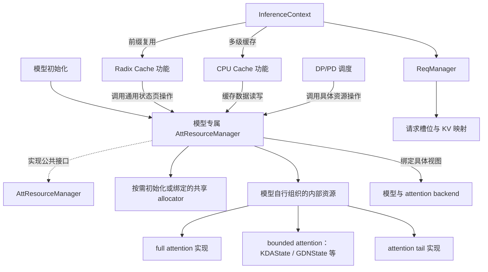

# Attention Resources 架构设计草案

本文定义 attention 资源的架构设计，包括 `AttResourceManager` 的职责、共享 allocator、各类 State 的接口、目录组织及 CPU/DP/PD 传输约定。文中的结构与接口为设计契约，待细化事项集中列于第 9 节。

## 1. 设计约定

统一在 `lightllm/common/att_resources/` 下组织可复用的资源实现，由 `AttResourceManager` 提供资源初始化、内部状态页聚合操作及 CPU/DP/PD 数据传输的默认实现。所有模型直接使用该类，资源组合由模型的三类 State 工厂决定。radix cache、CPU cache 和传输调用方依赖模型持有的管理器，资源层不反向依赖这些调用方。

公共层约定三种 allocator 入口，具体实例按模型组合和启用的功能初始化：

```python
class AttResourceManager:
    full_att_allocator: FullAttKVAllocator | None
    bounded_att_big_page_allocator: StatePageAllocator | None
    bounded_att_small_page_allocator: StatePageAllocator | None
```

这三个入口表示资源管理器对分配域的管理责任，聚合操作与传输接口见第 6.2 节。具体初始化必须保证所需 allocator 已创建或绑定，无需的 allocator 为 `None`。例如纯 full-attention 模型只初始化 `full_att_allocator`；启用 bounded 状态页的组合再按配置初始化大小页 allocator。GPU 运行态的存在本身不要求启用页池。

- 基类不声明固定的 `main_full_att`、`draft_full_att`、`main_linear_att`、`draft_linear_att`、`main_att_tail`、`draft_att_tail` 成员。具体模型按需组织资源组合与实现类型，拥有的 State 成员统一遵守第 3.5 节的角色、类型和存储方案命名。
- `full_att`、`bounded_att`、`att_tail` 作为可复用实现的目录分类。full attention 保存历史 KV；bounded attention 由 `BoundedAttentionState` 抽象基类约定操作，当前包含 `KDAState`、`GDNState`，以后可加入 sliding-window 等有界状态，各自定义运行态与可选页池；attention tail 保存索引、池化、压缩等模块在增量计算中需要跨步骤保留的尾部数据及控制信息；具体实现决定恢复边界和快照要求。
- main/draft 可以采用不同方案；同一共享分配域的参与方使用同一个 allocator 实例，遵守统一的索引和回收约定。资源对象持有 buffer 和布局信息；管理器创建或绑定共享 allocator，调用方直接使用对应 allocator 分配与归还索引。
- `AttResourceManager` 提供运行态清零、清零指定请求的 tail、token 复制、状态页的聚合保存、恢复和数据传输操作；缓存功能流程决定匹配、引用、发布与淘汰时机，推理流程决定请求执行阶段。
- `req_to_token_indexs` 和请求槽位仍由 `ReqManager` 持有。资源管理器接收显式传入的物理索引、请求槽位及恢复长度，提供资源操作接口。
- 内部调用契约使用 `assert`，例如页类型、物理索引范围、Tensor 形状及共享分配域的一致性；用户配置、外部页面内容及格式兼容性继续显式校验，资源不足等运行失败保留相应异常。GPU 上的 MTP 状态选择保留异步断言，避免引入主机同步。
- 内部 attention 资源的暴露方式作为接口设计问题单独讨论。当前建议按调用方区分统一资源操作、模型推理视图和 State 直接传输操作，详见第 6 节。

本文区分已确定的职责边界和接口草案。main/draft 的资源由共享的 `AttResourceManager` 统一持有，模型只持有管理器，计算上下文和 backend 从管理器绑定各自角色的 State；后续细化事项包括新模型的具体存储方案与功能接口参数的数据形式。

### 1.1 接口命名、排列与注释规范

新增 Python 文件、类和接口按 **公共函数在前、私有辅助函数在后** 排列。已有基础流程文件以保留功能、减少 review 差异为优先，保留原有函数相对顺序，不为满足分组规范整体重排。

- 模块中先定义公共函数，再定义以下划线开头的私有辅助函数（双下划线协议函数除外）。文件名以 `_` 开头不改变文件内函数的排列规则。脚本的 `if __name__ == "__main__"` 执行入口仍放在全部定义之后。
- 类的方法区依次排列：`__new__`、`__init__`、其他公共方法与属性、私有辅助方法。`__getstate__`、`__post_init__` 等 Python 双下划线协议方法属于公共协议，不作为私有辅助方法处理。
- `async def`、`classmethod`、`staticmethod`、`property`、抽象方法均按方法名分类。属性 getter/setter 等存在定义依赖的方法保持必要顺序，装饰器和关联注释随函数一起移动。
- 同一组内保留原有相对顺序，便于按接口职责阅读；不按字母排序，不为了调整位置修改函数名称或增加转发层。
- 模块说明、导入、常量、类型定义和类级数据声明保留必要的依赖顺序。重排须检查装饰器、默认参数、类型注解及模块初始化语句的定义时依赖，并保持函数体与业务语义不变。

本规范适用于资源管理器、State、allocator、helper、相关模型与 server 调用代码，以及对应的测试和验证脚本。新增文件和新增类必须遵守上述完整分组规则；在存量文件中增加接口时，新增公共接口放在入口区域，新增私有辅助函数放在相关实现区域，新增代码之间仍按公共在前、私有在后排列，不牵动已有函数的位置。

模型初始化、推理执行、调度、缓存和传输等已有基础流程，只保留实现功能所需的改动，不混入纯函数排序、接口改名或无关格式整理。函数名称及 public/private 属性是否调整由功能需要决定，不因排列规范修改；功能重构与存量代码的风格整理分别进行。

State 的基类与具体实现同样使用中文大块分隔注释，依次组织基础定义、该类资源的数据操作、CPU Cache、DP、PD、私有辅助实现。KDA/GDN 直接继承 `BoundedAttentionState`；所有具体 full-attention State 直接继承 `FullAttentionState`。具体 State 之间不继承实现，分别在自己的文件中按上述分块组织完整操作。

- 分类数据操作统一带 `full_att`、`bounded_att` 或 `att_tail` 标识，例如 `write_full_att_kv`、`copy_full_att_tokens`、`reset_bounded_att_state`、`save_bounded_att_pages`、`reset_attention_tail_state`。管理器与 State 的同类操作同名，区别在于聚合多个 State 或只操作自身存储。
- `get_layer_view` 用于计算访问，CPU/DP/PD 保持按传输方向命名。State 不增加仅用于统一名字的转发方法。
- 所有 attention 配置字段必须提供中文注释，说明业务含义、单位或对应 Tensor 轴、全局/TP 本地范围，以及适用方案和默认值的特殊语义；派生属性还需说明计算关系。资源身份只保存在 State，不放入 config。
- 已知的调用参数使用显式 `key=value`，如 `size=...`、`dtype=...`、`device=...`、`pin_memory=...`；不先组装 `options` 字典再通过 `**options` 传入。
- 资源身份、布局范围和分配域选择等必要检查直接在使用处展开，不再包装成只有断言、布尔判断或转发循环的小函数。同一操作已校验的槽位继续复用，避免逐页、逐 State 重复校验分配器。
- 每个公共接口使用中文 docstring 说明操作对象、索引含义和数据范围；在有差异时明确量化参数、前缀长度、MTP 游标及完整 tail 的处理。私有实现使用独立分块，关键布局或状态转换另加说明。
- bounded 运行态重置、大小页保存与恢复、MTP 提交和运行态复制集中排列。pool 只保存快照 buffer；前缀与槽位的关联、页面发布和引用生命周期由调用流程管理。

## 2. 整体结构与职责边界



图中的资源类别按模型需要选择，可以缺省或包含多个角色、方案不同的实例。箭头表示调用或组合关系；main/draft 推理模型共享共享的 `AttResourceManager`，分别绑定各自的计算 State。

| 层次 | 组件 | 职责 |
| --- | --- | --- |
| 请求流程 | `InferenceContext`、`ReqManager` | 创建、暂停、恢复和完成请求；由 ReqManager 管理请求槽位、KV 索引映射及采样参数 |
| 资源数据操作 | `AttResourceManager` 公共功能接口及模型专属实现 | 管理共享 allocator 与内部 State，实现内部状态页的聚合操作与 CPU/DP/PD 数据传输 |
| 缓存功能 | radix、CPU cache 及其调用流程 | 组织前缀匹配、节点引用、发布与淘汰，管理外部缓存页，并调用`AttResourceManager`操作资源数据 |
| 资源实现 | 模型所需的 State、存储布局、checkpoint pool | 持有 buffer 和布局，实现读写、复制、重置和快照；IPC 导出范围由管理器统一处理 |
| 传输调度 | DP/PD 与多级缓存模块 | 管理任务、队列、通信、事件同步及完成通知 |

`AttResourceManager` 不持有请求 KV 映射表，也不直接访问全局 `g_infer_context` 或通过 `ReqManager` 查询映射。资源方法接收调用方提供的请求槽位、长度、物理索引和资源引用；将逻辑 token 位置转换为物理索引、写入或清理请求映射属于请求流程。缓存功能调用方提供已选定数据的长度、索引和资源引用，`AttResourceManager`执行清零、复制、保存和恢复。请求阶段的组织和缓存节点策略由相应调用流程负责。

代码依赖从调用流程向资源层单向传递。radix cache 依赖管理器的通用状态页操作；管理器与 State 不导入或访问 radix 节点、树和策略。资源实现也不反向导入请求调度模块；传输调度使用数据读写与复制接口。

## 3. 对象结构与资源归属

```text
ReqManager
├── request_slots
└── req_to_token_indexs           # 共享请求到 KV 的索引映射

AttResourceManager              # 公共接口与 allocator 入口
├── full_att_allocator: FullAttKVAllocator | None
├── bounded_att_big_page_allocator: StatePageAllocator | None
└── bounded_att_small_page_allocator: StatePageAllocator | None

<Model>AttResourceManager       # 模型实现，内部结构由其自行定义
├── 按需创建或绑定所需 allocator
├── 初始化模型所需的资源组合
├── 实现内部状态页聚合操作与 CPU / DP / PD 数据传输
└── 绑定推理视图、组织传输所需状态 # 搬运直接调用 State 方法
```

纯 full-attention 与混合模型都使用 `AttResourceManager`，区别在于模型工厂返回的 State 组合。管理器按角色持有各 State，共享 allocator 按分配域创建；公共调用方使用同一组聚合接口。

以下列出可复用资源组件的结构示例。linear attention 直接使用 `KDAState`、`GDNState` 等具体状态对象，由 `BoundedAttentionState` 约定必需操作，不增加资源包装实例。管理器内部的成员遵守统一命名及唯一性约束，checkpoint pool 仅在相应功能启用时存在：

```text
FullAttentionState
├── capacity / page_size / device # 普通 token 容量、HOLD 页大小及分配设备
├── storage_dtype                # 实际 KV 编码类型；普通方案使用 config.dtype，INT4/8 为 int8，静态 FP8 为 uint8
├── k_storage / v_storage        # GQA 及其量化方案分别分配 K/V；MLA 使用单份 latent storage
└── layer_mapping                # 本模型的层映射

KDAState                         # 一种具体 attention 状态实现
├── conv_state: torch.Tensor       # 卷积历史窗口及 MTP 尾部空间
├── ssm_state: torch.Tensor        # KDA 递推状态及 MTP 状态槽位
├── mtp_state_index: Tensor | None
├── big_pages_pool              # 按需创建，使用共享 allocator 分配的槽位
│   ├── conv_state
│   └── ssm_state
└── small_pages_pool            # 按需创建
    ├── conv_state
    └── ssm_state

GDNState                         # 独立定义 GDN 状态、布局和快照操作
└── 按其实现组织 Conv / SSM / MTP 状态及可选大小页 pool

AttentionTailState                 # 抽象操作契约，不固定内部存储
└── KPoolAttentionTailState         # GLM K-pool 的具体状态
    └── tail_buffer              # 原始 key/gate ring，按层、请求组织
```

同一共享分配域中的 allocator 只初始化一次，由 main/draft 共用的唯一 `AttResourceManager` 管理生命周期。调用方解除相关引用后，向对应 allocator 单次归还索引，不因模型数增加而重复分配或释放。

| 资源 | 持有者 | 分配单位 / 生命周期 |
| --- | --- | --- |
| full-attention 空闲页与容量状态 | `AttResourceManager.full_att_allocator` | 每次为请求统一分配/回收物理页索引，main/draft 共用 |
| 大页 checkpoint 空闲槽位 | `AttResourceManager.bounded_att_big_page_allocator` | 为 main/draft 参与的大页 pool 统一分配槽位 ID |
| 小页 checkpoint 空闲槽位 | `AttResourceManager.bounded_att_small_page_allocator` | 为 main/draft 参与的小页 pool 统一分配槽位 ID，独立于大页分配域 |
| 请求 KV 索引表 | `ReqManager` | 记录逻辑 token 到共享物理索引的映射；负责绑定、更新和清理 |
| HOLD 保留物理页及索引描述 | `AttResourceManager` 及其 full-attention allocator | 从普通分配范围排除保留页；ReqManager 使用其索引初始化 HOLD 行 |
| KV、量化 scale、packed indexer buffer 与层映射 | `AttResourceManager` 组织的 full-attention 资源 | 按统一容量建立存储，使用共享索引访问各自数据 |
| KDA/GDN 的 Conv/SSM、MTP 游标 | `AttResourceManager`持有的 `KDAState` / `GDNState` | 使用共同请求槽位域，由各算法状态对象分别维护 |
| 大小页 checkpoint buffer | 各具体状态对象中启用的 pool | 使用共同分配的槽位 ID 保存数据；不持有独立空闲列表或长度记录 |
| indexer 原始尾部窗口 | `AttResourceManager` 组织的 indexer 资源 | 使用共同请求槽位域，各自维护所需 tail 布局 |
| 请求槽位 | `ReqManager` | 请求创建时分配，完成时回收，暂停时保留 |
| 前缀缓存索引与引用记录 | radix cache 功能 | 维护前缀节点及引用；通过管理器保存、恢复关联资源数据，解除引用后直接归还 allocator |

### 3.1 main/draft 共享 full-attention allocator

调用方直接通过 `AttResourceManager.full_att_allocator` 分配一次 KV 索引，再通过 ReqManager 将索引写入共享请求表。复用前缀时，radix 功能选定缓存数据，`AttResourceManager`恢复关联状态，所需 KV 索引由 ReqManager 绑定到请求映射。main 和 draft 从同一请求映射获取索引，访问各自的存储：

```text
逻辑 token 位置 t
        ↓ ReqManager.req_to_token_indexs
统一物理索引 i
        ├── main 对应的 KV 存储位置
        └── draft 对应的 KV 存储位置
```

二者的层数、head 维度、dtype 和量化布局可以不同；同一索引域内需要使用兼容的 page_size，并且各存储都覆盖 allocator 可返回的索引范围。同一分配域统一容量和物理页索引规则，不引入模型间索引重映射。

共享索引表示存储位置的对应关系，不表示 main/draft 在每个位置都已经写入有效 KV。MTP 预留区和回退后的有效长度仍由请求执行流程维护。

释放时，请求流程与`AttResourceManager`确认相关使用方已完成，由 `ReqManager` 清理请求映射。调用方解除相关使用引用后，仅将不再被缓存、请求或传输持有的索引向同一个 `full_att_allocator` 归还一次。任一模型的资源对象都不能自行释放共享索引。容量评估累计各模型 State 独立分配的存储，不能因共享 allocator 而漏算。

### 3.2 main/draft 共享 linear checkpoint allocator

main/draft 选择各自需要的具体状态对象，例如 main 使用 `KDAState`，draft 使用 `GDNState` 或无需 linear 状态。各状态对象持有自身运行态及启用的大页或小页 pool。对同一前缀的一个大页或小页 checkpoint，调用方直接从管理器持有的对应 allocator 分配一次槽位 ID，再将该 ID 传给管理器的聚合数据操作，供参与的两侧 pool 使用。两侧的状态布局、dtype 和单槽位字节数可以不同，各自的存储必须覆盖共享 allocator 可返回的槽位范围。

例如分配大页槽位 `s` 后，main 和 draft 对应的大页 pool 在各自的槽位 `s` 保存状态。`AttResourceManager`负责找到参与操作的 pool，请求流程无需读取模型内部字段。缓存调用流程维护前缀到槽位的关联，并在两侧都完成对应状态的保存后发布；恢复时通过该关联选择槽位。仅一侧具有 linear 资源时，只处理该侧。

共享 checkpoint 需要约定共同的恢复边界和 token 位置语义，并确保参与实现都能捕获该位置的状态。MTP 推测中的临时状态需先按执行流程选出对应位置的状态，再保存快照。共享索引不要求 main/draft 每一步同步执行；回收时须等所有参与方结束使用，槽位只归还一次。

linear 运行态与两侧 indexer tail 均由 `ReqManager` 提供的 `req_idx` 定位。indexer tail 不单独分配 checkpoint 槽位；其状态布局和恢复规则由各自实现描述。

### 3.3 分配状态与数据状态分离

allocator 是索引分配的唯一事实来源，资源对象持有存储和布局。缓存功能流程通过 radix 维护前缀关联、页/槽位的引用与发布关系；`AttResourceManager` 组织所有参与 State 的数据操作；调用方确认最后一个使用引用已解除后，直接向对应 allocator 归还索引。

同一 linear checkpoint 可以包含 main/draft 多个状态资源的快照。槽位分配状态由共享 allocator 维护，数据内容和有效长度由各侧 pool 分别维护。

对于使用 K-pool 的实现，已完成池化的压缩 key/scale 保留在对应 full-attention 资源的 packed 存储中，indexer tail 资源管理增量计算需要的原始短窗口；二者的组合关系由`AttResourceManager`维护。

### 3.4 按具体 attention 实现定义状态

定义只约束操作的 `BoundedAttentionState` 抽象基类，由 `KDAState`、`GDNState` 等子类负责自己的成员、布局、重置、快照与恢复语义。`AttResourceManager` 初始化并组合所需对象，公共缓存流程通过管理器访问它们。不同模型也可以复用同一种状态实现。

`KDAState` 的成员定义如下：

```python
class KDAState(BoundedAttentionState):
    config: ConvSSMStateConfig  # 仅包含算法布局和 TP 信息
    resource_id: str | None  # 构造时为 None，由管理器绑定模型角色时设置
    request_capacity: int  # 包含 HOLD 请求槽位
    conv_state: torch.Tensor
    ssm_state: torch.Tensor
    mtp_state_index: torch.Tensor | None
    mtp_step: int  # 该实例的 MTP 布局参数
    big_pages_pool: KDAPagesPool | None
    small_pages_pool: KDAPagesPool | None
```

State 直接持有按层组织的 Tensor，不额外设置通用状态管理对象。该示例中的 Conv、SSM 和 MTP 索引驻留 GPU；checkpoint pool 独立持有快照 buffer。设请求槽位容量为 `N`（包含保留槽位），该实例的 `mtp_step` 为 `S`：

| 成员 | 内容与索引方式 |
| --- | --- |
| `conv_state` | 对应算法的卷积历史窗口，窗口宽度为 `conv_kernel_size - 1 + S`；用 `buffer[layer, req_idx, ...]` 访问 |
| `ssm_state` | KDA 的递推矩阵状态，每请求预留 `S + 1` 个状态槽位；第 `j` 个槽位位于 `buffer[layer, req_idx * (S + 1) + j, ...]` |
| `mtp_state_index` | 形状为 `[N]` 的 `int32` Tensor；记录各请求接受的 MTP 状态索引。`S == 0` 时为 `None` |
| 大小页 pool | 按需创建，保存该算法指定前缀位置的状态；槽位来自管理器的对应 `bounded_att_*_allocator` |

`GDNState` 按 GDN 算法独立定义 Conv/SSM 和 MTP 状态，其大小页使用 `GDNPagesPool`，支持不同的 K/V head 数及维度。`KDAPagesPool` 按 KDA 的相同 Q/K/V head 数和方阵递推状态定义布局。两类 pool 各自分配快照存储，不额外记录长度或页面有效性；前缀与槽位的关联由缓存调用流程维护。两种 State 可以复用兼容的 Conv/SSM 数据操作，共同实现 `BoundedAttentionState` 接口；基类不规定 Conv/SSM 等成员，也不意味着两种算法的状态内容可以互换。

运行态按 `ReqManager` 的槽位容量预分配，状态对象接收 `req_idx` 执行操作。main/draft 可以持有同一种状态类的两个独立实例，也可以使用不同状态类型；各实例的层数、维度、dtype 和 MTP 配置由对应模型决定。allocator 仍由 `AttResourceManager` 创建或绑定并统一管理。

后续 sliding-window attention 可以定义实现 `BoundedAttentionState` 的 `SlidingWindowState`，按窗口 KV、有效范围和游标等实际需求组织成员及自己的页池。它可以使用适用的 bounded-attention 分配域，其页布局、恢复边界和已接受状态选择须按窗口语义实现；不要求包含 Conv/SSM 字段，也不复用 KDA/GDN 的页池。统一操作接口见 6.7 节。

### 3.5 State 成员命名、资源身份与唯一性

`AttResourceManager(request_capacity)` 只记录共享请求容量，三个 allocator 初始为 `None`，State 由各模型创建后通过 `set_att_state(model_name, state)` 绑定。`model_name` 为 `main` 或 `draft0` 到 `draft35`；接口根据 `state.get_state_type()` 生成规范成员名，并设置 `state.resource_id`。`FullAttentionConfig`（含量化与 MLA 子类）、KDA/GDN 的 `ConvSSMStateConfig` 和 `KPoolStateConfig` 均不保存资源身份，绑定时保留原配置对象；这些 State 未绑定时的 `resource_id` 为 `None`，资源名称只保存在 State 上。管理器持有传入的原对象，不复制 Tensor、不重建 State、不创建额外的 buffer 视图，meta State 和已分配运行态均可绑定。每个角色的同一方案只能绑定一次，同一个 State 对象不能分配给多个角色；`finish_state_creation()` 后不再添加 State。allocator 仍由后续容量与存储初始化流程设置。

管理器成员名与 `state.resource_id` 完全一致，统一使用 `{model_name}_{算法及存储方案}_state`。模型角色为 `main` 或 `draft0` 到 `draft35`，最多 36 个 draft。资源类别由 `FullAttentionState`、`BoundedAttentionState`、`AttentionTailState` 类型表达，名称中不再重复 `full_att`、`bounded_att`、`att_tail`。

三类 State 都必须实现 `get_state_type()`，只返回中间的算法及方案标记，使用小写 snake_case。方案标记区分量化位宽、group size、scale 方式/精度，KDA/GDN 分别标注 Conv 和 SSM 精度，K-pool 标注压缩比例与存储精度。层号、容量、设备、TP rank 和请求信息不进入名称。

同一角色、同一标记只能注册一个 State，包含该方案的全部逻辑层；不同存储方案可以共存，通过算法字符串、层归属及可选的 State 类别筛选。名字用于资源定位，不能替代完整布局兼容性检查。标记注册后保持稳定，meta 定义、实际存储和 CPU/DP/PD 进程使用相同名称，不提供旧名称别名。

| 方案 | State 成员名及 `resource_id` |
| --- | --- |
| 普通 BF16 KV | `main_gqa_bf16_state` |
| INT8，group size 8，BF16 scale | `main_gqa_int8_group8_bf16_scale_state` |
| 静态 FP8，per-head scale | `main_gqa_fp8_static_per_head_state` |
| MLA BF16 | `draft0_mla_bf16_state` |
| 带 indexer 字段的 packed MLA FP8 | `main_mla_packed_fp8_group128_state` |
| KDA / GDN | `main_kda_conv_bf16_ssm_fp32_state` / `draft0_gdn_conv_bf16_ssm_fp32_state` |
| K-pool C4 indexer tail | `main_kpool_c4_bf16_state` |

普通 KV 使用 `gqa`，涵盖 MHA/GQA/MQA；MLA 使用 `mla`。`packed` 区分 KV 与 indexer 联合存储，FP8 packed MLA 还标注量化 group size。KDA/GDN 使用 `conv_*_ssm_*` 明确两类状态的精度；K-pool 使用 `kpool_cN_*` 标明压缩比例与存储精度。完整 shape、标定方式等仍保存在 State 配置中。

以启用 draft 的 GLM BF16 配置为例，管理器的 State 成员是：

```text
AttResourceManager
├── full_att_allocator
├── bounded_att_big_page_allocator
├── bounded_att_small_page_allocator
├── main_mla_packed_bf16_state
├── main_kda_conv_bf16_ssm_fp32_state
├── main_kpool_c4_bf16_state
├── draft0_mla_packed_bf16_state
└── draft0_kpool_c4_bf16_state
```

当前 GLM draft 不使用 KDA，因此不创建 `draft0_kda_conv_bf16_ssm_fp32_state`。Qwen 的线性状态为 `main_gdn_conv_bf16_ssm_fp32_state`；Full Attention 按实际配置创建 `main_gqa_bf16_state` 等成员。MLA 与普通 KV 都可使用同一个 `full_att_allocator` 分配域。

`vanilla_no_att`、`eagle_no_att` 等仅执行 FFN 的 draft 不创建 KV State，也不初始化 attention backend；其计算引用可以为 `None`，仍共享管理器的 allocator 与请求映射。缺少实际需要的 draft attention State 则应在初始化时断言失败。

因此同一角色可以同时拥有 `main_gqa_bf16_state` 和 `main_gqa_int8_group8_bf16_scale_state`；这是两种不同方案，各自覆盖对应的层，聚合复制及传输必须覆盖二者。现有内置模型按配置选择自己的方案；未来混合量化模型在管理器中显式定义多个规范成员，基类通过聚合查询将它们传给相同 helper，不需要增加通用 State 注册表。

main/draft 必须拥有不同逻辑 State，不能将覆盖两侧层的同一个 State 同时命名为 main 和 draft。当前启动流程为各模型分别创建 State 和存储；GLM 的每个模型也分别创建 indexer ring。三种 allocator 的名称不带模型角色，同一分配域只初始化或绑定一个实例。

`AttResourceManager`只持有实际启用的成员。当前配置选择的类型名可作为普通元数据保存，用于找到对应的规范字段；参与操作的集合由基类查询接口从显式成员生成，State 对象创建完成后可缓存只读 tuple 查询结果。Model 在资源层只持有 `att_resource_manager`，不另存 `full_att_state` 或游标集合。main 在准备资源时创建唯一的管理器，所有 draft 从准备 State 开始就引用同一实例，并通过 `set_att_state` 添加各自的规范成员。每个 draft 使用独立的 `draft0`、`draft1` 等角色，最多 36 个（`draft0` 到 `draft35`）；即使方案相同，也分别持有 State，不合并层或运行态。State config 完整保存全局 head 数和 TP 分布规则，全部对象创建完成后再统一分配缓存存储。管理器的拥有成员必须使用完整规范名称。

`InferStateInfo` 保存 `att_resource_manager`、`is_draft_model` 和资源角色 `att_resource_role`，不额外绑定 `full_att_state`。各层直接访问管理器上对应方案的 State 成员，再通过局部引用取得层视图或写入 KV；FP8 backend 从具体量化方案的成员读取固定参数。每个 draft 的层由自身编号对应的 State 管理；`att_resource_role` 为 `main` 或 `draft0` 到 `draft35`，不能仅根据 `is_draft_model` 选择资源。是否初始化 full-attention backend 根据管理器中该角色实际启用的资源判断；FFN-only 和 linear-only 模型不创建 full-attention backend，linear backend 由相应模型独立初始化。

资源身份用于 CPU/PD 资源布局与 DP 映射，所有传输按完整角色和方案匹配。部署配置确定各资源的页布局；PD 参数兼容性由 PD master 在连接阶段校验，CPU 服务绑定时核对页大小，磁盘缓存按 main/draft 模型版本隔离。

## 4. 目录设计

目录按资源管理、allocator 与具体 State 组织，传输能力由具体实现类提供。管理器、公共 State、allocator 和 pool 文件按对应类名命名；具体 State 实现使用算法或布局名加 `_state.py`。Triton/CUDA 计算 kernel 位于对应计算模块，由 State 方法调用。

```text
lightllm/common/
├── basemodel/
│   ├── basemodel.py                     # 模型基础流程与模型专属配置 hook
│   └── basemodel_utils.py               # 配置归一化、KV 选项与 full/linear State 定义构建
├── att_resources/
│   ├── __init__.py
│   ├── utils.py                         # State 角色与精度命名
│   ├── att_resource_manager.py          # AttResourceManager：State 装配、容量与存储初始化、缓存和传输接口
│   ├── types.py                         # TensorField / StateTransferLayout 等
│   ├── allocators/                      # 管理器直接持有，同一分配域共享实例
│   │   ├── __init__.py
│   │   ├── full_att_kv_allocator.py         # FullAttKVAllocator / KVCapacityReader：full_att 分配域及共享容量读取
│   │   └── state_page_allocator.py # StatePageAllocator：bounded_att 大小页各一个实例
│   ├── full_att/
│   │   ├── __init__.py
│   │   ├── base_state.py                # FullAttentionConfig / FullAttentionState：通用配置与抽象接口
│   │   ├── create_gqa_state.py          # GQA 统一创建入口：选择普通精度、INT4/INT8 或静态 FP8
│   │   ├── gqa_state.py                 # GQAFullAttentionState：兼容 MHA / GQA / MQA
│   │   ├── gqa_transfer.py             # GQA CPU/PD 共用的 K/V 页传输入口与 kernel
│   │   ├── group_quantized_state.py     # GroupQuantizedFullAttentionState：INT4 / INT8 等
│   │   ├── group_quantized_transfer.py          # INT4/INT8 KV 与动态 scale 的定制传输
│   │   ├── static_fp8_state.py          # StaticFP8FullAttentionState
│   │   ├── static_fp8_transfer.py               # FP8 K/V 原始编码的定制传输
│   │   ├── create_mla_state.py          # MLA 统一创建入口：选择普通、packed 或 packed FP8
│   │   ├── mla_state.py                 # MLAFullAttentionState：压缩 latent 存储
│   │   ├── mla_transfer.py                      # latent KV 的定制传输
│   │   ├── packed_mla_state.py          # PackedMLAFullAttentionState：含 indexer key/scale 的 packed 布局
│   │   └── packed_mla_transfer.py   # packed KV、RoPE 与 indexer 字段的定制传输
│   ├── bounded_att/
│   │   ├── __init__.py
│   │   ├── base_state.py                # BoundedAttentionState：有界状态的抽象操作契约
│   │   ├── utils.py                     # 页池分配策略：DP fetch 使用共享 pinned 存储
│   │   ├── transfer_utils.py            # bounded_att_buffer_copies：复制完整状态快照
│   │   ├── conv_ssm_types.py            # KDA/GDN 的 Conv/SSM 布局配置
│   │   ├── create_kda_state.py          # KDA 统一创建入口
│   │   ├── kda_state.py                 # KDAState：Conv / SSM / MTP 与页操作
│   │   ├── kda_pages_pool.py            # KDAPagesPool：KDA Conv 历史和方阵递推快照
│   │   ├── create_gdn_state.py          # GDN 统一创建入口
│   │   ├── gdn_state.py                 # GDNState：独立算法状态与页操作
│   │   └── gdn_pages_pool.py            # GDNPagesPool：支持不同 K/V head 数和维度的快照
│   └── att_tail/
│       ├── __init__.py
│       ├── base_state.py                # AttentionTailState：尾部状态抽象操作契约
│       ├── transfer_utils.py            # att_tail_buffer_copies：本地 ring 与固定逻辑窗口之间搬运
│       ├── create_kpool_state.py        # K-pool 统一创建入口
│       └── kpool_state.py               # KPoolAttentionTailState：原生 ring 与恢复规则
└── req_manager/                          # 请求槽位、KV 索引映射、采样与生命周期

lightllm/models/<model>/
├── model.py                              # 三类 State 创建接口，决定本模型的资源组合
└── att_resource_config.py                # 模型配置与可复用的 State 创建工具
```

`allocators/` 与三类 State 目录平级。`full_att_kv_allocator.py` 提供 full-attention 的 KV 分配器，对外使用 token 数量和索引，内部遵守整页分配约束；`state_page_allocator.py` 提供 bounded-attention 的状态槽位分配器，管理器按需创建大小页两个独立实例。后者的分配能力不限定为 linear attention，使用它也不要求继承 `BoundedAttentionState`。

`full_att/base_state.py` 同时定义 `FullAttentionConfig` 和 `FullAttentionState`；`bounded_att/base_state.py`、`att_tail/base_state.py` 分别定义另外两类公共接口；布局或算法差异由对应的 `*_state.py` 实现。full-attention 的 storage 属于具体 State 的内部实现，可与该 State 放在同一文件中；确有复用需要时再拆为内部存储工具，不设置另一套独立的 storage 公共继承体系。

`KDAState` 使用 `KDAPagesPool`，`GDNState` 使用 `GDNPagesPool`；每个 State 的 `big_pages_pool` 与 `small_pages_pool` 是对应 pool 类型的独立实例。两个 State 的 `initialize_page_pools()` 分别直接创建 `KDAPagesPool` 和 `GDNPagesPool`；管理器确定共享槽位容量后调用该公共方法，不直接构造某种通用 pool。State 页接口与管理器统一使用 `save_bounded_att_pages`、`restore_bounded_att_pages` 等名称，pool 不持有 allocator。`KPoolAttentionTailState` 管理请求运行态，不创建独立大小页 pool。

`ConvSSMStateConfig` 描述 KDA/GDN 共享的 Conv/SSM 布局，不作为所有 bounded attention 的配置契约。KDA/GDN 构造函数的 `config` 明确标注为 `ConvSSMStateConfig`，入口通过 `assert isinstance(config, ConvSSMStateConfig)` 约束类型；配置只描述层、head、维度、dtype 和 TP，不包含 `resource_id`。其余构造参数为 `request_capacity`、`mtp_step` 和 `device`；State 只保存一份请求容量和 MTP 步数，设备从 Tensor 获取。大小页池初始为 `None`，容量确定后通过 `initialize_page_pools(big_page_capacity, small_page_capacity, *, device="cpu", pin_memory=True)` 创建，容量保存在 pool 中。大小页恢复直接访问 Conv/SSM 基准存储切片，不为恢复操作构造字段字典或 `TensorField`。`get_layer_view(logical_layer_id)` 直接返回 `(conv_state, ssm_state)` 两个 Tensor 引用，MTP 游标与步数从 State 读取，不另外包装视图对象。`BoundedAttentionState` 不声明抽象构造函数，仅约定操作；构造参数由具体 State 和算法 create 入口明确标注，KDA/GDN 分别实现运行态、大小页、MTP 与传输方法，不再设置中间实现基类；新的算法可以定义自己的配置、层视图和页池。管理器统一使用 `get_bounded_attention_states(role=None)` 枚举参与对象；模型通过 `_create_bounded_att_states(..., device="meta")` 返回 CPU 布局定义。KDA/GDN 在各自 State 中构建 CPU/PD 传输区域；其他 bounded 布局分别实现 `get_cpu_transfer_regions()` 和 `get_pd_transfer_regions()`，管理器使用同一组接口。

`FullAttentionState`、`BoundedAttentionState` 的具体子类直接实现 CPU、DP、PD 读写；`AttentionTailState` 实现 PD 快照读写，CPU/DP 缓存前缀恢复时按对齐边界重置；IPC 导出前由管理器统一创建浅拷贝并排除进程私有资源，State 不设置额外的序列化钩子。各具体 State 通过 `get_cpu_transfer_regions()` / `get_pd_transfer_regions()` 选择传输字段、形状及 TP 切片；字段字节对齐、区间计算和 `TransferRegion` 构造直接在 State 内展开，不再通过 `region()` 包装。各具体 full-attention State 对应的 `*_transfer.py` 由 Triton 直接按 token 和页索引搬运 KV 及配套量化字段，每个字段一次 launch 覆盖全部页，不创建 gather/scatter 中间 KV。CPU 页必须是 pinned 或已通过 `cudaHostRegister` 注册的内存；调用方在 stream/event 完成后才能读取或复用页面。每种 full-attention 方案的 CPU/PD 路径共用本方案的 `transfer_*_pages` 入口和 kernel，直接按 token 和页索引读写外部页。两条路径均兼容不足整页的有效 token；`bounded_att/transfer_utils.py` 复制完整状态快照，不接收 token 数量；`att_tail/transfer_utils.py` 接收本地 ring 和 prefill 前缀长度，按逻辑时间顺序搬运最近 `pool_size` 个位置；短前缀的不存在位置在写出时补零。bounded-attention 和 tail 的共用传输函数使用 `page_buffers` 和必传的 `page_index`，不带 CPU/PD 前缀；页存储必须至少为二维，第一维表示页，统一通过 `page_buffers[page_index]` 取页。PD State 与 manager 读写入口统一接收 `pd_page_buffers` 和必填的 `pd_page_index`，将页集合与真实页索引直接传给共用搬运函数；不接受单页 Tensor，也不在入口添加页维度。CPU 专属读写接口仍使用 `cpu_page_buffers` 和 `cpu_page_indices`。Full attention 的各方案 CPU/PD 共用入口直接提交 Triton kernel；其余复制视图函数返回源、目标视图列表，由 State 在调用处遍历执行 `dst.copy_(src, non_blocking=True)`，不再包装仅转发循环的搬运函数。取页和外部字段视图在三类函数中直接展开：先选择页，再按字节起止位置切片并解释为字段 dtype/shape，不额外逐区域断言边界、对齐或轴定义。full-attention 在各方案的 `*_transfer.py` 中直接应用 TP 切片，kernel 按索引长度裁剪有效 token；bounded-attention 在本地 `transfer_utils.py` 特化 `_copy_pair`，仅处理状态轴切片。tail 使用固定 `pool_size` 的逻辑窗口，按传入的前缀长度把逻辑位置映射到本地 ring 槽位；短前缀在外部窗口前部补零，读回时清零其余本地候选历史。三类路径都在提交前断言实际复制视图的 shape 一致。读回时交换本地和外部视图，不重新构造反向轴映射。full-attention DP 直接复制同一 TP 分片的显式存储，原根目录 `transfer_utils.py` 的字段映射复制已无调用方并删除。State 的 KV 写入与量化方法直接调用相应计算模块中的 kernel。具体方案标记统一由 `get_state_type()` 返回，不再保留无读取方的 `layout_name`。这些聚合操作由 `AttResourceManager` 提供默认实现，统一组织多资源读写、CPU 联合页、调用方传入的长度和位置映射；模型子类仅覆盖存在差异的部分。网络通信、任务队列与完成通知由 server 层管理。

CPU 服务通过模型配置与 meta device 上的 State 描述生成页格式，无需分配 GPU 存储。服务端将 main/draft 的 meta State 装配到管理器并标记创建完成，复用 `AttResourceManager.get_cpu_transfer_layouts()`，与推理端使用同一条布局聚合路径。该接口直接遍历 full-attention、bounded State，调用各自的 `get_cpu_transfer_regions()`，同时平移字段区间的起点和终点；每个 State 的最大字段终点按 8 字节对齐后作为下一 State 的起点。CPU 页容量由全部布局的最大 `byte_end` 按 16 字节对齐得到，TP 副本不重复占用外部页；启动绑定时核对页字节数。

无需模型特有初始化的场景直接使用 `AttResourceManager`，main 和各 draft 通过自身的准备流程向同一个管理器添加 State。它可以同时管理 full attention、bounded attention 和 indexer tail，不按 main 的 attention 类型再分一层管理器。构造函数只接收 `request_capacity`；各模型通过 `set_att_state` 绑定已创建的 State，allocator 在后续容量与存储初始化流程中设置。

模型特有的 State 组合由 `model.py` 中三类创建接口确定，复用工具放在现有的 `att_resource_config.py`。Qwen3Next 创建 GDN，GLM 创建 KDA 和 K-pool tail；main/draft 分别返回各自的 State。所有模型共用 `AttResourceManager` 的聚合数据操作，不再保留 Qwen3Next/GLM 专用管理器及旧 `bind_storage()` 流程。

token 复制、bounded 运行态重置、大小页保存/恢复、MTP 提交及 tail 重置直接在 `AttResourceManager` 中遍历对应 State，不再增加仅转发调用的 helper。CPU/DP/PD 传输组织也直接在 `AttResourceManager` 的现有接口中实现，通过聚合查询选择参与 State；不再通过独立 helper 转发 State 集合及 allocator，模型子类仍可按特有需求覆盖操作。显式成员决定 State 归属，不另外维护 `_full_states`、`_bounded_states`、`_tail_states` 或 `_states` 注册表，也不按 `id(state)` 静默去重。基类允许在对象创建完成后缓存从这些成员派生的查询结果，缓存不参与资源装配。传输按 resource_id 匹配时可构建临时映射，它不决定模型的资源组织方式。

#### 按逻辑算法创建 State

每种逻辑算法提供一个公开的 `create` 入口。量化属于该算法的存储选择，不按量化类型拆分创建入口；调用方提供逻辑配置及编码参数，由入口返回具体 State。

| 逻辑类型 | 创建入口 | 参数决定的实现 |
| --- | --- | --- |
| GQA（含 MHA/MQA） | `full_att.create_gqa_state(config, *, kv_type, page_size, device, ...)` | 普通浮点、INT4/INT8 分组量化、per-tensor/per-head 静态 FP8 |
| MLA | `full_att.create_mla_state(config, *, kv_type, packed, page_size, device, ...)` | 普通 MLA、带 indexer 的 packed MLA、packed FP8 MLA |
| KDA | `bounded_att.create_kda_state(config, request_capacity, mtp_step=0, *, device)` | KDA Conv/SSM 运行态 |
| GDN | `bounded_att.create_gdn_state(config, request_capacity, mtp_step=0, *, device)` | GDN Conv/SSM 运行态 |
| K-pool | `att_tail.create_kpool_state(config, request_capacity, mtp_step=0, *, device)` | 带池化尾部窗口及 MTP 历史槽位的 K-pool State |

每个算法的创建入口独立放在 `create_gqa_state.py`、`create_mla_state.py`、`create_kda_state.py`、`create_gdn_state.py` 和 `create_kpool_state.py`，通过各分类包导出。一个算法的普通精度与量化实现共用同一 create 入口，由参数选择具体 State；State 实现文件不负责选择其他实现。不增加工厂类或注册表。入口不读取请求信息，不绑定角色，不创建 allocator；返回对象后由模型调用 `set_att_state`。

GQA/MLA 的 `config` 使用逻辑 `FullAttentionConfig`。GQA 的 `kv_type` 使用现有编码名 `"None"`、`"int4kv"`、`"int8kv"`、`"fp8kv_spt"`、`"fp8kv_sph"`；`group_size` 仅对 INT4/INT8 生效。静态 FP8 构造函数和创建入口不接收标定参数，`scales`、`q_scales` 初始均为 `None`；全部 State 就绪后，统一加载流程只能通过 `bind_calibration()` 初始化标定。各 DP 使用相同的标定配置，不额外生成或校验标定内容指纹。MLA 的 `config.head_dim` 始终传逻辑 latent 维度，`packed=True` 时由入口计算包含 indexer、scale 和对齐的物理行宽；`"fp8kv_dsa"` 仅用于 packed MLA。

`lightllm/utils/att_resource_config.py` 负责把启动参数和标定文件转换为这些显式参数，并调用对应算法入口。full-attention 创建时仍为零普通 token 容量，后续由管理器统一分配；bounded 和 tail 按请求容量直接创建运行态，大小页池另行初始化。GPU 启动与 CPU cache 元数据使用同一套算法创建逻辑。

```python
state = create_gqa_state(
    config=full_config, kv_type="int4kv", group_size=8,
    page_size=16, device="meta",
)
manager.set_att_state("main", state)
# 全部 State 准备完成后，由 manager 统一规划容量并分配存储。
```

根目录的公共帮助代码收敛到 `utils.py`，该文件负责 State 角色与精度命名，测试专用角色视图和成员筛选帮助函数放入测试辅助文件；full-attention 的 CPU/PD 页复制放在各方案的 `*_transfer.py` 中，bounded/tail 的页复制放在各自目录的 `transfer_utils.py` 中；CPU/DP/PD 传输及 State 聚合循环直接放在 manager 中。共享资源初始化由 `AttResourceManager.initialize_resources()` 统一组织。各文件用中文大分块注释区分职责，公共函数在前、私有辅助在后；索引直接使用调用方提供的有效值，仅在需要列表的操作处展开 Tensor 转换，不再集中重复校验索引类型、范围和唯一性。共用的 Conv/SSM 布局配置放在 `conv_ssm_types.py`，由 `bounded_att` 包统一导出；该文件不包含 State 操作实现。具体 State、具体页池与公共数据类型保持各自的定义边界。

管理器聚合调用全部参与 State：CPU 页包含全部参与 linear State，全部页面读回后清零目标 tail；IPC 导出不携带 allocator 所有权。调用方在全部数据操作完成后发布页面，失败时不发布。radix 和 CPU cache 通过`AttResourceManager`操作资源数据，缓存策略与请求执行流程按各自职责组织。公共资源包不反向导入模型实现；模型初始化负责选择和装配。

`types.py` 仅放跨资源使用的纯数据类型，包括 `TensorField`、`AxisSlice`、`TransferRegion`、`StateTransferLayout` 和 `PageKind`。各 State 的内部类型放在对应实现文件中，字段格式和状态选择由该实现解释。资源目录不引入统一插件注册机制，也不要求三类 State 继承同一个大接口。

## 5. allocator 与状态页 pool

### 5.1 allocator 的公共入口与按需初始化

| 公共入口 | 类型 | 初始化条件 |
| --- | --- | --- |
| `full_att_allocator` | `FullAttKVAllocator \| None` | 组合中存在需要页式 KV 分配的 full-attention 资源 |
| `bounded_att_big_page_allocator` | `StatePageAllocator \| None` | 启用 bounded 大页 |
| `bounded_att_small_page_allocator` | `StatePageAllocator \| None` | 启用 bounded 小页 |

`AttResourceManager`初始化完成时，已启用的分配域必须具有 allocator 实例及容量匹配的资源，未启用的入口保持 `None`。申请未启用的分配域应明确报错；公共缓存流程根据已启用能力选择操作。只有 full attention 的配置无需创建 linear allocator、运行态或 checkpoint pool。

allocator 入口的存在只能说明该分配域已启用，具体恢复边界、支持的传输布局等能力仍由`AttResourceManager`明确描述。

大小页均启用时，使用同一种 allocator 类的两个独立实例，每个实例供参与模型对应类别的 pool 共用。同一模型的单个快照保存该实现所需的完整状态，例如 Conv/SSM；main/draft 的快照布局和大小可以不同。“大页/小页”指 token 边界和缓存策略，不表示快照按 token 数分成不同大小。

`FullAttKVAllocator` 的申请量和返回索引均以 token 表示，分配和回收须满足整页约束；`StatePageAllocator` 返回状态页槽位 ID。GPU 运行态和 indexer tail 使用请求槽位，不使用上述状态页分配器。

HOLD 页位于普通 KV 分配域之后，由 full-attention 存储预留。初始化流程将 allocator 的 `hold_token_indices` 显式交给 `ReqManager.bind_hold_page` 建立 padding 请求映射；ReqManager 不持有 allocator，也不负责释放 KV。`FullAttKVAllocator` 构造时直接创建 `shared_can_use_token_num: SharedInt` 并发布初始容量，在 `alloc`、`free` 和 `free_all` 中直接更新。对应的 `KVCapacityReader` 定义在同一文件中，router 按本地 DP 分组读取共享计数；Reader 不重置计数。读写双方使用同一服务前缀与 `rank_in_node` 命名，因此构造 allocator 前须完成服务名和 rank 初始化，无需外部绑定或容量回调。

`FullAttKVAllocator` 沿用 token 索引栈 `mem_state`、`mark_start/mark_end` 游标和循环返回缓冲区；每次分配复制索引到预分配的返回缓冲区，避免逐次申请 pinned memory。分配和归还均以整页为单位，归还时保持每页内部 token 索引连续且有序，页之间可以任意排列。调用方负责资源所有权、单次归还及索引的类型、范围与页内顺序；allocator 只保留容量与页对齐、int32 索引上限及分配/归还数量边界的断言，不逐元素校验、不另建逐页分配位图，也不对归还索引排序。返回缓冲区按原有三倍容量循环复用，调用方须在缓冲区复用前完成异步索引读取；需要长期保留索引时自行复制。

### 5.2 管理器、allocator 与 pool 分工

CPU 大小页池通过 `bounded_att/utils.py` 的 `create_page_pool_tensor()` 统一选择分配方式。未启用 `enable_dp_prompt_cache_fetch` 时沿用 `torch.empty(..., pin_memory=True)`；启用后直接创建共享 Storage 并原地调用 `cudaHostRegister(Portable | Mapped)`，避免先申请普通 pinned 页池再转共享存储造成整块复制。显式关闭 pin_memory 时只创建共享 CPU 存储，GPU 存储保持原分配方式。注册随本地 Storage 生命周期管理，最后一个视图释放时等待 GPU 使用结束再注销；接收进程需要自行注册其映射地址。KDA/GDN 页池均提供 `register_pin_memory()`，复用 `register_page_pool_tensor()` 注册 Conv/SSM 的整个 Storage；已 pinned 或空存储重复调用为空操作。`create_dp_ipc_copy()` 保留共享 CPU 页池，`create_pd_ipc_copy()` 始终排除全部大小页池。DP 接收端设置本地设备并读出资源后，调用 manager 的 `register_page_pools_pin_memory()`，统一注册所有 bounded State 的大小页池。`Portable` 使本进程其他 CUDA context 也识别其 pinned 属性，`Mapped` 建立设备可访问映射；它们不会替另一个进程注册地址。

`StatePageAllocator` 只维护可用槽位。`KDAPagesPool`、`GDNPagesPool` 等具体页池只负责分配和持有各自的状态 buffer；State 使用外部传入的槽位完成保存和恢复。`AttResourceManager` 持有 allocator 并提供跨 State 的聚合数据操作，调用方直接使用 allocator。操作顺序如下：

1. 调用方直接从 `bounded_att_big_page_allocator` 或 `bounded_att_small_page_allocator` 分配槽位。新分配的槽位不代表已有可复用内容，必须先完成保存或载入才能发布。
2. `save_bounded_att_pages` 聚合调用参与 State 保存；异步操作通过 stream/event 保证后续读取顺序。保存失败直接向上传递异常，由调用方停止发布并处理槽位生命周期。
3. `restore_bounded_att_pages` 按调用方选定的槽位恢复全部参与 State，调用方保证前缀关联正确并已满足同步条件。
4. 调用方确认引用已解除且异步使用完成，直接向同一个 allocator 归还共享槽位一次；pool 中的数据可保留至下一次写入。

CPU load/offload 尾页的两个暂存槽位 ID 由管理器统一保留，排除在大页 allocator 的普通分配范围外；参与操作的 main/draft 大页 pool 分别为这些槽位提供存储。成员名为 `bounded_att_cpu_load_big_page_slot`（从 CPU 加载末尾不足一页的状态时使用）和 `bounded_att_cpu_offload_big_page_slot`（为卸载到 CPU 预留，当前尚无调用点），均属于 bounded-attention 大页池。

`AttResourceManager`声明数据可捕获及可恢复的条件，并实现保存和恢复操作；缓存调用流程选择保存位置、发布时机及淘汰对象，并直接调用 allocator 处理分配与归还。State 直接操作 pool 中的快照数据。

### 5.3 前缀长度与状态页的关联

前缀长度与大小页槽位的关联由请求及缓存流程维护。`big_pages_pool` 和 `small_pages_pool` 仅保存算法快照，不重复持有长度数组或页有效性标记。

大小页保存/恢复和 bounded 运行态复制只接收索引与布局，不接收前缀长度。`reset_attention_tail_state(req_indices)` 只清零指定请求的 tail，manager 的 CPU/DP 操作不传递专用于重置的长度。PD tail 读写单独接收 `state_token_len`，用于把 prefill 末尾的逻辑位置映射到两端各自的 ring；该值来自 PD 任务的 `end_kv_index`，不保存到 State 或传输页内。

调用方只能发布已完成全部参与 State 保存的页面，并通过 stream/event 保证异步操作顺序。尚未捕获的中间边界不能发布为可复用快照；失败时不发布对应页面，等待已提交操作结束后再回收槽位。前缀身份、引用与就绪状态均由调用流程管理。

## 6. 对外接口与 attention 资源暴露方式

`AttResourceManager` 负责共享资源初始化及缓存和传输操作，模型工厂决定 State 组合。以下接口按数据用途划分；调用方显式提供索引、长度、槽位及来源，`AttResourceManager` 组织内部 State 完成操作。

### 6.1 FullAttentionState：公共接口与不同 storage 的完整处理

本节是底层接口草案。`FullAttentionState` 负责一组历史 KV 存储的容量描述、布局访问、写入及复制，包含该布局所需的 scale 和 packed indexer 数据。`AttResourceManager` 决定实例组合、共享索引域及生命周期。allocator 由管理器持有，缓存发布由缓存调用流程组织，请求映射由 ReqManager 负责，通信任务由传输调度负责。

#### 逻辑层与物理存储层

`FullAttentionConfig.logical_layer_groups: tuple[tuple[int, ...], ...]` 是 full-attention 层映射的唯一配置来源。外层每项代表一份物理层存储，顺序对应 K/V、scale 和 packed indexer 等 Tensor 的 layer 轴；内层列出共享这份存储的逻辑层号。每组必须非空，同一个逻辑层不能重复出现，层号不要求连续。

```python
logical_layer_groups = (
    (0, 4),  # 逻辑层 0、4 共用物理层 0。
    (8,),    # 逻辑层 8 使用物理层 1。
)
# 不共享时使用 ((0,), (4,), (8,))，对应三份物理层存储。
```

层命名统一使用 `logical_` 和 `storage_` 区分含义：`logical_layer_groups` 描述共享分组，`logical_layer_id` 是推理层传入的逻辑层号，`storage_layer_index` 是 Tensor layer 轴上的物理下标。State 的 `_logical_to_storage_layer` 保存两者的对应关系。KDA/GDN 和 K-pool 当前仍是一对一存储，配置使用 `logical_layer_ids`；三类 State 的 `get_layer_view(logical_layer_id=...)` 使用相同参数语义。FP8 标定的 `storage_layer_count`、`storage_layer_start` 表示物理行数和偏移，不能传逻辑层号。Tensor 轴标签 `"layer"` 保留，表示存储层轴。

State 根据分组展开逻辑层到物理下标的映射。上述配置的 `get_layer_view(logical_layer_id=0)` 与 `get_layer_view(logical_layer_id=4)` 返回同一份存储视图；`logical_layer_id=8` 返回另一份。分配、单 token 字节数、CPU/PD 布局和静态量化标定行数均按 `len(logical_layer_groups)` 计算，不按组内逻辑层总数计算，不重复保存物理层数或另一份配置映射。

同组逻辑层共享该 State 的全部配套字段，必须使用兼容的布局和参数。分组只表达数据共享关系，不指定写入者或执行顺序；模型负责跳过共享消费者的 KV 写入，避免覆盖生产层数据。普通模型每个逻辑层单独一组；Gemma4 将后部共享层加入同类型的最后一个非共享层所在组。推理层按自己的逻辑层号访问，CPU 服务与模型使用同一套配置构建物理分组。DP/CPU/PD 传输按相同的物理层顺序搬运，main/draft 仍各自拥有独立 State。

#### State 层归属与模型装配

三类 State 均提供 `has_logical_layer(logical_layer_id) -> bool`，通过自身的逻辑层映射判断归属，不要求存储已分配。full-attention 的共享消费者和生产层都属于同一个 State；调用方不展开 `logical_layer_groups`，也不选择物理层。

`AttResourceManager.get_att_state(model_name, att_type, logical_layer_id, *, state_class=None)` 通过三部分选择资源：`model_name` 按完整角色前缀匹配，避免 `draft1` 匹配 `draft10`；`att_type` 在 `get_state_type()` 返回值中做字符串包含匹配，如 `gqa`、`gqa_int8`、`mla_packed`、`kpool_c4`；`has_logical_layer()` 判断层归属。可用 `state_class` 进一步限定资源类别；通用推理模板传 `att_type=""`，仅通过角色、逻辑层和类别选择。最终必须恰好匹配一个 State，不存在或多个匹配均断言失败。

该单对象查询使用 `lru_cache(maxsize=None)`，要求 `_states_created=True`，与聚合查询一样只能在全部 main/draft State 创建完成后调用。实际存储可以尚未分配，后续原地初始化不改变缓存中的 State 对象。三类模型工厂只返回 State 列表，`prepare_att_resources()` 统一注册，不查询或绑定推理层资源。完成全部 State 创建和统一分配后，推理层直接调用 `get_att_state()`；首次按角色、逻辑层号和资源类别匹配，后续相同参数命中缓存。无需单独的 State 绑定阶段。

推理层与 indexer 都不保存 `full_att_state_name`，也不提供 `bind_full_attention_state()`。两者通过推理上下文的模型角色、自身逻辑层号及 `FullAttentionState` 类别取得同一资源；同层 tail 不会被误选。共享消费者是否写入 KV 仍由具体模型的推理层控制。

#### 继承与内部 storage 的关系

建议以 `FullAttentionState` 作为公共接口，由具体布局子类实现差异。子类内部的 storage 持有 buffer 和布局信息，operator 可以复用兼容的写入、量化及复制 kernel。布局选择集中在具体子类及其配套实现，公共调用方使用稳定接口。

```text
FullAttentionState
├── GQAFullAttentionState  # MHA / GQA / MQA 共用的 KV 存储
├── GroupQuantizedFullAttentionState  # INT4 / INT8 等
├── StaticFP8FullAttentionState
├── MLAFullAttentionState
└── PackedMLAFullAttentionState  # 附带 indexer 数据的 packed 布局
```

所有具体 full-attention State 必须直接继承 `FullAttentionState`，具体实现之间禁止继承，也不通过调用其他具体 State 的方法复用行为。每种方案在自己的文件中完整实现配置初始化、容量计算、层视图、写入、token 复制以及 CPU/DP/PD 操作，防止某个方案的修改隐式改变其他方案。公共复用限于明确的工具函数和底层 kernel，不引入带具体存储行为的中间基类。`FullAttentionConfig` 与抽象接口共同定义在 `full_att/base_state.py`，量化和 packed 专属配置可扩展该配置；配置结构的继承不代表 State 实现的继承。

`gqa_state.py` 中的 `GQAFullAttentionState` 使用广义 GQA 命名。设 TP 切分前的 Query 头数为 `H_q`、KV 头数为 `H_kv`，每个 KV 头对应一组 `H_q / H_kv` 个 Query 头，要求 `H_q` 能被 `H_kv` 整除。MHA 是 `H_kv == H_q`、每组一个 Query 头的特例；MQA 是 `H_kv == 1`、全部 Query 头共享同一组 KV 的特例；中间情况为多组 Query 分别共享 KV。

该 State 只保存 KV，`config.head_num` 表示当前 TP rank 切分或复制后持有的 KV 头数。K 和 V 各自独立分配一个 `[layer, token_slot, local_kv_heads, head_dim]` buffer，不再保存 `heads_per_kv`。写入接口的输入仍按 K heads、V heads 前后排列，State 将两部分分别写入各自存储；计算 backend 直接取得 K/V 视图。Query 头到 KV 头的分组关系由 attention backend 处理，因此三者共用同一套 State 接口与存储实现。

#### 必须提供的公共接口

```python
# ViewT / WriteT 为具体布局定义的类型，下面是公共签名草案。
class FullAttentionState:
    # ========================================================================
    # 一、资源定义与初始化
    # ========================================================================
    @abstractmethod
    def get_state_type(self) -> str: ...

    def __init__(
        self, layout_config: FullAttentionConfig,
        page_size: int = 1, *,
        device: str | torch.device = "cuda",
    ) -> None:
        ...

    def initialize_storage(self, token_capacity: int) -> None:
        ...

    def get_token_bytes(self) -> int:
        ...

    # ========================================================================
    # 二、Full attention：计算视图、KV 写入与完整 token 复制
    # ========================================================================
    def has_logical_layer(self, logical_layer_id: int) -> bool: ...

    def get_layer_view(self, logical_layer_id: int) -> ViewT:
        ...

    def write_full_att_kv(self, logical_layer_id: int, token_indices: torch.Tensor, kv: WriteT) -> None:
        ...

    def copy_full_att_tokens(self, src_indices: torch.Tensor, dst_indices: torch.Tensor) -> None:
        ...

    # ========================================================================
    # 三、CPU Cache 数据交换
    # ========================================================================
    def get_cpu_transfer_regions(self) -> tuple[TransferRegion, ...]:
        raise NotImplementedError

    # layout 描述该 State 在外部页中的位置及本地轴到页内轴的映射。
    def write_to_cpu(
        self, token_indices, cpu_page_buffers, cpu_page_indices,
        *, layout: StateTransferLayout, cpu_page_readies: List[bool] | None = None,
    ) -> None:
        raise NotImplementedError

    def read_from_cpu(
        self, cpu_page_buffers, cpu_page_indices, token_indices,
        *, layout: StateTransferLayout,
    ) -> None:
        raise NotImplementedError

    # ========================================================================
    # 四、DP 迁移
    # ========================================================================
    # 其他 DP 的同一 TP 分片到当前 State；调用方准备各自设备上的 CUDA 索引，目标为 int64。
    def copy_tokens_from_other_dp(
        self, src_token_indices: torch.Tensor, dst_token_indices: torch.Tensor,
        remote_dp_full_att_state: FullAttentionState,
    ) -> None:
        raise NotImplementedError

    # ========================================================================
    # 五、PD 分离传输
    # ========================================================================
    def get_pd_transfer_regions(self) -> tuple[TransferRegion, ...]:
        raise NotImplementedError

    # pd_page_buffers 为页集合，pd_page_index 选择物理页；layout 区域偏移相对该页起点。
    def write_to_pd_buffer(
        self, token_indices, pd_page_buffers,
        *, pd_page_index: int, layout: StateTransferLayout,
    ) -> None:
        raise NotImplementedError

    def read_from_pd_buffer(
        self, pd_page_buffers, token_indices,
        *, pd_page_index: int, layout: StateTransferLayout,
    ) -> None:
        raise NotImplementedError
```

“必须提供”表示每个具体布局直接实现相同的抽象操作契约，不能从其他具体 State 继承实现。buffer 分配属于初始化；请求使用哪些物理 token 槽位由管理器的 allocator 决定。

| 接口 | 完整语义 |
| --- | --- |
| 初始化 | 创建或绑定实际存储，建立层映射并校验容量、dtype、对齐和配置；随后暴露有效视图。共享底层存储的所有权及其负责区域必须明确 |
| `initialize_storage(token_capacity)` | 仅接收 token 容量，原地创建全部 buffer，保留 State 对象身份和 config；页大小、设备及配套参数使用已设置的存储配置。GQA/MLA 分配 KV，分组量化同时分配动态 scale，静态 FP8 同时绑定固定标定参数；计算视图在实际分配后获取 |
| `get_token_bytes()` | 返回当前 TP rank 单个 token 的完整存储字节数，包含动态量化参数和 packed 行 padding；不包含静态标定参数。管理器按模型组合汇总后直接乘容量或 page size |
| `has_logical_layer(logical_layer_id)` | 判断当前 State 是否包含该逻辑层，不依赖实际存储分配，共享逻辑层同样返回 True |
| `get_layer_view(logical_layer_id)` | 返回该逻辑层供匹配 backend 使用的具体视图，包含计算所需 Tensor 和参数。视图引用底层存储，不触发 KV 搬运；没有对应 full-attention 存储的层明确报错 |
| `write_full_att_kv(logical_layer_id, token_indices, kv)` | 将输入 KV 写入已分配物理位置，完成该布局需要的编码、量化及关联 scale 更新。输入类型与格式由具体布局明确，不能把浮点 KV、已量化数据和 packed 字节隐式混用 |
| `copy_full_att_tokens(src_indices, dst_indices)` | 在同一 State 内复制所有所辖存储层的对应 token 数据，覆盖全部随 token 变化的字段；保持存储表示，不重新量化。只操作本 State 负责的区域，遵守该布局声明的复制粒度与对齐条件 |

容量、device、层映射及布局标识应从同一份稳定配置和描述中取得，避免多处维护互相矛盾的副本。配置相同且只改变容量时，容量计算和真实 buffer 创建应覆盖相同的数据组成。共享底层内存按实际分配去重记账。

#### 存储字段与 State 元数据

三类 State 不提供完整存储枚举接口，各实现显式确定参与传输的固定字段。Full attention 的布局直接根据配置计算形状、dtype 和字节区间；PD/DP 调用处显式列出实际字段：GQA 为 K/V，MLA 为 latent，分组量化增加动态 scale，packed MLA 包含对应的 KV、scale、RoPE 与 indexer 字段。静态标定参数独立保留，不加入 token 传输字段。KDA/GDN 直接从配置描述 Conv/SSM，K-pool 直接描述完整 tail ring。

`TensorField` 仅作为内部搬运数据描述，仅保留 `tensor`、`axes`，字段名称由所在字典的 key 提供；Tensor 自身提供 dtype、shape、stride、device 和底层存储视图。运行态、MTP 游标及大小页池由具体 State 直接持有，不额外导出一份完整字段列表。

CPU/PD 的字段选择由 State 显式定义，公共区域接口如下：

| State 类型 | CPU 区域接口 | PD 区域接口 |
| --- | --- | --- |
| `FullAttentionState` | `get_cpu_transfer_regions()` | `get_pd_transfer_regions()` |
| `BoundedAttentionState` | `get_cpu_transfer_regions()` | `get_pd_transfer_regions()` |
| `AttentionTailState` | 无；CPU 缓存恢复通过边界重置 | `get_pd_transfer_regions()` |

所有接口返回 `tuple[TransferRegion, ...]`，可以基于 meta State 调用，不分配传输 buffer。State 决定哪些字段参与传输、字段区域的 dtype/shape、TP 切片和共享页的副本写入者；每份描述以 `byte_start` / `byte_end` 记录左闭右开的字节区间，两个位置均从该 State 的区域起点计算。三类 State 的 CPU/PD 区域接口统一无参数。full-attention 从全局启动参数读取 `cpu_cache_token_page_size` 或 `pd_kv_page_size`，按固定页容量展开形状与字段偏移；全局 head 数与本地 TP 切片均由自身 config 推导。bounded/indexer 每次描述一份运行态。

本次有效 token 数属于读写流程，不参与布局生成。CPU cache 使用固定的全局 CPU 页布局；State 的传输接口在不足整页时仍使用相同的字段形状和偏移，只搬运有效 token。缓存页的保存边界和发布条件由外层流程控制。

GQA、MLA 及各量化方案只导出 KV、动态 scale 和随 token 保存的 indexer 字段，不传静态标定参数或 packed padding。KDA/GDN 只导出有效 Conv 窗口和一份已接受 SSM，不传 MTP 候选区、游标或整个大小页池。K-pool 导出完整原生 key/gate ring。CPU 与 PD 可以在具体子类中分别覆盖；当前字段布局相同的实现共用自己的私有构建方法。

manager 将 State 内区间平移为页内区间：CPU/PD 均按对应传输字段的实际最大结束位置安排后续资源，并通过布局终点计算整页大小；manager 不解析 Conv/SSM/K-pool 的内部结构。CPU 服务复用相同 State 接口；当前 CPU 联合页仍只包含 full/bounded，tail 按恢复边界重置。DP 映射只包含 full/bounded attention，调用它们无参数的 PD 区域接口，只取字段名和本地轴切片，不使用区域的页形状与字节偏移；本次复制的 token/request 数量由调用参数决定。

资源身份使用 `state.resource_id`；层映射、容量和 TP 分片事实继续由 State 的 config、capacity、page_size 及计算接口维护。CPU/DP/PD 由抽象接口约定并由具体 State 实现，管理器直接调用对应方法，不再维护额外的传输能力集合。信息保留在其所属对象，传输布局仅描述当前路径所需字段。

字段描述只读，引用的 Tensor 可以由合法计算操作更新。字段列表不表示数据已就绪，stream/event 同步和前缀关联仍由调用流程负责。每次增加辅助 buffer 或 packed 字段，都需要检查固定传输字段、容量计算、写入和复制/传输是否一起覆盖它。公共层不根据固定属性名推测资源组成。

#### 计算视图与完整存储范围

| 布局 | 计算视图的主要内容 | 完整复制需要覆盖的内容 |
| --- | --- | --- |
| 普通 K/V | K、V | 对应位置的全部 K/V |
| 分组 INT4/INT8 | K/V 与动态 scale | packed/量化 K/V 加上对应动态 scale |
| 静态 FP8 | 以正确数值类型解释的 KV 及静态 scale | 本地 token 复制只搬 KV；跨资源使用须验证或传递固定量化参数 |
| MLA | 压缩 KV 或其所需分段 | 本 State 负责的完整压缩 KV 表示 |
| 带 indexer 的 packed 布局 | attention KV 子视图、indexer key/scale 子视图 | KV 及全部相关 packed 辅助数据；按实际存储区域处理别名 |

`get_layer_view()` 可以返回 `DenseKVView`、`QuantizedKVView`、`MLAView` 等具体小对象。视图类型由模型/backend 在初始化绑定时确认。各布局不必返回相同 Tensor 个数，也不必填充包含所有可选字段的大对象。

带 indexer 的 packed 布局中，attention 与 indexer 可以分别读取 buffer 的不同区域。因此不能用 attention 的读取视图代替完整复制范围。类似地，静态 FP8 的物理存储 dtype 和计算时解释的 dtype 可以不同，视图必须明确相应参数。

`write_full_att_kv` 更新其输入所描述的 KV 及关联字段；indexer 池化等专用 kernel 可以通过专用视图写入另一区域。管理器与执行流程在相关写入都满足同步条件后才允许复用或发布。融合写入路径可以直接使用预先绑定的布局视图，同时遵守相同的数据表示与完整性约定。

#### 基类与子类的分工

| 部分 | 基类可复用逻辑 | 子类必须负责的内容 |
| --- | --- | --- |
| 初始化 | 生命周期、配置与映射校验、稳定视图管理 | `_create_storage(...)`：实际 Tensor/区域和完整描述 |
| 层访问 | 逻辑层到存储层的映射、视图缓存 | `_make_layer_view(storage_layer_id)`：该布局的计算视图 |
| 写入 | 参数契约、层映射和公共调用入口 | `_write_full_att_kv(...)`：编码/量化/写入 kernel 及输入格式校验 |
| 完整复制 | 索引操作契约、公共调用入口 | `_copy_full_att_tokens(...)`：布局正确的复制，或显式复用与其描述兼容的公共工具 |
| 传输 | 定义 CPU/DP/PD 直接读写接口，未支持的操作显式报错 | 覆盖所支持的读写方法，直接使用自身 storage 调用相应 kernel |

受保护方法名为候选。一个子类可以复用满足其布局要求的 kernel；通用复制工具只有在理解 token 维、stride、数据区域和别名关系时才适用。复杂 packed 布局应由专用实现处理，公共层不尝试仅凭 Tensor shape 推导复制语义。

#### 索引、异步执行与生命周期

构造函数显式接收 `page_size` 和 `device`，不接收外部 KV buffer 或 token 容量，不再使用 `FullAttentionStorageSpec` 或其量化子类。层、head、dtype、TP 与量化方案继续放在 config；实际容量只保存为 `capacity`，页大小只保存为 `page_size`。构造阶段 `capacity=0`、各数据 buffer 为 `None`，不调用 `initialize_storage()`，也不分配 HOLD 页。单 token 字节数直接由配置计算；传输布局查询直接按配置计算字段形状和 dtype，不创建 meta Tensor，也不依赖实际存储。所有模型准备完成后，管理器统一规划容量并调用 `initialize_storage(token_capacity)` 分配实际存储。`device` 指定分配目标，管理器从 meta 准备阶段切换到实际设备时更新它，再调用只接收容量的 `initialize_storage(token_capacity)`。HOLD 索引由管理器决定，State 在普通容量之后为其预留一页。整页容量约束由 `FullAttKVAllocator` 检查，State 分配时不重复执行通用配置校验；量化格式由配置检查；静态标定参数在 `bind_calibration()` 中检查。

State 在后续 `initialize_storage()` 中自行分配数据 buffer：GQA 与静态 FP8 分别分配 `k_storage`、`v_storage`，分组量化另外分别分配 `k_scales`、`v_scales`；MLA/packed MLA 保留单份 latent `storage`。动态 scale 初始为 `None`，与 KV 同阶段分配；构造函数不接受 `buffer` 或 `scale_buffer`。每个 State 独立分配 KV 和动态 scale，容量规划累计各 State 的存储开销；main/draft 共享 allocator，不共享 KV buffer。静态 FP8 构造时不接收 `scales` 或 `q_scales`；只能通过 `bind_calibration()` 绑定真实的 CPU 标定 Tensor，实际分配时再迁移到目标设备，不把标定值转换成 meta Tensor。CPU/PD 的 K/V 字段顺序和全局形状不随物理存储拆分而改变，单 token 容量仍累计两份 KV 及其配套动态 scale。静态 FP8 写入 kernel 支持独立的 K/V 输出，保留原先的 per-tensor/per-head 标定规则；backend 通过 K/V 视图共同定位物理层，不依赖两个地址的大小关系。正常推理期间保持 buffer 地址稳定。`copy_full_att_tokens()` 复用 `kv_move.copy_kv_buffer_to_kv_buffer`，逐个 token buffer 按字节直接搬运，包含动态 scale 与 packed 行 padding，不创建中间 KV Tensor，也不在设备端检查索引集合是否重叠。调用方保证源、目标集合不相交且目标索引唯一；索引迁移到存储所在 GPU 后直接提交 Triton 算子。

`logical_layer_id` 的命名空间在模型绑定时约定。两个逻辑层若共享同一物理层，计算视图可指向同一存储，完整复制和容量统计按实际区域去重。`token_indices` 为已分配的物理 token 索引，逻辑请求映射仍由 `ReqManager` 管理。

混合模型将实际 full-attention 逻辑层号及追加的 draft 层号写入 State 配置；例如逻辑层 3、7、8 可以分别对应物理行 0、1、2。计算侧直接以逻辑层号调用 `write_full_att_kv` 和 `get_layer_view`，由 State 完成映射，CPU/PD 描述复用同一份层标识。KV/Q 标定按物理存储行组织，backend 必须使用对应行的参数。

写入与复制接受与资源同设备的一维整数索引 Tensor。源和目标索引长度相同，目标唯一；基础复制先约定源目标不重叠，重叠移动另行定义。索引还须满足具体布局的对齐和粒度条件。

数据操作在调用方当前 CUDA stream 上提交，方法返回不代表设备操作完成；跨 stream 消费由调用方建立依赖。销毁存储前，管理器等待相关计算和传输结束并解除推理视图及跨进程存储引用。热路径不支持隐式 resize；需要重建存储时必须重新绑定视图及相关执行结构。

#### CPU / DP / PD 直接操作

三种路径直接作为 `FullAttentionState` 的方法暴露，由子类覆盖实现。CPU/PD 接口通过 `StateTransferLayout` 描述联合页与 TP 切片；DP State 接口直接复制同一 TP 分片的完整 token，不需要字段映射。布局是只读数据参数，不包含算子、buffer 所有权或执行方法。

| 接口 | 数据方向与位置参数 |
| --- | --- |
| `write_to_cpu(..., layout)` | 当前 State → CPU 缓存；layout 描述外部页区域、层/轴映射和写入副本选择 |
| `read_from_cpu(..., layout)` | CPU 缓存 → 当前 State；layout 描述该目标 State 从页中读取的对应范围 |
| `copy_tokens_from_other_dp(src_token_indices, dst_token_indices, remote_dp_full_att_state)` | 其他 DP 同一 TP 分片 → 当前 State，复制完整 token 的 KV、动态量化参数及 indexer 字段，不接收 mapping |
| `write_to_pd_buffer(..., layout)` | 当前 State → `pd_page_index` 指定的 PD 页；按 layout 写入指定区域 |
| `read_from_pd_buffer(..., layout)` | `pd_page_index` 指定的 PD 页 → 当前 State；按 layout 恢复对应区域 |

`write_to_*` 表示将本 State 的数据写到外部区域，`read_from_*` 表示从外部区域读入本 State。DP 的源明确到具体 State，`AttResourceManager`按源 DP/TP/资源及对应 token 分组；一个目标分片需要多个来源时，以多次直接调用覆盖，不假定源 rank 与目标 rank 一一对应。

基类对未支持的操作抛出 `NotImplementedError`，子类覆盖自身支持的路径，不能用空实现表示成功。`AttResourceManager` 在启用对应功能时校验所需方法和布局映射。具体实现必须声明其支持的组合；不支持的量化、重分片、非连续布局或部分页操作须明确拒绝。

每次调用完整处理其映射涉及的数据及关联的动态 scale、packed 字段；一次组合传输可以由若干次调用完成，上层检查所有必需数据区域均已完成。固定参数按约定传递或验证兼容性。位置映射的组成、单位及生成责任见 6.5 节。

方法统一在调用方当前 CUDA stream 上提交操作，返回 `None`。若内部使用其他 stream，子类须将完成依赖汇合到调用方 stream，使调用方随后记录的 event 覆盖本次操作。网络收发、任务排队和完成通知由调度层负责。

形状相同不能证明不同模型的 KV 语义可互换。模型/资源身份和 token 前缀匹配由管理器与缓存流程校验；State 检查布局及固定参数兼容性。跨布局重编码需要明确实现，本地 `copy_full_att_tokens` 不承担这一职责。

### 6.2 AttResourceManager：内部资源的聚合操作与数据传输

`AttResourceManager` 对内部资源组合提供统一的数据操作。一个模型可以包含不同角色或不同具体方案的 FullAttentionState、KDAState、GDNState 等状态实现，同一角色和具体方案最多一个；token 复制覆盖 full-attention 参与集合，清零操作覆盖需要初始运行态的参与集合，状态页操作覆盖指定大小页域的参与集合。外部调用方无需知道具体数量、类型或成员名称。

数据操作的依赖方向是 `radix cache / CPU cache / 其他调用方 → AttResourceManager → 各 State`；槽位分配与归还由调用方直接访问管理器持有的共享 allocator。状态页接口不接收 radix 节点、树或前缀匹配对象，也不读取 radix 内部状态；radix 只保存并使用管理器提供的页类别、槽位 ID 和状态长度等数据。状态页在未启用 radix 时同样可以保存、恢复或用于 CPU 缓存。

#### 资源初始化、State 查询与传输布局查询

| 接口 | 语义 |
| --- | --- |
| `AttResourceManager(request_capacity)` | 仅接收共享请求容量，初始化空资源管理器；State 与 allocator 在后续流程中设置 |
| `set_att_state(model_name, state)` | 将已创建的 full/bounded/indexer State 原对象绑定为规范成员，同步 State 与 config 身份；只允许在创建完成前调用 |
| `finish_state_creation()` | 全部 main/draft State 对象装配完成后，先断言未重复标记创建完成，再设置 `_states_created = True`；允许 full-attention 存储仍为 `None`，只能调用一次 |
| `load_full_att_calibration(args)` | 在 `finish_state_creation()` 后、存储分配前加载静态 FP8 标定；文件只读一次，逐 State 绑定物理层区间及 TP 参数；没有静态 FP8 State 时直接返回 |
| `initialize_resources(args, *, token_capacity, mem_fraction, device="cuda")` | 共享资源初始化入口：在完成创建标记和标定绑定后，确定容量并分配存储；PD 模式在容量规划时按需构建 meta 布局。不接收或修改模型对象，返回 `None` |
| `get_att_state(model_name, att_type, logical_layer_id, *, state_class=None)` | 全部 State 创建完成后按模型角色、方案子串、逻辑层及可选资源类别选择唯一 State；断言 `_states_created` 并使用 `lru_cache` 缓存 |
| `get_full_attention_states(role=None)` | 返回指定角色或全部 `FullAttentionState` 的 tuple |
| `get_bounded_attention_states(role=None)` | 返回指定角色或全部 `BoundedAttentionState` 的 tuple |
| `get_attention_tail_states(role=None)` | 返回指定角色或全部 `AttentionTailState` 的 tuple |
| `get_full_att_token_bytes()` | 返回当前 TP rank 全部 full-attention State 的单 token 存储字节数，包含动态 scale 和行 padding |
| `get_cpu_page_bytes()` | 依赖 `get_cpu_transfer_layouts()`，取全部 State 的最大 `byte_end` 并按 16 字节对齐；包含字段间及 State 间的必要 padding，页内不保存格式指纹、长度或版本 |
| `get_cpu_transfer_layouts()` | 按全局 `cpu_cache_token_page_size` 生成 CPU 联合页中各 State 的字段偏移和 TP 映射，使用 `lru_cache` 缓存 |
| `get_pd_full_att_transfer_layouts()` | 从全局启动参数读取 `pd_kv_page_size`，按 State 字段的实际偏移和结束位置生成 `kv` 布局及最终页跨度；不依赖 `get_pd_page_bytes()`，按 `resource_id` 索引并缓存 |
| `get_pd_bounded_att_or_tail_transfer_layouts()` | 按实际字段结束位置独立生成 `att_state` 布局及其自身所需大小，不查询 KV 布局或执行组合容量校验；每个 State 保存一份运行态，`tokens_per_page=None` |
| `get_pd_page_bytes()` | 查询两类布局大小并集中决定实际 PD 块容量：返回 KV 页与完整运行态页占用的最大值；有 KV 且 KV 页较小时记录 warning 并扩大物理页；无资源时返回 0。包含 field 与 State 间的 padding，可基于 meta State 查询，不分配传输 buffer |
| `initialize_storage(token_capacity, page_size, *, big_page_tokens, small_page_capacity, device)` | 为已创建 State 分配实际 full-attention 存储、共享 allocator 和 bounded 大小页 |
| `create_pd_ipc_copy()` | PD 导出：保留运行态 Tensor 和容量信息，排除 allocator 及所有大小页池 |
| `create_dp_ipc_copy()` | DP shared 导出：保留运行态和共享 CPU 大小页池，仅排除 allocator |
| `register_page_pools_pin_memory()` | 在当前 GPU 上统一注册全部 bounded State 的大小页池，已注册存储可重复调用 |

聚合查询、页大小计算、传输布局 getter 和数据操作均由基类提供默认实现。CPU 布局 getter、两个 PD 布局 getter 及 CPU/PD 页大小查询分别使用 `lru_cache` 缓存，存储初始化后同步调用 `cache_clear()`；子类若覆盖布局 getter，需保留缓存清理能力。各模型通过 `set_att_state` 建立规范成员，组织各自资源。`role` 支持 `None`、`"main"`、`"draft0"` 到 `"draft35"`；默认返回全部，统一按完整 `resource_id` 字符串排序，CPU 布局构建采用相同规则。该顺序只用于保持布局和聚合遍历的一致性，不表示模型执行顺序。不存在对应资源时返回空 tuple。集合接口覆盖同一角色多个 attention 方案，用于初始化校验、组合传输等聚合流程，不另设 main/draft 两套函数。`get_att_state` 提供创建完成后的单对象缓存查询，推理层通过该接口直接取得当前层使用的资源，不另存成员名。

State 装配期间由管理器内部遍历 `__dict__`，公共聚合查询及 `get_att_state` 均会断言失败，避免缓存不完整的 main/draft 集合；模型准备阶段只创建和注册 State，不查询推理资源。装配完成后先调用 `finish_state_creation()`，再通过聚合查询接口进行容量计算和存储初始化；此时查询可以返回 meta State。创建完成标记表示对象及组合关系稳定，不表示实际 buffer 已经分配。

容量确定后，管理器先统一设置 State 的页大小和实际设备，再调用各 FullAttentionState 的 `initialize_storage(token_capacity)` 原地分配其 KV 和配套参数，保持 State 对象身份不变；bounded/indexer 的固定运行态保留，通过 `initialize_page_pools()` 只补齐 bounded 大小页。因此创建完成后建立的 tuple 缓存始终引用同一组对象，不需要清除缓存或替换成员。实际存储分配前取得的 Tensor/层视图不用于后续计算；计算 backend 在实际存储就绪后建立视图。

实际存储分配完成后执行 warmup。CPU 布局由第一次容量查询或读写时按需生成；PD 容量规划会通过 `get_pd_page_bytes()` 在 meta State 上提前生成 PD 布局，不分配实际传输 buffer。PD 页的 token 容量由全局 `get_env_start_args().pd_kv_page_size` 唯一确定，两个 PD 布局 getter 均不接收页 token 数，按 manager 实例缓存并直接返回 `Mapping[str, StateTransferLayout]`，没有对应资源时返回空字典。

PD 的依赖方向为：`get_pd_page_bytes()` 分别查询两个独立的布局 getter。full-attention 和 bounded/indexer 各自生成偏移及本类布局所需大小，互不查询，也不调用 `get_pd_page_bytes()`。实际块大小取两类布局占用的最大值，统一在 `get_pd_page_bytes()` 完成。State 提供包含内部字段 padding 的相对偏移，manager 按字段的实际最大结束位置确定下一个 State 的起点，不再用裸存储字节数预留 PD 区域。PD 收发流程按 `kv` / `att_state` 任务选择布局。

CPU getter 从全局启动参数读取 `cpu_cache_token_page_size`，同样按 manager 实例缓存。不保存独立的 `cpu_page_bytes`、`pd_page_bytes`、`cpu_transfer_layouts`、`pd_transfer_layouts` 或 `cpu_page_tokens` 成员。存储分配可能改变 State 的物理页规格，因此分配完成后同时清除布局及派生 CPU/PD 页大小缓存。初始化时的异常直接向上传播，初始化失败即终止该流程；不增加属性拦截或回滚逻辑。

查询检查与遍历集中在 `_get_states`，通过 `@lru_cache(maxsize=None)` 缓存结果，键包含 manager 实例、资源类别和角色。返回不可变 tuple 中的对象引用，不复制存储，也不修改资源归属，不再维护实例缓存字典。manager 按进程生命周期使用；若在进程内卸载或重建管理器，需对 State 查询、页大小和布局查询方法调用 `cache_clear()`，释放缓存持有的 manager 和 State 引用，该操作会清除对应方法所有实例的查询缓存。

IPC 发布按用途调用 `create_pd_ipc_copy()` 或 `create_dp_ipc_copy()`，两者均浅拷贝管理器并将三个 allocator 字段置为 `None`。PD 导出会分别浅拷贝 bounded State，再清空大小页池；即使源页池是共享内存，PD 副本也不携带。DP shared 导出保留运行态及大小页池引用，要求页池已使用共享 CPU 存储，避免序列化私有页池时隐式分配、复制。两种导出都不修改源管理器，也不转移槽位所有权。

`shared_att_resources_utils.py` 提供 `publish_att_resources` / `load_att_resources`，用于发布和读取 attention 资源及请求索引映射的 IPC 副本。PD/DP 的发布与读取显式传入 `kind`，分别使用 `rank_storage_pd_<rank>` 和 `rank_storage_dp_<rank>`，锁及剩余读取计数也各自独立，允许同时启用且不依赖读者到达顺序。DP 仅导入本节点其他 DP 中对应 TP rank 的副本，每个发布者的读者数为 `dp_size_in_node - 1`；资源管理器和请求映射使用按节点内 DP rank 索引的字典，每项均对应本进程的 TP 分片；节点内进程 rank 仅用于加载 IPC 资源。DP 接收端设置当前设备后读取 DP 副本，再调用 `register_page_pools_pin_memory()`；manager 遍历各 State 的大小页池，复用 pool 的 `register_pin_memory()`。注册只作用于接收进程的映射，不随对象序列化；PD 接收端无需注册页池。

`lru_cache` 属于方法，不进入实例的序列化数据；副本及接收方首次查询时以各自实例为键建立缓存。是否允许查询由创建完成标记判断，不依赖 allocator 是否存在。

#### 数据操作入口

| 操作 | 接口 | 聚合语义 |
| --- | --- | --- |
| full-attention token 复制 | `copy_full_att_tokens(src_indices, dst_indices)` | 聚合复制所有参与 FullAttentionState 的对应物理 token 数据，覆盖各自完整存储字段 |
| bounded 空前缀清零 | `reset_bounded_att_state(req_indices)` | 将指定槽位的全部参与 bounded 运行态及控制信息恢复到长度 0，保留 KV、tail 和状态页 |
| bounded 状态页保存 | `save_bounded_att_pages(...)` | 将指定运行态保存到全部参与 bounded State 的同类 pool、同一组槽位 |
| bounded 状态页恢复 | `restore_bounded_att_pages(...)` | 按调用方选定的槽位，将各 bounded State 保存的页恢复到对应运行态位置 |
| bounded 验证后提交 | `commit_bounded_att_state(req_indices, accepted_steps, *, role)` | 将指定角色的接受步数分发给参与 bounded State；由 State 选择已接受运行态，不暴露游标 Tensor |
| attention tail 初始化与无快照恢复 | `reset_attention_tail_state(req_indices)` | 清零指定请求在全部参与 tail 中的状态；调用方保证空前缀或可重置的缓存边界，保留其他状态 |
| CPU 写出 / 读回 | `write_req_to_cpu(...)` / `read_req_from_cpu(...)` | 组合 KV 和状态页，按调用参数提供的长度读写各 State 在外部页中的区域 |
| DP 复制 | `copy_from_other_dp(remote_att_manager, src_token_indexes, dst_token_indexes, src_big_page_ids, dst_big_page_ids, src_req_idx, dst_req_idx)` | 直接遍历同名 State，复制 token、大页快照及指定请求的 prefill 基准运行态，清零目标 tail；不分配资源 |
| PD 写出 / 读回 | `write_to_pd_buffer(...)` / `read_from_pd_buffer(...)` | 组合对应 State 的数据，按指定 KV 或运行态范围打包、还原 |

#### 必须实现的聚合接口

基类源码使用醒目的分隔线划分八个大块：基础管理、Full attention、Bounded attention、Indexer tail、CPU Cache 数据交换、DP 迁移、PD 分离传输、私有辅助实现。Bounded attention 分块依次放置运行态重置、大小页保存与恢复、MTP 提交接口。各块内保留接口的具体说明，接口顺序保持 public 在前、private 在后。

管理器的分类操作使用 `full_att`、`bounded_att`、`att_tail` 标明作用范围；CPU/DP/PD 接口继续表示跨资源传输。具体 State 的分类操作与管理器使用相同命名；State 只操作自身数据，管理器负责聚合参与对象。

以下仅展示接口签名，实际方法在基类中提供聚合实现。

```python
from collections.abc import Mapping
from typing import Any, List, Literal

PageKind = Literal["big", "small"]


class AttResourceManager:
    full_att_allocator: FullAttKVAllocator | None
    bounded_att_big_page_allocator: StatePageAllocator | None
    bounded_att_small_page_allocator: StatePageAllocator | None

    def __init__(self, request_capacity: int): ...

    def set_att_state(
        self, model_name: str, state: FullAttentionState | BoundedAttentionState | AttentionTailState,
    ) -> None: ...

    # ========================================================================
    # Full attention：token 数据复制
    # ========================================================================
    def copy_full_att_tokens(
        self, src_indices: torch.Tensor, dst_indices: torch.Tensor,
    ) -> None: ...

    # ========================================================================
    # Bounded attention：运行态重置、大小页保存与恢复、MTP 提交
    # ========================================================================

    # 空前缀初始化，只处理 bounded 运行态；req_indices 定位已分配的槽位。
    def reset_bounded_att_state(self, req_indices: List[int]) -> None: ...

    # Bounded Attention 状态页：供 radix/CPU cache 复用，调用方直接分配和归还槽位。
    def save_bounded_att_pages(
        self, req_indices: List[int], *, page_kind: PageKind, slot_ids: List[int],
    ) -> None: ...

    def restore_bounded_att_pages(
        self, req_indices: List[int], *, page_kind: PageKind, slot_ids: List[int],
    ) -> None: ...

    # MTP 推测解码：只提交指定角色；接受步数包含本轮已经执行的基准输入步。
    def commit_bounded_att_state(
        self, req_indices: torch.Tensor, accepted_steps: torch.Tensor, *, role: str,
    ) -> None: ...

    # ========================================================================
    # Indexer tail：空前缀初始化与无快照恢复
    # ========================================================================
    def reset_attention_tail_state(self, req_indices: list[int]) -> None: ...

    # 基类使用 lru_cache 缓存布局，存储初始化后清除缓存。
    def get_cpu_transfer_layouts(self) -> Mapping[str, StateTransferLayout]: ...

    # CPU 联合页：KV + 全部参与 linear State 的有效页。
    # 纯 full-attention 模型没有 linear 页；混合模型不能省略它们。
    def write_req_to_cpu(
        self, token_indices, cpu_page_buffers, cpu_page_indices,
        *, layouts: Mapping[str, StateTransferLayout],
        cpu_page_readies: List[bool] | None = None,
        big_page_slot_ids: List[int] | None = None,
        small_page_slot_ids: List[int] | None = None,
    ) -> None: ...

    # 一次读取同一前缀的有序页面；全部页面读回后清零 req_idx 的 tail。
    def read_req_from_cpu(
        self, cpu_page_buffers, cpu_page_indices, token_indices,
        *, layouts: Mapping[str, StateTransferLayout],
        big_page_slot_ids: List[int] | None = None,
        req_idx: int | None = None,
    ) -> None: ...

    # DP 缓存迁移：索引已由调用方分配，空 Tensor/列表表示不搬运该类数据。
    def copy_from_other_dp(
        self, remote_att_manager: AttResourceManager,
        src_token_indexes: torch.Tensor, dst_token_indexes: torch.Tensor,
        src_big_page_ids: List[int], dst_big_page_ids: List[int],
        src_req_idx: int, dst_req_idx: int,
    ) -> None: ...

    # 基类直接构建两类 PD 布局，各自使用 lru_cache 缓存；无对应资源时返回空字典。
    def get_pd_full_att_transfer_layouts(self) -> Mapping[str, StateTransferLayout]: ...

    def get_pd_bounded_att_or_tail_transfer_layouts(self) -> Mapping[str, StateTransferLayout]: ...

    # PD 分离：pd_page_buffers 为页集合，pd_page_index 必填；kind 沿用 kv / att_state 两类任务。
    def write_to_pd_buffer(
        self, pd_page_buffers, *, pd_page_index: int, kind: Literal["kv", "att_state"],
        layouts: Mapping[str, StateTransferLayout],
        token_indices=None, req_idx: int | None = None, state_token_len: int | None = None,
    ) -> None: ...

    def read_from_pd_buffer(
        self, pd_page_buffers, *, pd_page_index: int, kind: Literal["kv", "att_state"],
        layouts: Mapping[str, StateTransferLayout],
        token_indices=None, req_idx: int | None = None, state_token_len: int | None = None,
    ) -> None: ...
```

以上方法均有基类默认实现，直接按已创建的 State 聚合执行。子类仅实现模型特有部分。未支持的 CPU/DP/PD 路径须明确报错，启用相应功能时检查参与 State 的完整支持能力。未启用某种页分配域时，保存和恢复该域明确报错；纯 full-attention 模型无需创建大小页 pool，其 `reset_bounded_att_state` 可以为空操作；没有 indexer tail 的组合，其 `reset_attention_tail_state` 也可以为空操作。

`page_kind="big"` 对应 `bounded_att_big_page_allocator` 和参与 State 的 `big_pages_pool`；`"small"` 对应小页 allocator 与 `small_pages_pool`。两者是独立分配域，即使槽位数字相同，也不是同一份资源。

调用方根据 `page_kind` 直接选择相应 allocator；该成员为 None 时不能申请该域。分配与归还使用 allocator 自身的接口，管理器不再增加包装方法。allocator 只管理空闲索引，不修改 State 的页数据或有效长度。

`req_indices` 只定位运行态存储，不传递请求对象。保存/恢复时，请求状态槽位与页槽位逐项对应；目标槽位唯一且已分配。调用方维护快照与实际前缀的关联，资源方法不再接收重复的长度参数。

#### bounded 空前缀运行态初始化

`reset_bounded_att_state(req_indices: List[int])` 用于从前缀长度 0 开始计算时初始化 bounded 运行态。`req_indices` 仅接受 Python 整数列表，不支持 `torch.Tensor`；实现直接使用列表，不做类型转换。调用方已通过 ReqManager 取得请求槽位，并确认这些槽位此前的计算和传输使用结束；管理器只按传入索引初始化 bounded 数据，不查询缓存命中情况或请求对象。

- 对全部参与的 KDA/GDN 等状态调用 `reset_bounded_att_state(req_indices)`，将 Conv/SSM 恢复到零初值，并重置 MTP 游标及影响后续读取的候选信息。未来算法按自身契约恢复空前缀初态。
- 不修改 AttentionTailState。没有缓存命中时，调用方另行调用 `reset_attention_tail_state(req_indices)`，完成 tail 的空前缀初始化。
- full-attention 没有需要清零的空前缀递推状态；该操作不遍历或清空历史 KV，不更改请求映射，也不失效大小页快照或归还索引。纯 full-attention 管理器合法地不做数据操作。
- 目标请求槽位须唯一且在有效范围内，main/draft 所需运行态全部初始化后才可使用。重复执行在没有并发访问时具有相同结果；方法返回仍遵守 stream 完成约定。

这是长度 0 的数据初始化接口，不接收非零前缀长度。命中非零前缀时使用 `restore_bounded_att_pages` 或 CPU/DP/PD 读回；没有 tail 快照时在保证可重置边界后通过 `reset_attention_tail_state` 清零 tail；不能在 bounded 运行态恢复后调用此方法，否则会清除已经恢复的 bounded 数据。

#### 验证后运行态提交

`commit_bounded_att_state(req_indices, accepted_steps, *, role)` 只执行 bounded 运行态选择，不承担 token 验证、采样、KV 回收或请求长度更新。调用方在验证完成后传入逐请求的槽位与接受步数，两个参数必须是当前 State 设备上的一维 CUDA Tensor；请求索引为 int32/int64，接受步数为 int32，长度一致，接口内部不转换设备或类型。语义与 State 的 `commit_bounded_att_state` 接口一致；接受步数包含已经执行的基准输入步。

main/draft 共享管理器，因此必须显式指定 `role="main"` 或具体 draft 编号（例如 `role="draft1"`）。管理器只调用该角色参与 bounded State 的 `commit_bounded_att_state`，不将主模型验证结果直接提交到 draft 的候选状态；该角色没有需要提交的 State 时为空操作。

`mtp_state_index` 及其他提交控制信息只由具体 State 持有。BaseModel 不维护 `mtp_state_cursors` 或其他游标引用集合，验证流程也不直接读写游标。State 自行决定通过游标选择、数据搬移或其他方式提交；计算 backend 可通过 State 或层视图读取所需信息。

#### 无 tail 快照时清零尾部状态

`reset_attention_tail_state(req_indices)` 清零指定请求的 tail，用于空前缀初始化或可重置的缓存前缀恢复。请求槽位使用 `list[int]`，目标唯一且已分配；接口不接收前缀长度，不读取请求映射或缓存节点。

管理器依次调用各 AttentionTailState 的 `reset_attention_tail_state(req_indices)`。K-pool 直接清零指定请求的完整 ring，不在 reset 中重复检查长度。模型初始化与缓存流程保证恢复边界对齐：缓存页大小必须是各参与 tail 池化步长的整数倍，main/draft 使用不同方案时分别满足各自约束。异常直接透传，不保证跨 State 或整个 CPU/DP 恢复流程的原子性。

该操作只重置 tail 及其必要控制信息，保留已恢复的 Conv/SSM、MTP 游标、KV 和大小页快照。没有 tail 的管理器合法地不做数据操作。调用方保证此前使用已结束，并在相关数据操作完成后继续计算；这不是运行中 MTP 回退的替代操作。

前缀页命中时，调用方恢复 KV 和 bounded 页后，调用本接口清零未保存的 tail。PD 已传入完整 tail 时直接使用该快照，不再重置。DP fetch 只迁移可恢复的缓存前缀，由管理器在目标端清零 tail；边界选择属于缓存流程。

这里的“最后一页”按本次命中前缀的逻辑顺序确定，与 CPU 物理页编号大小无关。全部页面先恢复 KV 和 linear 页数据，再由末页恢复 linear 运行态；中间长度无需逐个重置 tail，只有最终恢复长度需要满足 tail 的可重置边界。批量恢复多个请求时，调用方按请求分别调用，各自选择对应前缀的末页。

#### full-attention 的聚合 token 复制

`copy_full_att_tokens(src_indices, dst_indices)` 的两个索引均为存储设备上的一维 CUDA 整数 Tensor；直接使用输入 dtype 和 stride，不转换设备、类型或连续布局。源和目标位置不重叠。该接口在本管理器持有的 full-attention 存储内部执行位置复制。参与集合在初始化时按共享 token 索引域确定，可以包含 main/draft 的不同布局，也可以包含同一模型的多个 FullAttentionState。管理器将同一组物理索引交给各参与 State 的 `copy_full_att_tokens`；每个 State 在自己的存储中从源位置复制到目标位置，不在不同模型之间互拷数据。

- 复制覆盖全部参与存储层的 KV、动态 scale 和 packed indexer key/scale 等随 token 变化的数据，保持各自存储表示；共享物理区域的别名按所有权去重。
- 源和目标为逐项对应的一维整数索引 Tensor，长度相等、目标唯一，且满足各布局的复制粒度与对齐要求；基础契约要求源目标不重叠。源数据须已就绪并保持有效，目标物理位置须已分配且允许写入。
- 只搬运 full-attention token 数据，不分配或回收索引、不修改 ReqManager 映射，也不复制 linear 运行态、大小页快照或 AttentionTailState 的原始 tail。
- 调用前校验全部参与 State 的参数和能力；无 full-attention 参与者时明确报错。方法在当前 stream 提交并返回 None，全部参与复制完成前不能消费目标数据；中途失败时目标视为未就绪。

例如 main 和 draft 各有一个 FullAttentionState，复制物理位置 `[10, 11]` 到 `[20, 21]` 时，一次管理器调用会分别搬运 main 和 draft 各自的对应数据。共享的是位置变换，不要求两者具有相同存储布局。

#### 多个 State 的参与规则

`AttResourceManager`在初始化时确定每种页类型的完整参与集合，集合按模型组合固定，不由每次调用临时选择。它可以包含同一模型中的多种 linear attention，也可以包含 main/draft 中应共同保存的状态。内部成员按第 3.5 节命名；同一角色、同一具体方案只有一个 State，不增加公共 State 注册层。

例如，一个管理器同时管理两个 KDAState 和一个 GDNState，大页槽位 17 对应：

```text
bounded_att_big_page_allocator 分配一次 slot_id = 17
    ├── KDAState A.big_pages_pool[17]
    ├── KDAState B.big_pages_pool[17]
    └── GDNState C.big_pages_pool[17]
```

调用 `save_bounded_att_pages(..., page_kind="big", slot_ids=[17])` 保存三个 State；`restore_bounded_att_pages` 恢复这三个 State。各 State 的 buffer 形状、dtype 和单槽字节数可以不同，共享的是槽位索引及对应状态位置。

调用方通过已发布的槽位引用选择可复用页面；发布引用前须保证全部参与 State 已保存对应前缀的状态；回收前解除相关引用，重新分配后先写入再发布。`restore_bounded_att_pages` 和 CPU 写出直接使用指定槽位的数据，不另查页池长度记录。应参与的 State 缺少 pool 属于初始化配置错误，不能跳过该 State。

full-attention 历史 KV 和没有独立 pool 的 AttentionTailState 不属于这组状态页操作。需要同时恢复这些数据的调用方，使用相应资源操作，并保证历史 KV、bounded 快照和 tail 对应同一前缀且均已就绪。

#### 保存与直接归还槽位的完整性

- 调用方只从共享 allocator 分配一次槽位，全部参与 pool 覆盖同一索引范围。分配成功仅表示槽位可用，不表示其中已有有效状态。后续数据操作失败时，本次数据不得发布；调用方在已提交操作结束后决定重写或归还槽位。
- `save_bounded_att_pages` 将同一组槽位传给全部参与 State 保存。只有所有参与者都完成对应位置的数据保存，调用方才能发布页面；一项失败时直接透传异常，不发布本次结果。
- `restore_bounded_att_pages` 使用调用方选定的快照恢复各参与 State。复制阶段失败时直接透传异常，源页保持不变，调用方不得消费半恢复的数据。
- 归还槽位前，调用方必须解除相关使用引用并满足完成条件，再直接向对应 allocator 归还一次。只归还指定大小页域的槽位，不操作相同数字的 KV 索引或请求槽位；槽位中的旧内容不能作为重新分配后的有效快照使用。

保存时全部参与 State 必须实际具备所要求位置的状态；不能从较新的状态补造较早快照。main/draft 可以分别计算，但聚合操作的完整性条件不变；若具体实现分阶段捕获参与者，未全部完成前必须保持聚合页不可用。

GPU 数据操作遵守当前 stream 的依赖约定。调用方通过 stream/event 在读取、发布或释放前确认异步复制完成。数据操作失败后，等待已提交操作结束再复用或释放相关存储。

共享域跨多个管理器实例时，调用方使用同一个 allocator 实例分配和归还。只有所有使用方均已结束且全部相关引用已解除后，才归还该槽位一次；不能仅因某个管理器已经结束使用就提前回收。allocator 的创建和销毁责任仍由装配时约定的唯一所有者承担。

#### CPU / DP / PD 聚合接口的参数与数据路径

`layouts` 是按完整 `resource_id`（包含 main/draft 角色）索引的 `StateTransferLayout` 映射，用于 CPU/PD 外部页。DP 不构造字段映射：manager 直接遍历本地 State，通过同名成员取得远端 State，将对应 token、页或请求索引交给具体实现。DP 不再维护映射缓存，也不通过 helper 转发。

CPU/PD 的映射集合必须覆盖所选页格式的全部参与资源；不能通过遗漏某个布局静默丢弃必需状态。CPU 读写由管理器按 full-attention、bounded 状态页、末页运行态恢复及 tail 重置分阶段组织，高频读写路径不记录流程日志；buffer 与字段搬运约束交给 State，管理器检查恢复所需的目标请求、非空前缀及完整页槽位数量。异步搬运的完成仍由调用方的 stream/event 保证。DP 一次调用可以只覆盖一个来源的分片，完整迁移要求全部调用的覆盖范围合起来满足资源恢复要求。源目标语义、字段范围、别名、TP 副本写入者与已有数据的就绪条件均需在写入前校验。

**CPU 联合页**

包含 linear attention 的模型，每个已发布 CPU 缓存页都必须包含全部参与 linear State 对应页终点的有效快照，且长度一致。调用方在写出前通过前缀与槽位的关联选取完整快照，读回时按布局写入目标 pool；不完整状态不能发布。纯 full-attention 模型仍使用自身的 KV 页格式。接口不增加缺失 linear 快照的 CPU 页语义，也无需为选择有效快照终点新增元数据查询方法。

- `token_indices: torch.Tensor` 是由调用方准备在 CUDA 上的 full-attention 物理 token 索引，`cpu_page_indices: List[int]` 是 CPU 页池的页 ID，仅接受 Python 列表，不接受 Tensor 或其他序列，也不在接口内部转换。索引按列表顺序排列，从各页槽位 0 开始；长度与页数遵守 6.5 节的整页/尾页约定。页列表按逻辑前缀顺序排列，不要求物理页 ID 连续或递增。只传状态的 CPU 格式使用空整数 Tensor 作为 token 索引。
- 格式包含 linear 页时，管理器写出接口分别接收 `big_page_slot_ids` 与 `small_page_slot_ids`；`cpu_page_indices` 前段对应大页、后段对应小页，每段与槽位列表一一对应。未参与的页池传 None 或空列表。full-attention KV 按完整页面列表写出一次，各 bounded State 再分别从大小页池写出快照；读回接口固定写入大页池，不接收 `page_kind`。管理器的 `big_page_slot_ids: List[int]` 只包含完整 CPU 页对应的普通大页槽位，不包含末尾碎页的临时槽位；没有 linear 页时为 None。槽位参数仅接受 Python 列表，不接受 Tensor。快照搬运不需要逐页长度数组。
- `cpu_page_readies: List[bool] | None` 是本批 CPU 页的跳过写入标记，顺序与 `cpu_page_indices` 一致；True 保留整张联合页，None 表示全部写出。缓存层保留完整 token/page 序列并一次调用资源管理器，不逐页发起传输，也不通过过滤页 ID 改变 token 映射。资源层不查询或发布 ready 状态，全部 ready 时直接返回。
- FullAttentionState 将 ready 标记传给各自 CPU/PD 共用的传输入口；CPU 写出按 State 构造一次 GPU bool Tensor，全部字段复用。在 kernel 内按逻辑页屏蔽源 KV/量化字段读取和目标写入；若当前 block 没有待写元素，直接跳过后续索引读取、地址计算和数据搬运。跨页 block 混有 ready 与未就绪元素时保留逐元素 mask。PD 与读回不传标记、不分配此 Tensor，也不执行 ready 归约判断。bounded State 接收对应大小页段的 ready 列表，在取快照和构造复制视图前跳过 ready 页。
- CPU 页不保存 tail 数据，写出接口不接收请求索引；布局只包含 full-attention 与 bounded-attention。
- `read_req_from_cpu` 一次处理同一前缀的有序页面，将全部 KV 写到给定物理位置，将各页 linear 快照写入对应 pool 槽位。管理器根据 `token_indices.numel()` 和布局的页 token 数判断是否存在末尾碎页，将其完整 linear 快照写入预留 LOAD 大页；完整页写入 `big_page_slot_ids` 指定的大页槽位。读回后直接使用最后一页恢复 `req_idx` 的 linear 运行态，不修改调用方的槽位列表。仅含碎页时传 `big_page_slot_ids=[]`；只传状态的格式使用空 token 索引，按传入的普通槽位恢复。
- 存在 bounded 或 tail 时，调用方提供单个目标 `req_idx`；管理器在全部页面读回后调用 `reset_attention_tail_state([req_idx])`。调用方保证最终前缀处于可重置边界。仅有 full-attention 时，`req_idx=None`。
- 恢复终点必须对齐 tail 的可重置边界。最后一页可以仅使用大页的一部分，但仍须落在允许恢复的小页边界；不能恢复需要真实 tail 快照的非对齐位置。
- 任一资源读入失败时异常直接透传，已写入的数据不得作为就绪数据使用。写出失败时不得发布不完整联合页。

例如恢复三个 CPU 页，终点长度依次为 `[P, 2P, 3P]`：全部 KV 和 linear 快照读回后，只对最终长度 `3P` 重置 tail，不逐页重置。管理器在重置 tail 前已将最后一页的 linear 快照恢复为运行态，调用方不再额外调用恢复接口。

**DP 直接复制**

当前 DP fetch 的来源是 radix cache 命中的前缀。缓存页大小须为每个 tail 池化步长的整数倍；GLM 启动时检查 `linear_att_hash_page_size % index_kpool == 0`。管理器复制 KV 与 bounded 运行态后清零目标 tail，不额外接收前缀长度。tail 不参与 DP 映射，也不读取源 tail；PD 的结束位置可能未对齐，仍传输完整快照。

`src_manager` 明确来源 DP/TP 存储实例，也可以是传输进程中已绑定共享存储的管理器。源和目标 token 索引等长、逐项对应；`src_req_indices`、`dst_req_indices` 仅接受 `List[int]`，成对提供且数量相等，用来迁移 prefill 基准 bounded 运行态；KDA/GDN 源游标必须为 0。有 tail 时直接清零目标请求的 tail，不传递额外长度。token 索引与请求槽位是不同的寻址维度，无需等长；前缀对应关系及可重置边界由调用方保证。

只复制 KV 时，运行态三项均为 None；只复制运行态时，两个 token 索引序列均为空；提供运行态参数时须包含所需 bounded 映射，或存在需要重置的 tail。一个目标分片需要多个来源时，调用方按来源分批调用，`AttResourceManager` 将各项 mapping 交给对应 State。每次只写所声明区域，不清零其他批次已恢复的数据；全部必需区域及控制信息就绪后才可继续计算。DP 不自动生成历史大小页快照。

**PD 页读写**

| `kind` | 必需参数 | 处理对象 |
| --- | --- | --- |
| `"kv"` | `token_indices`；`req_idx=None` | 按单页容量读写全部参与 full-attention 的 KV、scale 和 packed 字段 |
| `"att_state"` | `req_idx`；有 tail 时还需 `state_token_len`；`token_indices=None` | 读写 prefill 基准 bounded 状态与固定 tail 逻辑窗口，不经过大小页 pool |

PD 参数按上述两种组合校验，不允许混用；`req_idx=0` 是有效槽位，不能当成缺失参数。`pd_page_buffers` 第一维是页维度，调用方必须传入 `pd_page_index`；资源层先选 `pd_page_buffers[pd_page_index]`，再应用 layout 中相对该页的区域偏移，各偏移只应用一次。连接参数兼容性由 PD master 校验，资源层不再逐页读写布局指纹、长度或版本字段。传输任务通过 `end_kv_index` 管理请求进度；`att_state` 任务的该值作为 `state_token_len` 传给 manager，再仅转交 tail State 完成 ring 重排。full/bounded State 的接口不增加长度参数；页内只保存状态数据。无运行态资源的管理器不接受 `att_state` 任务。

CPU/DP/PD 方法均返回 None，只执行对应数据操作，不申请索引或修改请求映射。GPU 操作在调用方 stream 提交，内部使用其他 stream 时须合并完成依赖；返回不代表全部数据已可用。传输调度负责网络收发和完成事件，CPU 同步读 pinned 数据前还须确认之前的 GPU 写入已完成。

#### 调用方与资源实现的边界

radix 负责前缀匹配、节点引用及淘汰时机，只把页类别、槽位 ID 和长度关联到自己的节点；保存和恢复状态页时调用上述通用接口，前缀与槽位的对应关系由 radix 调用流程保证；槽位分配与归还直接调用管理器持有的相应 allocator。管理器不生成 radix 节点数据、不返回前缀匹配结果，也不改变请求到 KV 的映射。

CPU cache、DP、PD 通过直接数据接口操作同一组内部资源，`AttResourceManager`负责组合布局、字段覆盖和分片对应。请求阶段、MTP 验证决策及 ReqManager 映射维护由外部流程组织；验证得到接受步数后，通过管理器提交，由各 State 更新自己的运行态选择信息。管理器中的 `req_idx` 仅是运行态数据地址的一部分。

### 6.3 模型推理使用具体资源视图

Model 和 InferStateInfo 通过 `att_resource_manager` 访问资源，不额外保存 full-attention State 别名。执行 KV 写入或读取层视图时，直接访问管理器上的具体成员，例如 `main_gqa_bf16_state`、`draft0_mla_packed_bf16_state`。InferStateInfo 的 `att_resource_role` 指定当前模型的资源前缀；`is_draft_model` 仍用于推理流程判断。

视图结构由模型和 backend 的实际需求决定。例如普通 full-attention 层需要 KV 视图，KDA/GDN backend 从对应状态对象获取自身所需视图，GLM indexer 需要 packed KV 与 tail 的关联视图。一个模型可以按层绑定多个不同视图；main/draft 的视图类型也可以不同。

普通 KV 层可支持多种存储精度。推理层使用 `get_att_state(model_name=infer_state.att_resource_role, att_type="gqa", logical_layer_id=self.layer_num_, state_class=FullAttentionState)` 取得资源。MLA 推理层和 GLM indexer 使用 `att_type="mla"`，indexer 使用自己的 `layer_idx`。通用写入模板使用空字符串和 `FullAttentionState` 类型，不推断算法。匹配结果由管理器缓存，推理层和 indexer 不保存重复成员名，也不需要模型启动时逐层绑定。不同精度的 State 由逻辑层归属区分。

Gemma4 共享 KV 层按自己的逻辑层号查询 State 并取得视图，由 State 将共享消费者映射到源物理层。FP8 FA3 和 FlashInfer 分别直接访问对应角色的 per-head 和 per-tensor State 成员获取标定参数；GLM indexer 按自身压缩比例访问对应角色的 tail 成员。物理层索引在具体 State 内确定。同一角色的不同量化方案可以分别覆盖不同层；复杂模型仍需选择支持各层方案的计算 backend。

成员访问只读取 Python 属性，不复制 buffer，也不执行 GPU→CPU 同步。KV 写入直接调用该 State 的方法，packed KV/indexer 通过其层视图访问。DFlash 的特殊 KV 写入上下文同样设置管理器和 draft 标记。需要主机标量的 backend 在 State 初始化时准备标定镜像，避免 forward 中逐层执行 GPU→CPU 同步。

### 6.4 调用边界与独立传输进程

单资源操作直接调用“具体 State 的读写方法 → kernel”；涉及多个资源时，由模型专属 `AttResourceManager` 的具体方法组织调用。该管理器确定参与资源、布局映射和已分配索引，layout/mapping 只作为数据参数传入。推理用的 `get_layer_view()` 保留其计算数据访问用途。

具体 State 负责导出重建自身所需的 GPU 句柄、实现标识、布局配置、所属 TP 组/rank 的分片描述和固定参数，并实现导入后的存储绑定。模型专属 `AttResourceManager` 按模型角色及资源身份组织这些描述。独立传输进程按描述使用相同的具体 State 类绑定共享存储，随后直接调用其读写方法；多资源的组合规则由该`AttResourceManager`的具体实现提供。

跨进程共享通过管理器的 `create_pd_ipc_copy()` / `create_dp_ipc_copy()` 保留 State Tensor 引用并由 IPC 传递句柄，不调用 `initialize_storage()` 重新分配 KV；两者均排除 allocator，PD 副本排除全部大小页池，DP 副本保留共享 CPU 大小页池，不导出整个模型或请求管理器。传输进程中的 State 持有已导入 buffer 的引用，不负责回收原进程的物理槽位；原持有方与调度层共同保持存储有效。跨进程导出仅是初始化过程，具体序列化字段在实施时按实际 State 细化。网络 PD 路径只发送约定数据和必要元信息。

### 6.5 复杂 attention 组合与 TP 的位置映射

#### 位置映射的范围

传输需要分别描述逻辑层到物理层的映射、组合页中的资源区域、各字段的 TP 分片与副本关系，以及本次操作的 token/page 索引。KV、scale、Conv、SSM 和 tail 可以使用不同的 dtype、stride、对齐和轴划分，不能统一简化为一个 `offset` 或一个全局 `tp_rank`。

#### 信息由谁维护

| 信息 | 维护位置 | 示例 |
| --- | --- | --- |
| 本地存储布局与分片事实 | 具体 State 的配置、存储参数及内部 Tensor | 物理层映射、Tensor stride、packed 字段偏移、字段的全局 head 范围、TP 副本关系 |
| 传输字段及本地 TP 切片 | 具体 State 的 `get_cpu_transfer_regions()` / `get_pd_transfer_regions()` | 字段选择、全局形状、State 内字段的起止区间和各 rank 的读写切片 |
| 组合页布局及资源间分区 | 模型专属 `AttResourceManager` 根据参与资源和 CPU/PD 格式组织，结合传输端确认的格式生成 | main_gqa_bf16_state、draft0_mla_fp8_state、Conv、SSM、tail 各区域的起止位置、对齐和整页容量 |
| 某个 State 到外部页、或两个 State 之间的位置映射 | 管理器在传输初始化时生成并缓存；具体 State 校验是否支持 | `StateTransferLayout`；按资源与 CPU/PD 路径分别保存 |
| 本次实际位置和长度 | 请求流程/传输调度显式传入 | 已分配的 token 索引、CPU 页 ID、所选 PD 页、有效 token 数 |

资源的全局身份须包括模型角色及资源标识，不能只用层号识别 main/draft。同一模型角色可以有多个存储或量化方案不同的 State，但每个 `(role, state_type)` 最多一个；同方案的所有层归入该 State。管理器按需组织成员，不增加固定的六个成员变量。共享 allocator 只保证索引域，不能推导层、head、字段或传输字节位置。

同一 State 可能服务 CPU cache 和多个 PD 对端，不应把组合页的绝对位置固化成唯一的 `self.pd_offset`。本地存储事实固定在 State，外部位置由该次传输选择的 layout/mapping 提供。算子不得用进程全局的 TP rank 替代被操作 State 的分片描述，尤其是在传输进程导入多个 rank 的 State 时。

#### StateTransferLayout：单个 State 的传输布局

`StateTransferLayout` 通过 `resource_id` 绑定一个具体 State，描述它在 CPU/PD 外部页中的传输布局。它通过 `regions` 组织字段级映射，每个 `TransferRegion` 描述 State 内一个字段与外部页区域之间的对应关系，`AxisSlice` 进一步描述轴上的拷贝范围：

```text
StateTransferLayout                  # 一个 State 的传输布局
├── resource_id                      # 对应的 State
├── tokens_per_page                  # 外部页的 token 容量
├── byte_start / byte_end             # 本 State 的页内预留区间 [start, end)
└── regions: tuple[TransferRegion, ...]
    └── TransferRegion               # 一个字段与外部区域的映射
        ├── field / byte_start / byte_end / dtype / axes / shape
        ├── axis_slices: tuple[AxisSlice, ...]
        └── write_enabled
```

同一类布局页可包含多个 State 的 layout，共用该类布局的 token 容量。每个 layout 的 `[byte_start, byte_end)` 只描述本 State 的预留区间，包含该 State 的字段、对齐及预留空间；其中每个 region 的区间只包含对应字段的实际数据。后一个 State 从前一个 State 的终点开始排列，所有 layout 的最大终点表示该类布局的总占用。

CPU buffer 使用 `(page_num, page_bytes)` 的二维页池，通过 `cpu_page_buffers[page_id]` 选择物理页；页间距由实际 buffer 决定，不保存在 State 布局中。CPU 整页大小按全部 State 的占用向上对齐到 16 字节。PD 的 `kv` 与 `att_state` 分别生成自身区间，`get_pd_page_bytes()` 统一选择实际传输块大小，可能大于运行态布局的占用。同一字段也可通过多个 region 描述不同范围，例如 Conv 的 Q/K/V channel 切片。读回时反向使用字段与外部区域之间的映射。

这些类型均为只读数据参数，不持有 buffer 或执行搬运。具体 State 的方法根据 layout 完成数据操作。

| 字段 | 语义与单位 |
| --- | --- |
| `resource_id` | 与管理器成员名和 State 的资源名称一致，用于选择当前资源的页区域 |
| `tokens_per_page` | 含 KV 的页格式为正整数 token 容量；纯递推状态页为 `None`，按请求状态或 checkpoint 槽位处理 |
| `byte_start` | 本 State 相对整页的起始字节，包含该位置；region 已使用页内坐标，搬运时不再重复加上此起点 |
| `byte_end` | 本 State 的结束字节，不包含该位置，涵盖自身字段、对齐及预留空间；与起点之差是本 State 占用，不是物理页间距 |
| `regions` | 本 State 参与传输的物理字段或片段列表，同一字段可分为多个映射项 |
| 每项的 `field`、`dtype`、`axes`、`shape` | 标识 State 中的字段及外部页区域；axes 命名各维度，shape 用元素数量；外部区域采用连续布局，stride 由 shape 和 dtype 推导 |
| 每项的 `byte_start`、`byte_end` | 字段的左闭右开字节区间，组合后相对整页；长度等于 `prod(shape) * dtype.itemsize`，不包含字段间的对齐空隙，必须位于所属 State 区间内 |
| 每项的 `axis_slices` | `tuple[AxisSlice, ...]`，通过 `axis`、`src_start`、`dst_start`、`length` 描述轴名、源起点、目标起点和元素数量；一个 region 内同一轴只出现一次，同轴不连续范围拆成多个 region |
| 每项的 `write_enabled` | 指定 TP 副本是否负责写入该区域，避免多个副本重复写入；恢复时各目标副本均可读取 |

以下冻结数据类只描述传输位置，不包含搬运方法：

```python
from dataclasses import dataclass, replace
import torch


@dataclass(frozen=True)
class AxisSlice:
    axis: str
    src_start: int
    dst_start: int
    length: int


@dataclass(frozen=True)
class TransferRegion:
    field: str                      # 对应 State 内部搬运字段，如 k/v/scale/packed
    byte_start: int                 # 字段起点；State 返回局部位置，manager 组合后相对整页
    byte_end: int                   # 字段终点，不包含；区间长度等于 shape 对应的数据字节数
    dtype: torch.dtype              # 外部区域的数据类型
    axes: tuple[str, ...]           # 如 (token, layer, head, dim)
    shape: tuple[int, ...]          # 外部区域在各轴上的完整尺寸，不含页池的 page 轴
    axis_slices: tuple[AxisSlice, ...]
    write_enabled: bool = True


@dataclass(frozen=True)
class StateTransferLayout:
    resource_id: str                 # 含模型角色，如 main_gqa_fp16_state
    tokens_per_page: int | None     # KV 页为 token 容量，纯状态页为 None
    byte_start: int                 # 本 State 的页内起点，包含
    byte_end: int                   # 本 State 的页内终点，不包含，含自身对齐与预留空间
    regions: tuple[TransferRegion, ...]
```

`field` 在初始化时与 State 字段匹配；本地 Tensor 继续保留自身的 dtype、stride 和字段起点，可以是 packed buffer 的非连续视图。外部页中每个 region 的完整区域采用连续布局，`axes` 与 `shape` 长度相同且轴名唯一，逐维 stride 由后续维度大小乘 dtype 字节数推导，不再作为输入字段。多个 region 可以通过切片引用同一外部区域，例如 Conv 的 Q/K/V 分片。部署配置确定布局，CPU cache 读写直接使用字段区域与 TP 切片。

`AxisSlice` 的起点和长度均以元素为单位。在 `TransferRegion` 中，方向固定为本地 State 到外部页，读回时交换源、目标起点。构造时使用字段名，搬运时通过属性访问，不再依赖四元组的位置。

层维度统一完整、同序复制，搬运前检查源目标层数一致。逻辑层到物理存储位置的映射由 State 自身维护，例如逻辑层 `[3, 7]` 紧凑存为 `[0, 1]`，外部页沿用相同层顺序。CPU/PD 区域和 DP State 复制均不提供层子集选择或层重排参数。

token 轴由本次索引向量驱动，外部页内从槽位 0 开始，不放进 `axis_slices`。其余搬运轴通过 `AxisSlice` 指定范围，同一组切片应用于全部层；不同 TP rank 的 head/channel 差异由这些切片表达，不改变层顺序。使用多个连续片段表达同一轴的非连续范围。

`shape` 表达该外部字段区域的完整范围，而 `axis_slices` 表达当前 State 实际访问的子范围；两者不能混淆。State 区域接口返回的起点、终点均相对本 State 起点；管理器组合时同时平移两个位置：

```python
replace(region, byte_start=offset + region.byte_start, byte_end=offset + region.byte_end)
```

最终 `StateTransferLayout.regions` 中的区间相对整张外部页，搬运时直接使用。共用搬运函数要求 buffer 至少为二维，并沿第一维选择对应页；PD State 入口直接接收页集合与显式页索引。取页后直接按字段字节区间、dtype 和 shape 构造视图，不重复断言布局边界。

下面将前述结构用于 P 端 TP=2、rank 1：本地 K/V 各有 2 个 heads，外部页使用 4 个全局 heads。假设组合页共 64 KiB，其中前 32 KiB 存 main K/V，后 32 KiB 用于其他资源：

```python
k_region = TransferRegion(
    field="k",
    byte_start=0,
    byte_end=16384,
    dtype=torch.float16,
    axes=("token", "layer", "head", "dim"),
    shape=(8, 2, 4, 128),
    axis_slices=(
        AxisSlice(axis="head", src_start=0, dst_start=2, length=2),
        AxisSlice(axis="dim", src_start=0, dst_start=0, length=128),
    ),
)
v_region = replace(k_region, field="v", byte_start=16384, byte_end=32768)

layout = StateTransferLayout(
    resource_id="main_gqa_fp16_state",
    tokens_per_page=8,
    byte_start=0,
    byte_end=32768,
    regions=(k_region, v_region),
)
```

示例中的配置标识字符串只为说明关联关系，不规定标识编码方式。K/V 每个完整区域为 `8 * 2 * 4 * 128 * 2 = 16384` 字节；当前 rank 通过 head 映射只写各区域的一半，另一半由另一个 TP rank 写入。逻辑层 `[3, 7]` 到本地层 `[0, 1]` 的关系保留在 State，外部区域按相同顺序完整存放这两层。

例如当前 rank 的本地 head 0、token 在页内位置 0、物理层 0、dim 0，对应 K 区域地址偏移为 `0 + 2 * 256 = 512` 字节，V 为 `16384 + 512 = 16896` 字节。CPU buffer 每行 `65536` 字节，选择下一行即进入下一物理页；本 State 的 `byte_end - byte_start = 32768` 只表示自身占用。

D 端 TP=4 的 rank 3 可以复用相同外部页格式及 K/V 区域尺寸，把本地 head 映射改成 `AxisSlice(axis="head", src_start=0, dst_start=3, length=1)`。P/D 根据各自的 TP 配置生成切片，完整 layout 对象可以不同。

字段列表按实际物理表示组织。例如 K、V、scale 可分别描述；packed 数据也可整体描述为一个字节区域。别名区域只搬运一次。Conv 的 Q/K 和 V、SSM 可能采用不同 head 映射，应分别描述，不能把一个资源的 `head_start` 套用于所有字段。数据类型、量化组粒度及索引单位由对应格式约束。

`AttResourceManager`从 State 的 CPU/PD 区域接口取得布局需求和分片事实，分配对齐区域并生成映射；子类只需理解自身字段及支持的映射形式，无须知道前后还有哪些资源。简单连续映射可以预先化成 kernel 参数，通用描述不意味着必须使用逐元素的通用复制 kernel。

FullAttentionState 的 token 页操作要求 `tokens_per_page` 为正整数。CPU 参数 `cpu_page_buffers` 为完整二维页池；PD 参数 `pd_page_buffers` 同样为页集合，`pd_page_index` 指定物理页。传入完整页集合，不提前切到单页或 State 区域。对于常规 K/V，一个外部地址可以写成：

```text
page_base = cpu_page_buffers[page_id].data_ptr()  # CPU 选择对应行
page_base = pd_page_buffers[pd_page_index].data_ptr()  # PD 选择对应行

page_base
+ region.byte_start
+ token_in_page * token_stride_bytes
+ buffer_layer * layer_stride_bytes
+ buffer_head * head_stride_bytes
+ dim * dim_stride_bytes
```

`data_ptr()` 已指向传入 Tensor 的起点，不重复加 Tensor 的 storage offset。State 内部源/目标地址使用该 State 自身 Tensor 的基址及 stride；PyTorch 元素 stride 进入字节描述前乘以对应 dtype 大小。非连续区域必须保留真实 stride，不能通过会产生拷贝的 reshape/contiguous 假装仍指向原写入目标。

CPU/PD 的 token 页操作统一从外部页内槽位 0 开始，公共接口不设置页内 token 起点参数。令 `i` 为本次索引向量位置：

```text
# CPU：按给定页 ID 顺序，从每页槽位 0 开始
page_id = cpu_page_indices[i // tokens_per_page]
token_in_page = i % tokens_per_page

# PD：通过显式索引选择本次传输页
page_id = pd_page_index
token_in_page = i
```

有效 token 数由索引长度给出。普通 CPU 路径要求整页操作；支持尾页的路径允许最后一页只有前部有效，CPU 页 ID 数量须与覆盖页数一致，PD 单页要求 `len(token_indices) <= tokens_per_page`。checkpoint 对应的前缀长度由调用方关联到槽位，不作为页拷贝参数，也不保存在 pool 中。

上述固定的是 token 维度起点。组合资源的 `byte_start` / `byte_end`、TP head/channel 范围以及 State 的实际物理 token 索引仍可非零，应继续保留在各自的位置映射中。

#### DP 同名 State 的直接复制

DP 请求共享信息分为两个数组，均按请求在当前批次中的位置和节点内 DP 编号索引：

- `shared_req_infos` 保持 `[max_req_num, dp_size_in_node, 2]`，两项分别为 KV 长度和请求槽位。
- `shared_req_big_page_ids` 独立使用 `[max_req_num, dp_size_in_node, max_big_pages]`，其中 `max_big_pages = max_req_total_len // big_page_tokens`；未启用大页时不创建。

大页列表第 `i` 项对应前缀长度 `(i + 1) * big_page_tokens`。主 TP rank 将 radix 已命中的大页与请求持有的大页按对应边界写入，每次先把当前行清为 `-1`，避免较短请求复用共享行时读到旧页 ID。发布和读取沿用节点内 barrier，源请求引用保持到所有复制完成。

`TransTask` 使用 `src_token_indexes` / `dst_token_indexes`、`src_big_page_ids` / `dst_big_page_ids` 明确配对关系；`dst_req` 持有目标请求，`src_req_idx` 指定来源运行态，`src_dp_rank` 以节点内 DP 编号定位对应 TP 分片的远端 manager 和请求索引表；节点内进程 rank 只在初始化加载 IPC 资源时使用。目标 token 索引来自 CPU allocator，在调用资源接口前一次性转成 CUDA int64。

目标 DP 只复制从本地已有 KV 长度到来源 KV 长度之间新增的完整大页，不重复复制已有前缀页。先申请目标大页再申请 KV；目标大页分配必须成功，通过断言检查。复制完成后，将目标页按前缀长度登记到 `req.hybrid_len_to_big_page_id`，后续 radix 插入和释放沿用请求的现有归属管理。未跨越新大页边界时，大页列表为空。

DP 副本之间使用相同的 State 成员名。`copy_from_other_dp` 接收远端 manager、源/目标 token 索引、源/目标大页 ID，以及单个源/目标请求索引 `src_req_idx` / `dst_req_idx`，直接遍历本地 full/bounded State，通过 `getattr(remote_att_manager, state.resource_id)` 定位远端同名 State。不需要复制 token 或大页时传空 Tensor 或空列表；指定请求的运行态仍会复制。manager 将单个请求索引包装为列表，调用各 bounded State 的 `copy_run_time_state_from_other_dp`，再清零目标 tail。调用方保证源 MTP 游标为 0、前缀处于 tail 可重置边界，以及源页就绪、引用有效。当前 DP fetch 从独立的大页共享数组读取新增前缀对应的页 ID，在同一次调用中完成 token、大页和运行态复制。

full-attention 使用 `copy_tokens_from_other_dp(src_token_indices, dst_token_indices, remote_dp_full_att_state)` 指定源对象和配对索引；bounded State 分别通过 `copy_big_page_state_from_other_dp` 与 `copy_run_time_state_from_other_dp` 指定源对象和配对索引，不接收字段映射。full-attention DP 的源、目标 token 索引必须是位于各自存储设备上的 CUDA Tensor；源索引可为 int32/int64，目标索引须为 int64（当前 `index_copy_` 的要求）。manager 和 State 直接使用传入索引，不进行设备迁移、dtype 转换或 Python list 转换；bounded 请求索引仍为 `list[int]`。布局及编码兼容检查使用断言。full-attention 所有 token 索引入口（KV 写入、本地 token 复制、CPU/PD 页读写及 DP 复制）都只接受 CUDA Tensor，由调用方准备好索引；State 不迁移设备、不转换 dtype，也不调用 `contiguous()` 创建副本。CPU cache 页面仍在主机内存，token 索引仍须位于 CUDA。PD 网络任务中的 `mem_indexes` 仍以列表序列化，由传输进程在调用 `copy_page` 前显式创建设备上的整数 Tensor。State 的四个公开页读写接口将显式存储成员交给本方案的 `transfer_*_pages`；CPU 传入页索引列表，PD 传入包含指定页索引的列表，不再保留 `_buffer_io()`。CPU/PD/DP 显式访问各实现的存储成员：GQA/静态 FP8 使用 `k_storage`、`v_storage`，分组量化同时操作 `k_scales`、`v_scales`，MLA 使用 `storage`；本地变量和页切片逐项列出，具体 State 不提供统一枚举存储 buffer 的接口。完整 token 复制同样直接对各存储成员调用搬运算子。所有 full-attention CPU/PD 共用 kernel 和本地 token 复制 kernel 均按输入索引的 stride 寻址，直接支持非连续 CUDA 索引，保留 int32/int64 类型；DP fetch 的源索引直接取自远端 CUDA 请求表，目标 allocator 返回 CPU int32 索引，因此由 DP 调用方在进入 manager 前一次性准备当前设备的 CUDA int64 索引，供全部 State 共用；State 仅断言索引为 CUDA Tensor，不重复转换。页布局由对应 State 生成，调用方保证读回目标索引唯一；搬运时仅保留页大小和页数等必要检查，不逐次重建字段集合或回读索引去重。

CPU 直接索引拷贝的实现约束：每个传输字段用真实 Tensor stride 计算本地槽位和外部页地址，支持独立 K/V、动态 scale、packed MLA 的 RoPE/indexer 字段及 TP 切片。按同宽整数搬运原始编码，保留浮点 NaN 等位模式；未参与字段、其他 TP 分片、GPU packed padding 和最后一页的无效 token 均不写入。写出时遵守 `write_enabled`，读回不受它限制。写入的 CPU 页 ID、读回的目标 token 索引由调用方保证无冲突；一次调用只分配少量索引 Tensor，临时显存不随 KV 数据量增长。CPU cache 搬运仅支持 CUDA State，不提供 CPU 参考路径或回退。GQA、静态 FP8、分组量化、MLA、packed MLA 各自提供专用入口和 kernel 文件；GQA/静态 FP8 显式接收 K/V，分组量化再接收 K/V scale，MLA 接收 latent，packed MLA 接收 packed 存储及 KV/indexer 区间参数。每个 full-attention 方案的 CPU/PD 共用本方案的 `transfer_*_pages` 入口及一个双向 kernel，显式接收 K/V、token 索引、`page_buffers` 和 `page_indices: list[int]`。CPU 传入页索引列表，PD 入口将单个 `pd_page_index` 转为 `[pd_page_index]`，公共 State 接口保持原有语义。读写均直接寻址，不使用 `index_select`、`index_copy_` 或中间 KV Tensor；单页和多页统一构造 GPU 页索引 Tensor，由 kernel 按 `PAGE_IDS[token // PAGE_TOKENS]` 定位物理页，不再设置单页特判。各 `transfer_*_pages(..., grid_num=36)` 控制每个字段发射的 program 数；kernel 从 `program_id * BLOCK` 开始，按 `num_programs * BLOCK` 跳步循环，因此 grid 数量固定时仍可覆盖任意搬运范围。先构造全部参与字段的视图，再逐字段提交 kernel，保留 TP 切片、副本写出规则及尾页有效范围。网络收发和同步继续由调用方负责。静态 FP8 标定参数不随页传输，动态量化 scale 与 token 一起传输；packed MLA 只搬运有效字段，保留本地行 padding。所有 full-attention 页搬运和 KV 写入均要求 CUDA State；CPU 实例仅用于布局、容量等描述性操作与测试。DP 保持各自的数据操作路径。


DP 直接复制两端 State 的字段，buffer 基址、容量和 stride 从各自 State 获取。层维度完整、同序复制；字段类型、形状、编码及固定参数的检查仍由具体实现完成。不保存额外的复制映射。

DP 只复制对应 TP rank 的完整分片，不支持通过 State 接口拼接多个 TP 分片。不同 token 来自不同 DP 时，先按来源分组索引，再逐项调用 `copy_tokens_from_other_dp`；同一批内配对源与目标 token 索引。

源与目标布局完全一致、分片一一对应时，可以采用同构布局的复制 kernel，但须先确认源目标 stride 等条件成立。重分片或编码变化由具体子类明确声明支持并提供实现。

#### main/draft 与不同 TP 的例子

假设 main 的 full-attention 逻辑层为 `[3, 7]`，本地压缩存储层为 `[0, 1]`；一页 16 个 token，全局 4 个 KV heads，每 head 64 个 FP16 元素。以 K、V 分区的示例格式组织 `kv` 页：

```text
byte 0      : main_gqa_fp16_state K [16 tokens, 2 layers, 4 heads, 64 dims]  # 16 KiB
byte 16384  : main_gqa_fp16_state V [16 tokens, 2 layers, 4 heads, 64 dims]  # 16 KiB
byte 32768  : draft0_mla_fp8_state 的数据区域，按 draft 自身格式定义
```

在该示例格式下，main 的 P 端 TP=2 时，rank 1 的本地 head `[0, 2)` 映射到页内全局 head `[2, 4)`；D 端 TP=4 时，rank 3 的本地 head `[0, 1)` 从页内全局 head `[3, 4)` 恢复。两端共享页格式，使用不同的局部分片映射。

如果 draft 使用 TP 副本形式的 MLA，draft 区域由选定的 P 端副本写一次，D 端各副本读取该区域。它不沿用 main 的 head 偏移公式。main 与 draft 即使共享 token allocator，也分别取得自己的区域映射。

CPU 组合页包含 full-attention 和状态快照，实际 KV token 数由索引数量确定、格式由外层描述；PD 使用 `kv` 与 `att_state` 两类任务，各自拥有布局，不强制把 KV、Conv、SSM 和 tail 放进同一页。采用按 TP rank 分块的格式时，必须明确其 TP 配置约束；跨 TP 配置恢复需要相应格式和转换能力。

#### 初始化与提交时的校验

布局由部署配置和 State 生成；搬运时校验资源名称、字段覆盖、dtype、字节对齐、页内地址边界及层/轴映射范围，TP 切片指定分片范围与副本写入者。各资源的实际写入区域不得相互覆盖；packed 别名按实际物理范围去重。涉及多个布局的描述以实际访问地址为准，不能仅比较 shape。

数据操作保留必要的长度和对应页数检查，直接使用调用方提供的有效索引；源数据须已就绪且保持有效。`AttResourceManager`校验所有参与 State、TP 分片及调用方传入的长度；调用方确认写入完成后，才允许发布对应缓存或继续计算。布局或参与资源改变时，重新生成映射，使用对应的区域偏移。

### 6.6 子类实现与直接调用示例

以下为伪代码，layout/mapping 在初始化时由管理器组织并经具体 State 校验，调用过程保持直接。

```python
class GQAFullAttentionState(FullAttentionState):
    def write_to_pd_buffer(
        self, token_indices, pd_page_buffers, *, pd_page_index: int, layout,
    ) -> None:
        gqa_kv_to_pd_buffer(
            kv_buffer=self.kv_buffer,
            token_indices=token_indices,
            pd_page_buffers=pd_page_buffers,
            pd_page_index=pd_page_index,
            layout=layout,
        )

    def read_from_pd_buffer(
        self, pd_page_buffers, token_indices, *, pd_page_index: int, layout,
    ) -> None:
        gqa_pd_buffer_to_kv(
            pd_page_buffers=pd_page_buffers,
            pd_page_index=pd_page_index,
            kv_buffer=self.kv_buffer,
            token_indices=token_indices,
            layout=layout,
        )
```

CPU 操作按路径选取该 State 的位置映射：

```python
state.write_to_cpu(
    src_token_indices, cpu_page_buffers, cpu_page_indices,
    layout=cpu_write_layout,
)
# 当前 stream 上记录 event；所有资源写入完成后发布 CPU 页 ready。

state.read_from_cpu(
    cpu_page_buffers, cpu_page_indices, dst_token_indices,
    layout=cpu_read_layout,
)
# 后续计算与写入建立 stream/event 依赖。
```

DP 操作按同一 TP 分片的来源执行；多来源时重复调用，批次由`AttResourceManager` 组织：

```python
dst_state.copy_tokens_from_other_dp(
    src_token_indices=src_token_indices,
    dst_token_indices=dst_token_indices,
    remote_dp_full_att_state=src_state,
)
```

PD 两端分别传入完整发送/接收页集合与本地页索引；两端页索引可以不同，区域与 TP 位置来自各自 layout：

```python
p_state.write_to_pd_buffer(
    src_token_indices, send_pages,
    pd_page_index=send_page_index,
    layout=p_layout,
)
# 全部参与资源/分片的打包完成后，调度层发送。

# D 端接收完成并建立 stream 依赖后执行。
d_state.read_from_pd_buffer(
    recv_pages, dst_token_indices,
    pd_page_index=recv_page_index,
    layout=d_layout,
)
# 所有目标资源/分片恢复完成后允许 decode。
```

调度层负责网络、同步和生命周期。方法返回不等于数据已经就绪，发送页在网络发送完成前不能复用，源槽位在读取完成前不能释放。KDA/GDN 状态的统一操作见 6.7 节，indexer tail 的操作见 6.8 节；它们共用适用的位置描述，不继承 `FullAttentionState`。

### 6.7 BoundedAttentionState：有界状态的统一操作接口

`BoundedAttentionState(ABC)` 约束有界 attention 状态的操作，当前由 `KDAState`、`GDNState` 实现，后续 sliding-window 等实现也按相同契约组织资源操作。基类不声明 Conv、SSM、窗口 KV 或 MTP buffer，不包装另一层状态对象。`AttResourceManager`直接持有子类实例，计算 backend 通过具体层视图访问所需运行态。以下存储与 MTP 示例以 KDA/GDN 为例，不规定其他算法必须使用相同布局。

```text
BoundedAttentionState             # 抽象操作契约
├── KDAState                     # Conv + KDA 递推状态 + 原生 MTP 布局
├── GDNState                     # Conv + GDN 递推状态 + 原生 MTP 布局
└── 后续 SlidingWindowState 等有界状态实现（各自定义布局与页池）
```

`bounded_att_*_allocator` 的范围仍可覆盖 sliding-window 等有界状态，但使用该 allocator 不要求继承 `BoundedAttentionState`。

#### 状态操作约定

- forward 通过层视图更新 Conv/SSM；MTP 提交选择已接受状态。提交可以只更新游标。当前大小页保存和 DP/PD 导出仅处理 prefill 基准状态，KDA/GDN 的源游标必须为 0，不支持 MTP 提交后保存或导出。
- 页保存只接受实际捕获的状态位置。跨过中间边界而未保留其状态时，只能预留槽位，不能发布为有效页。
- 大小页 pool 保存独立快照，默认使用 CPU pinned memory；DP/PD 操作请求运行态。两者使用不同索引和生命周期。

#### KDAState 内部布局示例

设线性层数为 `L`，请求槽位容量为 `N`（已经包含 HOLD），本地 head 数为 `H`，head 维度为 `D`，Conv 历史宽度 `W = kernel_size - 1`，MTP 额外候选数为 `S`。该 KDA 布局中，Q/K/V 均为 `H * D` 通道：

| 存储 | 示例形状 | 内容 |
| --- | --- | --- |
| GPU `conv_state` | `[L, N, 3*H*D, W+S]` | 历史窗口及验证时暂存的候选尾部 |
| GPU `ssm_state` | `[L, N*(S+1), H, D, D]` | 每请求 `S+1` 个递推状态槽位 |
| GPU `mtp_state_index` | `[N]`，int32；S=0 时可为 None | 当前已接受状态的原生选择索引 |
| 某个 pool 的 Conv | `[C, L, 3*H*D, W]` | 一个确定前缀的规范化历史窗口 |
| 某个 pool 的 SSM | `[C, L, H, D, D]` | 同一前缀对应的递推矩阵 |

大、小 pool 的 C 分别取管理器给出的容量；两者保存同种状态快照，区别主要在分配域、保存边界和容量，不是按 token 页大小重复展开运行态。pool 不持有空闲列表。默认使用 CPU pinned 快照存储，设备和 pin memory 选项由 `initialize_page_pools()` 的调用方指定，不在 State 中重复保存。

GDN 的 Q/K 与 V head 数和维度可以不同，其 Conv/SSM 形状由自身实现确定，不把上述 `3*H*D` 或方阵要求放进基类。KDA/GDN 即使 shape 相同，也不能互换状态内容。

#### 必须实现的公共接口

所有下列方法均为抽象方法。子类可继承已验证兼容的具体实现；对于未支持的 checkpoint、MTP 或传输功能，也必须明确实现为报错并在对应接口中说明限制，不能依靠基类空方法静默成功。初始化只要求实际启用的功能可用。

```python
from abc import ABC, abstractmethod
from typing import Any, List, Literal

PageKind = Literal["big", "small"]


class BoundedAttentionState(ABC):
    # ========================================================================
    # 一、资源定义与初始化
    # ========================================================================
    @abstractmethod
    def get_state_type(self) -> str: ...

    @abstractmethod
    def initialize_page_pools(
        self, big_page_capacity: int, small_page_capacity: int = 0, *, device="cpu", pin_memory: bool = True
    ) -> None: ...

    # ========================================================================
    # 二、Bounded attention：计算视图、运行态重置、大小页与 MTP 提交
    # ========================================================================
    @abstractmethod
    def has_logical_layer(self, logical_layer_id: int) -> bool: ...

    def get_layer_view(self, logical_layer_id: int) -> Any: ...

    @abstractmethod
    def reset_bounded_att_state(self, req_indices: List[int]) -> None: ...

    @abstractmethod
    def save_bounded_att_pages(
        self, req_indices: List[int], *, page_kind: PageKind, slot_ids: List[int],
    ) -> None: ...

    @abstractmethod
    def restore_bounded_att_pages(
        self, req_indices: List[int], *, page_kind: PageKind, slot_ids: List[int],
    ) -> None: ...

    @abstractmethod
    def commit_bounded_att_state(self, req_indices: torch.Tensor, accepted_steps: torch.Tensor) -> None: ...

    # ========================================================================
    # 三、CPU Cache 数据交换：读写大小页快照
    # ========================================================================
    @abstractmethod
    def get_cpu_transfer_regions(self) -> tuple[TransferRegion, ...]: ...

    @abstractmethod
    def write_page_state_to_cpu(
        self, page_kind: PageKind, slot_ids, cpu_page_buffers, cpu_page_indices,
        *, layout: StateTransferLayout, cpu_page_readies: List[bool] | None = None,
    ) -> None: ...

    @abstractmethod
    def read_page_state_from_cpu(
        self, cpu_page_buffers, cpu_page_indices,
        *, big_page_slot_ids: List[int], layout: StateTransferLayout,
    ) -> None: ...

    # ========================================================================
    # 四、DP 迁移
    # ========================================================================
    @abstractmethod
    def copy_big_page_state_from_other_dp(
        self, src_page_ids: List[int], dst_page_ids: List[int],
        remote_dp_bounded_state: BoundedAttentionState,
    ) -> None: ...

    @abstractmethod
    def copy_run_time_state_from_other_dp(
        self, src_req_indices: List[int], dst_req_indices: List[int],
        remote_dp_bounded_state: BoundedAttentionState,
    ) -> None: ...

    # ========================================================================
    # 五、PD 分离传输
    # ========================================================================
    @abstractmethod
    def get_pd_transfer_regions(self) -> tuple[TransferRegion, ...]: ...

    @abstractmethod
    def write_to_pd_buffer(
        self, req_idx: int, pd_page_buffers: torch.Tensor, *, pd_page_index: int, layout: StateTransferLayout,
    ) -> None: ...

    @abstractmethod
    def read_from_pd_buffer(
        self, pd_page_buffers: torch.Tensor, req_idx: int, *, pd_page_index: int, layout: StateTransferLayout,
    ) -> None: ...
```

bounded State 使用 `write_page_state_to_cpu` / `read_page_state_from_cpu` 表达页快照的写出与读回，区别于请求运行态操作；资源管理器通过 `write_req_to_cpu` / `read_req_from_cpu` 操作显式传入的 token 索引和状态页槽位，不接收 `InferReq`。`MultiLevelKvCacheModule` 提供接收 `InferReq` 的 `write_req_to_cpu` / `read_req_from_cpu`：负责查找 radix/请求持有的页、分配目标资源、跳过 ready 页和登记请求页引用；资源层负责跨 State 搬运、末页运行态恢复及 tail 重置。无需独立的 hybrid CPU cache helper 文件。State 写出接口保留 `page_kind` 和 `slot_ids`，由管理器按来源页池分别调用；管理器对外通过两类槽位列表表达来源。

CPU 页读写的 `cpu_page_indices`、写出的 `slot_ids` 与读回的 `big_page_slot_ids`，以及大小页保存和恢复的 `req_indices`、`slot_ids` 均仅接受 `List[int]`，单请求也传长度为 1 的列表；实现只断言 list 类型，不进行 Tensor 或其他序列转换。PD 状态页按单请求处理。`req_indices` 是 ReqManager 已分配的请求槽位，`slot_ids` 是调用方从共享 allocator 已分配的状态页槽位；两种索引不能混用，`page_kind` 决定使用哪个 pool。DP 运行态复制的 `src_req_indices`、`dst_req_indices` 和大页复制的 `src_page_ids`、`dst_page_ids` 同样仅接受 `List[int]`，实现不进行类型转换。manager 的 `copy_from_other_dp` 统一聚合 token、大页和请求运行态复制；manager 接收单个 `src_req_idx` / `dst_req_idx`，向 State 传入长度为 1 的列表，不隐式创建历史快照。

#### 运行态与推理访问

| 接口 | 必需语义 |
| --- | --- |
| 初始化 | 构造函数按 `request_capacity` 和 `mtp_step` 创建运行态及层映射，大小页池先为 `None`；不创建 allocator，不分配请求号或页槽位 |
| `initialize_page_pools(...)` | 容量规划完成后创建大小页池，覆盖共享 allocator 的槽位域；容量为零的页池保持 `None`，不重建运行态或重置 MTP 游标 |
| `has_logical_layer(logical_layer_id)` | 判断当前 State 是否包含该逻辑层，不依赖实际存储分配，共享逻辑层同样返回 True |
| `get_layer_view(logical_layer_id)` | 返回该层计算需要的直接引用；KDA/GDN 返回该层的 Conv、SSM 两个 Tensor；MTP 游标和步数直接从 State 读取。普通计算及融合 kernel 直接更新这些存储，State 不包装 attention forward；访问非本算法层必须报错 |
| `reset_bounded_att_state(req_indices)` | 恢复算法初始状态，并重置游标及影响后续读取的候选信息；KDA/GDN 初值为零。不改 ReqManager 映射，不释放 checkpoint |
| `commit_bounded_att_state(req_indices, accepted_steps)` | 在验证完成后选择各请求已接受的运行态，允许通过游标实现；不承担采样、KV 回收或请求长度更新 |

`accepted_steps` 为逐请求接受的、已经执行过 forward 的输入步数，包含本轮基准输入步，不是“接受的 draft token 数”或新采样输出数。取值范围为 `[1, 本轮实际验证宽度]`；KDA/GDN 的原生索引为 `accepted_steps - 1`。实现不应把不存在的零步回滚当作有效操作。未启用 MTP 时，合法的一步提交可为无数据移动的操作。

KDA 的提交可以只更新 `mtp_state_index`，下一轮 kernel 根据该游标选择输入状态。当前 DP/PD 不会发生在 MTP 提交后，源状态游标为 0，直接读取 Conv 的 `[:W]` 窗口和 SSM 的 `req_idx*(S+1)` 基准槽位。导入时写到目标的基准位置，并将游标设为 0。实现中以 TODO 标明：若以后支持 MTP 提交后传输，需要按已接受索引 j 选择 Conv 的 `[j:j+W]` 窗口和 SSM 的 `req_idx*(S+1)+j` 槽位。

prefill 的最终状态、普通 decode 的结果和已提交验证状态都可以成为“当前已接受状态”；执行流程必须保证所有相关层已完成且选择信息与数据一致。验证结果尚未提交时，不允许将临时候选作为当前状态发布。大小页保存仅发生在 prefill 阶段，此时 `mtp_state_index` 为 0，直接复制 Conv 的 `[:W]` 窗口及 SSM 的 `req_idx*(S+1)` 基准槽位，不需要先捕获候选状态。实现中以 TODO 标明：若以后支持 decode/MTP 后保存，需要改为按已接受游标选取数据。

#### 状态页：只保存真实存在的前缀状态

| 接口 | 必需语义 |
| --- | --- |
| `save_bounded_att_pages(...)` | 将每个请求 prefill 完成后的基准状态直接写到指定 pool 槽位；req 与 slot 逐项对齐，前缀关联由调用方维护 |
| `restore_bounded_att_pages(...)` | 从调用方选定的槽位恢复运行态和算法控制信息；源快照保持不变，目标 MTP 从规范化状态继续 |

调用方负责将快照关联到实际执行后的位置；KDA/GDN 的页保存契约只覆盖传入请求的 prefill 完成状态，不接收用于声称历史位置的长度参数。chunk 跨过中间边界但没有保留对应运行态时，预留槽位不能作为已保存的页面发布。未来支持中间捕获的算法需明确提供相应数据及接口扩展。

保存或 CPU 导入时直接写入指定槽位；异步完成前由上层保持 pending，完成后才发布或读取。发生失败直接透传异常，调用方不发布该批页面，并等已提交操作结束后才可回收。恢复前由调用方保证前缀关联和来源就绪，State 按兼容布局搬运数据。

同一槽位数字在 big/small pool 中属于不同分配域。main/draft 的相关 State 共享分配的槽位 ID，各自保存快照数据；管理器组织所有参与 State 的保存和恢复，缓存调用流程在数据就绪后发布；最终释放时，调用方解除引用并确认使用结束，再直接向 allocator 归还一次。

#### CPU、DP、PD 的状态单位

| 路径 | 传输单位与接口职责 |
| --- | --- |
| CPU 写出 | `write_page_state_to_cpu` 将指定 pool 的有效快照写到 CPU 组合页，长度由缓存任务携带，不写入页内；每个待发布页的参与状态必须完整；CPU pool 到 CPU 页同样是独立的格式搬运 |
| CPU 读回 | State 的 `read_page_state_from_cpu` 按 `big_page_slot_ids` 将快照写入大页池；管理器补上碎页 LOAD 槽位，并调用 `restore_bounded_att_pages` 恢复最后一页运行态 |
| DP 大页复制 | `copy_big_page_state_from_other_dp(src_page_ids, dst_page_ids, remote_dp_bounded_state)` 在同一 TP 分片的 DP 副本之间复制大页 Conv/SSM 快照；不分配页、不修改请求运行态或小页，前缀关联与源页生命周期由调用方维护 |
| DP 运行态复制 | `copy_run_time_state_from_other_dp(src_req_indices, dst_req_indices, remote_dp_bounded_state)` 复制同一 TP 分片的 prefill 基准 Conv/SSM；KDA/GDN 源游标必须为 0，目标游标归零，不修改大小页或其他候选区 |
| PD 写出 | `write_to_pd_buffer` 将一个请求的 prefill 基准状态写入 `pd_page_index` 指定的状态页区域，按协议关联其前缀长度 |
| PD 读回 | `read_from_pd_buffer` 将完整快照恢复到指定请求槽位，不接收前缀长度或读取页内长度、版本字段；不自动生成历史 checkpoint |

CPU 尾页若需要保存 prefill 完成后的运行态，管理器先使用保留槽位调用 `save_bounded_att_pages`，再由该槽位写入 CPU 页。保留槽位的借用和复用仍由管理器协调。使用池槽位与运行态的融合搬运属于实现优化，必须满足相同的长度和就绪契约。

CPU/PD 位置描述使用 `StateTransferLayout`；bounded DP 接口不需要字段映射，直接复制同一算法、同一配置及 TP 分片的对应存储。Conv 区域可用 `(layer, channel, window)` 轴，SSM 用 `(layer, head, key_dim, value_dim)` 轴。它们没有历史 KV 的 token 轴。含 KV 的 CPU 页仍有 token 容量，checkpoint 组件不按该容量重复展开；纯 PD 状态页的 `tokens_per_page` 为 None。各资源偏移、TP 范围和副本写入者由管理器组合，State 直接执行方法。

当前 DP/PD 导出 prefill 基准状态，调用方保证 KDA/GDN 源游标为 0，不传 MTP 候选区，也不支持 MTP 提交后导出。目标可按自己的 MTP 步数初始化工作区；DP 两端配置及 TP 分片一致，按各自 MTP 步数计算基准槽位。PD 则通过全局布局与 TP 切片处理两端分片差异。不能因为 KDA/GDN 的 Conv/SSM 形状相同就跨算法恢复。

多个来源共同恢复目标的不同区域时，每次调用只修改所声明的区域，不清空其他调用已写入的数据；`AttResourceManager`完成全部字段、分片和长度检查，调用方确认恢复就绪后再继续计算。只有当前运行态而没有历史 checkpoint 的 DP/PD 恢复，不能据此发布以前边界的快照。

#### 依赖、同步与使用示例

资源方法接收请求槽位、checkpoint 槽位和明确的资源引用，只有 tail 无快照恢复额外接收前缀长度，不读取 `InferReq`、ReqManager 映射或全局 infer context。KDAState 不持有 AttentionTailState；`AttResourceManager`单独协调 tail 在恢复边界上的重置或迁移。

GPU 操作在调用方当前 stream 上提交，返回 None；CPU 同步复制在返回前完成。方法若直接由 CPU 读取 pinned buffer，调用方须先确认此前 GPU 写入已经完成，不能仅靠 GPU stream 排队保证 CPU 可见。其余异步路径遵守事件依赖，释放请求/槽位前保持相关引用有效。正常执行不替换已有 buffer 地址。

```python
# ReqManager 已分配请求槽位；调用方已从管理器持有的 allocator 分配状态页槽位。
state.reset_bounded_att_state(req_indices)
# backend 经层视图完成 prefill；调用方维护实际 chunk 终点。
state.save_bounded_att_pages(
    req_indices,
    page_kind="big", slot_ids=slot_ids,
)
# 确认所有参与状态已按指定长度保存并完成传输后，缓存调用方发布联合页。

state.restore_bounded_att_pages(
    dst_req_indices,
    page_kind="big", slot_ids=slot_ids,
)
# target 请求在相关 KV、linear、tail 均就绪后继续执行。

# 验证 forward 完成后，将接受步数按请求提交。
state.commit_bounded_att_state(req_indices, accepted_steps)
# 后续计算 kernel 使用已提交游标；当前不支持在 MTP 提交后保存大小页或进行 DP/PD 导出。
```

各具体实现必须满足数据完整性、接受位置选择和跨布局复制约束。

### 6.8 AttentionTailState：原始尾部窗口的操作接口

`AttentionTailState(ABC)` 约束注意力相关模块的尾部运行态操作，具体实现负责自身窗口、位置规则和搬运 kernel。例如 `KPoolAttentionTailState` 定义 GLM K-pool 的尾部布局。通用分类使用 `att_tail`，具体类及 `kpool_c4_bf16` 等资源标记保留算法信息。该分类不包含算子临时 workspace、完整递推状态或随历史增长的索引 key cache；对齐后可重置是 K-pool 的具体规则，不作为所有 tail 实现的共同假设。它不继承 `FullAttentionState` 或 `BoundedAttentionState`，也不持有 allocator、请求 KV 索引表或独立大小页 pool。

#### KPoolAttentionTailState 布局与状态边界

设本实例层数为 `L`、请求容量为 `N`（包含 HOLD）、池化步长为 `P`、MTP 额外容量为 `S`、index head 维度为 `D`，原生 ring 布局为 `[L, N, P+S, 2*D]`，末维分别存 raw key 与 gate score。GLM K-pool 示例取 `P=4`、`D=128`，具体实现须声明其 kernel 支持的配置范围。

计算先用此前 tail 和本轮 raw 输入完成跨 chunk 池化，再更新 tail。绝对位置 `t` 写入 `t % (P+S)`。完成池化的压缩 key/scale 写入 full-attention packed buffer，由 `FullAttentionState` 管理；tail 保留增量计算所需的原始数据。

PD 只传输 prefill 结束时最近 `P` 个逻辑位置，不传输完整 `P+S` 物理 ring。CPU cache 与 DP fetch 恢复对齐的缓存前缀，直接重置目标 tail。D 端仍按本地 `P+S` 分配 ring，保留后续 MTP 验证、拒绝回退和 draft 回访所需的候选历史。PD 逻辑窗口仅用于 prefill 状态交接，不用于迁移已经执行 MTP 的运行态；前缀恢复的可重置边界由模型配置和缓存流程保证。

#### 必须实现的接口

构造函数直接接收配置、请求容量 `request_capacity`、MTP 步数 `mtp_step` 和分配设备 `device`，不再使用 `TailStorageSpec`。请求容量包含 HOLD 槽位；容量与 MTP 步数各在 State 上保存一份，设备从 `tail_buffer.device` 获取。K-pool 在构造阶段分配完整的 `pool_size + mtp_step` ring，不依赖后续 KV token 容量规划。

基类接口仅包含类型标记、层访问、边界重置及 PD 区域/读写；构造参数由各具体 State 和算法 create 入口定义，不要求统一使用 KPoolStateConfig。CPU cache 不保存 tail，CPU/DP 前缀恢复统一调用重置接口；tail 不提供 CPU 读写或 DP 复制接口。

```python
from abc import ABC, abstractmethod
from typing import Any


class AttentionTailState(ABC):
    # ========================================================================
    # 一、资源定义与初始化
    # ========================================================================
    @abstractmethod
    def get_state_type(self) -> str: ...

    # ========================================================================
    # 二、Attention tail：计算视图与无快照重置
    # ========================================================================
    @abstractmethod
    def has_logical_layer(self, logical_layer_id: int) -> bool: ...

    def get_layer_view(self, logical_layer_id: int) -> Any: ...

    @abstractmethod
    def reset_attention_tail_state(self, req_indices: list[int]) -> None: ...

    # ========================================================================
    # 三、PD 分离传输
    # ========================================================================
    @abstractmethod
    def get_pd_transfer_regions(self) -> tuple[TransferRegion, ...]: ...

    @abstractmethod
    def write_to_pd_buffer(
        self, req_idx, pd_page_buffers, *, pd_page_index: int, state_token_len: int, layout: StateTransferLayout,
    ) -> None: ...

    @abstractmethod
    def read_from_pd_buffer(
        self, pd_page_buffers, req_idx, *, pd_page_index: int, state_token_len: int, layout: StateTransferLayout,
    ) -> None: ...
```

重置接口只接收请求索引列表并清零对应 tail，不接收前缀长度。PD 按单请求和显式 `pd_page_index` 搬运固定逻辑窗口，`state_token_len` 表示该 State 已完成 prefill 的前缀长度。请求槽位由 ReqManager 分配，State 不保存请求长度表。

#### 容量、访问与恢复

| 接口 | 语义 |
| --- | --- |
| 初始化 | 创建或绑定 tail 存储、层映射及配置，覆盖请求槽位域与 HOLD；不分配请求号、KV 索引或 page 槽位 |
| `has_logical_layer(logical_layer_id)` | 判断当前 State 是否包含该逻辑层，不依赖实际存储分配，共享逻辑层同样返回 True |
| `get_layer_view(logical_layer_id)` | 返回该层计算直接使用的存储引用及必要布局信息。K-pool 可以直接返回 `[N, P+S, 2*D]` Tensor；逻辑层到本地物理层由子类映射，非所属层报错 |
| `reset_attention_tail_state(req_indices)` | 清零指定请求的 tail，适用于新请求或可重置的缓存前缀；K-pool 清零完整 ring，其他实现清零对应数据与控制信息。模型配置和缓存流程负责保证边界，接口不接收长度 |

`get_layer_view` 供计算 backend 直接使用；池化与写 tail 仍在模型 kernel 中完成，不增加通用的 `append_token` 或 attention forward 包装。执行顺序必须满足“先池化、再更新 tail”。

`reset_attention_tail_state` 是新请求/前缀恢复入口，不是 MTP 回滚入口。即使已接受长度恰好对齐 P，运行中的 draft 重访仍可能需要 ring 内历史，不能用该条件代替 MTP 状态处理。模型初始化与缓存流程分别保证 main/draft 的恢复条件；调用方还需确认对应 full-attention、linear 等资源全部恢复到约定位置。

#### PD：传输 prefill 逻辑窗口并适配本地 ring

| 接口 | 数据路径及约束 |
| --- | --- |
| `write_to_pd_buffer(...)` | 按 `state_token_len` 提取指定请求的逻辑窗口 → `pd_page_index` 指定的 PD 状态页区域，使用 layout 的资源偏移与 TP 写入规则 |
| `read_from_pd_buffer(...)` | 已接收的逻辑窗口 → 按 `state_token_len` 和本地 ring 容量映射到目标槽位；清零该请求的其余候选历史，调用方建立接收完成依赖 |

这些方法传输 tail 自身的 prefill 逻辑窗口，不承担历史 KV、池化 key/scale、bounded 状态或 MTP proposal 的迁移。发送端取最近 `P` 个位置并按时间顺序排列；接收端先清零该请求的本地 ring，再把有效位置放回对应物理槽位，其他请求保持不变。后续 MTP 候选历史由 D 端执行过程中产生。

`StateTransferLayout` 描述外部页位置与切片。K-pool region 的轴为 `("layer", "window", "channel")`，形状为 `[layers, P, 2*head_dim]`，与本地 `mtp_step` 无关。`window` 按时间顺序对应 `[state_token_len-P, state_token_len)`；短前缀中小于 0 的位置在发送时补零，接收时忽略。独立状态页的 `tokens_per_page=None`，该窗口不是 full-attention 的页内 token 轴。

P/D 使用相同的模型及 main/draft 资源集合，但允许不同的 `mtp_step`。位置 `pos` 在 P 端从 `pos % (P+S_p)` 读取，在 D 端写入 `pos % (P+S_d)`；不能直接截取 ring 的前 P 个物理槽位。模型算法、池化步长、层顺序、字段精度和逻辑维度仍须兼容。现有 main/draft prefill 保持相同的序列位置，因此可共用任务的 `end_kv_index`；位置变化不影响缓存的布局描述。

例如 `P=4`、`S_p=0`、`S_d=2`、前缀长度 11，外部窗口保存位置 `[7,8,9,10]`；P 端读取槽位 `[3,0,1,2]`，D 端恢复到 `[1,2,3,4]`。D 端其余 ring 槽位清零。PD 块仍使用 KV 页确定的固定容量，减少 tail 有效区域和本地复制量不代表网络整页传输字节数同步减少。

长度、前缀身份和格式来自保存/传输控制元数据，不能从原始 tail 字节反推。调用层负责核对元数据并维持 main/draft 的一致恢复点；State 负责布局和数据操作。所有 GPU 操作遵循当前 stream，返回不表示完成；源请求与目标页在读写完成前不能复用。

#### 与 linear 页接口和 MTP 提交的区别

- 不提供 `save_bounded_att_pages`、`restore_bounded_att_pages`：tail 没有独立大小页 pool。CPU/DP 缓存前缀在对齐边界通过 reset 恢复；非对齐的 PD 交接使用 prefill 逻辑窗口。
- 不要求 `commit_bounded_att_state`：K-pool 没有类似 KDA 的 SSM 选择游标，按绝对位置访问 ring，MTP 拒绝后由执行流程选择后续位置。增加空的提交方法不能替代窗口容量与重访范围的正确性；未来出现确实需要提交控制状态的实现时，再扩展对应契约。

## 7. 资源初始化与调用约定

### 7.1 初始化与绑定

BaseModel 提供只操作当前模型的公共阶段接口；main 调用自己的接口，各 draft 调用各自的接口，模型方法不接收其他模型或组织跨模型循环。`ModeBackend.init_model()` 直接组织 main/draft 构造、共享请求管理器创建与绑定、资源准备、共享分配和各模型运行时初始化，并在全部初始化成功后发布就绪标志。benchmark 和资源验证脚本在各自调用点展开相同流程，不另设跨模型运行时启动封装。模型构造保留配置、权重和计算层的准备，不创建或读取请求管理器。

| 单模型公共接口 | 封装的内部操作 |
| --- | --- |
| `get_req_manager_max_seq_len()` | 返回请求映射所需长度容量，取本模型 `batch_max_tokens`、`max_seq_length` 与 0 的最大值；未配置的值按 0 处理，不表示模型最大上下文能力 |
| `bind_req_manager(req_manager)` | 绑定调用方创建的共享实例，不判断 main/draft，也不通过 `main_model` 获取资源 |
| `prepare_att_resources()` | main 直接创建空的 `AttResourceManager`，draft 引用 main 的实例；在 KV 内存分区内调用三类 State 工厂并统一注册返回的列表 |
| `init_runtime()` | 绑定本模型 HOLD 页、检查容量、初始化 attention backend 和 hidden collector，完成 kernel 调优、padded-request 和 decode/prefill CUDA Graph 初始化；main 在自身图初始化后执行最大长度检查 |

1. 构造 main model，再构造所有 draft model。各模型加载自己的权重，准备配置和计算层，此时不创建 attention State。随后 backend 检查各模型的 `max_req_num` 一致，取所有模型 `get_req_manager_max_seq_len()` 的最大值，在主模型的 `MemoryTag.KV_CACHE` 分区中创建唯一 `ReqManager`，逐模型调用 `bind_req_manager()`。main/draft 共用请求槽位与逻辑 token 到物理索引的映射，模型不再提供 `_init_req_manager()` 私有初始化或子类共享覆盖。
2. backend 按 main、各 draft 的顺序分别调用 `prepare_att_resources()`。公共准备流程为 main 创建唯一管理器；各 draft 的准备入口直接引用 main 的管理器，公共流程调用其 `_create_full_att_states()`、`_create_bounded_att_states()`、`_create_att_tail_states()`，再通过 `set_att_state` 注册返回的全部 State。每个模型一次准备所需的 full-attention meta State、GDN/KDA 固定运行态和 indexer tail，各 State 的 config 保存容量规划与传输所需的完整布局信息。此阶段只准备布局，不读取静态标定文件；模型工厂不再接收或计算标定偏移。draft 可以拥有自己的 linear attention，不从 main 的 State 结构推导。main 和 draft 分别确定 KV head 数、head dimension、编码和层号，不提前在 main buffer 中预留 draft 层，也不在 Model 上保存 State 引用。
3. backend 检查 main 和所有 draft 引用同一个管理器，显式调用 `finish_state_creation()`，随后在 KV 内存分区中调用 `load_full_att_calibration(args)`。文件只读一次，管理器按 main、draft0..draft35 顺序累计全部 full State 的物理层数；同角色多 State 按最小逻辑层号排列，同起点时按规范成员名排序。每个 State 内保留 `logical_layer_groups` 的物理层顺序，同组共享逻辑层只占一行，bounded 层和无 attention 的 draft 不占行。现有标定文件仍按物理行组织，没有将逻辑层号直接当文件行号。
4. 静态 FP8 State 的 `bind_calibration(calibration, *, storage_layer_start)` 负责解析自身标定区间、校验编码和数值、切分本地 TP head，并绑定 K/V、Q 参数。仅此具体实现提供该接口，其他 State 无需空实现。无文件时 per-tensor 使用单位 scale；per-head 仍必须有 K/V 和 Q 标定。随后 backend 调用 `initialize_resources(args, token_capacity=main.max_total_token_num, mem_fraction=main.mem_fraction)` 规划容量并分配存储；原地分配不改变 State 对象身份，所有 full State 共享 allocator 索引域。静态 FP8 在尚未绑定标定时禁止分配实际存储。
5. 各 Model 继续使用同一个共享管理器。backend 按 main、各 draft 的顺序逐个调用 `init_runtime()`，其中 `_check_mem_size()` 从 `full_att_allocator.size` 更新当前模型的 `max_total_token_num` 并检查容量，随后完成 backend 绑定、warmup、padded-request 和图初始化，再初始化下一个模型。main 在自己的 `init_runtime()` 末尾执行最大长度检查；draft 不执行该检查。每次调用只操作当前模型，计算上下文和 attention backend 按本模型角色访问 State；MTP 游标仍由具体 State 持有。
6. 全部模型的 `init_runtime()` 成功返回后，backend 清理临时显存并发布就绪标志，再建立 radix cache、共享存储导出及缓存/传输服务。初始化失败直接向调用方传播，不发布就绪标志；重复启动在修改现有资源前断言失败。

BaseModel 提供三个默认返回空列表的 `classmethod` 扩展点，具体模型只覆盖自己支持的类别。创建接口不读取模型实例、管理器或其他创建接口的临时属性，也不注册 State、不设置 `resource_id`。

| 创建接口 | 返回值与职责 |
| --- | --- |
| `_create_full_att_states(...)` | 返回 `list[FullAttentionState]`；只准备布局，不加载静态标定或分配 KV 容量；可返回多种量化或存储方案 |
| `_create_bounded_att_states(...)` | 返回 `list[BoundedAttentionState]`；按请求容量创建运行态，大小页延后分配；CPU 查询使用 `device="meta"` |
| `_create_att_tail_states(...)` | 返回 `list[AttentionTailState]`；按请求容量创建本模型 tail，CPU 联合页不调用此接口 |

`model_logical_layer_ids` 表示当前模型拥有的全局逻辑层 ID，按模型内部层顺序排列；main/draft 保留现有全局编号机制。具体模型自行选择各类 State 的参与层和共享分组，该参数不代表物理存储层数，也不要求每个 State 使用全部层。

三个接口显式接收模型配置、启动参数、逻辑层号和 TP 信息；bounded/tail 接口另收请求容量和设备，full 工厂不接收标定起点。`prepare_att_resources()` 为 main 直接创建空的 `AttResourceManager`，draft 引用同一实例；随后用真实请求容量和 CUDA 设备调用模型工厂，并统一按模型角色注册所有返回对象。无 attention 的 draft 仅共享管理器，不创建自身资源。所有模型统一使用 `AttResourceManager`，模型差异由三类 State 工厂及具体 State 实现表达。ReqManager 的创建与共享关系仍由 backend 组织。


需要保留的跨模型阶段边界是：全部模型完成权重加载及 State 准备后才规划和分配共享容量。State 资源在创建完成后通过缓存查询取得；分配完成后的 attention backend 初始化、warmup、padded-request 和图初始化按单模型顺序执行，不要求全部模型先 warmup 再统一捕获图。其他调用方先通过 `get_req_manager_max_seq_len()` 汇总需求、创建共享请求管理器并调用 `bind_req_manager()`，再按相同顺序复用 `prepare_att_resources()` 和 `init_runtime()`，共享分配和就绪标志仍由调用方协调。

`_create_full_att_states()` 由具体模型直接构造 `FullAttentionConfig` 并调用 `create_gqa_state()` 或 `create_mla_state()`，返回 State 列表；不存在 full 层时返回空列表。模型自行决定 head 数、维度、精度、参与层及共享分组，同族相同方案可以继承工厂。bounded/tail 工厂同样直接调用算法 create；GLM main/draft 分别选择 tail 的参与层并读取自己的 K-pool 配置，不依赖其他工厂的副作用。

`AttResourceManager.initialize_resources()` 由基类提供通用实现，在显式完成创建标记及静态标定绑定后，保留两个阶段：估算内存并直接计算完整页容量、调用 `initialize_storage()` 初始化实际存储。PD 模式在容量规划阶段按需构建 meta State 的 PD 布局，得到传输 buffer 的预留大小。`token_capacity` 为指定的 token 容量，传入 `None` 时使用 `mem_fraction` 评估可用显存并协调各 TP rank 的容量；其余页大小及传输选项读取 `args`。该方法只操作管理器内部资源，不接收模型列表，也不遍历模型回填容量。调用方负责共享管理器检查、KV 内存分区和后续各模型的 `init_runtime()`；模型进入 `_check_mem_size()` 时再从 allocator 取得最终容量。CPU 布局构建使用相同的模型编号和独立 State 定义，保留每个 draft 的全局布局；容量统计通过共享管理器完成。

自动容量规划使用所有模型实际加载后的剩余显存，不再按 main 权重比例预估 draft 占用。静态量化标定须在规划前加载和校验；KV、动态 scale、packed padding 及 HOLD 页计入预算，静态 KV/Q 标定参数占比较小，不在容量规划中单独扣减。按完整物理页选择可容纳的最大 token 容量，各 rank 再统一取最小容量。共享 allocator 的不同 State 存储分别计算，不能因共享索引而漏算 draft buffer。

固定配置下，`get_full_att_token_bytes()` 返回所有 full-attention State 的单 token 开销，页开销直接计算为 `page_bytes = token_bytes * page_size`。可分配页数为 `budget // page_bytes - 1`，其中扣除的一页用于 HOLD，再乘以 page size 得到 token 容量；容量查询接口不接收 token 容量或页数，也不通过两次总占用查询求差值。索引范围由 `FullAttKVAllocator` 的已有断言校验。

PD 容量规划使用 `manager.get_pd_page_bytes() * page_count` 计算预留空间，依赖方向是先布局、后页大小。FullAttentionState 的 `get_pd_transfer_regions()` 根据全局 `pd_kv_page_size` 返回实际字段区域，包含各 field 的 dtype 对齐及实现要求的内部 padding。manager 同时平移字段区间的起点与终点，以 `max(region.byte_end)` 确定当前 State 的数据结束位置，向上对齐到 8 字节后记录为 layout 的 `byte_end`，并作为下一个 State 的 `byte_start`。所有 State 排列完成后，`max(layout.byte_end)` 就是 KV 页大小。GPU packed 行中未被任何传输字段覆盖的 padding 不进入 PD 页。

bounded/indexer 的运行态布局使用同一规则：按字段的实际最大结束位置确定 State 占用，不另外维护纯数据字节数估算，也不累加多个映射共用的同一区域。它始终返回各运行态 State 自身的起止区间，不依赖 full-attention 布局，运行态总占用取 `max(layout.byte_end)`。`get_pd_page_bytes()` 返回 KV 页与完整运行态页占用的最大值；没有参与资源时返回 0。有 KV 且 KV 页小于运行态页时记录英文 warning，自动扩大实际传输页，保持 `pd_kv_page_size` 的 token 数和两类布局偏移不变，不再因两类页大小关系而中止初始化。PD 调用方按这个返回值分配和选取实际传输页，再以该页起点执行对应任务的布局；例如运行态布局为 80 字节、KV 页为 128 字节时，实际传输块为 128 字节，运行态仅操作自己的 80 字节范围。

PD master 负责校验连接参数，长度通过传输任务的 `end_kv_index` 传递；资源层不附加 PD 页布局指纹及长度、版本字段。两个布局 getter 与页大小查询均使用 `lru_cache`，存储初始化后一起清除缓存。

CPU 使用相同的依赖方向：`get_cpu_page_bytes()` → `get_cpu_transfer_layouts()` → 各 State 的 `get_cpu_transfer_regions()`。布局 getter 读取全局 `cpu_cache_token_page_size`，在管理器内部直接展开聚合：依次取得 full-attention 和 bounded 的字段区间，平移为页内位置，以 `max(region.byte_end)` 向上对齐到 8 字节作为当前 State 的终点。页大小查询再取 `max(layout.byte_end)` 并按 16 字节对齐。字段之间的 dtype 对齐及 State 实现要求的内部 padding 均计入容量；未参与传输的 GPU packed 行 padding、静态标定参数不占 CPU 页。bounded 每页只保存一份快照，不乘页内 token 数，也不包含 MTP 候选区、游标或其他页池槽位。Attention tail 不参与 CPU 联合页，读回时按最终前缀边界重置；快照接口仅用于 PD。

State 的全局存储字节数查询继续描述存储开销，不用于推导 CPU/PD 传输容量。CPU 联合页不预留页头、长度或版本字段。布局及其派生页大小均按需缓存，实际存储分配后一起清理，避免继续使用 meta 准备阶段的布局尺寸。

State config 保存未切分的全局 head 数、当前 `tp_rank` / `tp_world_size` 及具体分布规则，本地数量使用只读属性计算，不保存第二份可独立修改的数值。CPU/PD 全局页和 DP 运行态映射直接读取对应 State 的 config，管理器不维护 `_full_head_counts`、`_bounded_head_counts`。每个 draft 的 State 独立保存完整 config，本地形状相同也不意味着全局布局相同，容量规划和传输均读取各自配置。

| 配置 | 保存的信息 | 计算属性 |
| --- | --- | --- |
| `FullAttentionConfig` | `global_head_num`、`replicated`、TP 坐标及原有层/维度/dtype 信息 | `head_num` 返回当前 rank 的 KV head 数 |
| `ConvSSMStateConfig` | 层、`global_k_heads`、`global_v_heads`、TP 坐标及 Conv/SSM 维度/dtype 信息；不保存资源身份 | `num_k_heads`、`num_v_heads` 分别返回本地 head 数，`conv_channels` 返回本地卷积通道数 |

full-attention 的 `replicated=True` 表示每个 rank 保存全部 head，例如复制的 MLA latent；否则按 head 均匀切分，全局 head 数小于 TP 时按组复制。KDA/GDN 的 K、V head 分别应用切分或分组复制规则。布局 helper 根据全局数量和本地数量计算 head 起点及副本写入者。只改变 config 的 TP 坐标即可重新计算目标分片，无需依赖来源 manager 的额外映射；实际数据迁移仍通过传输接口完成。

`basemodel_utils.py` 仅保留 `get_resource_config(model_config, *, model_class=None)`，处理字段别名、text config 和模型专有的配置转换。原生 MTP、DFlash 等模型可通过 `_resource_config` 将原始配置转为自己的有效层配置；该工具不选择 attention 算法、不构造 State，也不通过 options 字典分派布局。

GQA、MLA、packed MLA 的选择以及全局逻辑层分组直接写在模型的 `_create_full_att_states()` 中。普通模型按 `model_logical_layer_ids` 创建独立层，Qwen/GLM 选择混合模型的 full 层，Gemma4 根据共享关系将多个逻辑层放入同一物理分组。各模型不再提供 `_full_attention_options`。算法级 `create_gqa_state()` / `create_mla_state()` 继续负责量化版本、存储布局及算法专有的 TP 副本规则。

CPU 服务读取 main 和各 draft 自己的配置，直接调用模型类的 full/bounded 工厂，不构造模型实例。返回的 State 列表注册到临时管理器，再由 `get_cpu_transfer_layouts()` 聚合联合页。CPU 页可以包含同一模型的多个 State；静态标定不参与布局计算。无 attention 的 draft 由模型准备流程和 CPU 布局调用方跳过。`att_resource_config.py` 仅保留 CPU 服务布局构建；标定加载由管理器组织，具体格式由静态 FP8 State 解释。

资源容量确定后，buffer 地址及已绑定视图保持稳定。初始化 helper 不持有推理请求映射，也不引入请求级生命周期接口。后续模型扩展通过准备自己的 State 和实现所需 backend 完成；不需要将 draft 限定为 full attention。

### 7.2 缓存保存与恢复

没有任何可恢复缓存、从长度 0 开始时，调用方在获得请求槽位后调用 `reset_bounded_att_state(req_indices)` 和 `reset_attention_tail_state(req_indices)`，分别初始化 bounded 与 tail 运行态。全部初始化完成后再开始计算。命中非零前缀时使用对应恢复路径；完整恢复前不得读取目标状态。

调用方直接使用指定大小页域的 allocator 取得槽位，在状态仍可捕获时调用管理器的 `save_bounded_att_pages`。`AttResourceManager` 将同一组槽位传给全部参与 State 保存；调用方确认数据就绪后，可以把 `(page_kind, slot_id, state_token_len)` 关联到 radix 节点，也可以用于其他缓存操作。

radix 沿用原有判断：大页节点具有状态，小页节点通过 `small_page_buffer_idx is not None` 判断是否可恢复；图片边界仍通过 `clamp_mm_cache_len` 独立检查。匹配得到节点引用后，调用方直接调用 `restore_bounded_att_pages` 恢复全部参与 State。KV 索引由调用方交给 ReqManager 绑定；没有 tail 快照时，调用方使用管理器的 `reset_attention_tail_state(req_indices)` 清零 tail，保留已恢复的 linear 状态。调用方还需确认历史 KV、tail 和 bounded 快照均对应恢复前缀，并保证数据就绪。

使用 K-pool 的 tail 在完整池化边界上通过 `reset_attention_tail_state` 重置；非对齐恢复需要原始 tail 数据。CPU 读回后，管理器在最终前缀数据恢复后调用 `reset_attention_tail_state`，不读取 tail 快照。DP fetch 在对齐的缓存前缀上重置 tail；PD 按第 6.8 节传输固定逻辑窗口并重排到本地 ring。前缀恢复的清零规则不用于 MTP 回退。

MTP 接受位置由模型执行流程选择，供后续计算使用；当前大小页保存和 DP/PD 导出发生在 prefill 基准状态阶段。KDA/GDN 只保存实际捕获的状态；跨越但未保存的中间位置不可作为有效页，也不能发布为 CPU 缓存页；执行流程需在待缓存页边界安排真实状态捕获。管理器的数据操作不承担一次 forward 的提交或请求长度更新。

### 7.3 同步、引用与回收

请求流程负责请求暂停、结束及请求槽位回收；缓存功能流程负责节点引用和淘汰时机。归还资源索引前，调用方应停止相关使用、满足异步完成条件并解除相应引用。ReqManager 清理请求映射；对于状态页，调用方直接向对应 allocator 归还一次。

有缓存、请求或传输引用的数据必须保持有效。释放一份缓存数据不等于结束某个请求；请求结束也不表示其已共享缓存应被释放。调用方负责将具备回收条件的索引归还 allocator，管理器内部保留的页内容不参与引用计数。

保存、导入或复制失败时，不发布本次不完整数据；调用方在操作完成且引用解除后，直接回收本次不再使用的分配，已完成的共享缓存保持有效。CPU/DP/PD 操作遵守 stream/event 依赖，调用方在继续计算、复用 buffer 或回收索引前确认完成。

## 8. CPU、DP 与 PD 传输设计

### 8.1 具体 State 实现传输，`AttResourceManager` 组织组合

CPU cache 的请求入口位于 `MultiLevelKvCacheModule`，不再单设混合缓存辅助文件：

- `read_req_from_cpu(req, cpu_page_indices, page_lengths, *, start_token_len)` 为新增 KV 分配索引，补齐首个 CPU 页已有命中部分，为完整 bounded 页分配大页槽位，再调用资源管理器 `read_req_from_cpu`。成功提交后登记请求的大页引用并更新 KV 长度；CPU cache 加载按必须成功的流程执行，异常直接向上传播，不在此处捕获、同步回收或继续执行。
- `write_req_to_cpu(req, cpu_kv_cache_stream)` 先按 KV 长度和碎页规则申请 CPU 页；实际页数确定后，合并 radix 共享大页和请求自有页，仅查找本批页面所需槽位。完整大页必须存在，直接索引获取，缺失时暴露错误，不截断缓存前缀。将整批页面、完整 token 索引、大小页槽位和 `cpu_page_readies` 一次传给资源管理器 `write_req_to_cpu`，由各 State 跳过 ready 页面。返回含完成事件的 `TransTask`，由已有任务完成流程发布 ready 并释放引用。

写出入口仅通过 `cpu_kv_cache_stream.wait_stream(producer)` 等待当前生产流已提交的写入，不额外等待 overlap 流，也不对 hybrid 模型执行主机同步。TODO：bounded CPU→CPU 快照搬运仍需改为当前流上的 kernel；当前主机 copy 不受流等待约束，kernel 落地前源快照必须预先就绪。

命中边界、容量准入和 CPU 页引用释放仍由外层缓存调度负责。以上入口不把 `InferReq` 传入 `AttResourceManager`；资源层只接收显式索引与槽位，并组合各 State 的数据操作。

外部通过 6.2 节的管理器接口执行 CPU/DP/PD 操作。`AttResourceManager` 将布局及显式索引分发给各 State；各 State 继续使用 6.1、6.7、6.8 节的直接接口。

- full-attention 资源直接提供 CPU、DP、PD 读写方法，覆盖 KV、scale 或 packed 数据；请求流程从 `ReqManager` 获取请求映射，向 State 方法显式传入源、目标索引。
- `KDAState`、`GDNState` 实现 `BoundedAttentionState` 的直接传输方法：CPU 路径读写 checkpoint，DP/PD 路径迁移 prefill 基准请求状态；管理器组织参与对象及位置映射。
- `AttentionTailState` 提供层访问、按请求清零及 PD 直接读写方法，详见 6.8 节；CPU cache 和 DP fetch 通过重置恢复对齐前缀的 tail。GLM K-pool indexer 在 TP ranks 间为副本，其他实现自行描述其布局。
- 各具体 State 实现自身 GPU 存储句柄与布局元数据的导出、导入和绑定；模型专属 `AttResourceManager` 按角色及资源身份组织所需 State，并实现组合传输流程。传输进程使用这些具体实现，CPU pinned checkpoint pool 和 allocator 留在推理进程。main/draft 共享索引时，仍需逐项检查资源身份和格式兼容性。

跨进程导入的管理器持有借用的运行态存储和索引容量描述，不持有 allocator 或 CPU 状态池。请求映射由 server 层作为 ReqManager 所有的独立存储导出，不能附加到资源管理器。CUDA IPC 句柄按实际读取进程数发布，每个读取者消费独立引用；原进程在全部读取者结束使用前保持存储存活。

### 8.2 PD

PD 任务分为 `kv` 和 `att_state` 两类；涉及 main/draft 时按模型角色组合所需资源：

| 任务 | 组成 | 处理方式 |
| --- | --- | --- |
| `kv` | full-attention 历史 KV，包含布局所需的 packed indexer 数据 | 按 token 页复制 |
| `att_state` | linear Conv/SSM + 可选 indexer tail | 模型专属 `AttResourceManager` 按请求恢复位置调用对应 State 方法 |

P 端在 prefill 完成时发送状态页。linear state 按全局 head 布局打包，indexer tail 从来源 TP 组取一份；D 端按目标 TP 布局恢复 linear state，并将 tail 写入目标 TP 各 rank 的本地请求槽位。

模型专属 `AttResourceManager` 实现状态页的布局组织和容量校验，调用 linear State 与 indexer tail State 的直接传输方法。各具体 State 负责自身区域的读写和边界校验，PD 调度负责任务队列、网络传输与完成通知。收到所有 KV/state 数据并完成 GPU 写入后，请求才能继续 decode。

网络层只接收固定容量的字节页，不按 KV 的 head 数或 dtype 推断组合布局。两端在创建传输句柄前核对页容量，PD master 在连接时校验任务类别、资源身份、算法与编码、层映射和全局字段形状；页内不附加格式指纹、长度或版本。布局使用全局字段描述以支持不同 TP 大小，tail 布局只描述固定逻辑窗口，不包含本地 MTP 候选容量。运行态的前缀长度由传输任务提供。

P/D 使用相同模型和 main/draft 资源集合，允许不同 TP 与 `mtp_step`。full-attention 传输有效 KV 和量化字段；bounded 状态按 6.7 节传输 prefill 基准 Conv/SSM，恢复到本地基准位置并将游标归零；tail 按 6.8 节传输固定逻辑窗口并按本地 ring 容量重排。MTP 候选容量不进入 PD 字段形状，单个 task 仍使用既有的前缀位置描述。

### 8.3 CPU/Disk 与 DP fetch

CPU 联合页使用字节存储，从偏移 0 开始按具体 State 的字段布局保存数据，不预留格式页头或状态长度、版本字段。各资源区域由模型配置与 State 字段确定，TP 副本由明确的单个写入者更新共享区域。CPU 服务绑定时核对页大小，读回长度由任务参数提供，前缀与槽位的关联由调用方维护。磁盘缓存使用配置目录下的固定文件名 `cache_file`。

GPU→CPU 保存状态页完成后，才能在 CPU 上重排或复制这些快照；主机侧读取必须等待保存完成，不能只向另一个 CUDA stream 排入依赖。CPU 页的 ready 发布仍由调用流程在全部参与资源与 TP 分片传输完成后执行。

模型专属 `AttResourceManager` 实现 CPU 联合页的布局与读写组织，调用所需 main/draft State 的 CPU 方法，组合 full-attention KV 和 linear 页；按调用方提供的槽位写出或读回快照，pool 和 CPU buffer 均不保存长度副本。CPU 缓存调度提供外部页和任务生命周期；每个已发布 CPU 页都具备该模型组合所需的有效 linear 状态。一次读回处理同一前缀的页面，并通过 `reset_attention_tail_state` 清零目标 tail；恢复终点必须满足具体 tail 的可重置边界。

CPU load/offload 的尾页暂存槽位由管理器保留和协调，参与的大页 pool 分别提供存储。各参与方的暂存数据消费完成后，后续请求才能复用该槽位。磁盘存储使用 CPU 页格式；main/draft 异构组合需定义各自资源段的位置、字段形状及 TP 切片。

DP fetch 同时恢复缓存前缀需要的历史 KV 和 bounded 运行态，并在对齐边界重置目标 tail。只有当前运行态、缺少历史 checkpoint 的请求，不能据此发布未经保存的历史状态。传输能力由资源布局显式声明，不支持的组合在初始化阶段拒绝。

## 9. 待细化的设计问题

| 问题 | 设计约定 | 待确定内容 |
| --- | --- | --- |
| main/draft 管理器装配 | 模型组合实现自己的管理器；各角色和具体方案拥有唯一 State，同一分配域共享唯一 allocator 实例 | 新模型的 main/draft 装配时序及独立存储分配；调用方覆盖全部参与资源的引用解除及单次归还责任 |
| AttResourceManager 聚合接口 | 按 6.2 节提供 full-attention token 复制、空前缀清零、清零指定请求的 tail、大小页聚合操作及完整 CPU/DP/PD 接口；radix 是调用方 | 各模型参与集合、跨实例共享域装配、分阶段捕获及索引/元数据的具体承载类型 |
| 内部 attention 资源的暴露 | 具体模型在初始化阶段绑定 State 或层视图，不要求统一模型视图获取接口 | 各模型/backend 的具体绑定方式与按层访问结构 |
| FullAttentionState 接口与继承 | 必需语义：容量计算、初始化、层视图、KV 写入、完整 token 复制及固定字段传输布局；CPU/DP/PD 由子类按支持路径直接实现读写方法 | 新布局的 TensorField 覆盖范围、StateTransferLayout 映射约束及具体搬运实现 |
| BoundedAttentionState 接口与继承 | KDAState、GDNState 实现统一抽象操作；已接受运行态、checkpoint 和传输分别定义，allocator 仍归管理器 | 按 6.7 节细化各子类的描述字段和 kernel，核对 MTP 状态选择、跨 TP/CPU 格式兼容性 |
| AttentionTailState 接口与继承 | 按 6.8 节实现层访问、按请求清零及 PD 传输；prefill 逻辑窗口迁移，无独立页 pool | 各子类的恢复规则及跨 ring 布局转换能力 |
| allocator 能力描述 | 公共入口按需初始化，不需要的 allocator 为 None | 恢复边界和传输能力使用哪些最小描述，避免重复配置导致不一致 |
| checkpoint 引用形式 | 调用方维护大小页类别、共享槽位 ID、前缀长度及参与模型资源；各侧 pool 只保存快照数据 | 引用对象或参数组合的具体类型，以及参与资源集合的表达 |
| 配置类型拆分 | main/draft 分别产生实现和布局参数，共享 allocator 接收统一容量与索引配置 | 各类 State 的配置字段、跨资源共享字段与校验责任 |
| PD tail 的协议布局 | 固定 P 个逻辑位置，按任务前缀长度映射两端 ring；兼容不同 MTP 步数 | 保持相同模型资源集合与 prefill 状态交接约束 |
| CPU 缓存页的组合方式 | 每页包含全部有效 linear 状态；管理器组织读写，并在全部页面恢复后清零目标 tail | 不同 main/draft 实现的资源段布局及恢复边界兼容 |

以上待细化事项须遵守本文的资源归属、共享分配域和恢复语义约定。
