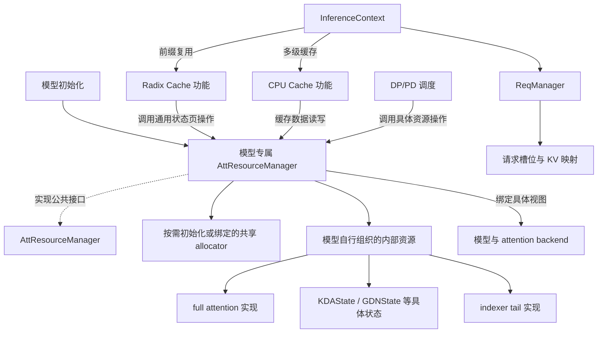

# Attention Resources 架构设计草案

本文定义 attention 资源的架构设计，包括 `AttResourceManager` 的职责、共享 allocator、各类 State 的接口、目录组织及 CPU/DP/PD 传输约定。文中的结构与接口为设计契约，待细化事项集中列于第 9 节。

## 1. 设计约定

统一在 `lightllm/common/att_resources/` 下组织可复用的资源实现，由 `AttResourceManager` 约定公共资源管理接口，各模型提供具体管理器实现，完成资源初始化、内部状态页的聚合操作及 CPU/DP/PD 数据传输。radix cache、CPU cache 和传输调用方依赖对应模型的管理器，资源层不反向依赖这些调用方。

公共层约定三种 allocator 入口，具体实例按模型组合和启用的功能初始化：

```python
class AttResourceManager:
    full_att_allocator: KVPageAllocator | None
    bounded_att_big_page_allocator: CheckpointSlotAllocator | None
    bounded_att_small_page_allocator: CheckpointSlotAllocator | None
```

这三个入口表示资源管理器对分配域的管理责任，聚合操作与传输接口见第 6.2 节。具体初始化必须保证所需 allocator 已创建或绑定，无需的 allocator 为 `None`。例如纯 full-attention 模型只初始化 `full_att_allocator`；启用 linear checkpoint 的组合再按配置初始化大小页 allocator。GPU linear 运行态的存在本身不要求启用 checkpoint 池。

- 基类不声明固定的 `main_full_att`、`draft_full_att`、`main_linear_att`、`draft_linear_att`、`main_indexer_tail`、`draft_indexer_tail` 成员。具体模型自行组织内部资源，数量、组合、字段名和实现类型由模型决定。
- `full_att`、`linear_att`、`indexer_tail` 保留为可复用实现的目录分类。full attention 保存历史 KV；linear attention 由 `LinearAttentionState` 抽象基类约定操作，按算法直接实现 `KDAState`、`GDNState` 等状态对象，包含各自的运行态与可选 checkpoint；indexer tail 保存增量索引所需尾部状态。
- main/draft 可以采用不同方案；同一共享分配域的参与方使用同一个 allocator 实例，遵守统一的索引和回收约定。资源对象持有 buffer 和数据有效性信息；管理器创建或绑定共享 allocator，调用方直接使用对应 allocator 分配与归还索引。
- 模型专属 `AttResourceManager` 提供运行态清零、按前缀长度重置 tail、token 复制、状态页的聚合保存、校验、恢复、失效和数据传输操作；缓存功能流程决定匹配、引用、发布与淘汰时机，推理流程决定请求执行阶段。
- `req_to_token_indexs` 和请求槽位仍由 `ReqManager` 持有。资源管理器接收显式传入的物理索引、请求槽位及恢复长度，提供资源操作接口。
- 内部 attention 资源的暴露方式作为接口设计问题单独讨论。当前建议按调用方区分统一资源操作、模型推理视图和 State 直接传输操作，详见第 6 节。

本文区分已确定的职责边界和接口草案。main/draft 采用组合管理器还是分别装配管理器实例、具体资源的绑定方式及功能接口参数的数据形式仍待细化。

## 2. 整体结构与职责边界



图中的资源类别按模型需要选择，可以缺省或包含多个实例。箭头表示调用或组合关系；main/draft 管理器实例的具体装配方式尚未固定。

| 层次 | 组件 | 职责 |
| --- | --- | --- |
| 请求流程 | `InferenceContext`、`ReqManager` | 创建、暂停、恢复和完成请求；由 ReqManager 管理请求槽位、KV 索引映射及采样参数 |
| 资源数据操作 | `AttResourceManager` 公共功能接口及模型专属实现 | 管理共享 allocator 与内部 State，实现内部状态页的聚合操作与 CPU/DP/PD 数据传输 |
| 缓存功能 | radix、CPU cache 及其调用流程 | 组织前缀匹配、节点引用、发布与淘汰，管理外部缓存页，并调用具体管理器操作资源数据 |
| 资源实现 | 模型所需的 State、存储布局、checkpoint pool | 持有 buffer、布局与数据有效性，实现读写、复制、重置、快照及自身存储的跨进程导出与绑定 |
| 传输调度 | DP/PD 与多级缓存模块 | 管理任务、队列、通信、事件同步及完成通知 |

`AttResourceManager` 不持有请求 KV 映射表，也不直接访问全局 `g_infer_context` 或通过 `ReqManager` 查询映射。资源方法接收调用方提供的请求槽位、长度、物理索引和资源引用；将逻辑 token 位置转换为物理索引、写入或清理请求映射属于请求流程。缓存功能调用方提供已选定数据的长度、索引和资源引用，具体管理器执行清零、复制、保存、校验、恢复或失效。请求阶段的组织和缓存节点策略由相应调用流程负责。

代码依赖从调用流程向资源层单向传递。radix cache 依赖管理器的通用状态页操作；管理器与 State 不导入或访问 radix 节点、树和策略。资源实现也不反向导入请求调度模块；传输调度使用数据读写与复制接口。

## 3. 对象结构与资源归属

```text
ReqManager
├── request_slots
└── req_to_token_indexs           # 共享请求到 KV 的索引映射

AttResourceManager              # 公共接口与 allocator 入口
├── full_att_allocator: KVPageAllocator | None
├── bounded_att_big_page_allocator: CheckpointSlotAllocator | None
└── bounded_att_small_page_allocator: CheckpointSlotAllocator | None

<Model>AttResourceManager       # 模型实现，内部结构由其自行定义
├── 按需创建或绑定所需 allocator
├── 初始化模型所需的资源组合
├── 实现内部状态页聚合操作与 CPU / DP / PD 数据传输
└── 绑定推理视图、组织传输所需状态 # 搬运直接调用 State 方法
```

例如纯 full-attention 管理器可以只保存一个 KV 存储对象；混合模型管理器可以组合 KV、多个 linear 运行态及 indexer tail；包含 draft 时按实际方案组织相关资源。可共用初始化逻辑的模型可以复用管理器实现。公共调用方通过接口使用这些组合。

以下列出可复用资源组件的结构示例。linear attention 直接使用 `KDAState`、`GDNState` 等具体状态对象，由 `LinearAttentionState` 约定必需操作，不增加资源包装实例。管理器内部的字段名和实例数量由模型决定，checkpoint pool 仅在相应功能启用时存在：

```text
FullAttentionState
├── storage_spec                 # 容量、页大小、保留索引范围、device
├── storage                      # 完整数据区域、固定参数及存储描述
└── layer_mapping                # 本模型的层映射

KDAState                         # 一种具体 attention 状态实现
├── conv_state: LayerCache       # 卷积历史窗口及 MTP 尾部空间
├── ssm_state: LayerCache        # KDA 递推状态及 MTP 状态槽位
├── mtp_state_index: Tensor | None
├── big_pages_pool              # 按需创建，使用共享 allocator 分配的槽位
│   ├── buffers
│   └── state_token_lens
└── small_pages_pool            # 按需创建
    ├── buffers
    └── state_token_lens

GDNState                         # 独立定义 GDN 状态、布局和快照操作
└── 按其实现组织 Conv / SSM / MTP 状态及可选大小页 pool

IndexerTailState                 # 抽象操作契约，不固定内部存储
└── KPoolIndexerTailState         # GLM K-pool 的具体状态
    └── tail_buffer              # 原始 key/gate ring，按层、请求组织
```

同一共享分配域中的 allocator 只初始化一次，由资源管理器负责其完整生命周期。若 main/draft 分别使用管理器实例，装配时应注入共享 allocator 引用，并明确唯一的创建和销毁责任，以及调用方统一失效并向 allocator 单次归还的约定；若采用一个组合管理器，则由该实现协调内部资源。两种装配方式均不能因模型数增加而重复分配或释放同一共享索引。实例装配形式保留为待定项。

| 资源 | 持有者 | 分配单位 / 生命周期 |
| --- | --- | --- |
| full-attention 空闲页与容量状态 | `AttResourceManager.full_att_allocator` | 每次为请求统一分配/回收物理页索引，main/draft 共用 |
| 大页 checkpoint 空闲槽位 | `AttResourceManager.bounded_att_big_page_allocator` | 为 main/draft 参与的大页 pool 统一分配槽位 ID |
| 小页 checkpoint 空闲槽位 | `AttResourceManager.bounded_att_small_page_allocator` | 为 main/draft 参与的小页 pool 统一分配槽位 ID，独立于大页分配域 |
| 请求 KV 索引表 | `ReqManager` | 记录逻辑 token 到共享物理索引的映射；负责绑定、更新和清理 |
| HOLD 保留物理页及索引描述 | `AttResourceManager` 及其 full-attention allocator | 从普通分配范围排除保留页；ReqManager 使用其索引初始化 HOLD 行 |
| KV、量化 scale、packed indexer buffer 与层映射 | 具体管理器组织的 full-attention 资源 | 按统一容量建立存储，使用共享索引访问各自数据 |
| KDA/GDN 的 Conv/SSM、MTP 游标 | 具体管理器持有的 `KDAState` / `GDNState` | 使用共同请求槽位域，由各算法状态对象分别维护 |
| 大小页 checkpoint buffer 与 `state_token_lens` | 各具体状态对象中启用的 pool | 使用共同分配的槽位 ID，分别保存数据和长度；不持有独立空闲列表 |
| indexer 原始尾部窗口 | 具体管理器组织的 indexer 资源 | 使用共同请求槽位域，各自维护所需 tail 布局 |
| 请求槽位 | `ReqManager` | 请求创建时分配，完成时回收，暂停时保留 |
| 前缀缓存索引与引用记录 | radix cache 功能 | 维护前缀节点及引用；通过管理器保存、恢复或失效关联资源数据 |

### 3.1 main/draft 共享 full-attention allocator

调用方直接通过 `AttResourceManager.full_att_allocator` 分配一次 KV 索引，再通过 ReqManager 将索引写入共享请求表。复用前缀时，radix 功能选定缓存数据，具体管理器校验并恢复关联状态，所需 KV 索引由 ReqManager 绑定到请求映射。main 和 draft 从同一请求映射获取索引，访问各自的存储：

```text
逻辑 token 位置 t
        ↓ ReqManager.req_to_token_indexs
统一物理索引 i
        ├── main 对应的 KV 存储位置
        └── draft 对应的 KV 存储位置
```

二者的层数、head 维度、dtype 和量化布局可以不同；同一索引域内需要使用兼容的 page_size，并且各存储都覆盖 allocator 可返回的索引范围。同一分配域统一容量和物理页索引规则，不引入模型间索引重映射。

共享索引表示存储位置的对应关系，不表示 main/draft 在每个位置都已经写入有效 KV。MTP 预留区和回退后的有效长度仍由请求执行流程维护。

释放时，请求流程与具体管理器确认相关使用方已完成，由 `ReqManager` 清理请求映射。调用方解除相关使用引用后，仅将不再被缓存、请求或传输持有的索引向同一个 `full_att_allocator` 归还一次。任一模型的资源对象都不能自行释放共享索引。容量评估需要计入各模型真实占用的存储；若资源实例只是同一 buffer 的视图，不重复计算该 buffer。

### 3.2 main/draft 共享 linear checkpoint allocator

main/draft 选择各自需要的具体状态对象，例如 main 使用 `KDAState`，draft 使用 `GDNState` 或无需 linear 状态。各状态对象持有自身运行态及启用的大页或小页 pool。对同一前缀的一个大页或小页 checkpoint，调用方直接从管理器持有的对应 allocator 分配一次槽位 ID，再将该 ID 传给管理器的聚合数据操作，供参与的两侧 pool 使用。两侧的状态布局、dtype 和单槽位字节数可以不同，各自的存储必须覆盖共享 allocator 可返回的槽位范围。

例如分配大页槽位 `s` 后，main 和 draft 对应的大页 pool 在各自的槽位 `s` 保存状态。具体管理器负责找到参与操作的 pool，请求流程无需读取模型内部字段。两侧各自维护 `state_token_lens[s]`；本次复用所需的两侧状态都对应目标长度并满足同步条件后，该缓存数据才具备发布或恢复条件；发布由缓存调用流程组织。仅一侧具有 linear 资源时，只处理该侧。

共享 checkpoint 需要约定共同的恢复边界和 token 位置语义，并确保参与实现都能捕获该位置的状态。MTP 推测中的临时状态需先按执行流程选出对应位置的状态，再保存快照。共享索引不要求 main/draft 每一步同步执行；回收时须等所有参与方结束使用，槽位只归还一次。

linear 运行态与两侧 indexer tail 均由 `ReqManager` 提供的 `req_idx` 定位。indexer tail 不单独分配 checkpoint 槽位；其状态布局和恢复规则由各自实现描述。

### 3.3 分配状态与数据状态分离

allocator 是索引分配的唯一事实来源，资源对象是存储布局与数据有效性的持有者。缓存功能流程通过 radix 维护页/槽位的引用与发布关系；具体管理器校验资源数据的完整性并聚合处理页失效；调用方确认最后一个使用引用已解除后，直接向对应 allocator 归还索引。

同一 linear checkpoint 可以包含 main/draft 多个状态资源的快照。槽位分配状态由共享 allocator 维护，数据内容和有效长度由各侧 pool 分别维护。

对于使用 K-pool 的实现，已完成池化的压缩 key/scale 保留在对应 full-attention 资源的 packed 存储中，indexer tail 资源管理增量计算需要的原始短窗口；二者的组合关系由具体管理器维护。

### 3.4 按具体 attention 实现定义状态

定义只约束操作的 `LinearAttentionState` 抽象基类，由 `KDAState`、`GDNState` 等子类负责自己的成员、布局、重置、快照与恢复语义。`AttResourceManager` 初始化并组合所需对象，公共缓存流程通过管理器访问它们。不同模型也可以复用同一种状态实现。

`KDAState` 的成员定义如下：

```python
class KDAState(LinearAttentionState):
    conv_state: LayerCache
    ssm_state: LayerCache
    mtp_state_index: torch.Tensor | None
    mtp_step: int  # 该实例的 MTP 布局参数
    big_pages_pool: LinearCheckpointPool | None
    small_pages_pool: LinearCheckpointPool | None
```

`LayerCache` 封装按层组织的 Tensor。该示例中的 Conv、SSM 和 MTP 索引驻留 GPU；checkpoint pool 独立持有快照 buffer 和 `state_token_lens`。设请求槽位容量为 `N`（包含保留槽位），该实例的 `mtp_step` 为 `S`：

| 成员 | 内容与索引方式 |
| --- | --- |
| `conv_state` | 对应算法的卷积历史窗口，窗口宽度为 `conv_kernel_size - 1 + S`；用 `buffer[layer, req_idx, ...]` 访问 |
| `ssm_state` | KDA 的递推矩阵状态，每请求预留 `S + 1` 个状态槽位；第 `j` 个槽位位于 `buffer[layer, req_idx * (S + 1) + j, ...]` |
| `mtp_state_index` | 形状为 `[N]` 的 `int32` Tensor；记录各请求接受的 MTP 状态索引。`S == 0` 时为 `None` |
| 大小页 pool | 按需创建，保存该算法指定前缀位置的状态，并分别记录 `state_token_lens`；槽位来自管理器的对应 `bounded_att_*_allocator` |

`GDNState` 按 GDN 算法独立定义 Conv/SSM 和 MTP 状态，可以复用底层 `LayerCache`、兼容的 checkpoint buffer 布局及复制工具。两者共同实现 `LinearAttentionState` 接口；基类不规定 Conv/SSM 等成员，不据此判断两种算法的状态内容可以互换。

运行态按 `ReqManager` 的槽位容量预分配，状态对象接收 `req_idx` 执行操作。main/draft 可以持有同一种状态类的两个独立实例，也可以使用不同状态类型；各实例的层数、维度、dtype 和 MTP 配置由对应模型决定。allocator 仍由 `AttResourceManager` 创建或绑定并统一管理。

后续 sliding-window attention 可以直接定义 `SlidingWindowState`，按窗口 KV、有效范围和游标等实际需求组织成员。它可以使用适用的 bounded-attention checkpoint 分配域，但其快照布局与恢复语义由自身实现定义。KDA/GDN 等递推状态的必需接口见 6.7 节；sliding-window 可以复用适用的页分配与描述工具，其接口另外按窗口语义细化，不强制继承线性状态基类。

## 4. 目录设计

目录按资源管理、allocator 与具体 State 组织，传输能力由具体实现类提供。管理器、公共 State、allocator 和 pool 文件按对应类名命名；具体 State 实现使用算法或布局名加 `_state.py`。Triton/CUDA 计算 kernel 位于对应计算模块，由 State 方法调用。

```text
lightllm/common/
├── att_resources/
│   ├── __init__.py
│   ├── att_resource_manager.py          # AttResourceManager：缓存与传输的数据操作接口
│   ├── types.py                         # StorageDescriptor / BufferTransferLayout / StateCopyMapping 等
│   ├── allocators/                      # 管理器直接持有，同一分配域共享实例
│   │   ├── __init__.py
│   │   ├── kv_page_allocator.py         # KVPageAllocator：full_att 分配域
│   │   └── checkpoint_slot_allocator.py # CheckpointSlotAllocator：bounded_att 大小页各一个实例
│   ├── full_att/
│   │   ├── __init__.py
│   │   ├── full_attention_state.py      # FullAttentionState：公共接口与可复用基础逻辑
│   │   ├── dense_state.py               # DenseFullAttentionState
│   │   ├── group_quantized_state.py     # GroupQuantizedFullAttentionState：INT4 / INT8 等
│   │   ├── static_fp8_state.py          # StaticFP8FullAttentionState
│   │   ├── mla_state.py                 # MLAFullAttentionState
│   │   ├── packed_mla_state.py          # PackedMLAFullAttentionState：含 indexer key/scale 的 packed 布局
│   │   ├── operator/                    # State 内部复用的 KV 写入、量化与复制函数
│   │   └── transfer_ops.py              # State 内部复用的 CPU/DP/PD 搬运函数
│   ├── linear_att/
│   │   ├── __init__.py
│   │   ├── linear_attention_state.py    # LinearAttentionState：抽象操作契约，无固定存储成员
│   │   ├── kda_state.py                 # KDAState：Conv / SSM / MTP 与页操作
│   │   ├── gdn_state.py                 # GDNState：独立算法状态与页操作
│   │   ├── linear_checkpoint_pool.py    # LinearCheckpointPool：big_pages_pool / small_pages_pool 的存储
│   │   └── transfer_ops.py              # State 内部复用的状态打包与 TP 布局转换函数
│   └── indexer_tail/
│       ├── __init__.py
│       ├── indexer_tail_state.py        # IndexerTailState：尾部状态抽象操作契约
│       ├── kpool_state.py               # KPoolIndexerTailState：原生 ring 与恢复规则
│       └── transfer_ops.py              # State 内部复用的 tail 搬运函数
└── req_manager/                          # 请求槽位、KV 索引映射、采样与生命周期

lightllm/models/<model>/
├── model.py                              # 选择、装配本模型的资源管理器
└── att_resource_manager.py               # 模型资源组合、功能数据操作及具体资源绑定
```

`allocators/` 与三类 State 目录平级。`kv_page_allocator.py` 提供 full-attention 的物理页分配器；`checkpoint_slot_allocator.py` 提供 bounded-attention 的状态槽位分配器，管理器按需创建大小页两个独立实例。后者的分配能力不限定为 linear attention，使用它也不要求继承 `LinearAttentionState`。

`full_attention_state.py`、`linear_attention_state.py`、`indexer_tail_state.py` 分别定义三类公共接口；布局或算法差异由对应的 `*_state.py` 实现。full-attention 的 storage 属于具体 State 的内部实现，可与该 State 放在同一文件中；确有复用需要时再拆为内部存储工具，不设置另一套独立的 storage 公共继承体系。

`linear_checkpoint_pool.py` 对应 `LinearCheckpointPool` 存储组件，供 `big_pages_pool` 和 `small_pages_pool` 复用；两者通过实例区分。公共页操作仍使用 `save_pages`、`restore_pages` 等名称，pool 不持有 allocator。`KPoolIndexerTailState` 管理请求运行态，不创建独立大小页 pool。

`FullAttentionState`、`LinearAttentionState` 与 `IndexerTailState` 的具体子类直接实现 CPU、DP、PD 读写及自身存储的跨进程导出与绑定。各资源目录中的 `transfer_ops.py` 仅放这些方法内部复用的函数，按实际复用需要创建。模型专属 `AttResourceManager` 在自身实现中组织多资源读写、CPU 联合页、长度元数据和位置映射。网络通信、任务队列与完成通知由 server 层管理。

模型专属资源组合、缓存与传输数据操作放在 `lightllm/models/<model>/att_resource_manager.py`，同类模型可以复用管理器实现。radix 和 CPU cache 功能通过具体管理器操作资源数据，缓存策略与请求执行流程按各自职责组织。公共资源包不反向导入模型实现；模型初始化负责选择和装配。main/draft 的实例数量、内部字段及资源方案由具体管理器决定，共享 allocator 按分配域统一创建或绑定。

`types.py` 仅放跨资源使用的纯数据类型，包括 `StorageDescriptor`、`TransferRegion`、`BufferTransferLayout`、`StateCopyMapping`，以及页类别、槽位引用和有效长度等共享描述。各 State 的内部类型放在对应实现文件中，字段格式和状态选择由该实现解释。资源目录不引入统一插件注册机制，也不要求三类 State 继承同一个大接口。

## 5. allocator 与 checkpoint pool

### 5.1 allocator 的公共入口与按需初始化

| 公共入口 | 类型 | 初始化条件 |
| --- | --- | --- |
| `full_att_allocator` | `KVPageAllocator \| None` | 组合中存在需要页式 KV 分配的 full-attention 资源 |
| `bounded_att_big_page_allocator` | `CheckpointSlotAllocator \| None` | 启用大页 linear checkpoint |
| `bounded_att_small_page_allocator` | `CheckpointSlotAllocator \| None` | 启用小页 linear checkpoint |

具体管理器初始化完成时，已启用的分配域必须具有 allocator 实例及容量匹配的资源，未启用的入口保持 `None`。申请未启用的分配域应明确报错；公共缓存流程根据已启用能力选择操作。只有 full attention 的配置无需创建 linear allocator、运行态或 checkpoint pool。

allocator 入口的存在只能说明该分配域已启用，具体恢复边界、支持的传输布局等能力仍由模型管理器明确描述。

大小页均启用时，使用同一种 allocator 类的两个独立实例，每个实例供参与模型对应类别的 pool 共用。同一模型的单个快照保存该实现所需的完整状态，例如 Conv/SSM；main/draft 的快照布局和大小可以不同。“大页/小页”指 token 边界和缓存策略，不表示快照按 token 数分成不同大小。

`KVPageAllocator` 以完整物理页为分配单位，对外提供对应 token 索引；checkpoint allocator 返回状态槽位 ID。GPU 运行态和 indexer tail 使用请求槽位，不使用上述 checkpoint allocator。

### 5.2 管理器、allocator 与 pool 分工

`CheckpointSlotAllocator` 只维护可用槽位。`LinearCheckpointPool` 只持有状态 buffer 和有效长度，使用外部传入的槽位完成保存、恢复和失效处理。`AttResourceManager` 持有 allocator 并提供跨 State 的聚合数据操作，调用方直接使用 allocator。操作顺序如下：

1. 调用方直接从 `bounded_att_big_page_allocator` 或 `bounded_att_small_page_allocator` 分配槽位。pool 初始化时有效长度为 None，槽位归还前统一失效，保证空闲槽位不保留有效页记录。
2. `save_pages` 聚合调用参与 State 保存；异步操作通过 stream/event 保证后续读取顺序。保存失败时使本次目标页在全部参与 pool 中失效。
3. `has_page` 校验全部参与 State 的页记录；`restore_pages` 在整体校验通过并满足同步条件后执行恢复。
4. 调用方确认引用已解除且异步使用完成，先调用 `invalidate_pages` 清除全部参与 pool 的有效记录，再直接向同一个 allocator 归还共享槽位一次。

CPU load/offload 尾页的两个暂存槽位 ID 由管理器统一保留，排除在大页 allocator 的普通分配范围外；参与操作的 main/draft 大页 pool 分别为这些槽位提供存储。

具体管理器声明数据可捕获及可恢复的条件，并实现保存、恢复和失效操作；缓存调用流程选择保存位置、发布时机及淘汰对象，并直接调用 allocator 处理分配与归还。State 和 pool 执行对应的数据操作。

### 5.3 页内状态的 token 长度元数据

各模型实际创建的 `big_pages_pool` 和 `small_pages_pool` 分别保留一份 `state_token_lens: list[int | None]`，按槽位 ID 索引，记录该槽位保存的状态所对应的 token 前缀长度。长度从序列起点计数；pool 的物理槽位大小由具体状态布局决定。这份元数据用于校验保存和恢复位置。

| 槽位记录 | 含义 |
| --- | --- |
| `state_token_lens[slot] is None` | 该槽位没有有效快照记录，包括尚未保存、保存失败或已经释放的情况 |
| `state_token_lens[slot] == L` | 该槽位的快照对应处理完前 `L` 个 token 后的状态 |

上层的 `length → slot` 映射表达某个前缀关联哪个槽位；pool 中的 `slot → state_token_len` 记录槽位内快照对应的位置。恢复时两者必须一致。只预留槽位但尚未捕获状态的中间页边界保持 `None`。

`LinearCheckpointPool` 通过保存、载入和失效接口维护这份记录；`AttResourceManager` 组织操作并校验恢复条件，allocator 只维护槽位的分配状态。CPU offload/load 同步携带并恢复长度元数据。对于包含 linear attention 的模型，每个已发布 CPU 缓存页必须包含全部参与 linear State 在该页前缀终点的有效状态；内部 pool 中尚未捕获的 None 记录不能发布为 CPU 缓存页。长度记录本身不表示异步复制已完成，也不标识具体 token 前缀；同步由 stream/event 保证，前缀身份由请求与缓存关联关系保证。

## 6. 对外接口与 attention 资源暴露方式

模型专属管理器负责资源初始化、内部组合及缓存和传输功能所需的数据操作。以下接口按数据用途划分；调用方显式提供索引、长度、槽位及来源，具体管理器组织内部 State 完成操作。

### 6.1 FullAttentionState：公共接口与不同 storage 的完整处理

本节是底层接口草案。`FullAttentionState` 负责一组历史 KV 存储的容量描述、布局访问、写入及复制，包含该布局所需的 scale 和 packed indexer 数据。`AttResourceManager` 决定实例组合、共享索引域及生命周期。allocator 由管理器持有，缓存发布由缓存调用流程组织，请求映射由 ReqManager 负责，通信任务由传输调度负责。

#### 继承与内部 storage 的关系

建议以 `FullAttentionState` 作为公共接口，由具体布局子类实现差异。子类内部的 storage 持有 buffer 和布局信息，operator 可以复用兼容的写入、量化及复制 kernel。布局选择集中在具体子类及其配套实现，公共调用方使用稳定接口。

```text
FullAttentionState
├── DenseFullAttentionState
├── GroupQuantizedFullAttentionState  # INT4 / INT8 等
├── StaticFP8FullAttentionState
└── MLAFullAttentionState
    └── PackedMLAFullAttentionState  # 示例：附带 indexer 数据
```

这些是目标实现示例，具体继承关系以可复用的行为为准。改变布局的子类必须重新核对存储描述、层视图、写入、完整复制和传输能力；父类的布局假设不能直接用于新的 packed 格式。内部 storage 可以是明确类型的数据对象或可复用的存储组件，不要求建立与 State 平行的公共继承体系。

#### 必须提供的公共接口

```python
# ViewT / WriteT 为具体布局定义的类型，下面是公共签名草案。
class FullAttentionState:
    @classmethod
    def get_required_bytes(cls, layout_config, storage_spec) -> int:
        ...

    def __init__(self, layout_config, storage_spec):
        ...

    def get_storage_descriptor(self) -> StorageDescriptor:
        ...

    def get_layer_view(self, layer_id: int) -> ViewT:
        ...

    def write_kv(self, layer_id: int, token_indices: torch.Tensor, kv: WriteT) -> None:
        ...

    def copy_tokens(self, src_indices: torch.Tensor, dst_indices: torch.Tensor) -> None:
        ...

    # layout 描述该 State 在外部页中的位置及本地轴到页内轴的映射。
    def write_to_cpu(
        self, token_indices, cpu_buffer, cpu_page_indices,
        *, layout: BufferTransferLayout,
    ) -> None:
        raise NotImplementedError

    def read_from_cpu(
        self, cpu_buffer, cpu_page_indices, token_indices,
        *, layout: BufferTransferLayout,
    ) -> None:
        raise NotImplementedError

    # 一个明确源 State 到当前 State；具体管理器按来源和分片拆分批次。
    def copy_from_dp(
        self, src_state, src_token_indices, dst_token_indices,
        *, mapping: StateCopyMapping,
    ) -> None:
        raise NotImplementedError

    # pd_buffer 为已选中的一页，区域偏移相对该页起点。
    def write_to_pd_buffer(
        self, token_indices, pd_buffer,
        *, layout: BufferTransferLayout,
    ) -> None:
        raise NotImplementedError

    def read_from_pd_buffer(
        self, pd_buffer, token_indices,
        *, layout: BufferTransferLayout,
    ) -> None:
        raise NotImplementedError
```

“必须提供”表示各布局满足相同的操作契约，可以继承正确的公共实现。创建或绑定 buffer 属于初始化；请求使用哪些物理 token 槽位由管理器的 allocator 决定。

| 接口 | 完整语义 |
| --- | --- |
| `get_required_bytes(layout_config, storage_spec)` | 在创建大块 buffer 前计算常驻 Tensor 存储需求，包括 KV、动态 scale、由本状态持有的固定参数、packed 数据、布局填充及保留区域。与真实初始化使用相同布局规则；管理器汇总资源需求，单独考虑传输空间和框架分配开销 |
| 初始化 | 创建或绑定实际存储，建立层映射并校验容量、dtype、对齐和配置；随后暴露有效视图。共享底层存储的所有权及其负责区域必须明确 |
| `get_storage_descriptor()` | 返回完整存储描述，供管理器做记账、兼容性检查和传输初始化。描述覆盖本 State 负责的全部数据及固定布局信息，其结构在正常推理期间保持稳定 |
| `get_layer_view(layer_id)` | 返回该逻辑层供匹配 backend 使用的具体视图，包含计算所需 Tensor 和参数。视图引用底层存储，不触发 KV 搬运；没有对应 full-attention 存储的层明确报错 |
| `write_kv(layer_id, token_indices, kv)` | 将输入 KV 写入已分配物理位置，完成该布局需要的编码、量化及关联 scale 更新。输入类型与格式由具体布局明确，不能把浮点 KV、已量化数据和 packed 字节隐式混用 |
| `copy_tokens(src_indices, dst_indices)` | 在同一 State 内复制所有所辖存储层的对应 token 数据，覆盖全部随 token 变化的字段；保持存储表示，不重新量化。只操作本 State 负责的区域，遵守该布局声明的复制粒度与对齐条件 |

容量、device、层映射及布局标识应从同一份稳定配置和描述中取得，避免多处维护互相矛盾的副本。配置相同且只改变容量时，容量计算和真实 buffer 创建应覆盖相同的数据组成。共享底层内存按实际分配去重记账。

#### StorageDescriptor 必须描述什么

`StorageDescriptor` 是存储结构与语义的描述，具体类型仍待实现时细化。至少包含：

| 信息 | 用途 |
| --- | --- |
| 容量、保留索引范围、page size、device | 确认存储覆盖管理器给出的物理索引域 |
| 布局标识/版本、资源身份、层映射、量化配置 | 标识模型角色及资源，记录逻辑层到本地物理层的映射，定位实际存储并检查兼容性 |
| 本 State 的 TP 分片描述 | 记录所属 TP 组及 rank、各字段本地轴到全局 head/channel 的对应和副本关系；不同资源可以使用不同分片方案 |
| 本 State 的数据区域及 Tensor 视图 | 列出 KV、动态 scale、packed 辅助字段，说明 token 维、stride、区域偏移和必要复制粒度 |
| 固定参数 | 列出静态 scale 等解释缓存所需的参数，明确如何绑定及验证兼容性 |
| 传输支持与格式 | 声明已实现的路径、可支持的字段表示、页格式及映射约束；组合页的区域位置由管理器统一安排，通过 layout/mapping 参数传入直接方法 |
| 底层分配与视图的关系 | 区分实际占用和别名视图，避免重复计费或重复/越界复制 |

该描述的结构只读，里面引用的 Tensor 可以由合法计算操作更新。固定布局信息不等于数据就绪信号；stream/event 同步和前缀关联仍由调用流程负责。

完整性以本 State 声明的数据范围为准。每次增加辅助 buffer 或 packed 字段，都需要检查描述、容量计算、写入和复制/传输是否一起覆盖它。公共层不根据 `hasattr(scale_buffer)` 或固定属性名推测资源组成。

#### 计算视图与完整存储范围

| 布局 | 计算视图的主要内容 | 完整复制需要覆盖的内容 |
| --- | --- | --- |
| 普通 K/V | K、V | 对应位置的全部 K/V |
| 分组 INT4/INT8 | K/V 与动态 scale | packed/量化 K/V 加上对应动态 scale |
| 静态 FP8 | 以正确数值类型解释的 KV 及静态 scale | 本地 token 复制只搬 KV；跨资源使用须验证或传递固定量化参数 |
| MLA | 压缩 KV 或其所需分段 | 本 State 负责的完整压缩 KV 表示 |
| 带 indexer 的 packed 布局 | attention KV 子视图、indexer key/scale 子视图 | KV 及全部相关 packed 辅助数据；按实际存储区域处理别名 |

`get_layer_view()` 可以返回 `DenseKVView`、`QuantizedKVView`、`MLAView` 等具体小对象。视图类型由模型/backend 在初始化绑定时确认。各布局不必返回相同 Tensor 个数，也不必填充包含所有可选字段的大对象。

带 indexer 的 packed 布局中，attention 与 indexer 可以分别读取 buffer 的不同区域。因此不能用 attention 的读取视图代替完整复制范围。类似地，静态 FP8 的物理存储 dtype 和计算时解释的 dtype 可以不同，视图必须明确相应参数。

`write_kv` 更新其输入所描述的 KV 及关联字段；indexer 池化等专用 kernel 可以通过专用视图写入另一区域。管理器与执行流程在相关写入都满足同步条件后才允许复用或发布。融合写入路径可以直接使用预先绑定的布局视图，同时遵守相同的数据表示与完整性约定。

#### 基类与子类的分工

| 部分 | 基类可复用逻辑 | 子类必须负责的内容 |
| --- | --- | --- |
| 初始化 | 生命周期、配置与映射校验、稳定视图管理 | `_create_storage(...)`：实际 Tensor/区域和完整描述；`get_required_bytes(...)`：同布局的容量计算 |
| 层访问 | 逻辑层到存储层的映射、视图缓存 | `_make_layer_view(storage_layer_id)`：该布局的计算视图 |
| 写入 | 参数契约、层映射和公共调用入口 | `_write_kv(...)`：编码/量化/写入 kernel 及输入格式校验 |
| 完整复制 | 索引操作契约、公共调用入口 | `_copy_tokens(...)`：布局正确的复制，或显式复用与其描述兼容的公共工具 |
| 传输 | 定义 CPU/DP/PD 直接读写接口，未支持的操作显式报错 | 覆盖所支持的读写方法，直接使用自身 storage 调用相应 kernel |

受保护方法名为候选。一个子类可以复用满足其布局要求的 kernel；通用复制工具只有在理解 token 维、stride、数据区域和别名关系时才适用。复杂 packed 布局应由专用实现处理，公共层不尝试仅凭 Tensor shape 推导复制语义。

#### 索引、异步执行与生命周期

`storage_spec` 明确可分配容量、保留区域和 device；HOLD 索引由管理器决定，State 为其提供存储。构造时完成映射和存储配置，正常推理期间保持 buffer 地址稳定。

`layer_id` 的命名空间在模型绑定时约定。两个逻辑层若共享同一物理层，计算视图可指向同一存储，完整复制和容量统计按实际区域去重。`token_indices` 为已分配的物理 token 索引，逻辑请求映射仍由 `ReqManager` 管理。

写入与复制接受与资源同设备的一维整数索引 Tensor。源和目标索引长度相同，目标唯一；基础复制先约定源目标不重叠，重叠移动另行定义。索引还须满足具体布局的对齐和粒度条件。

数据操作在调用方当前 CUDA stream 上提交，方法返回不代表设备操作完成；跨 stream 消费由调用方建立依赖。销毁存储前，管理器等待相关计算和传输结束并解除推理视图及跨进程存储引用。热路径不支持隐式 resize；需要重建存储时必须重新绑定视图及相关执行结构。

#### CPU / DP / PD 直接操作

三种路径直接作为 `FullAttentionState` 的方法暴露，由子类覆盖实现。接口在数据与物理索引之外显式接收位置映射，描述复杂资源组合及 TP 分片对应关系。`BufferTransferLayout` 和 `StateCopyMapping` 都是只读数据参数，不包含算子、buffer 所有权或执行方法。

| 接口 | 数据方向与位置参数 |
| --- | --- |
| `write_to_cpu(..., layout)` | 当前 State → CPU 缓存；layout 描述外部页区域、层/轴映射和写入副本选择 |
| `read_from_cpu(..., layout)` | CPU 缓存 → 当前 State；layout 描述该目标 State 从页中读取的对应范围 |
| `copy_from_dp(src_state, src_token_indices, dst_token_indices, mapping=...)` | 一个明确源 State → 当前 State；mapping 描述两侧字段、物理层及分片范围的对应 |
| `write_to_pd_buffer(..., layout)` | 当前 State → 已选中的 PD 页；按 layout 写入指定区域 |
| `read_from_pd_buffer(..., layout)` | 已选中的 PD 页 → 当前 State；按 layout 恢复对应区域 |

`write_to_*` 表示将本 State 的数据写到外部区域，`read_from_*` 表示从外部区域读入本 State。DP 的源明确到具体 State，具体管理器按源 DP/TP/资源及对应 token 分组；一个目标分片需要多个来源时，以多次直接调用覆盖，不假定源 rank 与目标 rank 一一对应。

基类对未支持的操作抛出 `NotImplementedError`，子类覆盖自身支持的路径，不能用空实现表示成功。`AttResourceManager` 在启用对应功能时校验所需方法和布局映射。具体实现必须声明其支持的组合；不支持的量化、重分片、非连续布局或部分页操作须明确拒绝。

每次调用完整处理其映射涉及的数据及关联的动态 scale、packed 字段；一次组合传输可以由若干次调用完成，上层检查所有必需数据区域均已完成。固定参数按约定传递或验证兼容性。位置映射的组成、单位及生成责任见 6.5 节。

方法统一在调用方当前 CUDA stream 上提交操作，返回 `None`。若内部使用其他 stream，子类须将完成依赖汇合到调用方 stream，使调用方随后记录的 event 覆盖本次操作。网络收发、任务排队和完成通知由调度层负责。

形状相同不能证明不同模型的 KV 语义可互换。模型/资源身份和 token 前缀匹配由管理器与缓存流程校验；State 检查布局及固定参数兼容性。跨布局重编码需要明确实现，本地 `copy_tokens` 不承担这一职责。

### 6.2 AttResourceManager：内部资源的聚合操作与数据传输

`AttResourceManager` 对内部资源组合提供统一的数据操作。一个模型可以包含多个 FullAttentionState、KDAState、GDNState 或其他状态实现；token 复制覆盖 full-attention 参与集合，清零操作覆盖需要初始运行态的参与集合，状态页操作覆盖指定大小页域的参与集合。外部调用方无需知道具体数量、类型或成员名称。

数据操作的依赖方向是 `radix cache / CPU cache / 其他调用方 → AttResourceManager → 各 State`；槽位分配与归还由调用方直接访问管理器持有的共享 allocator。状态页接口不接收 radix 节点、树或前缀匹配对象，也不读取 radix 内部状态；radix 只保存并使用管理器提供的页类别、槽位 ID 和状态长度等数据。状态页在未启用 radix 时同样可以保存、恢复或用于 CPU 缓存。

#### 数据操作入口

| 操作 | 接口 | 聚合语义 |
| --- | --- | --- |
| full-attention token 复制 | `copy_tokens(src_indices, dst_indices)` | 聚合复制所有参与 FullAttentionState 的对应物理 token 数据，覆盖各自完整存储字段 |
| 空前缀运行态清零 | `reset_state(req_indices)` | 将指定槽位的全部参与运行态恢复到长度 0 的初始状态，覆盖递推状态、控制信息与 indexer tail |
| 无 tail 快照的前缀恢复 | `reset_tail_state(req_indices, state_token_lens)` | 先聚合校验所有 tail 的恢复条件，再按对应长度重置 tail，保留其他已恢复状态 |
| 状态页保存 | `save_pages(...)` | 将指定运行态保存到全部参与 State 的同类 pool、同一组槽位 |
| 状态页校验 | `has_page(page_kind, slot_id, state_token_len)` | 全部参与 State 在该槽位都有匹配长度的有效页时返回 True |
| 状态页恢复 | `restore_pages(...)` | 先整体校验，再将各 State 保存的页恢复到对应运行态位置 |
| 状态页失效 | `invalidate_pages(page_kind, slot_ids)` | 撤销全部参与 pool 中指定槽位的数据有效性，保留分配 |
| PD 写出 / 读回 | `write_to_pd_buffer(...)` / `read_from_pd_buffer(...)` | 组合对应 State 的数据，按指定 KV 或运行态范围打包、还原 |
| DP 复制 | `copy_from_dp(...)` | 按显式来源、字段、层和分片映射，复制内部参与 State 的数据 |
| CPU 写出 / 读回 | `write_to_cpu(...)` / `read_from_cpu(...)` | 组合 KV、状态页与长度元数据，读写各 State 在外部页中的区域 |

#### 必须实现的聚合接口

```python
from abc import ABC, abstractmethod
from collections.abc import Mapping
from typing import Literal

PageKind = Literal["big", "small"]


class AttResourceManager(ABC):
    full_att_allocator: KVPageAllocator | None
    bounded_att_big_page_allocator: CheckpointSlotAllocator | None
    bounded_att_small_page_allocator: CheckpointSlotAllocator | None

    @abstractmethod
    def copy_tokens(
        self, src_indices: torch.Tensor, dst_indices: torch.Tensor,
    ) -> None: ...

    # 空前缀初始化；req_indices 只定位已分配的运行态槽位。
    @abstractmethod
    def reset_state(self, req_indices) -> None: ...

    # 无 tail 快照的前缀恢复；只校验并重置 tail。
    @abstractmethod
    def reset_tail_state(self, req_indices, state_token_lens) -> None: ...

    @abstractmethod
    def save_pages(
        self, req_indices, state_token_lens, *, page_kind: PageKind, slot_ids,
    ) -> None: ...

    @abstractmethod
    def has_page(self, page_kind: PageKind, slot_id, state_token_len) -> bool: ...

    @abstractmethod
    def restore_pages(
        self, req_indices, expected_token_lens, *, page_kind: PageKind, slot_ids,
    ) -> None: ...

    @abstractmethod
    def invalidate_pages(self, page_kind: PageKind, slot_ids) -> None: ...

    # CPU 联合页：KV + 可选大小页快照 + 可选 tail。
    @abstractmethod
    def write_to_cpu(
        self, token_indices, cpu_buffer, cpu_page_indices,
        *, layouts: Mapping[str, BufferTransferLayout],
        page_kind: PageKind | None = None, slot_ids=None,
        state_token_lens=None, req_indices=None,
    ) -> None: ...

    # 一次读取同一前缀的有序页面；tail 只恢复最后一页到 req_idx。
    @abstractmethod
    def read_from_cpu(
        self, cpu_buffer, cpu_page_indices, token_indices,
        *, layouts: Mapping[str, BufferTransferLayout],
        page_kind: PageKind | None = None, slot_ids=None,
        expected_token_lens=None, req_idx: int | None = None,
    ) -> None: ...

    # 一个明确来源管理器到当前管理器，按来源与 TP 分片分批调用。
    @abstractmethod
    def copy_from_dp(
        self, src_manager: "AttResourceManager",
        src_token_indices, dst_token_indices,
        *, mappings: Mapping[str, StateCopyMapping],
        src_req_indices=None, dst_req_indices=None, state_token_lens=None,
    ) -> None: ...

    # pd_buffer 始终是已选中的一页，kind 沿用 kv / att_state 两类任务。
    @abstractmethod
    def write_to_pd_buffer(
        self, pd_buffer, *, kind: Literal["kv", "att_state"],
        layouts: Mapping[str, BufferTransferLayout],
        token_indices=None, req_idx: int | None = None,
        state_token_len: int | None = None,
    ) -> None: ...

    @abstractmethod
    def read_from_pd_buffer(
        self, pd_buffer, *, kind: Literal["kv", "att_state"],
        layouts: Mapping[str, BufferTransferLayout],
        token_indices=None, req_idx: int | None = None,
        expected_token_len: int | None = None,
    ) -> None: ...
```

以上方法均为基类的抽象契约，由具体管理器实现或继承兼容的聚合实现。未支持的 CPU/DP/PD 路径须明确报错，启用相应功能时检查参与 State 的完整支持能力。未启用某种页分配域时，`has_page` 返回 False，保存、恢复和失效该域则明确报错；纯 full-attention 模型无需创建大小页 pool，其 `reset_state` 可以为空操作；没有 indexer tail 的组合，其 `reset_tail_state` 也可以为空操作。

`page_kind="big"` 对应 `bounded_att_big_page_allocator` 和参与 State 的 `big_pages_pool`；`"small"` 对应小页 allocator 与 `small_pages_pool`。两者是独立分配域，即使槽位数字相同，也不是同一份资源。

调用方根据 `page_kind` 直接选择相应 allocator；该成员为 None 时不能申请该域。分配与归还使用 allocator 自身的接口，管理器不再增加包装方法。allocator 只管理空闲索引，不修改 State 的页数据或有效长度。

`req_indices` 只定位运行态存储，不传递请求对象。保存/恢复时，请求状态槽位、页槽位和长度逐项对应；目标槽位唯一且已分配。长度表达实际已接受状态的位置，不能通过传入任意长度把当前运行态改称为历史状态。

#### 空前缀运行态初始化

`reset_state(req_indices)` 用于没有任何可恢复缓存、从前缀长度 0 开始计算的场景。调用方已通过 ReqManager 取得请求槽位，并确认这些槽位此前的计算和传输使用结束；管理器只按传入索引初始化数据，不查询缓存命中情况或请求对象。

- 对全部参与的 KDA/GDN 等状态调用 `reset_requests(req_indices)`，将 Conv/SSM 恢复到零初值，并重置 MTP 游标及影响后续读取的候选信息。未来算法按自身契约恢复空前缀初态。
- 对全部参与的 IndexerTailState 调用 `reset_requests(req_indices, state_token_lens=zeros)`，其中 `zeros` 与请求槽位等长；K-pool 清零原生 ring，其他实现同时初始化必要控制字段。
- full-attention 没有需要清零的空前缀递推状态；该操作不遍历或清空历史 KV，不更改请求映射，也不失效大小页快照或归还索引。纯 full-attention 管理器合法地不做数据操作。
- 目标请求槽位须唯一且在有效范围内，main/draft 所需运行态全部初始化后才可使用。重复执行在没有并发访问时具有相同结果；方法返回仍遵守 stream 完成约定。

这是长度 0 的数据初始化接口，不接收非零前缀长度。命中非零前缀时使用 `restore_pages` 或 CPU/DP/PD 读回；没有 tail 快照时通过 `reset_tail_state` 按长度校验并初始化 tail；不能在部分资源恢复后调用此方法，否则会清除已经恢复的运行态。

#### 无 tail 快照时按前缀长度重置

`reset_tail_state(req_indices, state_token_lens)` 用于已选定恢复前缀、但没有 tail 快照的情况，支持长度 0 和满足各实现恢复条件的非零长度。请求槽位与长度逐项对应，目标槽位唯一且已分配；该接口仅定位数据，不读取请求映射或缓存节点。

具体管理器先对全部参与的 IndexerTailState 和全部目标长度调用 `can_restore_without_tail(L)` 校验，全部通过后才逐个调用底层 `reset_requests(req_indices, state_token_lens)`。例如 K-pool 要求 `L % P == 0`；main/draft 各按自己的 P 检查。任意条件不满足时在修改任何 tail 前报错，调用方须使用真实 tail 快照或其他合法恢复点，不能强制清零后继续。

该操作只重置 tail 及其必要控制信息，保留已恢复的 Conv/SSM、MTP 游标、KV 和大小页快照。没有 tail 的管理器合法地不做数据操作。调用方保证此前使用已结束，并在相关数据操作完成后继续计算；这不是运行中 MTP 回退的替代操作。

前缀页命中时，调用方恢复 KV 和 linear 页后，调用本接口处理未保存的 tail。CPU 最后一页已有 tail 快照，或 DP/PD 已传入完整 tail 时，直接使用该快照，不再调用本接口重置它。恢复条件检查内聚在此方法中，无需调用方访问内部 State。

#### full-attention 的聚合 token 复制

`copy_tokens(src_indices, dst_indices)` 在本管理器持有的 full-attention 存储内部执行位置复制。参与集合在初始化时按共享 token 索引域确定，可以包含 main/draft 的不同布局，也可以包含同一模型的多个 FullAttentionState。管理器将同一组物理索引交给各参与 State 的 `copy_tokens`；每个 State 在自己的存储中从源位置复制到目标位置，不在不同模型之间互拷数据。

- 复制覆盖全部参与存储层的 KV、动态 scale 和 packed indexer key/scale 等随 token 变化的数据，保持各自存储表示；共享物理区域的别名按所有权去重。
- 源和目标为逐项对应的一维整数索引 Tensor，长度相等、目标唯一，且满足各布局的复制粒度与对齐要求；基础契约要求源目标不重叠。源数据须已就绪并保持有效，目标物理位置须已分配且允许写入。
- 只搬运 full-attention token 数据，不分配或回收索引、不修改 ReqManager 映射，也不复制 linear 运行态、大小页快照或 IndexerTailState 的原始 tail。
- 调用前校验全部参与 State 的参数和能力；无 full-attention 参与者时明确报错。方法在当前 stream 提交并返回 None，全部参与复制完成前不能消费目标数据；中途失败时目标视为未就绪。

例如 main 和 draft 各有一个 FullAttentionState，复制物理位置 `[10, 11]` 到 `[20, 21]` 时，一次管理器调用会分别搬运 main 和 draft 各自的对应数据。共享的是位置变换，不要求两者具有相同存储布局。

#### 多个 State 的参与规则

具体管理器在初始化时确定每种页类型的完整参与集合，集合按模型组合固定，不由每次调用临时选择。它可以包含同一模型中的多种 linear attention，也可以包含 main/draft 中应共同保存的状态。内部成员如何命名和组织由模型决定，不增加固定资源成员或公共 State 注册层。

例如，一个管理器同时管理两个 KDAState 和一个 GDNState，大页槽位 17 对应：

```text
bounded_att_big_page_allocator 分配一次 slot_id = 17
    ├── KDAState A.big_pages_pool[17]
    ├── KDAState B.big_pages_pool[17]
    └── GDNState C.big_pages_pool[17]
```

调用 `save_pages(..., page_kind="big", slot_ids=[17])` 保存三个 State；`restore_pages` 恢复这三个 State。各 State 的 buffer 形状、dtype 和单槽字节数可以不同，共享的是槽位索引及对应状态位置。

`has_page("big", 17, L)` 是全部参与者的校验结果之合取：每个 State 都必须存在对应页，且 `state_token_lens[17] == L`。任意一项缺失、无效或长度不一致均返回 False；未配置参与 State 时不能因空集合的 `all(...)` 得到 True。应参与的 State 缺少 pool 属于初始化配置错误，不能通过跳过它使校验通过。

full-attention 历史 KV 和没有独立 pool 的 IndexerTailState 不属于这组状态页操作。`has_page` 只证明参与 pool 的页记录完整，不证明历史 KV、tail、前缀身份或异步执行全部就绪。需要同时恢复这些数据的调用方，使用相应资源操作并检查共同恢复条件。

#### 保存、失效与直接归还槽位的完整性

- 调用方只从共享 allocator 分配一次槽位，全部参与 pool 覆盖同一索引范围。分配成功仅表示槽位可用，不表示其中已有有效状态。后续数据操作失败时，由调用方在完成失效与同步后决定重写或归还槽位。
- `save_pages` 先验证参数、参与集合和目标可写性，再失效本次目标页并调用各 State 保存。只有所有参与者都已捕获对应位置的数据，页记录才完整；一项失败时将本次目标槽位在全部参与 pool 中标为无效，避免留下可误用的部分结果。
- `restore_pages` 在任何运行态写入前校验全部源页及预期长度。复制阶段失败时，目标状态视为未就绪，源页保持有效；调用方不得消费半恢复的数据。
- `invalidate_pages` 只撤销全部参与 pool 的逻辑有效性，不回收槽位、不清零全部 buffer，也不改运行态。失效的槽位仍可由持有者再次写入。
- 归还槽位前，调用方必须解除相关使用引用并满足完成条件，再调用管理器的 `invalidate_pages`，最后直接向对应 allocator 归还一次。只归还指定大小页域的槽位，不操作相同数字的 KV 索引或请求槽位；不能绕过页失效而直接把有效槽位放回空闲集合。

保存时全部参与 State 必须实际具备所要求位置的状态；不能从较新的状态补造较早快照。main/draft 可以分别计算，但聚合操作的完整性条件不变；若具体实现分阶段捕获参与者，未全部完成前必须保持聚合页不可用。

GPU 数据操作遵守当前 stream 的依赖约定。长度记录或 `has_page=True` 不代表异步复制已完成；调用方在读取、发布或释放前确认完成。数据操作失败后，等待已提交操作结束再复用或释放相关存储。

共享域跨多个管理器实例时，调用方使用同一个 allocator 实例分配和归还，统一失效流程必须覆盖所有实际参与 pool。只有所有使用方均已结束且全部相关页失效后，才归还该槽位一次；不能因某个管理器的数据已失效就提前回收。allocator 的创建和销毁责任仍由装配时约定的唯一所有者承担。

#### CPU / DP / PD 聚合接口的参数与数据路径

`layouts` 是按完整 `resource_id`（包含 main/draft 角色）索引的 `BufferTransferLayout` 映射；`mappings` 按目标 `resource_id` 索引，每个 `StateCopyMapping` 同时标明明确的源资源与源目标布局。具体管理器在传输初始化时生成并缓存这些普通只读数据，调用方选择对应格式/对端的映射集合，无需查找内部 State。管理器查验后将每项传给匹配 State 的直接方法，不增加 Transfer 类或可执行 View。

CPU/PD 的映射集合必须覆盖所选页格式的全部参与资源；不能通过遗漏某个布局静默丢弃必需状态。DP 一次调用可以只覆盖一个来源的分片，完整迁移要求全部调用的覆盖范围合起来满足资源恢复要求。源目标语义、字段范围、别名、TP 副本写入者与已有数据的就绪条件均需在写入前校验。

**CPU 联合页**

包含 linear attention 的模型，每个已发布 CPU 缓存页都必须包含全部参与 linear State 对应页终点的有效快照，且长度一致。写出前检查这一条件，读回时校验格式和预期长度；不完整状态不能发布。纯 full-attention 模型仍使用自身的 KV 页格式。接口不增加缺失 linear 快照的 CPU 页语义，也无需为选择有效快照终点新增元数据查询方法。

- `token_indices` 是 full-attention 的物理 token 索引，`cpu_page_indices` 是 CPU 页池的页 ID。索引按列表顺序排列，从各页槽位 0 开始；长度与页数遵守 6.5 节的整页/尾页约定。页列表按逻辑前缀顺序排列，不要求物理页 ID 连续或递增。只传状态的格式使用空 token 索引序列。
- 格式包含 linear 页时，`page_kind` 与 `slot_ids` 必须同时提供，选择已分配 pool 槽位；`slot_ids` 和写出的 `state_token_lens` 或读回的 `expected_token_lens` 均与 CPU 页 ID 逐项对应，每项长度有效且不得为 None。没有 linear 页时，`page_kind/slot_ids` 为 None；纯 KV 传输且无需 tail 恢复时，长度参数也可为 None。
- 写出带 tail 的格式时，`req_indices` 和 `state_token_lens` 与 CPU 页 ID 逐项对应，各页的 tail 必须在其实际恢复位置仍可捕获时保存。没有 tail 段时，写出方法的 `req_indices=None`；不能用当前 tail 补写历史页。只有 tail 而没有 linear 页时，`page_kind/slot_ids` 为 None。
- `read_from_cpu` 一次处理同一前缀的有序页面，将全部 KV 写到给定物理位置，将各页 linear 快照写入对应 pool 槽位。linear 运行态随后由调用方使用最后一个槽位及 `expected_token_lens[-1]` 显式调用 `restore_pages` 恢复。
- 需要 tail 恢复时，调用方传入单个目标 `req_idx`，并提供非空的页列表和逐页 `expected_token_lens`。管理器只使用 `cpu_page_indices[-1]` 和 `expected_token_lens[-1]`，将最后一页的 tail 恢复一次；中间页的 tail 不写入运行态。底层 IndexerTailState 的批量接口使用长度为 1 的请求、页 ID 和长度序列调用，无需改动其签名。
- CPU 格式没有 tail 段时，管理器针对最后一页的长度调用 `reset_tail_state([req_idx], [expected_token_lens[-1]])`；恢复条件须在任何目标写入前检查。模型没有 tail 时，`req_idx=None`。多个目标前缀按前缀分别调用，不将不同请求的页混成一个列表。
- 读入 pool 前统一失效本次目标页；任一参与资源读入失败时，所有本次目标 pool 页保持无效，已写入的 KV 或 tail 不得作为就绪数据使用。CPU 写出失败时同样不得发布不完整联合页。

**DP 直接复制**

`src_manager` 明确来源 DP/TP 存储实例，也可以是传输进程中已绑定共享存储的管理器。源和目标 token 索引等长、逐项对应；`src_req_indices`、`dst_req_indices` 与 `state_token_lens` 作为一组提供，长度相等，用来迁移当前已接受的 linear 运行态和完整兼容 tail。token 索引与请求槽位是不同的寻址维度，无需等长，二者的前缀对应关系由调用方保证。

只复制 KV 时，运行态三项均为 None；只复制运行态时，两个 token 索引序列均为空；提供运行态参数却缺少所需映射应报错。一个目标分片需要多个来源时，调用方按来源分批调用，具体管理器将各项 mapping 交给对应 State。每次只写所声明区域，不清零其他批次已恢复的数据；全部必需区域及控制信息就绪后才可继续计算。DP 不自动生成历史大小页快照。

**PD 页读写**

| `kind` | 必需参数 | 处理对象 |
| --- | --- | --- |
| `"kv"` | `token_indices`；运行态槽位和长度参数为 None | 按单页容量读写全部参与 full-attention 的 KV、scale 和 packed 字段 |
| `"att_state"` | `req_idx`，以及写出的 `state_token_len` 或读回的 `expected_token_len`；`token_indices=None` | 读写该槽位的已接受 linear 状态及所需完整 tail，不经过大小页 pool |

PD 参数按上述两种组合校验，不允许混用；`req_idx=0` 和长度 0 都是有效值，不能当成缺失参数。`pd_buffer` 是已选中的一页基址，各资源偏移只通过 layout 应用一次。读回前按协议元数据校验资源身份、格式与预期长度；页内字段或与该页绑定的传输元数据必须能提供实际保存长度，不能仅信任调用方给出的预期值。无运行态资源的管理器不接受 `att_state` 任务。

CPU/DP/PD 方法均返回 None，只执行对应数据操作，不申请索引或修改请求映射。GPU 操作在调用方 stream 提交，内部使用其他 stream 时须合并完成依赖；返回不代表全部数据已可用。传输调度负责网络收发和完成事件，CPU 同步读 pinned 数据前还须确认之前的 GPU 写入已完成。

#### 调用方与资源实现的边界

radix 负责前缀匹配、节点引用及淘汰时机，只把页类别、槽位 ID 和长度关联到自己的节点；保存、检查、恢复和失效状态页时调用上述通用接口，槽位分配与归还直接调用管理器持有的相应 allocator。管理器不生成 radix 节点数据、不返回前缀匹配结果，也不改变请求到 KV 的映射。

CPU cache、DP、PD 通过直接数据接口操作同一组内部资源，具体管理器负责组合布局、字段覆盖和分片对应。请求阶段、MTP 接受位置选择及 ReqManager 映射维护由外部流程组织。管理器中的 `req_idx` 仅是运行态数据地址的一部分。

### 6.3 模型推理使用具体资源视图

建议在模型或 attention backend 初始化时，将所需资源绑定为具体推理视图。视图包含该实现需要的 Tensor、层映射、MTP 游标或资源操作引用，模型 forward 可以直接使用这些引用。

视图结构由模型和 backend 的实际需求决定。例如普通 full-attention 层需要 KV 视图，KDA/GDN backend 从对应状态对象获取自身所需视图，GLM indexer 需要 packed KV 与 tail 的关联视图。一个模型可以按层绑定多个不同视图；main/draft 的视图类型也可以不同。

模型专属初始化代码直接绑定对应 State 或层视图，绑定方式由具体模型和 backend 决定。管理器基类不规定统一的模型视图获取方法，也不规定固定的 `main_*` / `draft_*` 字段。视图引用的存储由具体管理器组织，请求映射由 ReqManager 持有。

模型初始化时为 infer state 和 attention backend 绑定对应 State 或层视图，推理阶段直接读取。每层 forward 无需按字符串检索资源或反复判断模型组合。

### 6.4 调用边界与独立传输进程

单资源操作直接调用“具体 State 的读写方法 → kernel”；涉及多个资源时，由模型专属 `AttResourceManager` 的具体方法组织调用。该管理器确定参与资源、布局映射和已分配索引，layout/mapping 只作为数据参数传入。推理用的 `get_layer_view()` 保留其计算数据访问用途。

具体 State 负责导出重建自身所需的 GPU 句柄、实现标识、布局配置、所属 TP 组/rank 的分片描述和固定参数，并实现导入后的存储绑定。模型专属 `AttResourceManager` 按模型角色及资源身份组织这些描述。独立传输进程按描述使用相同的具体 State 类绑定共享存储，随后直接调用其读写方法；多资源的组合规则由该模型管理器的具体实现提供。

这种绑定使用 State 的“创建或绑定存储”初始化语义，不重复分配 KV，也不导出 allocator、整个模型或请求管理器。传输进程中的 State 持有已导入 buffer 的引用，不负责回收原进程的物理槽位；原持有方与调度层共同保持存储有效。跨进程导出仅是初始化过程，具体序列化字段在实施时按实际 State 细化。网络 PD 路径只发送约定数据和必要元信息。

### 6.5 复杂 attention 组合与 TP 的位置映射

#### 位置映射的范围

传输需要分别描述逻辑层到物理层的映射、组合页中的资源区域、各字段的 TP 分片与副本关系，以及本次操作的 token/page 索引。KV、scale、Conv、SSM 和 tail 可以使用不同的 dtype、stride、对齐和轴划分，不能统一简化为一个 `offset` 或一个全局 `tp_rank`。

#### 信息由谁维护

| 信息 | 维护位置 | 示例 |
| --- | --- | --- |
| 本地存储布局与分片事实 | 具体 State，在初始化时确定并通过 `StorageDescriptor` 描述 | 物理层映射、Tensor stride、packed 字段偏移、字段的全局 head 范围、TP 副本关系 |
| 组合页布局及资源间分区 | 模型专属 `AttResourceManager` 根据参与资源和 CPU/PD 格式组织，结合传输端确认的格式生成 | main/full、draft/full、Conv、SSM、tail 各区域的起点、大小、对齐和总页跨度 |
| 某个 State 到外部页、或两个 State 之间的位置映射 | 管理器在传输初始化时生成并缓存；具体 State 校验是否支持 | `BufferTransferLayout`、`StateCopyMapping`；按资源、路径、对端配置分别保存 |
| 本次实际位置和长度 | 请求流程/传输调度显式传入 | 已分配的 token 索引、CPU 页 ID、所选 PD 页、有效 token 数 |

资源的全局身份须包括模型角色及资源标识，不能只用层号识别 main/draft。一个模型可以有多个同类 State；管理器组织内部组合，不增加固定的六个成员变量。共享 allocator 只保证索引域，不能推导层、head、字段或传输字节位置。

同一 State 可能服务 CPU cache 和多个 PD 对端，不应把组合页的绝对位置固化成唯一的 `self.pd_offset`。本地存储事实固定在 State，外部位置由该次传输选择的 layout/mapping 提供。算子不得用进程全局的 TP rank 替代被操作 State 的分片描述，尤其是在传输进程导入多个 rank 的 State 时。

#### BufferTransferLayout：页位置的纯数据参数

下面是该描述所需的数据，不要求引入执行器或类型继承体系。可以用冻结的数据类及元组表达；一个对象描述一个具体 State 在某种组合页格式中的位置。

| 字段 | 语义与单位 |
| --- | --- |
| `resource_id`、`format_id`、`format_version` | 关联模型角色/资源及双方确认的页格式 |
| `state_layout_id` | 绑定本地 State 的布局配置标识，覆盖本地格式版本、物理层映射和 TP 分片身份；这些配置改变后应重新生成标识及映射 |
| `tokens_per_page` | 含 KV 的页格式为正整数 token 容量；纯递推状态页为 `None`，按请求状态或 checkpoint 槽位处理 |
| `page_stride_bytes` | 相邻物理页起点的距离，以字节为单位；CPU 页池寻址使用此值 |
| `regions` | 本 State 参与传输的物理字段或片段列表，同一字段可分为多个映射项 |
| 每项的 `field`、`byte_offset`、`dtype`、`axes`、`shape`、`strides_bytes` | 标识 State 中的字段；其余描述外部页区域。偏移相对页起点，axes 命名各维度，shape 用元素数量，stride 明确为字节 |
| 每项的 `layer_pairs` | `(local_storage_layer, buffer_layer)`，两者分别属于 State 物理层和该页区域的层坐标；支持不连续层 |
| 每项的 `axis_slices` | `(axis, local_start, buffer_start, length)`，描述 head、channel、dim 等轴上的连续对应；一个 region 内同一轴只出现一次，同轴不连续范围拆成多个 region |
| 每项的 `write_enabled` / `read_enabled` | 指定该副本对该区域是否实际写入/读取；写入应有唯一来源，恢复时可读取到多个目标副本 |

建议先采用以下两个冻结数据类，均无搬运方法。这里是设计代码，字段名称和类型可随实现细化：

```python
from dataclasses import dataclass, replace
import torch


@dataclass(frozen=True)
class TransferRegion:
    field: str                      # 对应 State 存储描述中的字段，如 k/v/scale/packed
    byte_offset: int                # 相对外部一页起点的字节偏移
    dtype: torch.dtype              # 外部区域的数据类型
    axes: tuple[str, ...]           # 如 (token, layer, head, dim)
    shape: tuple[int, ...]          # 外部区域在各轴上的完整尺寸，不含页池的 page 轴
    strides_bytes: tuple[int, ...]  # 与 axes 顺序对应，全部使用字节单位
    layer_pairs: tuple[tuple[int, int], ...]  # (本地物理层, 外部区域层)
    axis_slices: tuple[tuple[str, int, int, int], ...]  # (轴, 本地起点, 外部起点, 长度)
    write_enabled: bool = True
    read_enabled: bool = True


@dataclass(frozen=True)
class BufferTransferLayout:
    resource_id: str                 # 含模型角色，如 main/full_0
    format_id: str                   # CPU/PD 页格式标识
    format_version: int
    state_layout_id: str            # 本地 State 的布局及分片配置标识
    tokens_per_page: int | None     # KV 页为 token 容量，纯状态页为 None
    page_stride_bytes: int          # 整个组合页的跨度，包含其他资源及填充
    regions: tuple[TransferRegion, ...]
```

`field` 在初始化时与 State 自身描述匹配；本地 Tensor、dtype、stride 和字段起点继续由 State 持有。`axes`、`shape`、`strides_bytes` 均描述外部页区域，长度必须相同且轴名唯一。例如 `axes=("token", "layer", "head", "dim")` 明确 stride 元组各项的含义，避免把 CPU 和 PD 不同的维度顺序混用。

`layer_pairs` 定义层选择；存在 layer 轴时必须明确列出对应，不默认源目标层号相同。token 轴由本次索引向量驱动，外部页内从槽位 0 开始，不放进 `axis_slices`。其余实际搬运轴在 `axis_slices` 中明确范围，各轴映射与层对按笛卡尔积组成当前 region 的拷贝范围；某些层需要不同 head 映射时拆分 region，避免产生错误的交叉组合。使用多个连续片段表达非连续范围，不引入额外的通用索引解释器。

`shape` 表达该外部字段区域的完整范围，而 `axis_slices` 表达当前 State 实际访问的子范围；两者不能混淆。`byte_offset` 已包含组合资源的起点，不再重复加一个资源 base offset。CPU 按页 ID 使用 `page_stride_bytes`；PD 传入已选中的一页，方法验证该页容纳完整布局。

下面将前述结构用于 P 端 TP=2、rank 1：本地 K/V 各有 2 个 heads，外部页使用 4 个全局 heads。假设组合页共 64 KiB，其中前 32 KiB 存 main K/V，后 32 KiB 用于其他资源：

```python
k_region = TransferRegion(
    field="k",
    byte_offset=0,
    dtype=torch.float16,
    axes=("token", "layer", "head", "dim"),
    shape=(16, 2, 4, 64),
    strides_bytes=(1024, 512, 128, 2),
    layer_pairs=((0, 0), (1, 1)),
    axis_slices=(("head", 0, 2, 2), ("dim", 0, 0, 64)),
)
v_region = replace(k_region, field="v", byte_offset=16384)

layout = BufferTransferLayout(
    resource_id="main/full_0",
    format_id="example_combined_kv",
    format_version=1,
    state_layout_id="dense_fp16_v1/main_tp/tp_2/rank_1/layers_3_7",
    tokens_per_page=16,
    page_stride_bytes=65536,
    regions=(k_region, v_region),
)
```

示例中的配置标识字符串只为说明关联关系，不规定标识编码方式。K/V 每个完整区域为 `16 * 2 * 4 * 64 * 2 = 16384` 字节；当前 rank 通过 head 映射只写各区域的一半，另一半由另一个 TP rank 写入。逻辑层 `[3, 7]` 到本地层 `[0, 1]` 的关系保留在 State，`layer_pairs` 使用本地物理层编号。

例如当前 rank 的本地 head 0、token 在页内位置 0、物理层 0、dim 0，对应 K 区域地址偏移为 `0 + 2 * 128 = 256` 字节，V 为 `16384 + 256 = 16640` 字节。下一物理页按 `65536` 字节递进，不能按本 State 占用的 `32768` 字节递进。

D 端 TP=4 的 rank 3 可以复用相同外部页格式及 K/V 区域尺寸，但使用自己的 `state_layout_id`，并把 head 映射改成 `("head", 0, 3, 1)`。页格式与本地映射分别校验，不要求 P/D 的完整 layout 对象相同。

字段列表按实际物理表示组织。例如 K、V、scale 可分别描述；packed 数据也可整体描述为一个字节区域。别名区域只搬运一次。Conv 的 Q/K 和 V、SSM 可能采用不同 head 映射，应分别描述，不能把一个资源的 `head_start` 套用于所有字段。数据类型、量化组粒度及索引单位由对应格式约束。

具体管理器从 State 的存储描述中取得布局需求和分片事实，分配对齐区域并生成映射；子类只需理解自身字段及支持的映射形式，无须知道前后还有哪些资源。简单连续映射可以预先化成 kernel 参数，通用描述不意味着必须使用逐元素的通用复制 kernel。

FullAttentionState 的 token 页操作要求 `tokens_per_page` 为正整数。CPU 参数 `cpu_buffer` 指向完整页池基址；PD 参数 `pd_buffer` 指向已选中的一页基址。调用方可以选择 PD 页，但不再额外切到资源区域后重复应用 `byte_offset`。对于常规 K/V，一个外部地址可以写成：

```text
buffer.data_ptr()
+ page_id * page_stride_bytes       # CPU 为实际页 ID；PD 已选页，取 0
+ region.byte_offset
+ token_in_page * token_stride_bytes
+ buffer_layer * layer_stride_bytes
+ buffer_head * head_stride_bytes
+ dim * dim_stride_bytes
```

`data_ptr()` 已指向传入 Tensor 的起点，不重复加 Tensor 的 storage offset。State 内部源/目标地址使用该 State 自身 Tensor 的基址及 stride；PyTorch 元素 stride 进入字节描述前乘以对应 dtype 大小。非连续区域必须保留真实 stride，不能通过会产生拷贝的 reshape/contiguous 假装仍指向原写入目标。

CPU/PD 的 token 页操作统一从外部页内槽位 0 开始，公共接口不设置页内 token 起点参数。令 `i` 为本次索引向量位置：

```text
# CPU：按给定页 ID 顺序，从每页槽位 0 开始
page_id = cpu_page_indices[i // tokens_per_page]
token_in_page = i % tokens_per_page

# PD：传入的 buffer 已选到一页
page_id = 0
token_in_page = i
```

有效 token 数由索引长度给出。普通 CPU 路径要求整页操作；支持尾页的路径允许最后一页只有前部有效，CPU 页 ID 数量须与覆盖页数一致，PD 单页要求 `len(token_indices) <= tokens_per_page`。checkpoint 对应前缀长度继续由 `state_token_lens` 表达。

上述固定的是 token 维度起点。组合资源的 `byte_offset`、TP head/channel 范围以及 State 的实际物理 token 索引仍可非零，应继续保留在各自的位置映射中。

#### StateCopyMapping：DP 源目标位置对应

DP 不经过 CPU/PD 组合页，因此不使用页字节偏移。`StateCopyMapping` 记录一对明确 State 的字段对应、`(src_storage_layer, dst_storage_layer)`、每个轴的 `(src_start, dst_start, length)` 或索引表，以及资源/布局身份。两侧 buffer 基址、容量和 stride 均来自各自 State；固定参数与编码兼容性分别校验。

目标分片跨多个源 TP rank 时，具体管理器按全局层/head/channel 的交集拆成多个映射，逐项调用 `copy_from_dp`，各项写入互不重叠。不同 token 来自不同 DP 时，先按来源分组其索引向量；同一批内逐项配对源与目标 token 索引。对源副本只选择一个合法来源。

源与目标布局完全一致、分片一一对应时，可以采用同构布局的复制 kernel，但须先确认源目标 stride 等条件成立。重分片或编码变化由具体子类明确声明支持并提供实现。

#### main/draft 与不同 TP 的例子

假设 main 的 full-attention 逻辑层为 `[3, 7]`，本地压缩存储层为 `[0, 1]`；一页 16 个 token，全局 4 个 KV heads，每 head 64 个 FP16 元素。以 K、V 分区的示例格式组织 `kv` 页：

```text
byte 0      : main/full K [16 tokens, 2 layers, 4 heads, 64 dims]  # 16 KiB
byte 16384  : main/full V [16 tokens, 2 layers, 4 heads, 64 dims]  # 16 KiB
byte 32768  : draft/full 的数据区域，按 draft 自身格式定义
```

在该示例格式下，main 的 P 端 TP=2 时，rank 1 的本地 head `[0, 2)` 映射到页内全局 head `[2, 4)`；D 端 TP=4 时，rank 3 的本地 head `[0, 1)` 从页内全局 head `[3, 4)` 恢复。两端共享页格式，使用不同的局部分片映射。

如果 draft 使用 TP 副本形式的 MLA，draft 区域由选定的 P 端副本写一次，D 端各副本读取该区域。它不沿用 main 的 head 偏移公式。main 与 draft 即使共享 token allocator，也分别取得自己的区域映射。

CPU 组合页可以包含 full-attention、checkpoint 和元数据；PD 使用 `kv` 与 `att_state` 两类任务，各自拥有布局，不强制把 KV、Conv、SSM 和 tail 放进同一页。采用按 TP rank 分块的格式时，必须明确其 TP 配置约束；跨 TP 配置恢复需要相应格式和转换能力。

#### 初始化与提交时的校验

初始化时校验模型/资源身份、格式版本、字段覆盖、dtype 与固定参数、字节对齐、页内地址边界、层/轴映射范围，以及 TP 写入覆盖和副本唯一写入者。各资源的实际写入区域不得相互覆盖；packed 别名按实际物理范围去重。涉及多个布局的描述以实际访问地址为准，不能仅比较 shape。

每次数据操作校验 token/page 索引、有效长度和对应页数；源数据须已就绪且保持有效。具体管理器校验所有参与 State、TP 分片及长度元数据；调用方确认写入完成后，才允许发布对应缓存或继续计算。布局格式或参与资源改变时，重新生成映射并重新校验，不能复用旧版本的偏移。

### 6.6 子类实现与直接调用示例

以下为伪代码，layout/mapping 在初始化时由管理器组织并经具体 State 校验，调用过程保持直接。

```python
class DenseFullAttentionState(FullAttentionState):
    def write_to_pd_buffer(
        self, token_indices, pd_buffer, *, layout,
    ) -> None:
        dense_kv_to_pd_buffer(
            kv_buffer=self.kv_buffer,
            token_indices=token_indices,
            pd_buffer=pd_buffer,
            layout=layout,
        )

    def read_from_pd_buffer(
        self, pd_buffer, token_indices, *, layout,
    ) -> None:
        dense_pd_buffer_to_kv(
            pd_buffer=pd_buffer,
            kv_buffer=self.kv_buffer,
            token_indices=token_indices,
            layout=layout,
        )
```

CPU 操作按路径选取该 State 的位置映射：

```python
state.write_to_cpu(
    src_token_indices, cpu_buffer, cpu_page_indices,
    layout=cpu_write_layout,
)
# 当前 stream 上记录 event；所有资源写入完成后发布 CPU 页 ready。

state.read_from_cpu(
    cpu_buffer, cpu_page_indices, dst_token_indices,
    layout=cpu_read_layout,
)
# 后续计算与写入建立 stream/event 依赖。
```

DP 操作按来源和分片交集执行；多来源时重复调用，批次由具体管理器组织：

```python
dst_state.copy_from_dp(
    src_state, src_token_indices, dst_token_indices,
    mapping=src_to_dst_mapping,
)
```

PD 两端分别调用；buffer 已选到实际发送/接收页，区域与 TP 位置来自各自 layout：

```python
p_state.write_to_pd_buffer(
    src_token_indices, send_page,
    layout=p_layout,
)
# 全部参与资源/分片的打包完成后，调度层发送。

# D 端接收完成并建立 stream 依赖后执行。
d_state.read_from_pd_buffer(
    recv_page, dst_token_indices,
    layout=d_layout,
)
# 所有目标资源/分片恢复完成后允许 decode。
```

调度层负责网络、同步和生命周期。方法返回不等于数据已经就绪，发送页在网络发送完成前不能复用，源槽位在读取完成前不能释放。KDA/GDN 状态的统一操作见 6.7 节，indexer tail 的操作见 6.8 节；它们共用适用的位置描述，不继承 `FullAttentionState`。

### 6.7 LinearAttentionState：KDA/GDN 的统一操作接口

`LinearAttentionState(ABC)` 约束线性递推状态的操作，`KDAState`、`GDNState` 等具体子类必须实现相应方法；基类不声明 Conv、SSM 或 MTP buffer，不包装另一层状态对象。模型管理器直接持有子类实例，计算 backend 通过层视图访问所需运行态。

```text
LinearAttentionState             # 抽象操作契约
├── KDAState                     # Conv + KDA 递推状态 + 原生 MTP 布局
├── GDNState                     # Conv + GDN 递推状态 + 原生 MTP 布局
└── 其他线性递推算法的 State
```

`bounded_att_*_allocator` 的范围仍可覆盖 sliding-window 等有界状态，但使用该 allocator 不要求继承 `LinearAttentionState`。

#### 状态操作约定

- forward 通过层视图更新 Conv/SSM；MTP 提交选择已接受状态。提交可以只更新游标，保存、复制及传输必须读取该游标对应的数据。
- 页保存只接受实际捕获的状态位置。跨过中间边界而未保留其状态时，只能预留槽位，不能发布为有效页。
- 大小页 pool 保存独立快照，默认使用 CPU pinned memory；DP/PD 操作请求运行态。两者使用不同索引和生命周期。

#### KDAState 内部布局示例

设线性层数为 `L`，请求槽位容量为 `N`（已经包含 HOLD），本地 head 数为 `H`，head 维度为 `D`，Conv 历史宽度 `W = kernel_size - 1`，MTP 额外候选数为 `S`。该 KDA 布局中，Q/K/V 均为 `H * D` 通道：

| 存储 | 示例形状 | 内容 |
| --- | --- | --- |
| GPU `conv_state` | `[L, N, 3*H*D, W+S]` | 历史窗口及验证时暂存的候选尾部 |
| GPU `ssm_state` | `[L, N*(S+1), H, D, D]` | 每请求 `S+1` 个递推状态槽位 |
| GPU `mtp_state_index` | `[N]`，int32；S=0 时可为 None | 当前已接受状态的原生选择索引 |
| 某个 pool 的 Conv | `[C, L, 3*H*D, W]` | 一个确定前缀的规范化历史窗口 |
| 某个 pool 的 SSM | `[C, L, H, D, D]` | 同一前缀对应的递推矩阵 |
| pool 的 `state_token_lens` | 长度为 C 的 `list[int | None]` | 每个槽位保存的前缀长度 |

大、小 pool 的 C 分别取管理器给出的容量；两者保存同种状态快照，区别主要在分配域、保存边界和容量，不是按 token 页大小重复展开运行态。pool 不持有空闲列表。默认使用 CPU pinned 快照存储，具体 device 由 `storage_spec` 声明。

GDN 的 Q/K 与 V head 数和维度可以不同，其 Conv/SSM 形状由自身实现确定，不把上述 `3*H*D` 或方阵要求放进基类。KDA/GDN 即使 shape 相同，也不能互换状态内容。

#### 必须实现的公共接口

所有下列方法均为抽象方法。子类可继承已验证兼容的具体实现；对于未支持的 checkpoint、MTP 或传输功能，也必须明确实现为报错并在存储描述中声明不支持，不能依靠基类空方法静默成功。初始化只要求实际启用的功能可用。

```python
from abc import ABC, abstractmethod
from typing import Literal

PageKind = Literal["big", "small"]


class LinearAttentionState(ABC):
    @classmethod
    @abstractmethod
    def get_required_bytes(cls, config, storage_spec, *, device) -> int: ...

    @abstractmethod
    def __init__(self, config, storage_spec): ...

    @abstractmethod
    def get_storage_descriptor(self) -> StorageDescriptor: ...

    @abstractmethod
    def get_layer_view(self, layer_id: int): ...

    @abstractmethod
    def reset_requests(self, req_indices) -> None: ...

    @abstractmethod
    def commit_accepted_state(self, req_indices, accepted_steps) -> None: ...

    @abstractmethod
    def copy_requests(self, src_req_indices, dst_req_indices) -> None: ...

    @abstractmethod
    def save_pages(
        self, req_indices, state_token_lens, *, page_kind: PageKind, slot_ids,
    ) -> None: ...

    @abstractmethod
    def restore_pages(
        self, req_indices, expected_token_lens, *, page_kind: PageKind, slot_ids,
    ) -> None: ...

    @abstractmethod
    def has_page(self, page_kind: PageKind, slot_id, state_token_len) -> bool: ...

    @abstractmethod
    def invalidate_pages(self, page_kind: PageKind, slot_ids) -> None: ...

    @abstractmethod
    def write_to_cpu(
        self, page_kind: PageKind, slot_ids, cpu_buffer, cpu_page_indices,
        *, layout: BufferTransferLayout,
    ) -> None: ...

    @abstractmethod
    def read_from_cpu(
        self, cpu_buffer, cpu_page_indices, expected_token_lens,
        *, page_kind: PageKind, slot_ids, layout: BufferTransferLayout,
    ) -> None: ...

    @abstractmethod
    def copy_from_dp(
        self, src_state, src_req_indices, dst_req_indices, state_token_lens,
        *, mapping: StateCopyMapping,
    ) -> None: ...

    @abstractmethod
    def write_to_pd_buffer(
        self, req_idx, state_token_len, pd_buffer, *, layout: BufferTransferLayout,
    ) -> None: ...

    @abstractmethod
    def read_from_pd_buffer(
        self, pd_buffer, req_idx, expected_token_len, *, layout: BufferTransferLayout,
    ) -> None: ...
```

请求/槽位接口按批量处理，单请求也传长度为 1 的序列；PD 状态页按单请求处理。`req_indices` 是 ReqManager 已分配的请求槽位，`slot_ids` 是调用方从共享 allocator 已分配的状态页槽位；两种索引不能混用，`page_kind` 决定使用哪个 pool。

#### 运行态与推理访问

| 接口 | 必需语义 |
| --- | --- |
| `get_required_bytes(..., device=...)` | 按指定 device 计算所需 Tensor 字节数；分别覆盖 GPU 运行态/MTP 和配置在该 device 上的大小页 pool。CPU pinned 快照不能计入 GPU 常驻需求；共享物理分配去重，管理器另计传输暂存空间 |
| 初始化 | 创建或绑定运行态、层映射和可选 pool，容量覆盖请求域及共享 checkpoint 域；不创建 allocator，不分配请求号或 checkpoint 槽位 |
| `get_storage_descriptor()` | 描述算法/模型资源身份、完整字段、device/dtype/stride、逻辑层与物理层映射、TP 分片、MTP 布局、pool 及保留槽位；声明功能支持和快照可捕获位置，KDA/GDN 的页保存对象为当前已接受状态 |
| `get_layer_view(layer_id)` | 返回该层计算需要的直接引用；KDA 示例包含 Conv、SSM、MTP 游标及必要布局参数。普通计算及融合 kernel 直接更新这些存储，State 不包装 attention forward；访问非本算法层必须报错 |
| `reset_requests(req_indices)` | 恢复算法初始状态，并重置游标及影响后续读取的候选信息；KDA/GDN 初值为零。不改 ReqManager 映射，不释放 checkpoint |
| `commit_accepted_state(req_indices, accepted_steps)` | 在验证完成后选择各请求已接受的运行态，允许通过游标实现；不承担采样、KV 回收或请求长度更新 |
| `copy_requests(src_req_indices, dst_req_indices)` | 复制当前已接受的全部算法状态到本地目标请求，目标恢复为可继续计算的规范化状态；不复制 checkpoint 关联或未接受候选，不改变源状态 |

`accepted_steps` 为逐请求接受的、已经执行过 forward 的输入步数，包含本轮基准输入步，不是“接受的 draft token 数”或新采样输出数。取值范围为 `[1, 本轮实际验证宽度]`；KDA/GDN 的原生索引为 `accepted_steps - 1`。实现不应把不存在的零步回滚当作有效操作。未启用 MTP 时，合法的一步提交可为无数据移动的操作。

KDA 的提交可以只更新 `mtp_state_index`，下一轮 kernel 根据该游标选择输入状态；所有保存、复制和导出方法都必须使用这一选择。设已接受索引为 j，则导出 Conv 的 `[j:j+W]` 窗口和 SSM 的 `req_idx*(S+1)+j` 槽位。导入时放到目标的标准窗口/基准 SSM 槽，并将游标设为 0，候选区只须保证不被误读；可以通过游标和有效范围隔离，不要求每次全量清零。

prefill 的最终状态、普通 decode 的结果和已提交验证状态都可以成为“当前已接受状态”；执行流程必须保证所有相关层已完成且选择信息与数据一致。验证结果尚未提交时，不允许将临时候选作为当前状态发布。

#### 状态页：只保存真实存在的前缀状态

| 接口 | 必需语义 |
| --- | --- |
| `save_pages(...)` | 将每个请求当前已接受状态规范化写到指定 pool 槽位，保存对应 `state_token_lens`；req、slot、长度逐项对齐，目标槽位唯一且已分配 |
| `restore_pages(...)` | 校验槽位长度等于 `expected_token_lens`，再恢复运行态和算法控制信息；源快照保持有效，目标 MTP 从规范化状态继续 |
| `has_page(...)` | 判断 pool 是否存在、槽位有效且长度匹配；没有 pool 或长度为空时返回 False。仅表示数据记录有效，不表示异步搬运已完成，也不校验 token 前缀身份 |
| `invalidate_pages(...)` | 将指定槽位的长度记录设为 None，撤销逻辑有效性；不归还 allocator，也不要求清零全部数据 |

`state_token_lens` 由调用方提供实际执行后的位置。它不要求 State 再维护一份请求长度副本，也不能仅凭传入长度把当前状态改称为历史状态；KDA/GDN 的页保存契约只覆盖传入请求的当前已接受位置。chunk 跨过中间边界但没有保留对应运行态时，管理器只能预留槽位，不能标记已保存。未来支持中间捕获的算法需明确提供相应数据及接口扩展。

保存或 CPU 导入前先使目标槽位无效，数据操作成功提交后记录长度；异步完成前由上层保持 pending、禁止发布或读取。发生失败需失效本次受影响的槽位，并等已提交操作结束后才可回收。恢复前除长度匹配外，还需满足布局兼容、来源就绪及上层前缀身份匹配。

同一槽位数字在 big/small pool 中属于不同分配域。main/draft 的相关 State 可以共享分配的槽位 ID，但每侧各自维护数据与长度记录；管理器校验所有必需侧的数据一致性，缓存调用流程在数据就绪后发布；最终释放时，调用方先通过管理器失效各 pool，再直接向 allocator 归还一次。

#### CPU、DP、PD 的状态单位

| 路径 | 传输单位与接口职责 |
| --- | --- |
| CPU 写出 | `write_to_cpu` 将指定 pool 的有效快照写到 CPU 组合页，并按布局写入/关联本资源的长度元数据；每个待发布页的参与状态必须完整，长度不得为 None；CPU pool 到 CPU 页同样是独立的格式搬运 |
| CPU 读回 | `read_from_cpu` 核对实际页元数据与预期长度，将快照恢复到已分配 pool 槽位并更新其长度记录；随后需要显式 `restore_pages` 才能恢复请求运行态 |
| DP 复制 | `copy_from_dp` 将源请求已接受状态按 mapping 写入目标请求；传入的长度描述该源状态对应位置。不同 TP 的字段/轴分别映射，目标规范化游标，源保持有效 |
| PD 写出 | `write_to_pd_buffer` 将一个请求的已接受状态写入已选中的状态页区域，按协议关联其前缀长度 |
| PD 读回 | `read_from_pd_buffer` 核对协议中的实际长度和 `expected_token_len` 后恢复目标运行态；不自动生成历史 checkpoint |

CPU 尾页若需要保存当前运行态，管理器先使用保留槽位调用 `save_pages`，再由该槽位写入 CPU 页。保留槽位的借用和复用仍由管理器协调。使用池槽位与运行态的融合搬运属于实现优化，必须满足相同的长度和就绪契约。

位置描述继续复用 `BufferTransferLayout` / `StateCopyMapping` 的纯数据部分：Conv 区域可用 `(layer, channel, window)` 轴，SSM 用 `(layer, head, key_dim, value_dim)` 轴。它们没有历史 KV 的 token 轴。含 KV 的 CPU 页仍有 token 容量，checkpoint 组件不按该容量重复展开；纯 PD 状态页的 `tokens_per_page` 为 None。各资源偏移、TP 范围和元数据写入者由管理器组合，State 直接执行方法。

DP/PD 导出的是可继续推理的已接受状态，不传未接受的 MTP 候选区。目标可按自己的 S 初始化工作区；仅在算法、模型身份、字段表示和映射兼容且具体实现支持时，才允许两端 MTP/TP 配置不同。不能因为 KDA/GDN 的 Conv/SSM 形状相同就跨算法恢复。

多个来源共同恢复目标的不同区域时，每次调用只修改所声明的区域，不清空其他调用已写入的数据；具体管理器完成全部字段、分片和长度检查，调用方确认恢复就绪后再继续计算。只有当前运行态而没有历史 checkpoint 的 DP/PD 恢复，不能据此发布以前边界的快照。

#### 依赖、同步与使用示例

资源方法只接受请求槽位、checkpoint 槽位、长度和明确的资源引用，不读取 `InferReq`、ReqManager 映射或全局 infer context。KDAState 不持有 IndexerTailState；模型管理器单独协调 tail 在恢复边界上的重置或迁移。

GPU 操作在调用方当前 stream 上提交，返回 None；CPU 同步复制在返回前完成。方法若直接由 CPU 读取 pinned buffer，调用方须先确认此前 GPU 写入已经完成，不能仅靠 GPU stream 排队保证 CPU 可见。其余异步路径遵守事件依赖，释放请求/槽位前保持相关引用有效。正常执行不替换已有 buffer 地址。

```python
# ReqManager 已分配请求槽位；调用方已从管理器持有的 allocator 分配状态页槽位。
state.reset_requests(req_indices)
# backend 经层视图完成 prefill；state_token_lens 为实际 chunk 终点。
state.save_pages(
    req_indices, state_token_lens,
    page_kind="big", slot_ids=slot_ids,
)
# 等待所有参与状态保存完成且元数据校验通过后，缓存调用方发布联合页。

state.restore_pages(
    dst_req_indices, expected_token_lens,
    page_kind="big", slot_ids=slot_ids,
)
# target 请求在相关 KV、linear、tail 均就绪后继续执行。

# 验证 forward 完成后，将接受步数按请求提交。
state.commit_accepted_state(req_indices, accepted_steps)
# 后续保存/传输由 State 自行选取已接受的 Conv 窗口和 SSM 槽位。
```

各具体实现必须满足数据完整性、接受位置选择和跨布局复制约束。

### 6.8 IndexerTailState：原始尾部窗口的操作接口

`IndexerTailState(ABC)` 约束 indexer 尾部运行态的操作，具体实现负责自身窗口、位置规则和搬运 kernel。例如 `KPoolIndexerTailState` 定义 GLM K-pool 的尾部布局。它不继承 `FullAttentionState` 或 `LinearAttentionState`，也不持有 allocator、请求 KV 索引表或独立大小页 pool。

#### KPoolIndexerTailState 布局与状态边界

设本实例层数为 `L`、请求容量为 `N`（包含 HOLD）、池化步长为 `P`、MTP 额外容量为 `S`、index head 维度为 `D`，原生 ring 布局为 `[L, N, P+S, 2*D]`，末维分别存 raw key 与 gate score。GLM K-pool 示例取 `P=4`、`D=128`，具体实现须声明其 kernel 支持的配置范围。

计算先用此前 tail 和本轮 raw 输入完成跨 chunk 池化，再更新 tail。绝对位置 `t` 写入 `t % (P+S)`。完成池化的压缩 key/scale 写入 full-attention packed buffer，由 `FullAttentionState` 管理；tail 保留增量计算所需的原始数据。

请求复制和传输保留完整原生 ring。容量 `P+S` 还用于保留拒绝候选或 draft 重访位置时需要的历史；不能仅按 `state_token_len % P` 裁剪，也不能认为长度对齐时所有运行态传输都可以省略 tail。前缀恢复的清零条件单独由 `can_restore_without_tail` 定义。

#### 必须实现的接口

接口直接执行数据操作。所有方法均为抽象契约，子类可继承兼容的实现；未支持的可选 CPU/DP/PD 路径必须在描述中声明并明确报错，启用相应功能时由初始化检查。CPU 接口为可选能力，需要联合页格式提供 tail 区域；不包含该区域的缓存格式仅支持满足无 tail 恢复条件的前缀。

```python
from abc import ABC, abstractmethod


class IndexerTailState(ABC):
    @classmethod
    @abstractmethod
    def get_required_bytes(cls, config, storage_spec, *, device) -> int: ...

    @abstractmethod
    def __init__(self, config, storage_spec): ...

    @abstractmethod
    def get_storage_descriptor(self) -> StorageDescriptor: ...

    @abstractmethod
    def get_layer_view(self, layer_id: int): ...

    @abstractmethod
    def can_restore_without_tail(self, state_token_len: int) -> bool: ...

    @abstractmethod
    def reset_requests(self, req_indices, state_token_lens) -> None: ...

    @abstractmethod
    def copy_requests(
        self, src_req_indices, dst_req_indices, state_token_lens,
    ) -> None: ...

    @abstractmethod
    def write_to_cpu(
        self, req_indices, state_token_lens, cpu_buffer, cpu_page_indices,
        *, layout: BufferTransferLayout,
    ) -> None: ...

    @abstractmethod
    def read_from_cpu(
        self, cpu_buffer, cpu_page_indices, req_indices, expected_token_lens,
        *, layout: BufferTransferLayout,
    ) -> None: ...

    @abstractmethod
    def copy_from_dp(
        self, src_state, src_req_indices, dst_req_indices, state_token_lens,
        *, mapping: StateCopyMapping,
    ) -> None: ...

    @abstractmethod
    def write_to_pd_buffer(
        self, req_idx, state_token_len, pd_buffer, *, layout: BufferTransferLayout,
    ) -> None: ...

    @abstractmethod
    def read_from_pd_buffer(
        self, pd_buffer, req_idx, expected_token_len, *, layout: BufferTransferLayout,
    ) -> None: ...
```

除单请求 PD 和单长度能力查询外，本 State 的接口均按批量处理，请求、长度和外部页索引逐项对应。管理器的 CPU 读回方法只选择该前缀最后一页，以长度为 1 的批次调用此 State，不要求为中间页提供目标请求槽位。`state_token_len=L` 表示已经接受且执行过 forward 的前缀 `[0, L)`，不是本轮输入数，也不是 sampled token 数。请求槽位由 ReqManager 分配；长度由执行流程显式传入，不要求 State 再维护一份请求长度表。

#### 容量、访问与恢复

| 接口 | 语义 |
| --- | --- |
| `get_required_bytes(..., device=...)` | 计算该 device 上全部 tail 字段及必要控制信息的 Tensor 字节数；K-pool 原生 ring 为 `L*N*(P+S)*2*D*element_size`。共享 buffer 不重复计数，外部传输页另由具体管理器计入 |
| 初始化 | 创建或绑定 tail 存储、层映射及配置，覆盖请求槽位域与 HOLD；不分配请求号、KV 索引或 page 槽位 |
| `get_storage_descriptor()` | 描述资源身份、算法/格式、字段与 dtype/shape/stride、层映射、请求容量、TP 分片或副本关系、恢复规则及传输能力；K-pool 额外声明 P、S、ring 寻址方式和原生格式版本 |
| `get_layer_view(layer_id)` | 返回该层计算直接使用的存储引用及必要布局信息。K-pool 可以直接返回 `[N, P+S, 2*D]` Tensor；逻辑层到本地物理层由子类映射，非所属层报错 |
| `can_restore_without_tail(L)` | 判断在“从已恢复完整历史前缀继续计算”的流程中，是否无需保存的 tail 即可恢复。K-pool 对合法非负 L 检查 `L % P == 0`；该查询不检查 KV 就绪性、前缀身份或其他资源 |
| `reset_requests(req_indices, state_token_lens)` | 为全新请求或无 tail 的前缀恢复初始化状态。全新请求传长度 0；其他长度必须逐项满足 `can_restore_without_tail`，不满足时在修改目标前拒绝。K-pool 清零 ring；包含位置控制信息的其他实现还需初始化对应字段 |
| `copy_requests(src, dst, state_token_lens)` | 在本 State 内完整复制指定请求的 tail 恢复状态，保持原始 ring 槽位对应关系及必要控制信息，不改源数据、不复制请求映射或释放索引 |

`get_layer_view` 供计算 backend 直接使用；池化与写 tail 仍在模型 kernel 中完成，不增加通用的 `append_token` 或 attention forward 包装。执行顺序必须满足“先池化、再更新 tail”。

`reset_requests` 是新请求/前缀恢复入口，不是 MTP 回滚入口。即使已接受长度恰好对齐 P，运行中的 draft 重访仍可能需要 ring 内历史，不能用该条件代替 MTP 状态处理。main/draft 分别检查自己的恢复条件；管理器还需确认对应 full-attention、linear 等资源全部恢复到约定位置。

批量复制要求目标请求唯一，禁止会覆盖其他源请求的交叉复制；源目标完全相同可以直接跳过。调用者保证源处于已接受边界且数据不再被并发更新；传入任意历史长度不会使当前 ring 自动成为该历史位置的有效状态。

#### CPU、DP、PD：直接搬运完整 tail 恢复状态

| 接口 | 数据路径及约束 |
| --- | --- |
| `write_to_cpu(...)` | 当前请求 tail → 外部 CPU 页中的 tail 区域。与 linear 的 CPU 方法不同，此处源是请求运行态，没有 `page_kind/slot_ids`；只能捕获当前实际可恢复位置 |
| `read_from_cpu(...)` | CPU 页的 tail 区域 → 目标请求运行态，恢复 ring 和必要控制信息。管理器只将本次前缀最后一页传给此接口，核对保存长度与 `expected_token_lens`；不能把缺失 tail 当成全零快照 |
| `copy_from_dp(...)` | 一个显式来源 State → 目标请求；`mapping` 指定字段、层和分片对应关系。GLM K-pool 在 TP 间为副本，选一个有效来源并恢复每个需要的目标副本；多来源由上层组织 |
| `write_to_pd_buffer(...)` | 指定请求 tail → 已选中的 PD 状态页区域，使用 layout 的资源偏移、字段布局与 TP 写入规则 |
| `read_from_pd_buffer(...)` | 已接收的 PD 状态页区域 → 目标请求 tail；具体管理器先核对资源身份、格式及预期长度，并建立接收完成依赖 |

这些方法传输 tail 自身的恢复状态，不承担历史 KV、池化 key/scale、linear 状态或 MTP proposal 的迁移。原生 ring 可以包含未接受候选留下的字节，完整复制不表示把这些候选标记为已接受；请求执行流程仍按接受位置和既定重算规则继续。其他实现如有游标、有效范围或辅助字段，必须一并恢复，不能只复制一个看似主要的 Tensor。

`BufferTransferLayout` 和 `StateCopyMapping` 继续只描述位置。K-pool 的外部 region 可使用 `("layer", "ring_slot", "channel")` 三个轴；`ring_slot` 保留原生环形槽位语义，不解释为历史 KV 的页内 token 轴。独立状态页的 `tokens_per_page=None`，tail 的字节偏移由具体管理器安排；混合 CPU 页仍按该组合页格式描述。外部页位置由 layout 描述，搬运由 State 方法执行。

原生 ring 传输要求算法语义、P、S、ring 寻址与字段格式兼容，层/TP 位置差异通过显式 mapping 处理。不同 S 导致 ring 容量和取模基数变化，不能直接复制或按较小形状截断。未来若增加规范化 tail 格式，需要单独定义可恢复历史范围、最近写入位置及绝对位置到目标 ring 的映射；仅有已接受长度不足以描述所有推测写入历史，该能力不能由当前接口名称推定已支持。

长度、前缀身份和格式来自保存/传输控制元数据，不能从原始 tail 字节反推。调用层负责核对元数据并维持 main/draft 的一致恢复点；State 负责布局和数据操作。所有 GPU 操作遵循当前 stream，返回不表示完成；源请求与目标页在读写完成前不能复用，CPU host 消费 pinned 数据前必须确认 GPU 写入已完成。

#### 与 linear 页接口和 MTP 提交的区别

- 不提供 `save_pages`、`restore_pages`、`has_page`、`invalidate_pages`：tail 没有独立大小页 pool。对齐前缀通过受校验的 reset 恢复；将来缓存非对齐位置时，可把 tail 段放入联合 CPU 页，并记录真实保存长度。
- 不要求 `commit_accepted_state`：K-pool 没有类似 KDA 的 SSM 选择游标，按绝对位置访问 ring，MTP 拒绝后由执行流程选择后续位置。增加空的提交方法不能替代窗口容量与重访范围的正确性；未来出现确实需要提交控制状态的实现时，再扩展对应契约。
- tail CPU 快照必须在目标恢复位置仍可捕获时保存，不能在请求推进后给旧 CPU 页补上一份当前 tail。没有 tail 快照的缓存格式仅允许满足无 tail 恢复条件的恢复点。

## 7. 资源初始化与调用约定

### 7.1 初始化与绑定

1. 模型选择具体 `AttResourceManager` 实现，确定内部 State 组合、请求状态槽位容量、共享分配域和存储布局。
2. 具体管理器创建或绑定所需 allocator，初始化 State、可选大小页 pool 和保留区域；同一共享分配域只创建一个 allocator 实例。
3. 模型初始化代码将具体 State 或层视图绑定到 backend。ReqManager 持有请求槽位及 KV 映射，使用管理器提供的 HOLD 物理索引初始化保留行。
4. 为启用的大小页域确定完整参与 State 集合，并配置 CPU/DP/PD 数据格式、资源位置与分片映射，检查相关 State 的数据操作能力。独立传输进程使用具体实现导入并绑定所需存储。

资源容量确定后，buffer 地址及已绑定视图保持稳定。资源申请和使用遵守共享 allocator 的索引规则；初始化过程不要求额外的公共请求生命周期接口。

### 7.2 缓存保存与恢复

没有任何可恢复缓存、从长度 0 开始时，调用方在获得请求槽位后调用 `reset_state(req_indices)`，统一初始化全部参与运行态，再开始计算。命中非零前缀时使用对应恢复路径；完整恢复前不得读取目标状态。

调用方直接使用指定大小页域的 allocator 取得槽位，在状态仍可捕获时调用管理器的 `save_pages`。具体管理器将同一组槽位传给全部参与 State 保存，并记录长度；调用方确认数据就绪后，可以把 `(page_kind, slot_id, state_token_len)` 关联到 radix 节点，也可以用于其他缓存操作。

radix 匹配得到节点引用后，调用方使用 `has_page` 检查状态页记录，并调用 `restore_pages` 恢复全部参与 State。KV 索引由调用方交给 ReqManager 绑定；没有 tail 快照时，调用方使用管理器的 `reset_tail_state(req_indices, expected_token_lens)` 校验并初始化 tail，保留已恢复的 linear 状态。状态页校验只覆盖对应 pool，调用方还需确认历史 KV、tail 和数据就绪性。

使用 K-pool 的 tail 在完整池化边界上通过 `reset_tail_state` 重置；非对齐恢复需要原始 tail 数据。CPU 读回只从该前缀最后一页恢复 tail；格式没有 tail 段时，由管理器按最后一页长度调用 `reset_tail_state`。DP/PD 运行态复制按第 6.8 节保留完整兼容的 ring，不能把前缀恢复的清零规则用于 MTP 回退。

MTP 接受位置由模型执行流程选择，再保存或传输已接受状态。KDA/GDN 只保存实际捕获的状态；跨越但未保存的中间位置不可作为有效页，也不能发布为 CPU 缓存页；执行流程需在待缓存页边界安排真实状态捕获。管理器的数据操作不承担一次 forward 的提交或请求长度更新。

### 7.3 同步、引用与回收

请求流程负责请求暂停、结束及请求槽位回收；缓存功能流程负责节点引用和淘汰时机。归还资源索引前，调用方应停止相关使用、满足异步完成条件并解除相应引用。ReqManager 清理请求映射；对于状态页，调用方先通过管理器统一失效，再直接向对应 allocator 归还一次。

有缓存、请求或传输引用的数据必须保持有效。释放一份缓存数据不等于结束某个请求；请求结束也不表示其已共享缓存应被释放。管理器对明确传入的状态页执行聚合失效，调用方负责将具备回收条件的索引归还 allocator。

保存、导入或复制失败时，不发布本次不完整数据；调用方在相关数据统一失效且操作完成后，直接回收本次不再使用的分配，已完成的共享缓存保持有效。CPU/DP/PD 操作遵守 stream/event 依赖，调用方在继续计算、复用 buffer 或回收索引前确认完成。

## 8. CPU、DP 与 PD 传输设计

### 8.1 具体 State 实现传输，模型管理器组织组合

外部通过 6.2 节的五个管理器抽象方法执行 CPU/DP/PD 操作。具体管理器将布局及显式索引分发给各 State；各 State 继续使用 6.1、6.7、6.8 节的直接接口。

- full-attention 资源直接提供 CPU、DP、PD 读写方法，覆盖 KV、scale 或 packed 数据；请求流程从 `ReqManager` 获取请求映射，向 State 方法显式传入源、目标索引。
- `KDAState`、`GDNState` 实现 `LinearAttentionState` 的直接传输方法：CPU 路径读写 checkpoint，DP/PD 路径迁移已接受请求状态；管理器组织参与对象及位置映射。
- `IndexerTailState` 提供请求复制与 CPU/DP/PD 直接读写方法，详见 6.8 节；CPU 能力按联合页格式启用。GLM K-pool indexer 在 TP ranks 间为副本，其他实现自行描述其布局。
- 各具体 State 实现自身 GPU 存储句柄与布局元数据的导出、导入和绑定；模型专属 `AttResourceManager` 按角色及资源身份组织所需 State，并实现组合传输流程。传输进程使用这些具体实现，CPU pinned checkpoint pool 和 allocator 留在推理进程。main/draft 共享索引时，仍需逐项检查资源身份和格式兼容性。

### 8.2 PD

PD 任务分为 `kv` 和 `att_state` 两类；涉及 main/draft 时按模型角色组合所需资源：

| 任务 | 组成 | 处理方式 |
| --- | --- | --- |
| `kv` | full-attention 历史 KV，包含布局所需的 packed indexer 数据 | 按 token 页复制 |
| `att_state` | linear Conv/SSM + 可选 indexer tail | 模型专属 `AttResourceManager` 按请求恢复位置调用对应 State 方法 |

P 端在 prefill 完成时发送状态页。linear state 按全局 head 布局打包，indexer tail 从来源 TP 组取一份；D 端按目标 TP 布局恢复 linear state，并将 tail 写入目标 TP 各 rank 的本地请求槽位。

模型专属 `AttResourceManager` 实现状态页的布局组织和容量校验，调用 linear State 与 indexer tail State 的直接传输方法。各具体 State 负责自身区域的读写和格式校验，PD 调度负责任务队列、网络传输与完成通知。收到所有 KV/state 数据并完成 GPU 写入后，请求才能继续 decode。

双方需要明确兼容的状态页格式，包括模型角色、资源实现、dtype、层数、全局 head 布局和 tail 布局。不同实现的 main/draft 组合需要明确各资源段布局、标识和版本，不能仅凭共享 allocator 推定传输兼容。linear 状态按 6.7 节导出已接受前缀的规范化状态，不传 MTP 候选区；不同 MTP 配置能否互通还须校验状态格式和实现能力。indexer tail 按 6.8 节复制完整、兼容的原生 ring；不同 MTP 配置的 ring 转换需要另行定义格式和可恢复历史范围，暂不支持直接互通。

### 8.3 CPU/Disk 与 DP fetch

模型专属 `AttResourceManager` 实现 CPU 联合页的布局与读写组织，调用所需 main/draft State 的 CPU 方法，组合 full-attention KV、linear 页及各参与 pool 的 `state_token_lens`。CPU 缓存调度提供外部页和任务生命周期；每个已发布 CPU 页都具备该模型组合所需的有效 linear 状态。一次读回处理同一前缀的页面，仅从最后一页恢复 indexer tail；没有 tail 段时通过 `reset_tail_state` 按最终长度重置。非对齐恢复需要最后一页包含真实 tail 快照，并由其具体 State 实现读回。

CPU load/offload 的尾页暂存槽位由管理器保留和协调，参与的大页 pool 分别提供存储。各参与方的暂存数据消费完成后，后续请求才能复用该槽位。磁盘存储使用 CPU 页格式；main/draft 异构组合需定义各自资源段的布局、格式版本和兼容规则。

DP fetch 同时恢复需要的历史 KV 和请求运行态。只有当前运行态、缺少历史 checkpoint 的请求，不能据此发布未经保存的历史状态。传输能力由资源布局显式声明，不支持的组合在初始化阶段拒绝。

## 9. 待细化的设计问题

| 问题 | 设计约定 | 待确定内容 |
| --- | --- | --- |
| main/draft 管理器装配 | 模型实现自己的管理器；同一分配域共享唯一 allocator 实例 | 使用组合管理器还是多个模型管理器实例，allocator 的唯一创建/销毁者；调用方覆盖全部参与 pool 的失效顺序及单次归还责任 |
| AttResourceManager 聚合接口 | 按 6.2 节提供 full-attention token 复制、空前缀清零、按长度重置 tail、大小页聚合操作及完整 CPU/DP/PD 接口；radix 是调用方 | 各模型参与集合、跨实例共享域装配、分阶段捕获及索引/元数据的具体承载类型 |
| 内部 attention 资源的暴露 | 具体模型在初始化阶段绑定 State 或层视图，不要求统一模型视图获取接口 | 各模型/backend 的具体绑定方式与按层访问结构 |
| FullAttentionState 接口与继承 | 必需语义：容量计算、初始化、完整存储描述、层视图、KV 写入、完整 token 复制；CPU/DP/PD 由子类按支持路径直接实现读写方法 | StorageDescriptor 的最小字段、BufferTransferLayout / StateCopyMapping 的具体数据类型，以及各布局的复制/传输约束 |
| LinearAttentionState 接口与继承 | KDAState、GDNState 实现统一抽象操作；已接受运行态、checkpoint 和传输分别定义，allocator 仍归管理器 | 按 6.7 节细化各子类的描述字段和 kernel，核对 MTP 状态选择、跨 TP/CPU 格式兼容性 |
| IndexerTailState 接口与继承 | 按 6.8 节实现层访问、受校验的重置、请求复制及直接传输；原生 ring 完整迁移，无独立页 pool | 各子类的恢复规则、带 tail 段的 CPU 格式及跨 ring 布局转换能力 |
| allocator 能力描述 | 公共入口按需初始化，不需要的 allocator 为 None | 恢复边界和传输能力使用哪些最小描述，避免重复配置导致不一致 |
| checkpoint 引用形式 | 明确大小页类别、共享槽位 ID、预期恢复长度及参与模型资源；各侧 pool 保留 `state_token_lens` | 引用对象或参数组合的具体类型，以及参与资源集合的表达 |
| 配置类型拆分 | main/draft 分别产生实现和布局参数，共享 allocator 接收统一容量与索引配置 | 各类 State 的配置字段、跨资源共享字段与校验责任 |
| PD tail 的协议布局 | 完整复制兼容原生 ring，组件描述字段，具体管理器安排位置与 TP 副本读写 | 不同 MTP 配置下的可恢复历史范围、位置元数据和格式转换规则 |
| CPU 缓存页的组合方式 | 每页包含全部有效 linear 状态；管理器组织读写，并只从最后一页恢复 tail | 不同 main/draft 实现的资源段布局、非对齐 tail 快照及版本兼容 |

以上待细化事项须遵守本文的资源归属、共享分配域和恢复语义约定。
