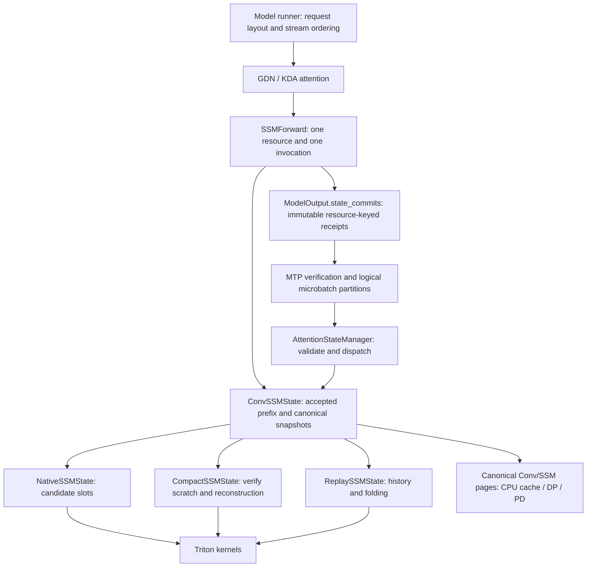

# Recurrent state ownership

GDN and KDA share the Conv/SSM resource lifecycle. Their attention implementations
own convolution, input packing and prefill computation. Each resource composes
one SSM implementation that owns recurrent execution, speculative storage and
accepted-state reconstruction.

## Lifetimes and interfaces

| Owner | Lifetime | Responsibility |
|---|---|---|
| `ConvSSMState` | Worker/resource | Conv pool, accepted position, layer mapping, canonical save/restore |
| Private `SSMState` implementation | Worker/resource | SSM pool, candidate/history layout, kernels, acceptance |
| `SSMForward` | Forward or captured graph | Request/state indices, cumulative lengths, prior accepted counts, selected launch config |
| `StateCommit` | Model output or captured graph | Registered resource name and immutable implementation metadata |
| `StateCommitBatch` | Verification call | Number of real logical requests and receipts from their producing forward |

The execution path is:

1. `LinearDecodeAttState.init_state()` groups fixed or dynamic MTP rows once and
   asks each participating resource to `prepare_decode()`. GDN obtains its actual
   draft width from `MtpManager`; KDA retains its configured width.
2. GDN/KDA select the resource by role, algorithm and logical layer. After their
   existing convolution/packing, `forward.run_layer()` dispatches the recurrence.
   The attention caller does not inspect storage modes, cursors or kernel configs.
3. `forward.finish()` publishes a detached receipt when acceptance needs metadata.
   Compact publishes the exact `SSMRunConfig` used for verification. Native and
   Replay need no receipt. Multiple resources can publish independently.
4. `verify_mtp_tokens()` passes logical request IDs and accepted lengths to the
   generic bounded-state commit interface. `MtpCommitContext` also retains the
   expanded verification rows and partitions from the producing forwards.
5. The manager validates all receipts before dispatching any mutations. Each SSM
   implementation commits its own state. Replay supplies its private cursor to
   the existing fused accepted-position kernel; Compact reconstructs each
   partition using its own forward's launch config.

Weights use checkpoint (physical) layer IDs. Conv, SSM and KV state use logical
execution layer IDs throughout dispatch. Loop models may reuse one weight object
at multiple execution depths; its `layer_num_` must never select recurrent state.

Logical request arrays are `[B]`; verification rows are `[T]`. Partition sizes
count real requests, excluding graph padding. Zero-sized partitions are allowed.
Registered resource names include the model role, so a draft receipt cannot be
applied to the main model. This uses the existing registration identity; it does
not add arbitrary same-type resource groups to the registration/transport schema.

Missing Compact receipts, unknown resource names, duplicate receipts and invalid
partition totals are errors. No fallback reads a mutable "last forward" config.
The runner must commit exactly once, preserve request ordering, and prevent
overlapping live forwards from using the same real request slots. A receipt is
reusable across graph invocations; it is not a one-use transaction or rollback
mechanism. Tensor-value checks requiring a device synchronization are not added
to the decode path.

## CUDA Graph and microbatch rules

Request preparation runs before every invocation, including graph replay.
Replay snapshots its forward cursor before accepting the guaranteed token of
ordinary decode. Moving preparation solely into capture-time Python would break
later invocations.

`SSMForward.copy_inputs()` copies nested tensor metadata into captured buffers,
validates their layouts, and preserves the captured launch config. Aliased
request/state-index buffers are copied once. Warmup clones each forward wrapper
so configuration selection cannot mutate the wrapper used for capture. Storage
and the tuning cache remain shared intentionally.

Graph replay returns the captured `ModelOutput`; unpadding preserves its receipt
tuple. Overlapped microbatches pass separate `StateCommitBatch` entries, each with
its own real request count and configuration. Neither the scheduler nor the
generic manager needs to know that Compact uses those configs for reconstruction.

## Checkpoints and numerical behavior

`get_accepted_state()` returns the convolution window and SSM state at the same
accepted prefix. Native selects a candidate slot, Compact exposes its committed
state, and Replay materializes a snapshot without folding or changing live
history. CPU pages and DP/PD transport contain this canonical state, independent
of execution mode or speculative width. `prepare_restore()` clears history and
the accepted position before exposing destinations for both fields.

Views may alias live storage. Existing stream ordering and completion events must
protect consuming copies before advancing or recycling requests. Restore callers
must fill both fields before execution resumes. A token length labels the
accepted prefix; it does not request reconstruction of arbitrary earlier tokens.

Native and Compact retain per-token state rounding. Replay retains its FP32
history accumulation and rounding at fold/materialization. These are intentionally
different numerical semantics. The refactor relocates host orchestration while
preserving the Triton recurrence/folding kernels and their launch parameters.
CLI modes, replay configuration, grouped heads, KDA gate bounds and existing
parallel-mode restrictions are unchanged.

## Source map and verification

- `common/attention_state/bounded_att/conv_ssm_state.py`: shared resource and
  canonical page/transfer lifecycle; GDN/KDA subclasses supply identity/page type.
- `common/attention_state/bounded_att/ssm/`: native, compact, replay and forward
  lifetimes; only the factory dispatches the configured mode.
- `common/basemodel/attention/linear/state.py`: shared request layout and graph
  integration; `gdn.py`/`kda.py` retain algorithm-specific processing.
- `common/attention_state/commit.py`: generic verification and receipt contracts.
- `common/basemodel/triton_kernel/linear_att/`: numerical kernels and tuning.

CPU contract tests cover accepted-state selection/reuse, resource-key routing,
invalid receipts, per-microbatch configs, nested graph copying and warmup
isolation. Kernel substitutions in these tests verify orchestration only.
The retained CUDA tests cover numerical recurrence, fused acceptance, dynamic
layouts, folding, graph alternation, checkpoint continuation and IPC. They must
run on compatible GPU hardware before claiming GPU or serving acceptance.
